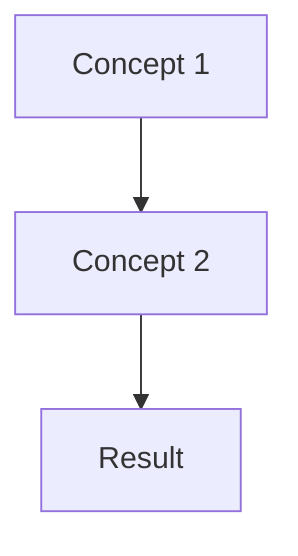
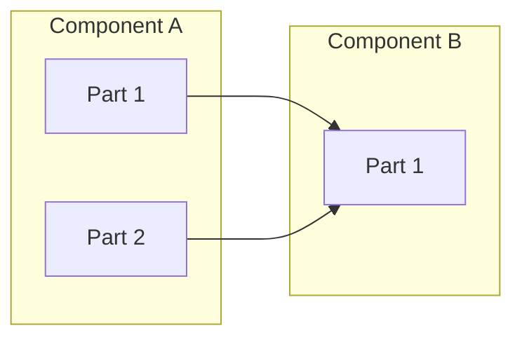

# [Concept/Topic Name]

> **Summary**: [One paragraph executive summary of the key concepts]

## Introduction

[2-3 paragraphs introducing the concept, why it exists, and why users should care about understanding it]

## Background

### The Problem

[What problem or need led to this concept/feature existing?]

### Historical Context

[If relevant, how did this evolve? What came before?]

## Core Concepts

### [Concept 1]

[Detailed explanation of the first core concept]

```
[Diagram or code example if helpful]
```

### [Concept 2]

[Detailed explanation of the second core concept]

### How They Work Together

[Explain how the concepts relate to each other]



## Architecture

### High-Level Design

[Explain the architectural decisions and their rationale]



### Design Decisions

#### Why [Decision 1]?

[Explain the reasoning behind key design decisions]

#### Trade-offs

| Approach         | Pros   | Cons   |
| ---------------- | ------ | ------ |
| Current approach | [Pros] | [Cons] |
| Alternative      | [Pros] | [Cons] |

## Comparisons

### [This] vs [Alternative]

[Compare with similar concepts or alternatives]

| Aspect   | This Approach | Alternative   |
| -------- | ------------- | ------------- |
| Aspect 1 | [Description] | [Description] |
| Aspect 2 | [Description] | [Description] |

### When to Use What

- **Use [This]** when: [scenarios]
- **Use [Alternative]** when: [scenarios]

## Deep Dive

### [Advanced Topic 1]

[For readers who want more detail]

### [Advanced Topic 2]

[Continue with advanced topics]

## Common Misconceptions

### Misconception 1

**Wrong**: [What people often think]

**Correct**: [What's actually true]

### Misconception 2

[Continue pattern...]

## Implications

### For Users

[What this means for everyday usage]

### For Developers

[What this means for plugin/extension developers]

### For Contributors

[What this means for those contributing to Logseq]

## Further Reading

- **Get started**: [Related Tutorial](../tutorials/related.md)
- **Practical application**: [Related How-To](../how-to/related.md)
- **Technical details**: [Related Reference](../reference/related.md)
- **External resources**: [Link to external documentation or papers]

## Summary

[Recap the key points in 2-3 sentences]

---

_Last updated: 2026-01-29 | [Report an issue](https://github.com/logseq/logseq/issues)_
