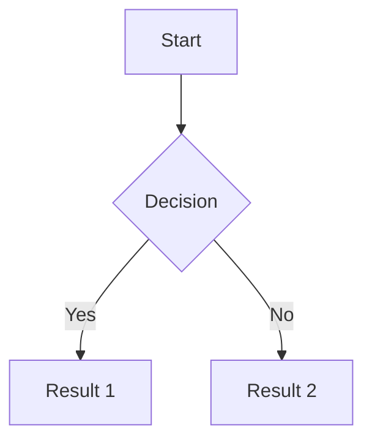
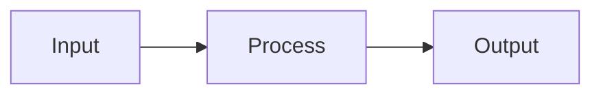

# Markdown Syntax Reference

Complete reference for Markdown syntax in Logseq. Learn all formatting options, from basic text styling to advanced features like code blocks, tables, and embeds.

**Quick Access:** Type `/` in any block for formatting commands.

---

## Table of Contents

1. [Text Formatting](#text-formatting)
2. [Headings](#headings)
3. [Lists](#lists)
4. [Links](#links)
5. [Code](#code)
6. [Tables](#tables)
7. [Block Elements](#block-elements)
8. [Logseq-Specific Syntax](#logseq-specific-syntax)
9. [Special Characters](#special-characters)

---

## Text Formatting

### Basic Formatting

| Style         | Syntax                   | Result            | Shortcut    |
| ------------- | ------------------------ | ----------------- | ----------- |
| Bold          | `**text**` or `__text__` | **bold**          | `⌘+B`       |
| Italic        | `*text*` or `_text_`     | _italic_          | `⌘+I`       |
| Strikethrough | `~~text~~`               | ~~strikethrough~~ | `⌘+Shift+S` |
| Highlight     | `^^text^^`               | ==highlighted==   | `⌘+H`       |
| Inline code   | `` `text` ``             | `code`            | `⌘+E`       |
| Underline     | `<u>text</u>`            | <u>underline</u>  | -           |

**Examples:**

```markdown
This is **bold text** and this is _italic_.
You can ~~cross things out~~ or ^^highlight them^^.
Use `inline code` for commands or variables.
```

**Result:**

This is **bold text** and this is _italic_.
You can ~~cross things out~~ or ==highlight them==.
Use `inline code` for commands or variables.

### Combining Styles

```markdown
**Bold and _italic_**
**_Bold and italic_**
~~**Struck through bold**~~
^^**Highlighted bold**^^
`**Bold code**` (note: bold won't render in code)
```

**Result:**

**Bold and _italic_**
**_Bold and italic_**
~~**Struck through bold**~~
==**Highlighted bold**==

---

## Headings

### Heading Levels

```markdown
# Heading 1

## Heading 2

### Heading 3

#### Heading 4

##### Heading 5

###### Heading 6
```

**Or use slash commands:**

```markdown
/h1 → # Heading 1
/h2 → ## Heading 2
/h3 → ### Heading 3
```

**Rendered:**

# Heading 1

## Heading 2

### Heading 3

#### Heading 4

##### Heading 5

###### Heading 6

**Best Practices:**

```markdown
✅ Do:

- Use one # per heading level
- Add space after #: # Title
- Use hierarchically: # then ## then ###
- Keep headings short

❌ Avoid:

- #Heading (missing space)
- Skipping levels: # to ###
- Very long headings
- ALL CAPS HEADINGS
```

---

## Lists

### Unordered Lists

**Syntax:**

```markdown
- Item 1
- Item 2
  - Nested item 2.1
  - Nested item 2.2
    - Deep nested 2.2.1
- Item 3
```

**Or use:**

```markdown
- Item 1
- Item 2

* Item 1
* Item 2
```

**Logseq Default:**

Logseq uses `-` (dash) by default for bullets.

### Ordered Lists

**Syntax:**

```markdown
1. First item
2. Second item
   1. Nested first
   2. Nested second
3. Third item
```

**Auto-numbering:**

```markdown
1. First
1. Second (auto-becomes 2)
1. Third (auto-becomes 3)
```

### Task Lists

**Syntax:**

```markdown
- [ ] Unchecked task
- [x] Checked task
- [ ] Task with subtasks
  - [x] Subtask 1
  - [ ] Subtask 2
```

**Or use Logseq markers:**

```markdown
- TODO Task to do
- DOING Task in progress
- DONE Completed task
- WAITING Blocked task
- LATER Backlog task
- CANCELLED Abandoned task
```

**Rendered:**

- [ ] Unchecked task
- [x] Checked task
- TODO Task to do
- DONE Completed task

---

## Links

### Page Links (Wiki-style)

**Syntax:**

```markdown
[[Page Name]]
[[Page/Nested/Name]]
[[Page Name|Display Text]]
```

**Examples:**

```markdown
- [[Projects]] → Links to Projects page
- [[Projects/Work]] → Links to Projects > Work
- [[Projects|My Projects]] → Shows "My Projects"
```

**Create pages:**

Typing `[[New Page]]` creates the page when you navigate to it.

### External Links

**Syntax:**

```markdown
[Link Text](https://example.com)
[Link with title](https://example.com 'Hover title')
<https://example.com>
https://example.com (auto-linked)
```

**Examples:**

```markdown
Visit [Logseq](https://logseq.com)
Read [documentation](https://docs.logseq.com 'Logseq Docs')
Quick: <https://github.com>
Auto: https://logseq.com
```

### Block References

**Syntax:**

```markdown
((block-uuid))
((block-uuid Display text))
```

**Create block reference:**

```markdown
1. Right-click block → Copy block ref
2. Paste: ((abc-123-def))
3. Or type (( and search
```

**Example:**

```markdown
See the definition: ((abc-123))
Or: ((abc-123 see here))
```

### Block Embeds

**Syntax:**

```markdown
{{embed ((block-uuid))}}
{{embed [[Page Name]]}}
```

**Examples:**

```markdown
Embed block:
{{embed ((abc-123-def))}}

Embed page:
{{embed [[Meeting Notes]]}}
```

---

## Code

### Inline Code

**Syntax:**

```markdown
Use `code` for inline code
Or `` code with `backticks` inside ``
```

**Examples:**

```markdown
Run `npm install` to install packages.
Use `` SELECT * FROM `users`  `` for SQL.
```

### Code Blocks

**Syntax:**

````markdown
```language
code here
```
````

**Supported Languages:**

```markdown
javascript, typescript, python, java, clojure, clojurescript,
ruby, go, rust, c, cpp, csharp, php, swift, kotlin,
bash, shell, sql, html, css, markdown, json, yaml, xml,
diff, dockerfile, graphql, latex, r, scala, and more...
```

**Examples:**

````markdown
```javascript
function hello() {
  console.log('Hello World')
}
```

```python
def hello():
    print("Hello World")
```

```bash
#!/bin/bash
echo "Hello World"
```
````

**Rendered:**

```javascript
function hello() {
  console.log('Hello World')
}
```

### Code Block with Line Numbers

````markdown
```javascript {numberLines: true}
function add(a, b) {
  return a + b
}
```
````

### Code Block with Highlighting

````markdown
```javascript {highlight: [2, 3]}
function example() {
  // This line highlighted
  // This line too
  return true
}
```
````

---

## Tables

### Basic Table

**Syntax:**

```markdown
| Header 1 | Header 2 | Header 3 |
| -------- | -------- | -------- |
| Cell 1   | Cell 2   | Cell 3   |
| Cell 4   | Cell 5   | Cell 6   |
```

**Rendered:**

| Header 1 | Header 2 | Header 3 |
| -------- | -------- | -------- |
| Cell 1   | Cell 2   | Cell 3   |
| Cell 4   | Cell 5   | Cell 6   |

### Alignment

```markdown
| Left | Center | Right |
| :--- | :----: | ----: |
| L1   |   C1   |    R1 |
| L2   |   C2   |    R2 |
```

**Alignment:**

- `:---` → Left align
- `:---:` → Center align
- `---:` → Right align

**Rendered:**

| Left | Center | Right |
| :--- | :----: | ----: |
| L1   |   C1   |    R1 |
| L2   |   C2   |    R2 |

### Table Tips

```markdown
✅ Tips:

- Columns don't need to line up perfectly
- Use | to separate columns
- Dashes (---) for header separator
- Can include markdown in cells

Example with formatting:
| Name | Status | Link |
|------|--------|------|
| **Bold** | `code` | [[Page]] |
```

---

## Block Elements

### Blockquotes

**Syntax:**

```markdown
> Single line quote

> Multiple line quote
> continues here
> and here

> Nested quote
>
> > Deeper quote
```

**Or use slash command:** `/quote`

**Rendered:**

> This is a blockquote

> Multiple line
> quote continues

### Horizontal Rules

**Syntax:**

```markdown
---

or

---

or

---
```

**Or use:** `/line` or `/divider`

**Rendered:**

---

### Callouts/Admonitions

**Logseq Syntax:**

```markdown
#+BEGIN_TIP
This is a tip!
#+END_TIP

#+BEGIN_WARNING
This is a warning!
#+END_WARNING

#+BEGIN_IMPORTANT
This is important!
#+END_IMPORTANT

#+BEGIN_NOTE
This is a note.
#+END_NOTE

#+BEGIN_CAUTION
Be cautious!
#+END_CAUTION
```

**Slash Commands:**

```markdown
/tip
/warning
/important
/note
/caution
```

**Custom Callout:**

```markdown
#+BEGIN_CUSTOM Custom Title
Your content here
#+END_CUSTOM
```

---

## Logseq-Specific Syntax

### Properties

**Syntax:**

```markdown
key:: value
property-name:: property value
tags:: [[Tag1]], [[Tag2]]
status:: in-progress
priority:: high
```

**Multi-line Property:**

```markdown
description::

- Line 1
- Line 2
- Line 3
```

### Tags

**Syntax:**

```markdown
#tag
#nested/tag
#tag-with-dashes
#TagWithCaps
```

**Or:** `/tag`

**Examples:**

```markdown
This is a #project note about #work/client-a
Tagged with multiple: #important #review #2026
```

### Page References

**Syntax:**

```markdown
[[Page Name]]
[[namespace/page]]
[[Projects/Work/Client A]]
```

**With alias:**

```markdown
[[Full Page Name|Short Name]]
Example: [[Projects/Work/Alpha|Alpha]]
```

### Block Properties

**Syntax:**

```markdown
- Block content here
  id:: unique-id
  created-at:: 2026-01-22
  type:: note
```

**Common Block Properties:**

```markdown
id:: custom-block-id
tags:: [[Tag]]
created-at:: timestamp
updated-at:: timestamp
collapsed:: true
```

### Commands and Macros

**Syntax:**

```markdown
{{command arg1 arg2}}
{{embed [[Page]]}}
{{youtube VIDEO_ID}}
{{pdf URL}}
{{tweet TWEET_URL}}
```

**Examples:**

```markdown
{{embed ((block-ref))}}
{{youtube https://youtu.be/VIDEO}}
{{pdf https://example.com/file.pdf}}
```

---

## Special Characters

### Escaping Characters

**Escape with backslash:**

```markdown
\* Not a bullet
\# Not a tag
\[ Not a link start
\` Not code
```

**Special characters:**

```markdown
\* → \*
\# → #
\[ → [
\] → ]
\( → (
\) → )
\{ → {
\} → }
\` → `
\~ → ~
\^ → ^
\\ → \
```

### HTML Entities

```markdown
&nbsp; → Non-breaking space
&lt; → <
&gt; → >
&amp; → &
&copy; → ©
&trade; → ™
&reg; → ®
```

### Emoji

**Unicode Emoji:**

```markdown
😀 😃 😄 😁 🎉 🎊 ✅ ❌ ⚠️
📝 📚 📊 🔥 💡 🚀 ⭐ 🏆
```

**Use emoji picker:** `⌘+Ctrl+Space` (macOS)

---

## Advanced Formatting

### Nested Blocks

**Syntax:**

```markdown
- Parent block
  - Child block 1
    - Grandchild block
  - Child block 2
    - Another grandchild
```

**Indent:** `Tab`
**Outdent:** `Shift+Tab`

### Mixed Content

```markdown
- Block with **bold** and _italic_
  - Code: `npm install`
  - Link: [[Page]]
  - Tag: #example
    id:: block-123
    priority:: high
```

### Math (LaTeX)

**Inline Math:**

```markdown
$E = mc^2$
$\sum_{i=1}^{n} x_i$
```

**Block Math:**

```markdown
$$
\frac{-b \pm \sqrt{b^2 - 4ac}}{2a}
$$
```

**Rendered:**

$E = mc^2$

$$
\frac{-b \pm \sqrt{b^2 - 4ac}}{2a}
$$

### Diagrams (Mermaid)

**Syntax:**

````markdown

````

**Flowchart Example:**



---

## Keyboard Shortcuts

### Quick Formatting

| Format        | Shortcut (macOS) | Shortcut (Windows) |
| ------------- | ---------------- | ------------------ |
| Bold          | `⌘+B`            | `Ctrl+B`           |
| Italic        | `⌘+I`            | `Ctrl+I`           |
| Highlight     | `⌘+H`            | `Ctrl+H`           |
| Inline code   | `⌘+E`            | `Ctrl+E`           |
| Link          | `⌘+K`            | `Ctrl+K`           |
| Strikethrough | `⌘+Shift+S`      | `Ctrl+Shift+S`     |

**See:** [Keyboard Shortcuts Reference](../interface/keyboard-shortcuts.md)

---

## Markdown vs Logseq

### Standard Markdown

**Logseq supports:**

```markdown
✅ Headings (# ## ###)
✅ Bold (**text**)
✅ Italic (_text_)
✅ Links ([text](url))
✅ Code (`code`)
✅ Lists (- item)
✅ Tables
✅ Blockquotes (>)
```

### Logseq Extensions

**Additional syntax:**

```markdown
🆕 Page links: [[Page]]
🆕 Block refs: ((uuid))
🆕 Embeds: {{embed}}
🆕 Properties: key:: value
🆕 Tags: #tag
🆕 Markers: TODO, DOING, DONE
🆕 Highlight: ^^text^^
🆕 Queries: #+BEGIN_QUERY
🆕 Callouts: #+BEGIN_TIP
```

### Compatibility

**Export to standard Markdown:**

```markdown
Logseq → Markdown export converts:

- [[Page]] → [Page](Page.md)
- ((ref)) → Link to block
- Properties → YAML frontmatter
- Tags → Markdown tags

Some features lost:

- Block references (become links)
- Embeds (become links)
- Queries (removed)
```

---

## Best Practices

### Formatting Guidelines

```markdown
✅ Do:

- Use semantic formatting (bold for emphasis)
- Keep formatting simple
- Be consistent with style choices
- Use headers for structure
- Link related content

❌ Avoid:

- Overusing bold/italic
- Too many colors/highlights
- Complex nested formatting
- Excessive emoji
- ALL CAPS
```

### Performance Tips

```markdown
- Large tables (100+ rows): Use queries instead
- Huge code blocks: Link to external files
- Many embeds: Use links instead
- Deep nesting (10+ levels): Flatten structure
```

### Accessibility

```markdown
- Use descriptive link text: [[Database Guide]] not [[Click here]]
- Alt text for images: 
- Semantic headings (hierarchical)
- Avoid color-only information
- Clear table headers
```

---

## Common Issues

**Problem: Markdown not rendering**

```markdown
✓ Check: Space after # for headings
✓ Check: Correct number of backticks for code
✓ Check: Balanced \*\* for bold
✓ Check: Not inside code block
```

**Problem: Links not working**

```markdown
✓ Check: [[Page Name]] not [Page Name]
✓ Check: Correct page name (case-sensitive)
✓ Check: Page exists or will be created
```

**Problem: Code block not formatting**

````markdown
✓ Check: Three backticks ```not one`
✓ Check: Language name lowercase
✓ Check: Closing backticks present
````

---

## Quick Reference Card

**Print this for reference:**

````markdown
FORMATTING
**bold** ^^highlight^^
_italic_ `code`
~~strike~~ <u>underline</u>

LINKS
[[Page]] Page link
[[Page|Alias]] With alias
((block-ref)) Block ref
[Text](url) External

CODE
`inline`

```language
block
```
````

STRUCTURE

# H1 ## H2 ### H3

- Bullet list

1. Numbered list
   > Quote
   > --- (line)

LOGSEQ
key:: value Property
#tag Tag
TODO Task
{{embed}} Embed
/command Slash cmd

```

---

## Next Steps

**Master Markdown:**

1. Practice basic formatting
2. Learn Logseq extensions
3. Use keyboard shortcuts
4. Explore advanced features
5. Develop consistent style

**Related:**
- [Slash Commands](../interface/slash-commands.md)
- [Block Editing](../../tutorials/getting-started/block-editing.md)
- [Advanced Formatting](../../how-to/content/advanced-formatting.md)

---

**Questions?** Join [Logseq Discord](https://discord.gg/KpN4eHY) or visit [discuss.logseq.com](https://discuss.logseq.com).
```
