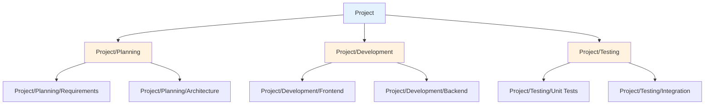
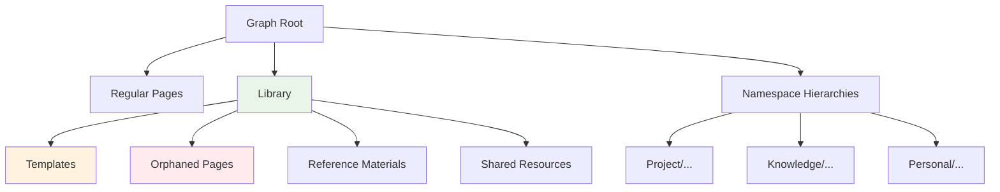

# Namespaces and Library System

## Overview

Logseq provides a sophisticated namespace and library system that enables hierarchical organization of pages and content. The namespace feature allows you to create structured hierarchies using forward-slash notation, while the Library system serves as a centralized repository for reusable pages, templates, and orphaned content. Together, these features provide powerful organizational capabilities that scale from personal note-taking to enterprise knowledge management.

## Namespace System

### Core Concepts

Namespaces in Logseq follow a hierarchical structure using forward-slash (`/`) as the delimiter, similar to file system paths or URL structures. This creates parent-child relationships between pages that enable powerful organizational and navigation capabilities.



### Namespace Syntax and Structure

#### Basic Namespace Syntax

```
Parent/Child
Domain/Category/Subcategory
ProjectName/Area/SpecificTopic
```

#### Valid Namespace Examples

```
Engineering/Software/Frontend
Research/Machine Learning/Deep Learning
Company/Departments/Engineering
Knowledge/Programming/JavaScript
Personal/Health/Nutrition
```

#### Implementation Details

**Namespace Character Definition** (`/deps/common/src/logseq/common/util/namespace.cljs`):

```clojure
(defonce namespace-char "/")
(defonce parent-char "/")

(defn namespace-page?
  "Used by DB and file graphs"
  [page-name]
  (and (string? page-name)
       (string/includes? page-name namespace-char)
       (not= (string/trim page-name) namespace-char)
       (not (string/starts-with? page-name "../"))
       (not (string/starts-with? page-name "./"))
       (not (common-util/url? page-name))))
```

### Namespace Database Model

#### Parent-Child Relationships

**Database Schema**:

```clojure
;; Block with namespace relationship
{:db/id 456
 :block/uuid #uuid "550e8400-e29b-41d4-a716-446655440000"
 :block/name "Project/Development/Frontend"
 :block/namespace {:db/id 123}  ; Points to "Project/Development" page
 :block/parent {:db/id 789}     ; Physical parent in content hierarchy
 :block/created-at #inst "2024-01-15T10:30:00Z"}

;; Parent namespace page
{:db/id 123
 :block/uuid #uuid "660e8400-e29b-41d4-a716-446655440001"
 :block/name "Project/Development"
 :block/namespace {:db/id 100}  ; Points to "Project" page
 :block/_namespace [{:db/id 456} {:db/id 457}]}  ; Back-references to children
```

#### Namespace Query Rules

**DataScript Rules** (`/deps/db/src/logseq/db/file_based/rules.cljc`):

```clojure
:namespace
'[(namespace ?page ?namespace-name)
  [?page :block/namespace ?parent]
  [?parent :block/name ?namespace-name]]

;; Find all pages under a namespace
:namespace-pages
'[(namespace-pages ?namespace ?page)
  [?namespace :block/name ?ns-name]
  [?page :block/namespace ?namespace]]

;; Recursive namespace hierarchy
:namespace-hierarchy
'[(namespace-hierarchy ?root ?descendant)
  [?descendant :block/namespace ?root]]
 [(namespace-hierarchy ?root ?descendant)
  [?intermediate :block/namespace ?root]
  (namespace-hierarchy ?intermediate ?descendant)]
```

### Namespace Navigation and Management

#### Hierarchy Visualization

**Namespace Tree Component** (`/src/main/frontend/components/file_based/hierarchy.cljs`):

```clojure
(defn- get-relation
  "Get all parent pages along the namespace hierarchy path"
  [page]
  (when-let [page (or (text/get-nested-page-name page) page)]
    (let [namespace-pages (file-model/get-namespace-pages repo page)
          parent-routes (file-model/get-page-namespace-routes repo page)]
      {:namespaces pages
       :namespace-pages namespace-pages})))

(rum/defc hierarchy-component
  [page]
  (let [relation (get-relation page)]
    [:div.hierarchy-tree
     [:div.namespace-path
      (for [route (:parent-routes relation)]
        [:span.namespace-segment
         [page-reference route]])]
     [:div.child-pages
      (for [child (:namespace-pages relation)]
        [:div.child-page
         [page-reference child]])]]))
```

#### Navigation Features

**Breadcrumb Navigation**:

```clojure
;; Breadcrumb path for "Engineering/Software/Frontend"
["Engineering" "Engineering/Software" "Engineering/Software/Frontend"]

;; Implementation
(defn get-page-namespace-routes
  "Returns all parent namespace routes for navigation"
  [repo page-name]
  (let [parts (string/split page-name namespace-char)]
    (map-indexed (fn [idx _]
                   (string/join namespace-char (take (inc idx) parts)))
                 parts)))
```

### Namespace Queries and Filtering

#### Basic Namespace Queries

```clojure
;; Find all pages under a namespace
{{query (namespace "Project")}}

;; Find specific subnamespace pages
{{query (namespace "Project/Development")}}

;; Combine namespace with other filters
{{query (and (namespace "Research") (task TODO))}}
```

#### Advanced Namespace Queries

```clojure
;; Find all tasks across project namespaces
{{query (and
  (namespace "Project")
  (task TODO DOING)
  (sort-by created-at desc))}}

;; Find recent pages in specific namespace
{{query (and
  (namespace "Knowledge/Programming")
  (between created-at -7d today))}}

;; Namespace-scoped tag queries
{{query (and
  (namespace "Research")
  #paper
  (property status "published"))}}
```

#### Namespace-Aware Query Rules

```clojure
;; Implementation for namespace queries
(defn- build-namespace
  [query-element]
  (let [page-name (page-ref/get-page-name! (str (first (rest query-element))))
        page (util/page-name-sanity-lc page-name)]
    {:query (list 'namespace '?p page)
     :rules [:namespace]}))

;; Usage in query system
(case (first query-element)
  'namespace (build-namespace query-element)
  ;; other query types...
  )
```

## Library System

### Library Concept and Purpose

The Library serves as a centralized repository within each graph for:

- **Reusable Content**: Templates, snippets, and reference materials
- **Orphaned Pages**: Pages without clear hierarchical placement
- **Shared Resources**: Content accessible across the entire graph
- **Content Organization**: Alternative to namespace hierarchies



### Library Implementation Architecture

#### Core Library System

**Library Configuration** (`/deps/common/src/logseq/common/config.cljs`):

```clojure
(defonce library-page-name "Library")
```

**Library Database Model** (`/deps/db/src/logseq/db.cljs`):

```clojure
(defn get-library-page
  "Returns the built-in Library page for the graph"
  [db]
  (get-built-in-page db common-config/library-page-name))

(defn page-in-library?
  "Check whether a page exists under the Library page"
  [db page]
  (when (page? page)
    (when-let [library-page (get-built-in-page db common-config/library-page-name)]
      (loop [parent (:block/parent page)]
        (cond
          (nil? parent) false
          (= (:db/id parent) (:db/id library-page)) true
          :else (recur (:block/parent parent)))))))
```

#### Library Content Management

**Library Structure**:

```clojure
;; Library page as content container
{:db/id 100
 :block/name "Library"
 :block/built-in? true
 :block/type "page"
 :block/_parent [...library-content...]}

;; Page in library
{:db/id 456
 :block/name "Monthly Report Template"
 :block/parent {:db/id 100}  ; Parent is Library page
 :block/created-at #inst "2024-01-15T10:30:00Z"
 :block/content "# Monthly Report for {{date}}"}
```

### Library User Interface

#### Library Management Component

**Library UI Implementation** (`/src/main/frontend/components/library.cljs`):

```clojure
(rum/defc library-component
  [page]
  (let [library-pages (get-library-content)
        available-pages (get-pages-not-in-library)]
    [:div.library-interface
     [:h2 "Library Management"]

     ;; Current library content
     [:div.library-content
      [:h3 "Current Library Pages"]
      (for [page library-pages]
        [:div.library-item
         [page-reference page]
         [:button.remove-from-library
          {:on-click #(remove-from-library! page)}
          "Remove"]])]

     ;; Add new content
     [:div.add-to-library
      [:h3 "Add Pages to Library"]
      [page-selector available-pages
       {:on-select add-to-library!
        :multiple? true
        :filter-library? true}]]]))
```

#### Library Search and Discovery

**Search Integration**:

```clojure
;; Special search mode for library management
{:search-options {:library-page-search? true}}

;; Filters out pages already in library
(defn filter-library-pages
  [search-results]
  (remove page-in-library? search-results))
```

### Library Migration and Auto-Organization

#### Database Migration Integration

**Automatic Library Management** (`/src/main/frontend/worker/db/migrate.cljs`):

```clojure
(defn migrate-orphaned-pages-to-library
  "During DB migration, move orphaned namespace pages to Library"
  [db]
  (let [orphaned-pages (find-orphaned-namespace-pages db)
        library-page (ensure-library-page db)]
    (when (seq orphaned-pages)
      (log/info "Moving" (count orphaned-pages) "orphaned pages to Library")
      (doseq [page orphaned-pages]
        (set-page-parent! page library-page)))))
```

#### Pipeline Integration

**Automatic Content Organization** (`/src/main/frontend/worker/pipeline.cljs`):

```clojure
(defn auto-organize-new-pages
  "Automatically organize new pages based on naming patterns"
  [pages]
  (doseq [page pages]
    (cond
      ;; Has namespace structure
      (namespace-page? (:block/name page))
      (setup-namespace-hierarchy page)

      ;; No clear hierarchy, add to library
      (and (not (has-parent? page))
           (not (built-in-page? page)))
      (add-to-library! page)

      ;; Template-like content
      (template-like? page)
      (add-to-library-templates! page))))
```

## Advanced Features and Integration

### Namespace and Library Query Integration

#### Combined Queries

```clojure
;; Find library content related to namespaces
{{query (and
  (page-property parent "Library")
  (property relates-to "Project/Development"))}}

;; Cross-reference namespace and library
{{query (or
  (namespace "Templates")
  (page-property parent "Library"))}}

;; Find reusable content
{{query (and
  (page-property parent "Library")
  (property type "template")
  (sort-by updated-at desc))}}
```

#### Query Rules for Library

```clojure
;; Custom rule for library content
:library-content
'[(library-content ?page)
  [?library :block/name "Library"]
  [?page :block/parent ?library]]

;; Find library templates
:library-templates
'[(library-templates ?page)
  (library-content ?page)
  [?page :block/properties ?props]
  [(get ?props "type") ?type]
  [(= ?type "template")]]
```

### Content Organization Patterns

#### Namespace Organization Strategies

**1. Domain-Driven Namespaces**:

```
Business/Sales/Prospects
Business/Marketing/Campaigns
Business/Operations/Processes
```

**2. Project-Based Namespaces**:

```
Project-Alpha/Planning/Requirements
Project-Alpha/Development/Frontend
Project-Alpha/Testing/QA
```

**3. Knowledge Management Namespaces**:

```
Knowledge/Programming/JavaScript
Knowledge/Design/UI-Patterns
Knowledge/Business/Marketing
```

#### Library Content Categories

**1. Template Library**:

- Meeting note templates
- Project planning templates
- Report templates
- Email templates

**2. Reference Library**:

- Code snippets
- Checklists
- Standard procedures
- Quick reference guides

**3. Resource Library**:

- Images and assets
- External links
- Documentation
- Research materials

### Performance and Scalability

#### Optimization Strategies

**Namespace Indexing**:

```clojure
;; Efficient namespace queries using indexes
(defn get-namespace-pages-optimized
  [db namespace-name]
  (d/q '[:find [?page ...]
         :in $ ?namespace
         :where
         [?ns :block/name ?namespace]
         [?page :block/namespace ?ns]]
       db namespace-name))

;; Cached namespace hierarchy
(def namespace-hierarchy-cache (atom {}))

(defn get-cached-namespace-tree
  [namespace]
  (or (get @namespace-hierarchy-cache namespace)
      (let [tree (build-namespace-tree namespace)]
        (swap! namespace-hierarchy-cache assoc namespace tree)
        tree)))
```

**Library Performance**:

```clojure
;; Lazy loading for large libraries
(defn get-library-pages-lazy
  [limit offset]
  (d/q '[:find (pull ?page [*])
         :in $ ?limit ?offset
         :where
         [?library :block/name "Library"]
         [?page :block/parent ?library]]
       db limit offset))

;; Library content caching
(def library-content-cache (atom nil))

(defn get-library-content-cached
  []
  (or @library-content-cache
      (reset! library-content-cache (fetch-library-content))))
```

### Migration and Compatibility

#### Cross-Graph Migration

```clojure
;; Export namespace structure
(defn export-namespace-structure
  [namespace]
  {:namespace namespace
   :pages (get-all-namespace-pages namespace)
   :hierarchy (build-namespace-hierarchy namespace)
   :metadata {:export-date (js/Date.)
             :version "1.0"}})

;; Import namespace structure
(defn import-namespace-structure
  [structure target-graph]
  (let [conflicts (detect-namespace-conflicts structure target-graph)]
    (when (confirm-import conflicts)
      (create-namespace-hierarchy structure)
      (migrate-content structure))))
```

#### Library Portability

```clojure
;; Export library content
(defn export-library
  [options]
  {:library-pages (get-all-library-pages)
   :templates (filter template? library-pages)
   :assets (filter asset? library-pages)
   :metadata {:export-timestamp (js/Date.)
             :graph-name (get-current-graph-name)
             :version "1.0"}})

;; Import library with conflict resolution
(defn import-library
  [library-data options]
  (let [conflicts (detect-library-conflicts library-data)
        resolution (:conflict-resolution options :merge)]
    (resolve-conflicts conflicts resolution)
    (import-library-content library-data)))
```

## User Interface and Experience

### Namespace Navigation Interface

#### Hierarchy Browser Component

```clojure
(rum/defc namespace-browser
  [current-page]
  (let [current-namespace (get-page-namespace current-page)
        namespace-tree (get-namespace-hierarchy current-namespace)]
    [:div.namespace-browser
     ;; Breadcrumb navigation
     [:div.namespace-breadcrumb
      (for [segment (get-namespace-path current-namespace)]
        [:span.breadcrumb-segment
         {:on-click #(navigate-to-namespace segment)}
         segment])]

     ;; Tree view
     [:div.namespace-tree
      [namespace-tree-component namespace-tree
       {:current-page current-page
        :collapsible? true
        :show-children? true}]]

     ;; Quick actions
     [:div.namespace-actions
      [:button.create-child-namespace "New Subnamespace"]
      [:button.move-to-namespace "Move Page"]
      [:button.rename-namespace "Rename"]]]))
```

#### Interactive Tree Visualization

```clojure
(rum/defc namespace-tree-component
  [tree options]
  (let [collapsed-state (r/atom #{})]
    [:ul.namespace-tree
     (for [node tree]
       [:li.namespace-node
        {:class (when (= node (:current-page options)) "current")}

        ;; Toggle for nodes with children
        (when (:children node)
          [:span.tree-toggle
           {:on-click #(toggle-collapse node)}
           (if (collapsed? node) "▶" "▼")])

        ;; Page link
        [:span.page-link
         {:on-click #(navigate-to node)}
         (:title node)]

        ;; Children (if expanded)
        (when (and (:children node) (not (collapsed? node)))
          [namespace-tree-component (:children node) options])])]))
```

### Library Management Interface

#### Library Dashboard

```clojure
(rum/defc library-dashboard
  []
  (let [library-stats (get-library-statistics)
        recent-additions (get-recent-library-additions)]
    [:div.library-dashboard
     ;; Statistics overview
     [:div.library-stats
      [:div.stat-card "Total Pages: " (:total-pages library-stats)]
      [:div.stat-card "Templates: " (:templates library-stats)]
      [:div.stat-card "Recent: " (:recent-count library-stats)]]

     ;; Category browser
     [:div.library-categories
      [:h3 "Browse by Category"]
      (for [category (get-library-categories)]
        [:div.category-card
         {:on-click #(browse-library-category category)}
         [:h4 (:name category)]
         [:span.count (:count category) " pages"]])]

     ;; Quick actions
     [:div.library-actions
      [:button.add-current-page "Add Current Page"]
      [:button.create-template "Create Template"]
      [:button.organize-library "Organize Library"]]]))
```

#### Drag-and-Drop Organization

```clojure
(rum/defc library-organizer
  [library-content]
  (let [drag-state (r/atom nil)]
    [:div.library-organizer
     ;; Drag source (unorganized content)
     [:div.unorganized-content
      [:h3 "Unorganized Content"]
      (for [page unorganized-pages]
        [:div.draggable-page
         {:draggable true
          :on-drag-start #(start-drag page)
          :on-drag-end #(end-drag)}
         [page-reference page]])]

     ;; Drop zones (categories)
     [:div.library-categories
      (for [category library-categories]
        [:div.drop-zone
         {:on-drop #(drop-in-category % category)
          :on-drag-over #(allow-drop %)}
         [:h4 (:name category)]
         (for [page (:pages category)]
           [:div.library-item
            [page-reference page]])])]]))
```

## Best Practices and Usage Patterns

### Namespace Organization Best Practices

#### 1. Hierarchical Consistency

```
✅ Good: Clear hierarchy
Company/Departments/Engineering/Projects/WebApp
Company/Departments/Marketing/Campaigns/Q1-2024

❌ Avoid: Inconsistent depth
Company/Engineering
Company/Departments/Marketing/Campaigns/Q1/January/Week1
```

#### 2. Logical Grouping

```
✅ Domain-based grouping:
Knowledge/Programming/Languages/JavaScript
Knowledge/Programming/Languages/Python
Knowledge/Programming/Frameworks/React

✅ Project-based grouping:
Project-Alpha/Planning/Requirements
Project-Alpha/Development/Backend
Project-Alpha/Testing/Integration
```

#### 3. Namespace Naming Conventions

```
✅ Use clear, descriptive names:
Research/Machine-Learning/Deep-Learning
Personal/Health/Nutrition-Tracking

❌ Avoid abbreviations and unclear names:
Res/ML/DL
Per/Hlth/Nut
```

### Library Organization Strategies

#### 1. Template Organization

```
Library/
├── Templates/
│   ├── Meeting-Notes/
│   ├── Project-Planning/
│   ├── Reports/
│   └── Personal/
├── References/
│   ├── Code-Snippets/
│   ├── Checklists/
│   └── Quick-Guides/
└── Assets/
    ├── Images/
    ├── Documents/
    └── Links/
```

#### 2. Content Lifecycle Management

```clojure
;; Regular library maintenance queries
{{query (and
  (page-property parent "Library")
  (property type "template")
  (between updated-at -90d today))}}  ; Recently updated templates

{{query (and
  (page-property parent "Library")
  (not (property category))
  (sort-by created-at desc))}}  ; Uncategorized library content
```

### Advanced Query Patterns

#### 1. Cross-Namespace Analysis

```clojure
;; Find common patterns across namespaces
{{query (and
  (or (namespace "Project-A") (namespace "Project-B"))
  (task DONE)
  (between completed-at -30d today))}}

;; Identify namespace-specific content types
{{query (and
  (namespace "Research")
  (property type)
  (sort-by created-at desc))}}
```

#### 2. Library Content Discovery

```clojure
;; Find useful templates
{{query (and
  (page-property parent "Library")
  (property type "template")
  (property category "meeting"))}}

;; Recently added library content
{{query (and
  (page-property parent "Library")
  (between created-at -7d today)
  (sort-by created-at desc))}}

;; Most referenced library content
{{query (and
  (page-property parent "Library")
  (property reference-count)
  (sort-by reference-count desc))}}
```

## Configuration and Customization

### Namespace Configuration

```clojure
;; Namespace behavior settings
(def namespace-config
  {:namespace-char "/"
   :auto-create-parents? true
   :show-breadcrumbs? true
   :max-hierarchy-depth 10
   :enable-namespace-queries? true
   :auto-organize-orphans? true})
```

### Library Configuration

```clojure
;; Library management settings
(def library-config
  {:auto-add-orphans? true
   :library-page-name "Library"
   :enable-library-search? true
   :show-library-stats? true
   :auto-categorize? false
   :template-auto-detection? true})
```

---

_This comprehensive documentation covers Logseq's namespace and library systems, from basic concepts to advanced usage patterns. These features provide powerful organizational capabilities that scale from simple personal note-taking to complex enterprise knowledge management, while maintaining the flexibility and user control that makes Logseq unique._
