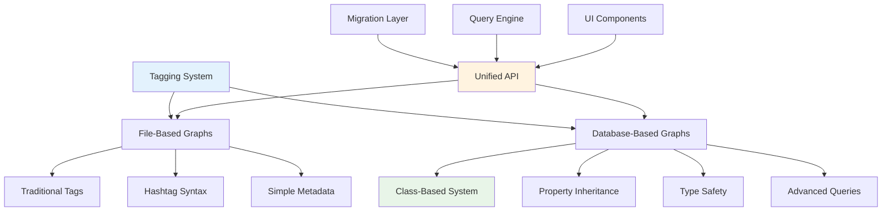

# Enhanced Tagging and Classification System

## Overview

Logseq features a sophisticated tagging and classification system that represents a significant evolution in personal knowledge management. The system introduces **class-based hierarchies**, **property inheritance**, and **advanced query capabilities** through a dual-mode architecture that supports both traditional file-based tagging and modern database-driven classification systems.

**Key Innovation**: In database-based graphs, **tags are classes** - implementing a true object-oriented approach to knowledge organization with inheritance, property templates, and type safety.

## System Architecture

### Dual Implementation Model



### Core Architectural Principles

1. **Tags as Classes**: Database graphs treat tags as first-class objects with properties and behaviors
2. **Inheritance Hierarchy**: Classes can extend other classes, creating rich taxonomies
3. **Property Templates**: Classes define property schemas for their instances
4. **Type System**: Comprehensive property validation and type checking
5. **Query Integration**: Deep integration with DataScript query system

## Database Schema and Data Structures

### Schema Architecture

The database-based system uses an enhanced DataScript schema:

```clojure
;; Enhanced schema for database graphs
(def schema
  "Schema for DB graphs. :block/tags are classes in this schema"
  (merge
   (apply dissoc file-schema/schema file-schema/file-only-attributes)
   {:block/name {:db/index true}        ; Indexed for fast class lookups
    :block/closed-value-property {:db/valueType :db.type/ref
                                  :db/cardinality :db.cardinality/many}}))

;; Current schema version: 65.10
```

### Class Entity Structure

**Class Definition**:

```clojure
{:db/id 789
 :db/ident :user.class/ProjectTask                    ; Unique class identifier
 :block/uuid #uuid "660e8400-e29b-41d4-a716-446655440001"
 :block/title "Project Task"                          ; Human-readable title
 :block/tags [:logseq.class/Tag]                     ; Meta-class relationship
 :logseq.property.class/extends [:logseq.class/Task] ; Inheritance
 :logseq.property.class/properties [:logseq.property/project-name
                                    :logseq.property/estimated-hours]
 :block/created-at #inst "2024-01-15T10:30:00Z"}
```

**Class Instance (Tagged Block)**:

```clojure
{:db/id 456
 :block/uuid #uuid "550e8400-e29b-41d4-a716-446655440000"
 :block/content "Implement user authentication system"
 :block/tags [:user.class/ProjectTask]               ; Instance-of relationship
 :logseq.property/status :logseq.property/status.doing
 :logseq.property/priority :logseq.property/priority.high
 :logseq.property/project-name "WebApp v2.0"        ; Custom property
 :logseq.property/estimated-hours 8                  ; Type-validated property
 :block/page {:db/id 890}}
```

## Built-in Class Hierarchy

### Comprehensive Built-in Classes

Logseq provides a rich set of built-in classes organized in hierarchical relationships:

```clojure
(def built-in-classes
  {:logseq.class/Root
   {:title "Root Tag"
    :description "Base class for all other classes"}

   :logseq.class/Tag
   {:title "Tag"
    :description "User-created classification tags"}

   :logseq.class/Property
   {:title "Property"
    :description "Defines attributes that can be attached to blocks"}

   :logseq.class/Page
   {:title "Page"
    :description "Top-level content containers"}

   :logseq.class/Journal
   {:title "Journal"
    :properties {:logseq.property.class/extends :logseq.class/Page
                 :logseq.property.journal/title-format "MMM do, yyyy"}
    :description "Daily journal entries with date-based organization"}

   :logseq.class/Whiteboard
   {:title "Whiteboard"
    :properties {:logseq.property.class/extends :logseq.class/Page}
    :description "Visual canvases for spatial information organization"}

   :logseq.class/Task
   {:title "Task"
    :schema {:properties [:logseq.property/status :logseq.property/priority
                         :logseq.property/deadline :logseq.property/scheduled]}
    :description "Actionable items with status tracking"}

   :logseq.class/Query
   {:title "Query"
    :properties {:logseq.property/icon {:type :tabler-icon :id "search"}}
    :schema {:properties [:logseq.property/query]}
    :description "Saved queries for dynamic content retrieval"}

   :logseq.class/Card
   {:title "Card"
    :schema {:properties [:logseq.property.fsrs/state :logseq.property.fsrs/due]}
    :description "Spaced repetition flashcards"}

   :logseq.class/Asset
   {:title "Asset"
    :properties {:logseq.property.class/hide-from-node true
                 :logseq.property.view/type :logseq.property.view/type.gallery}
    :schema {:properties [:logseq.property.asset/type :logseq.property.asset/size
                         :logseq.property.asset/checksum]
             :required-properties [:logseq.property.asset/type
                                  :logseq.property.asset/size
                                  :logseq.property.asset/checksum]}
    :description "File attachments and media resources"}

   ;; Specialized block types
   :logseq.class/Code-block {:title "Code" :description "Code snippets and programming content"}
   :logseq.class/Quote-block {:title "Quote" :description "Quoted text and citations"}
   :logseq.class/Math-block {:title "Math" :description "Mathematical expressions and equations"}
   :logseq.class/Pdf-annotation {:title "PDF Annotation" :description "Annotations from PDF files"}
   :logseq.class/Template {:title "Template" :description "Reusable content templates"}})
```

### Class Categories and Behaviors

**Page-Like Classes** (behave as pages):

```clojure
(def page-classes
  #{:logseq.class/Page :logseq.class/Tag :logseq.class/Property
    :logseq.class/Journal :logseq.class/Whiteboard})
```

**Internal Classes** (hidden from standard UI):

```clojure
(def internal-tags
  #{:logseq.class/Page :logseq.class/Property :logseq.class/Tag
    :logseq.class/Root :logseq.class/Asset})
```

**System Classes** (reserved for internal use):

```clojure
(def private-tags
  #{:logseq.class/Journal :logseq.class/Whiteboard :logseq.class/Asset
    :logseq.class/Code-block :logseq.class/Quote-block :logseq.class/Math-block})
```

## Class Inheritance System

### Inheritance Mechanism

Classes can extend other classes using the `:logseq.property.class/extends` property:

```clojure
:logseq.property.class/extends
{:title "Extends"
 :schema {:type :class
          :cardinality :many              ; Multiple inheritance supported
          :public? true
          :view-context :class}
 :properties {:logseq.property/description
              "This enables tags to inherit properties from other tags"}}
```

### Inheritance Rules Implementation

The system implements recursive inheritance through DataScript rules:

```clojure
;; Inheritance rule definition
:class-extends
'[[(class-extends ?parent ?child)
   [?child :logseq.property.class/extends ?parent]]
  [(class-extends ?parent ?child)
   [?intermediate :logseq.property.class/extends ?parent]
   (class-extends ?intermediate ?child)]]  ; Recursive inheritance chain
```

### Inheritance Processing Logic

```clojure
;; Get all classes that a class extends (transitive closure)
(defn get-class-extends
  "Returns all extends of a class including inherited ones"
  [class]
  (loop [extends (:logseq.property.class/extends class)
         result #{}]
    (if (seq extends)
      (let [next-extends (set (mapcat :logseq.property.class/extends extends))]
        (recur next-extends (into result extends)))
      result)))

;; Get all classes that extend a given class
(defn get-structured-children
  "Returns all children of a class"
  [db eid]
  (->> (d/q '[:find [?child ...]
              :in $ ?parent %
              :where
              (class-extends ?parent ?child)]
            db eid (:class-extends rules/rules))
       (remove #{eid})))  ; Prevent self-inclusion
```

### Inheritance Example Hierarchy

```clojure
;; Base work item class
{:db/ident :user.class/WorkItem
 :block/title "Work Item"
 :logseq.property.class/properties [:logseq.property/assignee
                                    :logseq.property/created-date
                                    :logseq.property/priority]}

;; Task inheriting from WorkItem
{:db/ident :user.class/Task
 :block/title "Task"
 :logseq.property.class/extends [:user.class/WorkItem]
 :logseq.property.class/properties [:logseq.property/status
                                    :logseq.property/estimated-hours]}

;; Bug inheriting from WorkItem
{:db/ident :user.class/Bug
 :block/title "Bug"
 :logseq.property.class/extends [:user.class/WorkItem]
 :logseq.property.class/properties [:logseq.property/severity
                                    :logseq.property/reproducer]}

;; Critical Bug with multiple inheritance
{:db/ident :user.class/CriticalBug
 :block/title "Critical Bug"
 :logseq.property.class/extends [:user.class/Bug :user.class/UrgentItem]
 :logseq.property.class/properties [:logseq.property/escalation-path]}
```

**Instance with Inherited Properties**:

```clojure
;; Bug instance inherits all properties from WorkItem and Bug
{:block/tags [:user.class/Bug]
 :logseq.property/assignee "John Doe"        ; From WorkItem
 :logseq.property/created-date "2024-01-15"  ; From WorkItem
 :logseq.property/priority :priority.high    ; From WorkItem
 :logseq.property/severity "Critical"        ; From Bug
 :logseq.property/reproducer "Steps 1,2,3"}  ; From Bug
```

## Property System and Type Safety

### Property Type System

Logseq implements a comprehensive property type system with validation:

```clojure
;; User-accessible property types
(def user-built-in-property-types
  "Valid property types for users in order they appear in the UI"
  [:default :number :date :datetime :checkbox :url :node])

;; Internal system property types
(def internal-built-in-property-types
  "Valid property types only for use by internal built-in-properties"
  #{:keyword :map :coll :any :entity :class :page :property :string :raw-number})
```

### Property Validation Schemas

```clojure
(def built-in-validation-schemas
  {:default  [:fn {:error/message "should be a text block"} text-entity?]
   :number   [:fn {:error/message "should be a number"} number-entity?]
   :date     [:fn {:error/message "should be a journal date"} date?]
   :datetime [:fn {:error/message "should be a datetime"} number?]
   :checkbox boolean?
   :url      [:fn {:error/message "should be a URL"} url-entity?]
   :node     [:fn {:error/message "should be a page/block with tags"} node-entity?]
   :class    [:fn {:error/message "should be a Class"} class-entity?]
   :property [:fn {:error/message "should be a Property"} property-entity?]
   :page     [:fn {:error/message "should be a Page"} page-entity?]})
```

### Closed Value Properties

Properties can have constrained value sets with rich metadata:

```clojure
;; Status property with closed values
:logseq.property/status
{:title "Status"
 :schema {:type :default
          :public? true
          :ui-position :block-left}
 :closed-values
 [{:db-ident :logseq.property/status.backlog :value "Backlog" :icon "Backlog"}
  {:db-ident :logseq.property/status.todo :value "Todo" :icon "Todo"}
  {:db-ident :logseq.property/status.doing :value "Doing" :icon "InProgress50"}
  {:db-ident :logseq.property/status.in-review :value "In Review" :icon "InReview"}
  {:db-ident :logseq.property/status.done :value "Done" :icon "Done"}
  {:db-ident :logseq.property/status.canceled :value "Canceled" :icon "Cancelled"}]
 :properties {:logseq.property/hide-empty-value true
              :logseq.property/default-value :logseq.property/status.todo}}

;; Priority property with visual indicators
:logseq.property/priority
{:title "Priority"
 :closed-values
 [{:db-ident :logseq.property/priority.low :value "Low" :icon "priorityLvlLow"}
  {:db-ident :logseq.property/priority.medium :value "Medium" :icon "priorityLvlMedium"}
  {:db-ident :logseq.property/priority.high :value "High" :icon "priorityLvlHigh"}
  {:db-ident :logseq.property/priority.urgent :value "Urgent" :icon "priorityLvlUrgent"}]
 :properties {:logseq.property/default-value :logseq.property/priority.medium}}
```

### Property Templates and Defaults

```clojure
;; Property with default values
:logseq.property/default-value
{:title "Default value"
 :schema {:type :entity
          :public? false
          :hide? true
          :view-context :property}}

;; Scalar default values for primitive types
:logseq.property/scalar-default-value
{:title "Non ref type default value"
 :schema {:type :any
          :public? false
          :hide? true
          :view-context :property}}
```

## Query System Integration

### Inheritance-Aware Query Rules

The query system provides sophisticated rules that respect class hierarchies:

```clojure
;; Check if object has property through class inheritance
:object-has-class-property
'[(object-has-class-property? ?block ?property)
  [?property-entity :db/ident ?property]
  [?class :logseq.property.class/properties ?property-entity]
  [?block :block/tags ?tag-class]
  (or [(= ?class ?tag-class)]
      (class-extends ?class ?tag-class))]  ; Inheritance-aware property checking

;; Tag-based queries with name resolution
:tags
'[(tags ?block ?tag-names)
  [?block :block/tags ?tag]
  [?tag :block/name ?tag-name]
  [(missing? $ ?block :block/link)]
  [(contains? ?tag-names ?tag-name)]]

;; Task queries using class system
:task-by-status
'[(task-by-status ?block ?status)
  [?block :block/tags ?class]
  [?class :db/ident :logseq.class/Task]
  [?block :logseq.property/status ?status-entity]
  [?status-entity :db/ident ?status]]

;; Property inheritance queries
:property-value
'[[(property-value ?block ?property-entity ?value)
   [?property-entity :db/ident ?property]
   (existing-property-value ?block ?property ?value)]
  [(property-value ?block ?property-entity ?value)
   (or
    (and
     [(missing? $ ?property-entity :db/valueType)]
     (property-scalar-default-value ?block ?property-entity :logseq.property/scalar-default-value ?value))
    (and
     [?property-entity :db/valueType :db.type/ref]
     (property-default-value ?block ?property-entity :logseq.property/default-value ?value)))]]
```

### Query Examples

#### Basic Class Queries

```clojure
;; Find all task instances
{{query (tags logseq.class/Task)}}

;; Find all cards due for review
{{query (and (tags logseq.class/Card) (property logseq.property.fsrs/due))}}

;; Find all journal entries
{{query (tags logseq.class/Journal)}}
```

#### Inheritance-Aware Queries

```clojure
;; Find all work items (includes Tasks, Bugs, etc. through inheritance)
{{query (tags user.class/WorkItem)}}

;; Find high-priority items across all inherited classes
{{query (and
  (tags user.class/WorkItem)
  (property priority high))}}

;; Find items assigned to specific person (inherited property)
{{query (and
  (tags user.class/Bug)
  (property assignee "John Doe"))}}  ; Finds bugs assigned to John via WorkItem inheritance
```

#### Advanced Property Queries

```clojure
;; Tasks with specific status using closed values
{{query (and
  (tags logseq.class/Task)
  (property status doing))}}

;; Custom class with multiple filters
{{query (and
  (tags user.class/ProjectTask)
  (property status todo)
  (property priority high)
  (property project-name "WebApp v2.0"))}}

;; Time-based queries with inherited properties
{{query (and
  (tags user.class/WorkItem)
  (property created-date)
  (between created-date -7d today))}}
```

#### Complex Hierarchy Queries

```clojure
;; Find all children of a class
[:find ?child-class
 :in $ ?parent-class %
 :where
 (class-extends ?parent-class ?child-class)]

;; Find blocks with inherited properties
[:find ?block ?property ?value
 :in $ ?class %
 :where
 [?block :block/tags ?tag]
 (class-extends ?class ?tag)
 [?class :logseq.property.class/properties ?prop]
 [?block ?prop ?value]]

;; Multi-level inheritance property resolution
[:find ?block ?final-value
 :in $ ?block ?property %
 :where
 [?block :block/tags ?direct-class]
 (class-extends ?ancestor-class ?direct-class)
 [?ancestor-class :logseq.property.class/properties ?prop]
 [?prop :db/ident ?property]
 (property-value ?block ?prop ?final-value)]
```

## User Interface and Management

### Class Creation and Management

#### Creating New Classes

```clojure
;; Class creation with validation
(defn <create-class!
  "Creates a class page and provides class-specific error handling"
  [title options]
  (-> (page-common-handler/<create! title (assoc options :class? true))
      (p/catch (fn [error]
                 (if (string/includes? (str error) "already exists")
                   (notification/show! "A class with this name already exists" :warning)
                   (notification/show! "Failed to create class" :error))))))
```

#### Class Conversion

```clojure
;; Convert regular page to class
(defn convert-page-to-tag!
  "Converts a Page to a Tag with safety checks"
  [page-entity]
  (let [txs [(db-class/build-new-class (db/get-db)
                                       {:db/id (:db/id page-entity)
                                        :block/title (:block/title page-entity)
                                        :block/created-at (:block/created-at page-entity)})
             [:db/retract (:db/id page-entity) :block/tags :logseq.class/Page]]]
    (db/transact! (state/get-current-repo) txs {:outliner-op :save-block})))

;; Convert class back to page with validation
(defn convert-tag-to-page!
  [entity]
  (cond
    (db/page-exists? (:block/title entity) #{:logseq.class/Page})
    (notification/show! "A page with this name already exists" :warning)

    (seq (:logseq.property.class/_extends entity))
    (notification/show! "Cannot convert tag with children. Remove inheritance first." :error)

    (has-instances? entity)
    (notification/show! "Cannot convert tag with instances. Untag blocks first." :warning)

    :else
    (execute-conversion-with-confirmation entity)))
```

### Tag Hierarchy Visualization

```clojure
;; Class hierarchy component
(rum/defc class-children
  [class]
  (when (seq (:logseq.property.class/_extends class))
    (let [children-pages (set (model/get-structured-children
                              (state/get-current-repo) (:db/id class)))
          default-collapsed? (> (count children-pages) 30)]
      (ui/foldable
       [:div.font-medium.opacity-50
        (str "Children (" (count children-pages) ")")]
       [:div.ml-1.mt-2
        (class-children-aux class {:default-collapsed? default-collapsed?})]
       {:default-collapsed? false
        :title-trigger? true}))))

(defn class-children-aux
  [class opts]
  (let [children (->> (:logseq.property.class/_extends class)
                      (remove #(= (:db/id class) (:db/id %)))  ; Prevent cycles
                      (sort-by :block/title))]
    (when (seq children)
      [:ul
       (for [child children]
         (let [title [:li.ml-2
                     (block/page-reference
                      {:show-brackets? false} (:block/uuid child) nil)]]
           (if (seq (:logseq.property.class/_extends child))
             (ui/foldable title
                         (class-children-aux child opts)
                         {:default-collapsed? (:default-collapsed? opts)})
             title)))])))
```

### Tag Selection and Autocomplete

```clojure
;; Smart tag creation from input
(defn create-items [q]
  (when (and (not (string/blank? q))
             (not config/publishing?))
    (let [class? (string/starts-with? q "#")
          class-name (get-class-from-input q)
          existing-class (ldb/class? (db/get-case-page class-name))]
      [{:text (cond
                existing-class "Configure tag"
                class? "Create tag"
                :else "Create page")
        :icon (if class? "hash" "new-page")
        :info (if class?
                (str "Create tag: " class-name)
                (str "Create page: " q))
        :on-click (if existing-class
                    #(navigate-to-class existing-class)
                    #(create-new-class class-name))}])))

;; Class selection component
(rum/defc class-select
  [property {:keys [multiple-choices? disabled? default-open? no-class? on-hide]}]
  (let [classes (model/get-all-readable-classes (state/get-current-repo)
                                                {:except-root-class? true})
        options (map (fn [class]
                       {:label (:block/title class)
                        :value (:block/uuid class)
                        :description (:logseq.property/description (:block/properties class))
                        :parent-classes (get-parent-classes class)})
                     classes)]
    (select/select-component options
                            {:multiple? multiple-choices?
                             :disabled? disabled?
                             :group-by :parent-classes
                             :placeholder "Select or create class..."})))
```

### Property Management UI

```clojure
;; Property configuration interface
(rum/defc property-config
  [class property]
  [:div.property-config
   [:div.property-header
    [:h3 (:title property)]
    [:span.property-type (:type (:schema property))]]

   [:div.property-schema
    (when (:required? (:schema property))
      [:span.badge.required "Required"])

    (when (:closed-values property)
      [:div.closed-values
       [:h4 "Allowed Values:"]
       [:ul
        (for [value (:closed-values property)]
          [:li
           [:span.value (:value value)]
           (when (:icon value)
             [:span.icon (:icon value)])])]])

    (when (:default-value (:properties property))
      [:div.default-value
       [:strong "Default: "]
       (:default-value (:properties property))])]])
```

## Advanced Features and Capabilities

### Property Inheritance Resolution

```clojure
;; Comprehensive property inheritance system
(defn resolve-inherited-properties
  "Resolves all properties available to a class through inheritance"
  [class]
  (let [direct-properties (:logseq.property.class/properties class)
        parent-classes (get-class-extends class)
        inherited-properties (mapcat :logseq.property.class/properties parent-classes)]
    {:direct direct-properties
     :inherited inherited-properties
     :all (distinct (concat direct-properties inherited-properties))
     :conflicts (find-property-conflicts direct-properties inherited-properties)}))

;; Property conflict resolution
(defn find-property-conflicts
  [direct-props inherited-props]
  (let [direct-names (set (map :db/ident direct-props))
        inherited-names (set (map :db/ident inherited-props))]
    (clojure.set/intersection direct-names inherited-names)))
```

### Dynamic Class Creation

```clojure
;; Runtime class creation with property inference
(defn create-class-from-usage
  "Creates a class by analyzing existing tagged blocks"
  [tag-name blocks]
  (let [common-properties (infer-common-properties blocks)
        property-types (infer-property-types blocks common-properties)
        suggested-extends (suggest-parent-classes common-properties)]
    {:db/ident (create-class-ident tag-name)
     :block/title (string/capitalize tag-name)
     :logseq.property.class/properties common-properties
     :logseq.property.class/extends suggested-extends
     :block/tags [:logseq.class/Tag]
     :auto-generated? true}))

;; Property type inference from usage
(defn infer-property-types
  [blocks properties]
  (reduce (fn [acc prop]
            (let [values (map #(get % prop) blocks)
                  inferred-type (analyze-value-types values)]
              (assoc acc prop {:type inferred-type
                              :cardinality (if (some coll? values) :many :one)})))
          {} properties))
```

### Advanced Query Builders

```clojure
;; Visual query builder for class-based queries
(rum/defc class-query-builder
  [initial-query]
  (let [selected-classes (r/atom #{})
        property-filters (r/atom {})
        inheritance-mode (r/atom :include-children)]  ; :include-children, :exact-match, :include-parents
    [:div.query-builder
     ;; Class selection
     [:div.class-selection
      [:h3 "Select Classes"]
      [class-multi-select selected-classes]]

     ;; Property filters
     [:div.property-filters
      [:h3 "Property Filters"]
      (for [class @selected-classes]
        (let [available-props (resolve-inherited-properties class)]
          [property-filter-group class available-props property-filters]))]

     ;; Inheritance options
     [:div.inheritance-options
      [:h3 "Inheritance Scope"]
      [:label [:input {:type "radio" :name "inheritance" :value :exact-match
                      :checked (= @inheritance-mode :exact-match)
                      :on-change #(reset! inheritance-mode :exact-match)}]
              "Exact class match only"]
      [:label [:input {:type "radio" :name "inheritance" :value :include-children
                      :checked (= @inheritance-mode :include-children)
                      :on-change #(reset! inheritance-mode :include-children)}]
              "Include child classes"]
      [:label [:input {:type "radio" :name "inheritance" :value :include-parents
                      :checked (= @inheritance-mode :include-parents)
                      :on-change #(reset! inheritance-mode :include-parents)}]
              "Include parent classes"]]

     ;; Generated query preview
     [:div.query-preview
      [:h3 "Generated Query"]
      [:pre (generate-query @selected-classes @property-filters @inheritance-mode)]]]))
```

## Performance and Optimization

### Query Optimization Strategies

```clojure
;; Index-optimized class queries
(defn optimized-class-query
  "Uses DataScript indexes efficiently for class-based queries"
  [class-ident property-filters]
  (let [base-query '[:find ?block ?content
                     :in $ ?class-ident %
                     :where
                     [?block :block/tags ?class]
                     [?class :db/ident ?class-ident]
                     [?block :block/content ?content]]]
    (reduce add-property-filter base-query property-filters)))

;; Inheritance-aware query optimization
(defn get-class-hierarchy-efficiently
  "Optimized query for class hierarchies using recursive rules"
  [db root-class-id]
  (d/q '[:find ?class ?level
         :in $ % ?root
         :where
         (class-hierarchy ?root ?class ?level)]
       db inheritance-rules root-class-id))

;; Property inheritance cache
(def property-inheritance-cache (atom {}))

(defn get-cached-class-properties
  [class-id]
  (if-let [cached (@property-inheritance-cache class-id)]
    cached
    (let [properties (resolve-inherited-properties-expensive class-id)]
      (swap! property-inheritance-cache assoc class-id properties)
      properties)))
```

### Memory Management

```clojure
;; Efficient class hierarchy storage
(defn optimize-class-storage
  "Optimizes memory usage for large class hierarchies"
  []
  (let [class-graph (build-class-dependency-graph)
        optimized-storage (compress-class-relationships class-graph)]
    (update-class-cache optimized-storage)))

;; Garbage collection for unused classes
(defn gc-unused-classes!
  "Removes classes with no instances and no children"
  [db]
  (let [unused-classes (find-unused-classes db)]
    (when (seq unused-classes)
      (log/info "Removing" (count unused-classes) "unused classes")
      (transact-class-removal unused-classes))))
```

## Migration and Compatibility

### Dual-Mode Architecture Support

```clojure
;; Graph type detection and behavior adaptation
(defn adapt-tagging-behavior
  [graph-name]
  (if (db-based-graph? graph-name)
    {:use-classes? true
     :inheritance-support? true
     :property-validation? true
     :tag-conversion :class-based}
    {:use-classes? false
     :inheritance-support? false
     :property-validation? false
     :tag-conversion :hashtag-based}))

;; Cross-graph compatibility
(defn ensure-tag-compatibility
  [tag-data target-graph-type]
  (case target-graph-type
    :database-graph (convert-hashtags-to-classes tag-data)
    :file-graph (convert-classes-to-hashtags tag-data)
    tag-data))
```

### Migration Strategies

```clojure
;; File-to-database migration with class creation
(defn migrate-tags-to-classes
  [file-tags]
  (map (fn [tag]
         (let [usage-analysis (analyze-tag-usage tag)
               inferred-properties (infer-properties-from-usage usage-analysis)
               suggested-hierarchy (suggest-class-hierarchy tag file-tags)]
           {:db/ident (create-class-ident (:name tag))
            :block/title (:name tag)
            :block/tags [:logseq.class/Tag]
            :logseq.property.class/properties inferred-properties
            :logseq.property.class/extends suggested-hierarchy
            :migration-metadata {:original-tag (:name tag)
                               :usage-count (:count usage-analysis)
                               :created-at (js/Date.)}}))
       file-tags))

;; Gradual migration with backwards compatibility
(defn setup-hybrid-tagging
  "Supports both hashtag and class-based tagging during migration"
  [graph]
  (let [config (get-graph-config graph)]
    (merge config
           {:support-hashtags? true
            :support-classes? true
            :auto-convert-hashtags? true
            :migration-mode? true
            :preserve-file-compatibility? true})))
```

### Data Export and Portability

```clojure
;; Export class hierarchy in portable format
(defn export-class-system
  "Exports entire class system for portability"
  [db]
  {:classes (get-all-user-classes db)
   :properties (get-all-properties db)
   :inheritance-relationships (get-class-hierarchy db)
   :closed-values (get-all-closed-values db)
   :usage-statistics (generate-usage-stats db)
   :schema-version "1.0"
   :export-timestamp (js/Date.)})

;; Import with conflict resolution
(defn import-class-system
  [class-data target-db options]
  (let [conflicts (detect-class-conflicts class-data target-db)
        resolution-strategy (:conflict-resolution options :merge)]
    (case resolution-strategy
      :merge (merge-with-existing-classes class-data target-db)
      :overwrite (replace-existing-classes class-data target-db)
      :skip (import-only-new-classes class-data target-db)
      :prompt (prompt-user-for-conflict-resolution conflicts))))
```

## Best Practices and Usage Patterns

### Recommended Class Design Patterns

#### 1. Domain-Driven Classification

```clojure
;; Business domain classes
:user.class/Customer
:user.class/Order
:user.class/Product
:user.class/Invoice

;; Academic domain classes
:user.class/Paper
:user.class/Experiment
:user.class/Dataset
:user.class/Analysis
```

#### 2. Functional Classification

```clojure
;; Process-oriented classes
:user.class/Meeting
:user.class/Decision
:user.class/Action-Item
:user.class/Follow-Up

;; Content-type classes
:user.class/Note
:user.class/Summary
:user.class/Reference
:user.class/Template
```

#### 3. Hierarchical Organization

```clojure
;; Base work item hierarchy
:user.class/WorkItem
  ├── :user.class/Task
  │   ├── :user.class/Development-Task
  │   └── :user.class/Research-Task
  ├── :user.class/Bug
  │   ├── :user.class/Critical-Bug
  │   └── :user.class/Enhancement
  └── :user.class/Epic
      └── :user.class/Feature
```

### Query Pattern Examples

#### GTD (Getting Things Done) Implementation

```clojure
;; Context-based queries
{{query (and (tags user.class/Task) (property context "@computer"))}}
{{query (and (tags user.class/Task) (property context "@calls"))}}
{{query (and (tags user.class/Task) (property energy "high"))}}

;; Workflow queries
{{query (and (tags user.class/Task) (property status "waiting-for"))}}
{{query (and (tags user.class/Task) (property review-date) (between review-date today +7d))}}
```

#### Project Management Patterns

```clojure
;; Sprint planning
{{query (and
  (tags user.class/Story)
  (property sprint "Sprint-23")
  (property status "todo"))}}

;; Risk management
{{query (and
  (tags user.class/Risk)
  (property probability "high")
  (property impact "high"))}}

;; Resource tracking
{{query (and
  (tags user.class/Resource)
  (property allocated-to "Team-A")
  (property availability))}}
```

---

_This comprehensive documentation covers Logseq's sophisticated tagging and classification system, from basic tag usage to advanced class hierarchies with inheritance, property systems, and query integration. The system represents a significant evolution in knowledge management, providing users with powerful organizational tools while maintaining simplicity and flexibility._
