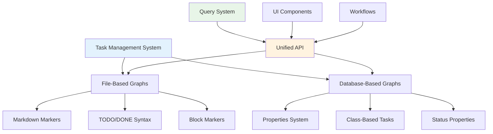
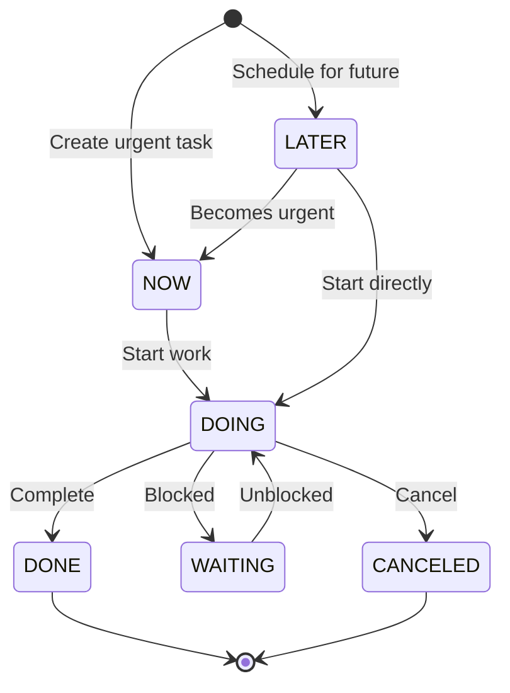
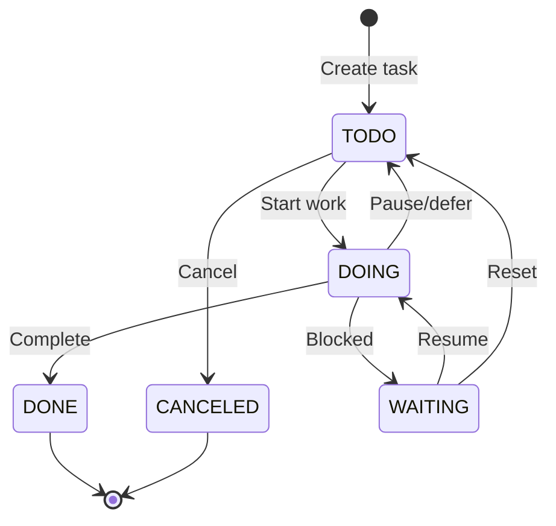

# Task Management System

## Overview

Logseq provides a powerful, flexible task management system that seamlessly integrates with your knowledge graph. The system supports multiple task states, workflows, and organizational approaches while maintaining compatibility across both file-based and database-based graphs. Tasks in Logseq are first-class citizens that can be queried, filtered, and managed using the full power of the knowledge graph.

## Task Architecture

### Dual Implementation System

Logseq's task system adapts to different graph types while providing a unified user experience:



### Task Data Models

#### File-Based Graphs

Tasks are represented using traditional markdown/org-mode syntax with block markers:

```clojure
;; Block with task marker
{:db/id 123
 :block/uuid #uuid "550e8400-e29b-41d4-a716-446655440000"
 :block/content "Complete project documentation"
 :block/marker "TODO"           ; Task state marker
 :block/priority "A"           ; Optional priority
 :block/scheduled 20240315     ; Scheduled date
 :block/deadline 20240320      ; Deadline date
 :block/repeated? true         ; Recurring task flag
 :block/page {:db/id 456}
 :block/properties {"priority" "high"
                   "estimated-time" "2h"}}
```

#### Database-Based Graphs

Tasks use the properties and class system for enhanced flexibility:

```clojure
;; Task as class instance
{:db/id 789
 :block/uuid #uuid "660e8400-e29b-41d4-a716-446655440001"
 :block/content "Review quarterly metrics"
 :block/tags [:logseq.class/Task]                    ; Task class
 :logseq.property/status :status/doing               ; Status property
 :logseq.property/priority :priority/high            ; Priority property
 :logseq.property/assigned-to "John Doe"             ; Custom properties
 :logseq.property/due-date #inst "2024-03-20"
 :logseq.property/estimated-hours 3
 :block/page {:db/id 890}}
```

## Task States and Workflows

### Standard Task States

Logseq supports multiple task states with semantic meaning:

| State           | Description      | Visual | Usage                              |
| --------------- | ---------------- | ------ | ---------------------------------- |
| **TODO**        | Pending task     | ☐      | Standard to-do items               |
| **DOING**       | Active task      | ⏳     | Currently working on               |
| **DONE**        | Completed task   | ✅     | Finished tasks                     |
| **NOW**         | Urgent/immediate | 🔥     | High priority, immediate attention |
| **LATER**       | Deferred task    | 📅     | Scheduled for future               |
| **WAITING**     | Blocked task     | ⏸️     | Waiting on dependencies            |
| **CANCELED**    | Cancelled task   | ❌     | Will not be completed              |
| **IN-PROGRESS** | Work in progress | 🔄     | Alternative to DOING               |

### Task Workflows

#### NOW/LATER Workflow

Optimized for time-based task management:



#### TODO/DOING Workflow

Traditional task management approach:



### Workflow Configuration

Users can configure their preferred workflow in settings:

```clojure
;; Configuration options (/src/main/frontend/state.cljs)
(def preferred-workflow
  #{:now           ; NOW/LATER workflow
    :todo})        ; TODO/DOING workflow

;; Workflow-specific state cycling
(defn get-workflow-states [workflow]
  (case workflow
    :now ["NOW" "LATER" "DONE"]
    :todo ["TODO" "DOING" "DONE"]))
```

## Task Creation and Management

### Creating Tasks

#### Keyboard Shortcuts

- **`Cmd+Enter` (Mac) / `Ctrl+Enter` (Windows)**: Cycle through task states
- **`Cmd+Shift+Enter`**: Create new task
- **`t t`**: Quick task creation (when block is selected)

#### Task Creation Methods

**1. Direct Typing:**

```markdown
TODO Complete project documentation
DOING Review quarterly metrics  
DONE Set up development environment
```

**2. State Cycling:**

```clojure
;; Implementation: /src/main/frontend/handler/editor.cljs
(defn cycle-todo! []
  "Cycle through task states based on current workflow"
  (let [current-state (get-current-marker)
        workflow (get-preferred-workflow)
        next-state (get-next-state workflow current-state)]
    (set-block-marker! next-state)))
```

**3. Mobile Interface:**

- Touch-friendly task state buttons
- Toolbar integration for quick task creation
- Optimized state cycling for mobile workflows

### Task State Transitions

#### Interactive State Cycling

Tasks can be cycled through states using keyboard shortcuts or UI interactions:

```clojure
;; State transition logic (/deps/common/src/logseq/common/marker.cljs)
(def workflow
  {:now ["NOW" "LATER" "DONE"]
   :todo ["TODO" "DOING" "DONE"]})

(defn cycle-marker
  "Cycle marker based on workflow preference"
  [marker workflow]
  (let [states (get workflow)]
    (case marker
      "NOW" "LATER"
      "LATER" "DONE"
      "TODO" "DOING"
      "DOING" "DONE"
      "DONE" (first states)    ; Reset to first state
      (first states))))       ; Default to first state
```

#### Batch Operations

Multiple tasks can be updated simultaneously:

```clojure
;; Batch task state updates
(defn batch-update-task-states [block-ids new-state]
  "Update multiple tasks to new state"
  (doseq [block-id block-ids]
    (let [block (get-block block-id)]
      (update-block-marker block new-state))))
```

## Task Queries and Filtering

### Query System Integration

Tasks integrate deeply with Logseq's query system, supporting both simple and advanced filtering:

#### Basic Task Queries

**File-Based Graphs:**

```clojure
;; Find all TODO tasks
{{query (task TODO)}}

;; Find tasks with multiple states
{{query (task TODO DOING)}}

;; Active tasks (currently being worked on)
{{query (task DOING NOW)}}

;; Completed tasks
{{query (task DONE)}}
```

**Database-Based Graphs:**

```clojure
;; Tasks using status property
{{query (property status todo)}}

;; Class-based task queries
{{query (and (tags logseq.class/Task) (property status doing))}}

;; Advanced property filtering
{{query (and
  (tags logseq.class/Task)
  (property priority high)
  (property status todo))}}
```

#### Advanced Task Filtering

**Time-Based Queries:**

```clojure
;; Tasks due this week
{{query (and (task TODO DOING) (between deadline -7d +7d))}}

;; Overdue tasks
{{query (and (task TODO) (property deadline) (between deadline -365d today))}}

;; Scheduled for today
{{query (and (task TODO DOING) (property scheduled today))}}

;; Tasks created this month
{{query (and (task TODO DOING DONE) (between created-at -30d today))}}
```

**Project and Context Filtering:**

```clojure
;; Tasks for specific project
{{query (and (task TODO DOING) [[Project Alpha]])}}

;; Tasks with priority
{{query (and (task TODO DOING) (property priority high))}}

;; Tasks by assignee (database graphs)
{{query (and
  (tags logseq.class/Task)
  (property assigned-to "John Doe")
  (property status todo doing))}}
```

### Query Rules Implementation

#### File-Based Task Rules

```clojure
;; Task query rules (/deps/db/src/logseq/db/file_based/rules.cljc)
:task
'[(task ?b ?markers)
  [?b :block/marker ?marker]
  [(contains? ?markers ?marker)]]

;; Task with scheduling
:scheduled-task
'[(scheduled-task ?b ?start ?end)
  [?b :block/marker ?marker]
  [?b :block/scheduled ?scheduled]
  [(>= ?scheduled ?start)]
  [(<= ?scheduled ?end)]]
```

#### Database-Based Task Rules

```clojure
;; Database graph task rules (/deps/db/src/logseq/db/frontend/rules.cljc)
:task-by-status
'[(task-by-status ?b ?status)
  [?b :block/tags ?class]
  [?class :db/ident :logseq.class/Task]
  [?b :logseq.property/status ?s]
  [?s :db/ident ?status]]

;; Priority-based task filtering
:task-by-priority
'[(task-by-priority ?b ?priority)
  [?b :logseq.property/priority ?p]
  [?p :db/ident ?priority]]
```

## Task Features and Capabilities

### Scheduling and Deadlines

#### Date Management

Tasks support both scheduling (when to start) and deadlines (when to finish):

```clojure
;; Scheduled task syntax
SCHEDULED: <2024-03-15 Fri>
TODO Review quarterly metrics

;; Task with deadline
DEADLINE: <2024-03-20 Wed>
TODO Submit project proposal

;; Combined scheduling and deadline
SCHEDULED: <2024-03-15 Fri> DEADLINE: <2024-03-20 Wed>
TODO Complete project documentation
```

#### Time-Based Queries

```clojure
;; Today's scheduled tasks
{{query (and (task TODO DOING) (property scheduled today))}}

;; This week's deadlines
{{query (and (task TODO DOING) (between deadline today +7d))}}

;; Overdue tasks
{{query (and
  (task TODO DOING)
  (property deadline)
  (between deadline -365d yesterday))}}
```

### Task Properties and Metadata

#### Standard Properties

- **Priority**: High, Medium, Low priority levels
- **Estimated Time**: Time estimates for task completion
- **Tags**: Categorization and organization
- **Context**: Location or context information
- **Dependencies**: References to related tasks or blocks

#### Custom Properties (Database Graphs)

```clojure
;; Extended task properties
{:logseq.property/status :status/doing
 :logseq.property/priority :priority/high
 :logseq.property/assigned-to "Team Lead"
 :logseq.property/sprint "Sprint-23"
 :logseq.property/story-points 5
 :logseq.property/estimated-hours 8
 :logseq.property/actual-hours 6
 :logseq.property/blocked-reason "Waiting for API access"
 :logseq.property/due-date #inst "2024-03-20"}
```

### Recurring Tasks

Tasks can be configured to repeat automatically:

```clojure
;; Recurring task implementation
SCHEDULED: <2024-03-15 Fri +1w>  ; Weekly recurrence
TODO Weekly team meeting

SCHEDULED: <2024-03-01 Fri +1m>  ; Monthly recurrence
TODO Monthly report submission

;; Custom recurrence patterns
SCHEDULED: <2024-03-15 Fri .+2d> ; Every other day
TODO Daily standup (team A)
```

### Task Aggregation and Statistics

#### Built-in Queries

Logseq provides default task views in journal templates:

```clojure
;; Journal page task queries (/resources/templates/journals.md)
## DOING
{{query (task DOING)}}

## TODO
{{query (task TODO)}}

## Task Statistics
Total tasks: {{query-count (task TODO DOING DONE)}}
Completed today: {{query-count (and (task DONE) (between updated-at today now))}}
```

#### Custom Dashboard Queries

```clojure
;; Project task dashboard
## Project Alpha - Task Status
### In Progress
{{query (and [[Project Alpha]] (task DOING NOW))}}

### Pending
{{query (and [[Project Alpha]] (task TODO LATER))}}

### Completed This Week
{{query (and [[Project Alpha]] (task DONE) (between updated-at -7d now))}}

### Task Breakdown by Priority
#### High Priority
{{query (and [[Project Alpha]] (task TODO DOING) (property priority high))}}

#### Medium Priority
{{query (and [[Project Alpha]] (task TODO DOING) (property priority medium))}}
```

## User Interface Components

### Task Visualization

#### Block-Level Task Display

Tasks are rendered with visual indicators and interactive elements:

```clojure
;; Task rendering (/components/file_based/block.cljs)
(defn task-marker-component [marker]
  [:span.task-marker
   {:class (str "marker-" (string/lower-case marker))
    :on-click #(cycle-task-state!)}
   (case marker
     "TODO" "☐"
     "DOING" "⏳"
     "DONE" "✅"
     "NOW" "🔥"
     "LATER" "📅"
     "WAITING" "⏸️"
     "CANCELED" "❌"
     marker)])
```

#### Task List Views

```clojure
;; Query result rendering for tasks
(defn render-task-query-results [results]
  [:div.task-list
   (for [task results]
     [:div.task-item
      {:class (str "task-" (get-task-state task))}
      [task-checkbox-component task]
      [task-content-component task]
      [task-metadata-component task]])])
```

### Mobile Task Interface

#### Touch-Optimized Controls

```clojure
;; Mobile task toolbar (/src/main/frontend/mobile/toolbar.cljs)
(defn task-toolbar-component []
  [:div.mobile-task-toolbar
   [:button.task-btn {:on-click #(create-task! "TODO")} "Add Task"]
   [:button.task-btn {:on-click #(cycle-task-state!)} "Change State"]
   [:button.task-btn {:on-click #(set-task-priority!)} "Set Priority"]])
```

### Keyboard Navigation

#### Task-Specific Shortcuts

```clojure
;; Keyboard shortcuts (/src/main/frontend/handler/editor.cljs)
(def task-shortcuts
  {"cmd+enter" cycle-todo!
   "cmd+shift+enter" create-new-task!
   "t t" toggle-task-state!
   "t p" set-task-priority!
   "t s" set-task-schedule!
   "t d" set-task-deadline!})
```

## Integration and Extensibility

### Plugin API Integration

Tasks are fully exposed through the plugin API for extensions:

```typescript
// Plugin task management
logseq.Editor.registerSlashCommand('Create Priority Task', {
  action: async () => {
    const currentBlock = await logseq.Editor.getCurrentBlock()
    if (currentBlock) {
      await logseq.Editor.updateBlock(
        currentBlock.uuid,
        'TODO High priority task'
      )
      await logseq.Editor.upsertBlockProperty(
        currentBlock.uuid,
        'priority',
        'high'
      )
    }
  },
})

// Task query automation
logseq.DB.onBlockChanged(async (block) => {
  if (block.marker === 'DONE') {
    // Automatically log completion time
    await logseq.Editor.upsertBlockProperty(
      block.uuid,
      'completed-at',
      new Date().toISOString()
    )
  }
})
```

### Export and Import

#### Task Data Export

Tasks maintain their state and metadata across export formats:

```clojure
;; Export format preservation
(defn export-task-block [block]
  (let [marker (:block/marker block)
        content (:block/content block)
        properties (:block/properties block)]
    {:content (str marker " " content)
     :properties (merge properties
                       {"task-state" marker
                        "exported-at" (now)})}))
```

### Calendar Integration

Tasks integrate with calendar views and scheduling:

```clojure
;; Calendar task display
(defn get-tasks-for-date [date]
  (let [scheduled-tasks (query-tasks-scheduled date)
        due-tasks (query-tasks-due date)]
    {:scheduled scheduled-tasks
     :due due-tasks
     :overdue (filter overdue? due-tasks)}))
```

## Configuration and Customization

### Task Configuration Options

```clojure
;; User configuration (/src/main/frontend/config.cljs)
(def task-config
  {:preferred-workflow :todo              ; :todo or :now
   :default-task-state "TODO"             ; Default when creating tasks
   :show-task-count-in-sidebar true       ; Display task counters
   :auto-set-deadline false               ; Automatically add deadlines
   :task-completion-sound true            ; Audio feedback
   :recurring-task-cleanup 30             ; Days to keep completed recurring tasks
   :task-priority-colors {:high "#ff4757"  ; Custom priority colors
                         :medium "#ffa502"
                         :low "#2ed573"}})
```

### Custom Task States

Users can define custom task states for specific workflows:

```clojure
;; Custom markers configuration
(def custom-markers
  {"REVIEW" {:color "#f39c12" :icon "📋"}
   "BLOCKED" {:color "#e74c3c" :icon "🚫"}
   "TESTING" {:color "#9b59b6" :icon "🧪"}
   "DEPLOYED" {:color "#27ae60" :icon "🚀"}})
```

## Performance and Scalability

### Task Query Optimization

The task system is optimized for performance across both graph types:

```clojure
;; Indexed task queries for large graphs
(defn get-active-tasks-optimized []
  "Optimized query for active tasks using indexes"
  (let [active-markers #{"TODO" "DOING" "NOW"}]
    (q '[:find ?b ?marker ?content
         :in $ ?active-markers
         :where
         [?b :block/marker ?marker]
         [(contains? ?active-markers ?marker)]
         [?b :block/content ?content]]
       active-markers)))

;; Database graph optimization
(defn get-db-tasks-by-status [status]
  "Efficient database task queries using property indexes"
  (q '[:find (pull ?b [*])
       :in $ ?status
       :where
       [?b :block/tags ?class]
       [?class :db/ident :logseq.class/Task]
       [?b :logseq.property/status ?s]
       [?s :db/ident ?status]]
     status))
```

### Memory Management

Task data is efficiently managed to support large task collections:

```clojure
;; Task cache management
(def task-cache (atom {}))

(defn get-cached-tasks [query-id query-fn]
  "Cache frequently accessed task queries"
  (if-let [cached-result (get @task-cache query-id)]
    cached-result
    (let [result (query-fn)]
      (swap! task-cache assoc query-id result)
      result)))
```

## Best Practices and Workflows

### Recommended Task Organization

#### 1. Project-Based Organization

```markdown
# Project Alpha

## Tasks

### TODO Set up development environment

### DOING Implement user authentication

### TODO Write API documentation

### DONE Design database schema
```

#### 2. Time-Based Organization

```markdown
# Daily Tasks - 2024-03-15

## NOW

- Review urgent customer feedback
- Fix production bug #127

## LATER

- Plan next sprint
- Update team wiki
```

#### 3. Context-Based Organization

```markdown
# Tasks by Context

## @computer

- TODO Update project dependencies
- DOING Code review for PR #45

## @office

- TODO Team meeting at 2 PM
- WAITING Schedule client call

## @errands

- TODO Pick up office supplies
- TODO Bank deposit
```

### Task Management Patterns

#### Getting Things Done (GTD) Workflow

```clojure
;; GTD-style task organization
{{query (and (task TODO) (property context "@computer"))}}     ; Computer tasks
{{query (and (task TODO) (property context "@calls"))}}        ; Phone calls
{{query (and (task TODO) (property energy "high"))}}           ; High energy tasks
{{query (and (task WAITING) (property waiting-for))}}          ; Waiting for others
```

#### Agile/Scrum Integration

```clojure
;; Sprint task management (database graphs)
{{query (and
  (tags logseq.class/Task)
  (property sprint "Sprint-23")
  (property status doing))}}                                    ; Current sprint work

{{query (and
  (tags logseq.class/Task)
  (property status todo)
  (property story-points))}}                                    ; Backlog with estimates
```

---

_This comprehensive task management documentation covers Logseq's sophisticated task system, from basic task creation to advanced querying and workflow automation. The system's flexibility allows users to adapt it to various methodologies while maintaining the power of graph-based task organization._
