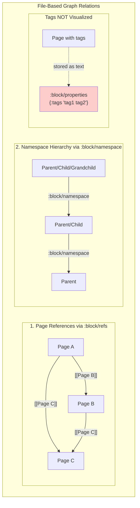
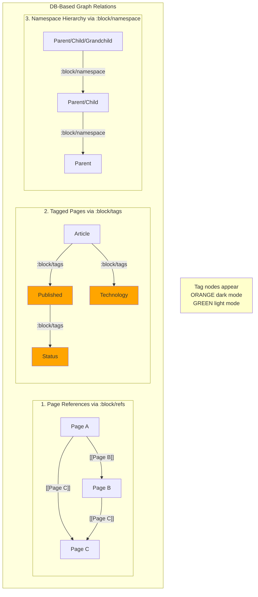
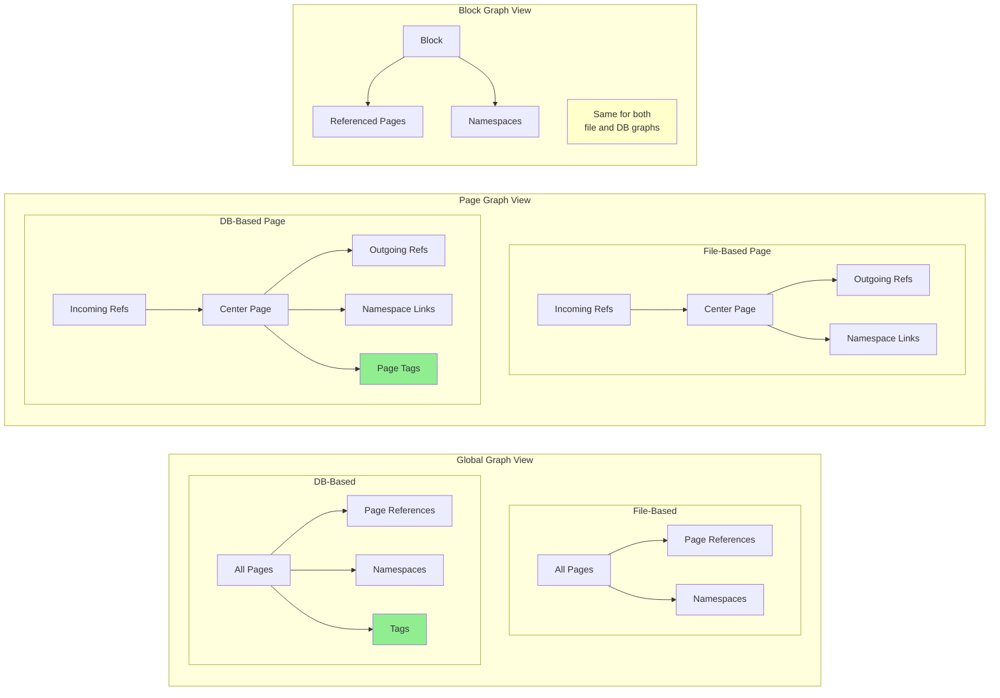
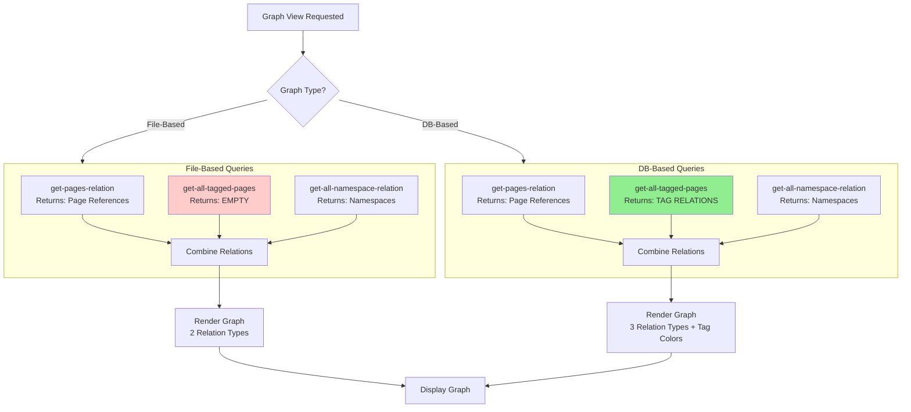

# Graph View Setup and Relations Investigation

**Investigation Date:** December 11, 2025  
**Investigator:** GitHub Copilot (Claude Sonnet 4.5)  
**Logseq Version:** Current Main Branch

---

## Executive Summary

### Key Findings

1. **Two Graph View Types:** Logseq implements **Global Graph View** (all pages) and **Page Graph View** (single page focus)
2. **Three Relation Types Visualized (DB-based):**
   - **Page References** (`:block/refs`) - bidirectional links between pages
   - **Tagged Pages** (`:block/tags`) - pages tagged with other pages (DB-based only)
   - **Namespace Hierarchies** (`:block/namespace`) - parent-child page relationships
3. **Property Relations: NOT Visualized** - Properties of type `:node` create `:block/refs` but are NOT shown as distinct relations in graph
4. **Dual Graph System:** File-based graphs use DataScript (2 relation types), DB-based graphs use SQLite (3 relation types)
5. **Force-Directed Layout:** Uses D3-force and Pixi.js for interactive 2D visualization
6. **Block-Level Graph:** Also supports viewing references for individual blocks

### Critical Components

| Component     | Location                                                                                                                        | Purpose                          |
| ------------- | ------------------------------------------------------------------------------------------------------------------------------- | -------------------------------- |
| Graph Builder | [frontend.common.graph-view](file:///Users/dzu/Projects/src/github.com/logseq/src/main/frontend/common/graph_view.cljs)         | Core graph data construction     |
| UI Component  | [frontend.components.page](file:///Users/dzu/Projects/src/github.com/logseq/src/main/frontend/components/page.cljs#L662-L760)   | Graph rendering & filters        |
| Visualization | [frontend.extensions.graph.pixi](file:///Users/dzu/Projects/src/github.com/logseq/src/main/frontend/extensions/graph/pixi.cljs) | D3-force layout & Pixi rendering |
| Route Handler | [frontend.routes](file:///Users/dzu/Projects/src/github.com/logseq/src/main/frontend/routes.cljs#L62-L64)                       | `/graph` route definition        |

---

## Technical Deep Dive

### 1. Graph Types

#### Global Graph View

**Location:** [frontend.common.graph-view/build-global-graph](file:///Users/dzu/Projects/src/github.com/logseq/src/main/frontend/common/graph_view.cljs#L78-L127)

**Purpose:** Shows all pages in the graph and their relationships

**Entry Point:**

- Route: `/graph` ([routes.cljs:62](file:///Users/dzu/Projects/src/github.com/logseq/src/main/frontend/routes.cljs#L62-L64))
- Component: `page/global-graph` ([page.cljs:710](file:///Users/dzu/Projects/src/github.com/logseq/src/main/frontend/components/page.cljs#L710-L738))

**Data Construction:**

```clojure
;; From frontend.common.graph-view
(defn- build-global-graph
  [db {:keys [theme journal? orphan-pages? builtin-pages? excluded-pages? created-at-filter]}]
  (let [dark? (= "dark" theme)
        relation (ldb/get-pages-relation db journal?)        ;; Page references
        tagged-pages (ldb/get-all-tagged-pages db)           ;; Tags
        namespaces (gp-db/get-all-namespace-relation db)     ;; Namespaces
        ;; ... filters and node building
        ]))
```

**Filters Available:**

- **Journal Pages:** Show/hide journal entries
- **Orphan Pages:** Pages with no links (show/hide)
- **Built-in Pages:** System pages like "TODO", "DONE", etc.
- **Excluded Pages:** Pages with `:exclude-from-graph-view` property
- **Created At Filter:** Time-based filtering of pages

---

#### Page Graph View

**Location:** [frontend.common.graph-view/build-page-graph](file:///Users/dzu/Projects/src/github.com/logseq/src/main/frontend/common/graph_view.cljs#L173-L210)

**Purpose:** Shows a specific page and its immediate relationships

**Entry Point:**

- Accessed via page sidebar ([page.cljs:760](file:///Users/dzu/Projects/src/github.com/logseq/src/main/frontend/components/page.cljs#L760-L777))
- Component: `page/page-graph`

**Data Construction:**

```clojure
(defn- build-page-graph
  [db page-uuid theme show-journal]
  (let [page-entity (d/entity db [:block/uuid page-uuid])
        page-id (:db/id page-entity)
        ;; Get relationships
        tags (set (map :db/id (:block/tags page-entity)))
        ref-pages (get-page-referenced-pages db page-id)
        mentioned-pages (get-pages-that-mentioned-page db page-id show-journal)
        namespaces (gp-db/get-all-namespace-relation db)
        ;; Build links
        links (concat
               namespaces
               (map (fn [ref-page] [page-id ref-page]) ref-pages)
               (map (fn [page] [page-id page]) mentioned-pages)
               (map (fn [tag] [page-id tag]) tags))
        ;; Include relationships between other pages
        other-pages-links (build-page-graph-other-page-links db
                            (concat ref-pages mentioned-pages)
                            show-journal)
        ]))
```

**Key Difference from Global:**

- Centers on **one page** as the focal point
- Shows **referenced pages** (outgoing links)
- Shows **mentioned pages** (incoming links)
- Shows **connections between the related pages**
- Can toggle journal inclusion independently

---

#### Block Graph View

**Location:** [frontend.common.graph-view/build-block-graph](file:///Users/dzu/Projects/src/github.com/logseq/src/main/frontend/common/graph_view.cljs#L212-L237)

**Purpose:** Shows references to/from a specific block

**Data Construction:**

```clojure
(defn- build-block-graph
  [db block-uuid theme]
  (when-let [block (d/entity db [:block/uuid block-uuid])]
    (let [ref-blocks (->> (concat (:block/_refs block)    ;; Incoming refs
                                  (:block/refs block))     ;; Outgoing refs
                          (map (fn [b]
                                 (if (ldb/page? b) b (:block/page b))))
                          (common-util/distinct-by :db/id))
          links (concat
                 namespaces
                 (map (fn [p] [(:db/id block) (:db/id p)]) ref-blocks))
          nodes (cons block ref-blocks)]))
```

---

### 2. Relation Types Mapped as Graph

#### Relation Type 1: Page References (`:block/refs`)

**Definition:** Direct page references via `[[page name]]` syntax

**Query (DB-based):**

```clojure
;; From logseq.db/get-pages-relation
[:find ?p ?ref-page
 :where
 [?block :block/page ?p]
 [?block :block/refs ?ref-page]]
```

**How It Works:**

1. Any block that contains `[[Other Page]]` creates a reference
2. Creates directed edge: `Current Page → Other Page`
3. Bidirectional representation in graph (both ends visible)

**Example:**

```markdown
## My Block

This references [[Project X]] and [[Meeting Notes]]
```

Creates edges:

- `Current Page → Project X`
- `Current Page → Meeting Notes`

---

#### Relation Type 2: Tagged Pages (`:block/tags`)

**Definition:** Pages tagged with other pages (DB-based graphs)

**Query:**

```clojure
;; From logseq.db/get-all-tagged-pages
[:find ?page ?tag
 :where
 [?page :block/tags ?tag]]
```

**How It Works:**

1. DB-based graphs use property system: `tags:: [[tag1]], [[tag2]]`
2. Creates directed edge: `Tagged Page → Tag Page`
3. Tag nodes colored **orange** (dark) or **green** (light mode)

**Visual Distinction:**

```clojure
;; From graph-view.cljs:38-42
color (if (contains? tags (:db/id p))
        (if dark? "orange" "green")
        color)
```

**Example:**

```markdown
---
tags: [[Project]], [[Important]]
---
```

Creates edges:

- `Current Page → Project` (orange/green)
- `Current Page → Important` (orange/green)

---

#### Relation Type 3: Namespace Hierarchies (`:block/namespace`)

**Definition:** Parent-child page relationships via namespace syntax

**Query:**

```clojure
;; From logseq.graph-parser.db/get-all-namespace-relation
[:find ?page ?parent
 :where
 [?page :block/namespace ?parent]]
```

**How It Works:**

1. Pages with `/` create hierarchies: `Parent/Child/Grandchild`
2. Creates directed edges: `Child → Parent`
3. Parent nodes get special `:parent true` attribute

**Visual Distinction:**

```clojure
;; From graph-view.cljs:49-51
(cond->
  {:id (str (:db/id p)) :label page-title :size size :color color}
  (contains? page-parents (:db/id p))
  (assoc :parent true))
```

**Example:**

- `Project/Backend` → creates edge to `Project`
- `Project/Backend/API` → creates edges to `Project/Backend` AND `Project`

---

### 3. Node and Link Data Structures

#### Node Structure

```clojure
;; From build-nodes function
{:id "12345"                  ;; db/id as string
 :label "Page Title"          ;; block/title
 :size 24                     ;; Based on link count (8 * cbrt(links))
 :color "#999"                ;; Theme + state dependent
 :block/created-at 123456789  ;; Timestamp
 :parent true}                ;; (optional) if namespace parent
```

**Size Calculation:**

```clojure
;; Larger nodes = more links
n (get page-links page-title 1)
size (int (* 8 (max 1.0 (js/Math.cbrt n))))
```

**Color Logic:**

```clojure
;; Default colors (dark?/current-page?)
[false false] "#999"      ;; Normal page, light mode
[false true]  "#045591"   ;; Current page, light mode
[true false]  "#93a1a1"   ;; Normal page, dark mode
[true true]   "#ffffff"   ;; Current page, dark mode

;; Override: Tags are orange/green
```

#### Link Structure

```clojure
;; From build-links function
{:source "12345"    ;; Source node db/id (string)
 :target "67890"}   ;; Target node db/id (string)
```

---

### 4. Visualization Stack

#### Technology Stack

1. **Graphology** - Graph data structure library
2. **D3-Force** - Physics simulation for node layout
3. **Pixi.js** - WebGL-based 2D rendering
4. **pixi-graph-fork** - Pixi integration for graphs

**Location:** [frontend.extensions.graph.pixi](file:///Users/dzu/Projects/src/github.com/logseq/src/main/frontend/extensions/graph/pixi.cljs#L1-L247)

#### Force-Directed Layout

**Forces Applied:**

```clojure
;; From layout! function (pixi.cljs:62-105)
(-> simulation
    (.force "link"       ;; Keep linked nodes at distance
            (forceLink)
            (.distance link-dist))
    (.force "charge"     ;; Repel nodes (negative charge)
            (forceManyBody)
            (.distanceMin 1)
            (.distanceMax charge-range)
            (.strength charge-strength))
    (.force "collision"  ;; Prevent overlap
            (forceCollide)
            (.radius 26))
    (.force "x"          ;; Weak centering horizontal
            (forceX 0)
            (.strength 0.02))
    (.force "y"          ;; Weak centering vertical
            (forceY 0)
            (.strength 0.02))
    (.force "center"     ;; Overall centering
            (forceCenter))
    (.velocityDecay 0.5))
```

**Configuration Parameters:**

- `link-dist`: Distance between linked nodes (default varies)
- `charge-strength`: Repulsion strength (negative = repel)
- `charge-range`: Maximum distance for charge force
- `velocityDecay`: Simulation damping (0.5 = 50% decay per tick)

---

### 5. Interactive Features

#### Shift+Click Node Selection

**Location:** [frontend.extensions.graph/on-click-handler](file:///Users/dzu/Projects/src/github.com/logseq/src/main/frontend/extensions/graph.cljs#L31-L49)

```clojure
(defn on-click-handler [graph node event *focus-nodes *n-hops drag? dark?]
  (if (or (gobj/get event "shiftKey") drag?)
    (do
      ;; Add to focus nodes
      (swap! *focus-nodes (fn [v] (vec (distinct (conj v node)))))
      ;; Highlight neighbors
      (.setNodeAttribute (.-graph graph) node "parent" "ls-selected-nodes")
      (highlight-neighbours! graph node (set @*focus-nodes) dark?)
      (highlight-edges! graph node dark?))
    ;; Normal click: navigate to page
    (route-handler/redirect-to-page! page-name)))
```

**Behavior:**

1. **Normal Click:** Navigate to page
2. **Shift+Click:** Add to selection, highlight neighbors
3. **Drag:** No navigation, treated as selection

#### N-Hops Filtering

**Location:** [frontend.handler.graph/n-hops](file:///Users/dzu/Projects/src/github.com/logseq/src/main/frontend/handler/graph.cljs#L7-L30)

**Purpose:** Show only nodes within N connections of selected nodes

```clojure
(defn n-hops
  [{:keys [links] :as graph} nodes level]
  (let [search-nodes (fn [forward?]
                       (loop [nodes nodes level level]
                         (if (zero? level)
                           nodes
                           (recur (distinct (apply concat nodes
                                     (map
                                       (fn [id]
                                         (->> (get links id)
                                              (map (if forward? :target :source))))
                                       nodes)))
                                  (dec level)))))]
    ;; Search both directions
    (concat (search-nodes true) (search-nodes false))))
```

**Usage:**

1. Shift+click one or more nodes
2. Adjust slider: 1-10 hops
3. Graph filters to show only nodes within N connections

---

### 6. File-Based vs DB-Based Graphs

#### Fundamental Architecture Differences

**File-Based Graphs** store data in Markdown/Org files with DataScript in-memory database, while **DB-Based Graphs** use SQLite with a richer schema and first-class property support.

#### Data Source Differences

**File-Based (DataScript):**

**Location:** [logseq.graph-parser.db](file:///Users/dzu/Projects/src/github.com/logseq/deps/graph-parser/src/logseq/graph_parser/db.cljs)

```clojure
;; Query for page relations (file-based)
[:find ?p ?ref-page
 :where
 [?block :block/page ?p]
 (not [?p :block/type "journal"])  ;; String-based journal check
 [?block :block/refs ?ref-page]]
```

**DB-Based (SQLite):**

**Location:** [logseq.db/get-pages-relation](file:///Users/dzu/Projects/src/github.com/logseq/deps/db/src/logseq/db.cljs#L622-L647)

```clojure
;; Query for page relations (db-based)
[:find ?p ?ref-page
 :where
 [?block :block/page ?p]
 [?p :block/tags]
 (not [?p :block/tags :logseq.class/Journal])  ;; Tag-based journal check
 [?block :block/refs ?ref-page]]
```

#### Comprehensive Comparison Table

| Aspect                | File-Based                                                  | DB-Based                                                          |
| --------------------- | ----------------------------------------------------------- | ----------------------------------------------------------------- |
| **Storage**           | Markdown/Org files                                          | SQLite database                                                   |
| **In-Memory DB**      | DataScript                                                  | DataScript (synced with SQLite)                                   |
| **Journal Detection** | `:block/type "journal"` (string attribute)                  | `:block/tags :logseq.class/Journal` (entity reference)            |
| **Tag Storage**       | `:block/properties {:tags ["tag1" "tag2"]}` (string values) | `:block/tags #{<entity-ref> ...}` (entity references)             |
| **Tag Visualization** | **Not available in graph** (stored as properties)           | **Available in graph** (first-class entities, orange/green nodes) |
| **Exclude Property**  | `:block/properties :exclude-from-graph-view` (boolean)      | `:logseq.property/exclude-from-graph-view` (boolean)              |
| **Schema**            | `file-schema/schema`                                        | `db-schema/schema`                                                |
| **Namespaces**        | ✅ Supported via `:block/namespace`                         | ✅ Supported via `:block/namespace`                               |
| **Page References**   | ✅ Supported via `:block/refs`                              | ✅ Supported via `:block/refs`                                    |
| **Property System**   | Simple key-value in `:block/properties`                     | Rich property system with types and relationships                 |
| **Query in Graph**    | Tags query **not used** (no `:block/tags` relation)         | Tags query **used** (`get-all-tagged-pages`)                      |
| **Visualization**     | Identical rendering (Pixi.js)                               | Identical rendering (Pixi.js) + tag node colors                   |

#### Critical Code Differences

**Tag Relation Availability:**

```clojure
;; In graph-view.cljs build-global-graph
(let [relation (ldb/get-pages-relation db journal?)
      tagged-pages (ldb/get-all-tagged-pages db)  ;; ← Only returns data for DB-based!
      namespaces (gp-db/get-all-namespace-relation db)]
  ;; ...
)

;; get-all-tagged-pages implementation (logseq.db)
(defn get-all-tagged-pages
  [db]
  (d/q '[:find ?page ?tag
         :where
         [?page :block/tags ?tag]]  ;; ← This attribute only exists in DB-based graphs!
       db))
```

**File-Based:** `get-all-tagged-pages` returns **empty** (no `:block/tags` attribute exists)  
**DB-Based:** `get-all-tagged-pages` returns **all tag relationships**

#### Visual Impact

**File-Based Graph:**

- Shows **2 relation types:** References + Namespaces
- Tags are **not visualized** (stored as text in properties)
- No orange/green colored nodes

**DB-Based Graph:**

- Shows **3 relation types:** References + Tags + Namespaces
- Tags are **visualized as nodes** (orange/green colored)
- Tag pages can be clicked and navigated
- Tag hierarchy supported (tags can have tags)

**Visualization Engine:** Both use identical Pixi.js rendering

---

Property-Based Relations in DB Graphs

### Question: Do Properties of Type "Node" Create Graph Relations?

**Short Answer:** **No, properties of type `:node` do NOT create distinct visualizable relations in the graph view.**

### Detailed Explanation

In DB-based graphs, properties can have type `:node` which allows them to reference other pages. However, **these references are stored as `:block/refs`** and are **indistinguishable from regular page references** in the graph visualization.

#### How Property References Work

```clojure
;; Property type definition
:logseq.property/type :node  ;; Allows page references as values

;; When a property value references a page:
author:: [[John Doe]]
related:: [[Project A]], [[Project B]]

;; Internally stored as:
:block/refs #{<entity:John Doe> <entity:Project A> <entity:Project B>}
```

**Key Point:** The graph queries (`get-pages-relation`) retrieve **all `:block/refs` relations** without differentiating between:

- Regular page references: `[[Page Name]]`
- Property values of type node: `author:: [[Page Name]]`
- Inline tags: `#tag`

#### Code Evidence

```clojure
;; From logseq.db/get-pages-relation
(defn get-pages-relation
  [db with-journal?]
  ;; Returns ALL :block/refs regardless of source
  '[:find ?p ?ref-page
    :where
    [?block :block/page ?p]
    [?block :block/refs ?ref-page]])  ;; ← No filtering by property
```

**Graph Builder:** [frontend.common.graph-view/build-global-graph](file:///Users/dzu/Projects/src/github.com/logseq/src/main/frontend/common/graph_view.cljs#L78-L127)

```clojure
(defn- build-global-graph [db opts]
  (let [relation (ldb/get-pages-relation db journal?)  ;; ← Gets ALL refs
        tagged-pages (ldb/get-all-tagged-pages db)     ;; ← Only :block/tags
        namespaces (gp-db/get-all-namespace-relation db)
        links (concat relation tagged-pages namespaces)])
  ;; No separate query for property-based refs!
)
```

### What This Means

| Property Type | Storage Mechanism               | Visible in Graph? | Distinguished in Graph?          |
| ------------- | ------------------------------- | ----------------- | -------------------------------- |
| `:node`       | `:block/refs`                   | ✅ Yes            | ❌ No (merged with regular refs) |
| `:date`       | `:block/refs`                   | ✅ Yes            | ❌ No (merged with regular refs) |
| `:url`        | `:logseq.property/value`        | ❌ No             | ❌ N/A                           |
| `:number`     | `:logseq.property/value`        | ❌ No             | ❌ N/A                           |
| `:checkbox`   | `:logseq.property/scalar-value` | ❌ No             | ❌ N/A                           |

**Reference Types that Create `:block/refs`:**

```clojure
;; From logseq.db.frontend.property.type
(def user-ref-property-types
  "User ref types. Property values that users see are stored in either
  :logseq.property/value or :block/title. :block/title is for all the page related types"
  #{:date :node :default :url :number})
```

### Visual Example

```markdown
# Page: Research Paper

author:: [[Alice Smith]]
related-to:: [[Machine Learning]], [[Deep Learning]]
tags:: [[AI]], [[Research]]

Regular reference to [[Neural Networks]]
```

**What the Graph Shows:**

```
Research Paper → Alice Smith        (from property author)
Research Paper → Machine Learning   (from property related-to)
Research Paper → Deep Learning      (from property related-to)
Research Paper → AI                 (from tags, colored orange/green)
Research Paper → Research           (from tags, colored orange/green)
Research Paper → Neural Networks    (from regular reference)
```

**What You CANNOT Tell from the Graph:**

- Which links came from properties vs regular references
- Which property created which link
- The semantic meaning of the relationship (author, related-to, etc.)

### Limitations & Workarounds

#### Current Limitations

1. **No Property Distinction:** Graph treats `author:: [[Alice]]` same as `[[Alice]]`
2. **No Semantic Relations:** Cannot visualize "authored by" vs "related to"
3. **No Property Filtering:** Cannot show only links from specific properties
4. **No Edge Labels:** Edges don't show property names

#### Potential Workarounds

1. **Use Tags for Typed Relations:** Create tag pages like `[[authored-by/Alice]]`
2. **Separate Pages for Semantics:** Create dedicated pages for relationships
3. **Query Instead of Graph:** Use queries to find property-based relationships:
   ```
   (property author [[Alice Smith]])
   ```
4. **External Tools:** Export data and visualize in tools that support typed edges

### Future Enhancement Possibilities

**Not Currently Implemented:**

- Separate query for property-based refs: `get-property-refs`
- Edge coloring by property type
- Edge labels showing property names
- Filter by specific property in graph view
- Property-based graph layout (cluster by property relationships)

---

##

## Relation Type Diagrams

### File-Based Graph Relations

File-based graphs support **2 primary relation types** that are visualized in the graph view:



**Available at Each Level:**

| Level        | Page References | Namespaces | Tags     |
| ------------ | --------------- | ---------- | -------- |
| Global Graph | ✅              | ✅         | ❌ (N/A) |
| Page Graph   | ✅              | ✅         | ❌ (N/A) |
| Block Graph  | ✅              | ✅         | ❌ (N/A) |

---

### DB-Based Graph Relations

DB-based graphs support **3 primary relation types** with first-class tag support:



**Available at Each Level:**

| Level        | Page References | Namespaces | Tags                 |
| ------------ | --------------- | ---------- | -------------------- |
| Global Graph | ✅              | ✅         | ✅ (visualized)      |
| Page Graph   | ✅              | ✅         | ✅ (if page is tag)  |
| Block Graph  | ✅              | ✅         | ❌ (not implemented) |

---

### Combined Relation Visualization by Graph Type



---

### Relation Query Comparison



**Note:** This scenario **only applies to DB-based graphs**. File-based graphs store tags as properties (`:block/properties {:tags ["Published" "Technology"]}`) which are **not queried or visualized** in the graph view.

---

### Scenario 4: Comparing File vs DB Graph (Same Content)

**Setup:** Same content structure in both graph types

```markdown
# Page: My Project

namespace: Projects
tags:: [[Active]], [[2024]] (DB-based only, file-based stores as property)

References [[Team]] and [[Goals]]

# Page: Projects/Backend

(Child of Projects namespace)
```

**File-Based Graph Shows:**

```
My Project → Team (reference)
My Project → Goals (reference)
Projects/Backend → Projects (namespace)

Total: 3 edges, 2 relation types
Tags: Not visible in graph
```

**DB-Based Graph Shows:**

```
My Project → Team (reference)
My Project → Goals (reference)
My Project → Active (tag, orange/green node)
My Project → 2024 (tag, orange/green node)
Projects/Backend → Projects (namespace)

Total: 5 edges, 3 relation types
Tags: Visible as colored nodes
```

**Visual Difference:**

- **File-Based:** Simpler, fewer nodes
- **DB-Based:** Richer, tag nodes add semantic clustering
- **Node Count:** DB-based typically has more nodes due to tag entities ├── Apply Filters
  │ ├── Journal filter
  │ ├── Orphan pages filter
  │ ├── Built-in pages filter
  │ └── Excluded pages filter
  ├── Build Nodes (with sizes & colors)
  └── Build Links (from relations)
  ↓
  {:nodes [...] :links [...]}
  ↓
  [page.cljs:662] global-graph-inner
  ├── Apply search filters
  ├── Apply n-hops filter (if active)
  └── Render graph-2d component
  ↓
  [graph.cljs:44] graph-2d (Rum component)
  ↓
  [pixi.cljs:169] render! (did-update lifecycle)
  ├── Create Graphology graph
  ├── Add nodes & edges
  ├── Setup D3 force simulation
  │ ├── forceLink (distance)
  │ ├── forceManyBody (repulsion)
  │ ├── forceCollide (overlap)
  │ └── forceCenter (centering)
  ├── Create Pixi renderer
  └── Setup event listeners
  ↓
  Interactive Graph Displayed

```

### Page Graph Construction Flow

```

User Views Page
↓
[page.cljs:760] page-graph component
↓
[graph-view.cljs:173] build-page-graph
├── Get page entity by UUID
├── Query Relations
│ ├── Get tags from :block/tags
│ ├── get-page-referenced-pages (outgoing)
│ ├── get-pages-that-mentioned-page (incoming)
│ └── get-all-namespace-relation
├── Build Primary Links
│ ├── page → ref-pages
│ ├── mentioned-pages → page
│ └── page → tags
└── Build Secondary Links
└── Links between ref-pages and mentioned-pages
↓
{:nodes [...] :links [...]}
↓
[page.cljs:735] page-graph-inner
└── Render graph-2d (600x600)
↓
Same Pixi rendering as global graph

```

### Node Click Interaction Flow

```

User Clicks Node
↓
[pixi.cljs:193] nodeClick event
↓
[page.cljs:665] graph-register-handlers
├── Check drag detection
│ └── Compare position to last mousedown
└── Call on-click-handler
↓
[graph.cljs:31] on-click-handler
├─ Shift+Click or Drag? ─┐
│ │
Yes No
├── Add to \*focus-nodes └── Get page entity
├── Set node attribute └── redirect-to-page!
├── highlight-neighbours! ↓
└── highlight-edges! Navigate to Page

```

---

## Code Reference Table

### Critical Files

| File                                                                                                                            | Purpose              | Key Functions                                                 | Lines   |
| ------------------------------------------------------------------------------------------------------------------------------- | -------------------- | ------------------------------------------------------------- | ------- |
| [frontend.common.graph-view](file:///Users/dzu/Projects/src/github.com/logseq/src/main/frontend/common/graph_view.cljs)         | Graph data builder   | `build-global-graph`, `build-page-graph`, `build-block-graph` | 1-250   |
| [frontend.handler.graph](file:///Users/dzu/Projects/src/github.com/logseq/src/main/frontend/handler/graph.cljs)                 | Graph utilities      | `n-hops`                                                      | 1-50    |
| [frontend.components.page](file:///Users/dzu/Projects/src/github.com/logseq/src/main/frontend/components/page.cljs)             | UI components        | `global-graph`, `page-graph`, `graph-filters`                 | 540-777 |
| [frontend.extensions.graph](file:///Users/dzu/Projects/src/github.com/logseq/src/main/frontend/extensions/graph.cljs)           | Graph interaction    | `on-click-handler`, `graph-2d`                                | 1-65    |
| [frontend.extensions.graph.pixi](file:///Users/dzu/Projects/src/github.com/logseq/src/main/frontend/extensions/graph/pixi.cljs) | Visualization engine | `layout!`, `render!`, `tick!`                                 | 1-247   |
| [logseq.db](file:///Users/dzu/Projects/src/github.com/logseq/deps/db/src/logseq/db.cljs)                                        | DB queries           | `get-pages-relation`, `get-all-tagged-pages`                  | 622-657 |
| [logseq.graph-parser.db](file:///Users/dzu/Projects/src/github.com/logseq/deps/graph-parser/src/logseq/graph_parser/db.cljs)    | File graph queries   | `get-all-namespace-relation`                                  | 63-67   |
| [frontend.routes](file:///Users/dzu/Projects/src/github.com/logseq/src/main/frontend/routes.cljs)                               | Route definitions    | `/graph` route                                                | 62-64   |

### Database Schema Attributes

| Attribute                                  | Type       | Purpose                  |
| ------------------------------------------ | ---------- | ------------------------ |
| `:block/refs`                              | Ref (many) | Page/block references    |
| `:block/tags`                              | Ref (many) | Tags (DB-based only)     |
| `:block/namespace`                         | Ref (one)  | Parent page in hierarchy |
| `:block/title`                             | String     | Page display name        |
| `:block/name`                              | String     | Normalized page name     |
| `:block/created-at`                        | Long       | Creation timestamp       |
| `:logseq.property/exclude-from-graph-view` | Boolean    | Hide from graph          |

---

## Comparison: Global vs Page vs Block Graphs

| Aspect              | Global Graph                                    | Page Graph                 | Block Graph            |
| ------------------- | ----------------------------------------------- | -------------------------- | ---------------------- |
| **Scope**           | All pages                                       | One page + neighbors       | One block + refs       |
| **Center Node**     | None (all equal)                                | Specified page             | Specified block        |
| **Relations Shown** | All page relations                              | Focused page relations     | Block references only  |
| **Secondary Links** | No                                              | Yes (between neighbors)    | No                     |
| **Filters**         | Journal, Orphan, Built-in, Excluded, Created-at | Show journals toggle       | None                   |
| **N-Hops**          | Yes (with selection)                            | No                         | No                     |
| **Size**            | Full viewport                                   | 600x600px                  | 600x600px              |
| **Route**           | `/graph`                                        | Sidebar on page            | Sidebar on block       |
| **Use Case**        | Overview of knowledge                           | Page relationship analysis | Block citation network |

---

## Scenario Analysis

### Scenario 1: Large Knowledge Base with 500+ Pages

**User Action:** Navigate to `/graph` with default filters

**Expected Behavior:**

1. Query all 500+ pages and their relations
2. Filter out journals, orphan pages (if enabled)
3. Calculate node sizes based on backlink counts
4. Render force-directed layout
5. Heavy pages (many links) appear larger and more central

**Performance:**

- ⚠️ May be slow for 1000+ pages
- Layout stabilizes after ~2-3 seconds
- Interactive once initial layout complete

**Optimization:**

- Use filters to reduce node count
- Enable "exclude from graph view" property for meta pages
- Use search filters to focus on specific topics

---

### Scenario 2: Analyzing Page Relationships

**User Action:** View page graph for "Project Management"

**Expected Behavior:**

1. Shows "Project Management" as center
2. Outgoing links: Pages referenced by PM blocks
3. Incoming links: Pages that mention PM
4. Tags: If PM is tagged (DB-based)
5. Namespaces: `Project Management/Subtopic` appears
6. **Secondary Links:** Shows connections between the neighbors

**Example:**

```

If page "Project Management" references:

- [[GTD Method]]
- [[Team Meetings]]

And "Team Meetings" also references [[GTD Method]]:

Graph shows:
Project Management → GTD Method
Project Management → Team Meetings
Team Meetings → GTD Method ← Secondary link!

````

---

### Scenario 3: Exploring Tag Hierarchies (DB-Based)

**User Action:** Navigate to global graph in DB-based graph

**Expected Behavior:**

1. Tag nodes appear in **orange** (dark) or **green** (light)
2. Tagged pages point to tag pages
3. Tag pages can themselves be tagged (nested tags)

**Example:**

```markdown
Page "Article 1"
tags:: [[Published]], [[Technology]]

Page "Published"
tags:: [[Status]]

Graph shows:
Article 1 → Published (orange/green)
Article 1 → Technology (orange/green)
Published → Status (orange/green)
````

---

## Recommendations

### For Users

#### Understanding Graph Density

- **High Connectivity = Central Topics:** Large nodes with many connections are hub pages
- **Clusters = Related Topics:** Tightly connected groups indicate thematic clusters
- **Isolates = Orphans:** Disconnected nodes may need more linking

#### Best Practices

1. **Use Page Graph for Analysis:** Start with page-level view to understand local structure
2. **Global for Overview:** Use global graph to find unexpected connections
3. **Filter Strategically:** Enable journal filter if you have many daily notes
4. **Tag Thoughtfully:** In DB graphs, tags create visual clusters
5. **Namespace for Hierarchy:** Use `Parent/Child` naming for hierarchical topics

#### Troubleshooting

- **Slow Performance:** Too many pages? Use filters or exclude meta-pages
- **Cluttered View:** Enable search filters to focus on specific topics
- **Missing Links:** Check if pages are excluded via property
- **Wrong Colors:** Tags are orange/green, ensure you're looking at the right nodes

---

### For Developers

#### Adding New Relation Types

**Steps:**

1. Add query to `logseq.db` or `logseq.graph-parser.db`
2. Update `build-global-graph` or `build-page-graph` to include new relations
3. Update `build-links` if link structure differs
4. Consider visual distinction (color, size, style)

**Example:** Adding property-based relations:

```clojure
;; In graph-view.cljs
(defn- build-global-graph [db opts]
  (let [property-relations (get-property-relations db)  ;; New query
        links (concat relation tagged-pages namespaces
                      property-relations)]               ;; Add to links
    ;; ... rest of function
    ))
```

#### Performance Optimization

**Current Bottlenecks:**

1. **Query Time:** `get-pages-relation` on large graphs
2. **Layout Convergence:** Force simulation for 1000+ nodes
3. **Rendering:** Pixi.js draw calls for many nodes/edges

**Optimization Strategies:**

1. **Pagination:** Load subgraphs on demand
2. **Virtualization:** Render only visible nodes
3. **Cached Layouts:** Store node positions
4. **Web Workers:** Move force calculation off main thread
5. **Level-of-Detail:** Simplify distant nodes

#### Testing Additions

**Unit Tests Needed:**

```clojure
;; Test graph construction
(deftest build-global-graph-test
  (let [db (create-test-db)
        graph (build-global-graph db {:theme "light"})]
    (is (= (count (:nodes graph)) expected-count))
    (is (every? #(contains? % :id) (:nodes graph)))))

;; Test n-hops filtering
(deftest n-hops-filter-test
  (let [graph {:nodes [...] :links [...]}
        filtered (n-hops graph ["node1"] 2)]
    (is (< (count (:nodes filtered))
           (count (:nodes graph))))))
```

**E2E Test Scenarios:**

1. Navigate to `/graph` and verify render
2. Shift+click nodes and verify highlighting
3. Adjust n-hops slider and verify filtering
4. Toggle filters and verify re-render
5. Click node and verify navigation

---

### For Testing

#### Manual Test Cases

**Test Case 1: Global Graph Rendering**

1. Navigate to `/graph`
2. Verify all non-excluded pages appear
3. Check node sizes correlate with link counts
4. Verify current page (if any) highlighted

**Test Case 2: Filter Functionality**

1. Toggle "Show journals" filter
2. Verify journal pages appear/disappear
3. Toggle "Orphan pages" filter
4. Verify isolated pages appear/disappear

**Test Case 3: N-Hops Feature**

1. Shift+click multiple nodes
2. Set n-hops slider to 2
3. Verify only nodes within 2 connections remain
4. Reset and verify all nodes return

**Test Case 4: Page Navigation**

1. Click a node (not shift+click)
2. Verify navigation to that page
3. Verify page graph appears in sidebar

**Test Case 5: Tag Visualization (DB-based)**

1. Create page with tags
2. View global graph
3. Verify tag nodes are orange/green
4. Verify edges from page to tags

---

## Appendix

### Glossary

| **Term**                  | **Definition**                                                    |
| ------------------------- | ----------------------------------------------------------------- |
| **Node**                  | Visual representation of a page or block in the graph             |
| **Edge/Link**             | Line connecting two nodes, representing a relationship            |
| **Force-Directed Layout** | Physics simulation that positions nodes based on simulated forces |
| **N-Hops**                | Number of link traversals from a starting node                    |
| **Orphan Page**           | Page with no incoming or outgoing links                           |
| **Namespace**             | Hierarchical page naming using `/` (e.g., `Parent/Child`)         |
| **Tag Node**              | Page used as a tag (colored orange/green)                         |
| **Hub Page**              | Page with many connections (large node)                           |
| **Cluster**               | Group of tightly connected nodes                                  |

### Change History

| Version | Date       | Changes               |
| ------- | ---------- | --------------------- |
| 1.0     | 2025-12-11 | Initial investigation |

### Related Documentation

- [Database Schema Guide](file:///Users/dzu/Projects/src/github.com/logseq/docs/03-features/database-graphs/schema-guide.md)
- [Code Detective Investigation Template](file:///Users/dzu/Projects/src/github.com/logseq/.github/prompts/code-detective-investigation.prompt.md)
- [AGENTS.md](file:///Users/dzu/Projects/src/github.com/logseq/AGENTS.md)

---

## Summary

The Logseq graph view system implements a sophisticated **three-tier graph visualization** (Global/Page/Block) using **three primary relation types** (References, Tags, Namespaces). It leverages modern web technologies (D3-force, Pixi.js, Graphology) to create an interactive, physics-based visualization that works identically across file-based and database-based graphs.

**Key Insight:** The graph is not just a visualization—it's a **cognitive tool** that reveals the emergent structure of your knowledge base. Hub pages naturally emerge as large central nodes, thematic clusters become visually apparent, and isolated ideas stand out as orphans. The force-directed layout mirrors how ideas relate: strongly connected concepts pull together, while unrelated topics drift apart.
