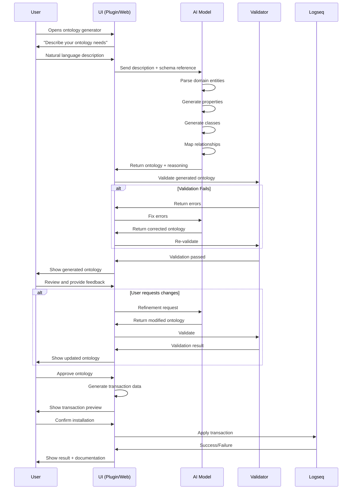
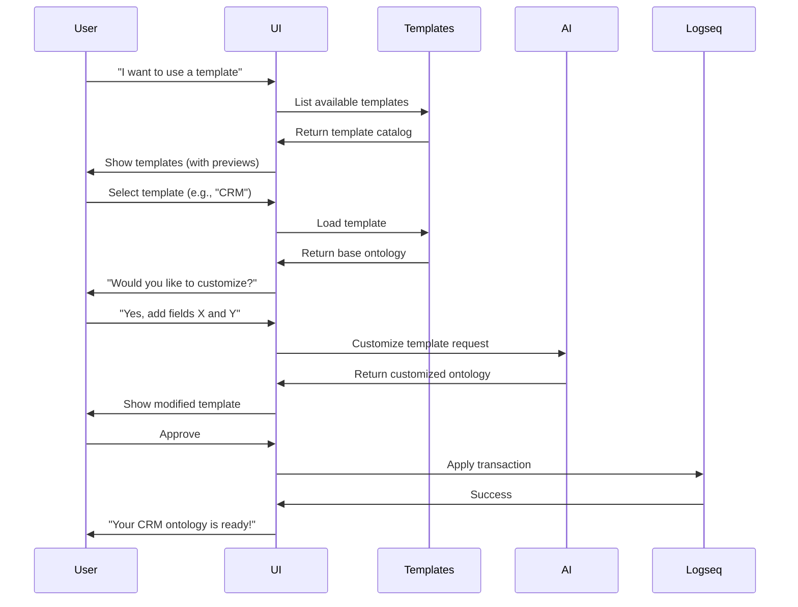
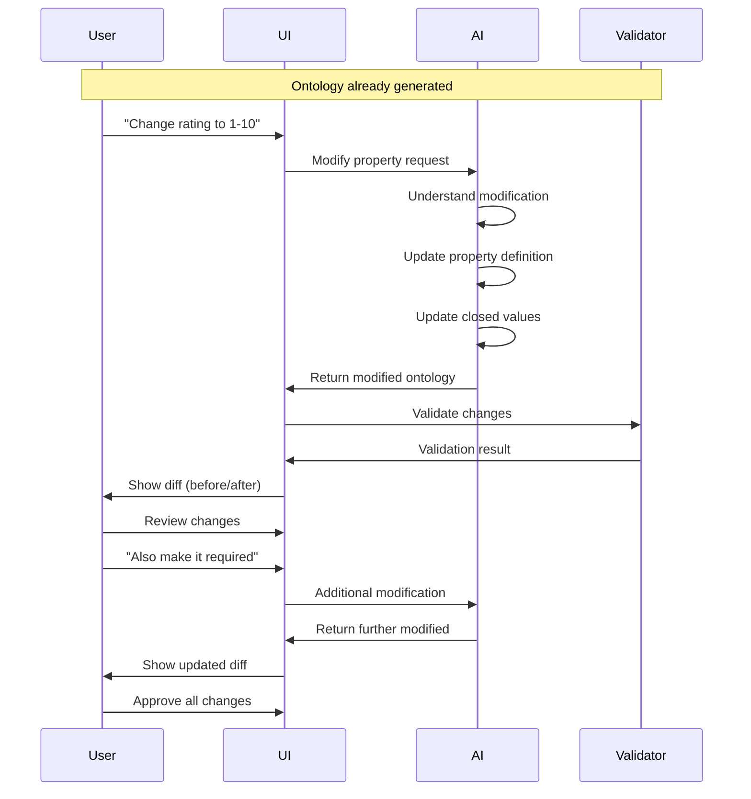

# AI-Powered Logseq Ontology Generator: Requirements Document

**Project**: Natural Language to Logseq Ontology Generator
**Version**: 1.0
**Date**: 2025-10-15
**Status**: Draft

---

## Executive Summary

### Vision

Create an AI-powered assistant that enables Logseq users to design custom ontologies (properties, classes, and their relationships) through natural language conversation, without requiring technical knowledge of the Logseq database graph schema.

### Problem Statement

**Current State**:

- Users must understand the complex Logseq database schema (107+ built-in properties, 13 classes, 14 property types)
- Creating custom properties and classes requires knowledge of:
  - Property types and their capabilities
  - Cardinality options
  - Closed values
  - Class inheritance
  - Entity types and relationships
  - Schema validation rules
- Manual schema design is error-prone and time-consuming
- No guidance on best practices for ontology design

**Desired State**:

- Users describe their domain/use case in natural language
- AI generates appropriate properties, classes, and relationships
- System validates against Logseq schema rules
- Users can iterate and refine through conversation
- Generated ontology is production-ready

### Target Users

1. **Knowledge Workers**: Need custom ontologies for project management, research, CRM, etc.
2. **Domain Experts**: Want to model specialized knowledge (medical, legal, scientific, etc.)
3. **Logseq Beginners**: Don't understand the technical schema details
4. **Power Users**: Want to quickly prototype complex ontologies
5. **Plugin Developers**: Need valid schemas for their plugins

### Success Metrics

- **Generation Accuracy**: 95%+ of generated ontologies are valid and match user intent
- **Time Savings**: 10x faster than manual ontology creation
- **User Satisfaction**: 90%+ of users successfully create their desired ontology
- **Adoption**: Used for 50%+ of custom property/class creation within 6 months
- **Iteration Rate**: Users successfully refine ontologies through < 3 conversations

---

## Table of Contents

1. [Functional Requirements](#functional-requirements)
2. [Technical Requirements](#technical-requirements)
3. [User Interaction Flow](#user-interaction-flow)
4. [AI Model Requirements](#ai-model-requirements)
5. [Validation Requirements](#validation-requirements)
6. [UI/UX Requirements](#uiux-requirements)
7. [Example Use Cases](#example-use-cases)
8. [Success Criteria](#success-criteria)
9. [Implementation Phases](#implementation-phases)
10. [Risk Analysis](#risk-analysis)
11. [Open Questions](#open-questions)

---

## Functional Requirements

### FR1: Natural Language Input Processing

**Priority**: P0 (Critical)

**Description**: System must accept and understand natural language descriptions of ontologies.

**Requirements**:

**FR1.1**: Accept multi-turn conversational input

- Users can provide information across multiple messages
- System maintains conversation context
- Users can ask clarifying questions

**FR1.2**: Parse domain descriptions

- Extract entity types (e.g., "books", "projects", "customers")
- Extract attributes (e.g., "author", "deadline", "contact email")
- Extract relationships (e.g., "books have authors", "projects belong to customers")
- Understand hierarchies (e.g., "fiction and non-fiction are types of books")

**FR1.3**: Understand common use cases

- Project management (tasks, projects, milestones)
- Research (papers, citations, notes)
- CRM (customers, deals, contacts)
- Personal (goals, habits, journal entries)
- Content creation (articles, videos, ideas)
- Book/media tracking (books, movies, ratings)

**FR1.4**: Handle ambiguity

- Ask clarifying questions when intent is unclear
- Suggest alternatives when multiple valid interpretations exist
- Provide examples to help users refine their description

**Example Input**:

```
User: "I want to track my book collection. Each book has an author,
      publication year, rating (1-5 stars), and genre. Some books are
      fiction, others non-fiction. I also want to track if I've finished
      reading them and add personal notes."
```

**Expected Output**: System understands:

- Entity: Book
- Properties: author (text), publication year (number/date), rating (1-5), genre (choice), status (finished/reading), notes (text)
- Classes: Fiction, Non-fiction (both extend Book)

---

### FR2: Property Generation

**Priority**: P0 (Critical)

**Description**: Generate valid Logseq properties based on natural language descriptions.

**Requirements**:

**FR2.1**: Select appropriate property types

- Map natural language to property types:
  - "name", "title", "description" → `:default`
  - "count", "amount", "quantity" → `:number`
  - "date", "birthday", "anniversary" → `:date`
  - "timestamp", "created at", "modified at" → `:datetime`
  - "yes/no", "done", "completed" → `:checkbox`
  - "website", "link", "URL" → `:url`
  - "reference to", "related to" → `:node`

**FR2.2**: Determine cardinality

- Single-value by default
- Detect "multiple", "many", "list of", "set of" → cardinality `:many`
- Examples:
  - "author" (single) vs "authors" (many)
  - "tag" vs "tags"
  - "one genre" vs "multiple genres"

**FR2.3**: Generate closed values

- Detect enumerated options:
  - "status: backlog, todo, in progress, done"
  - "priority: low, medium, high"
  - "rating: 1-5 stars"
- Create closed value entities with:
  - Appropriate `:db/ident`
  - Display value
  - Optional icon
  - Default value

**FR2.4**: Set property metadata

- `:public?` → true for user properties (default)
- `:queryable?` → true for properties users want to filter/search
- `:hide?` → false for user properties (default)
- `:view-context` → based on where property should appear
- `:ui-position` → block-left for status-like properties, properties for metadata

**FR2.5**: Create valid property identifiers

- Format: `user.property/<normalized-name>`
- Normalize: lowercase, replace spaces with hyphens
- Ensure uniqueness
- Validate against naming rules

**FR2.6**: Add property descriptions

- Generate helpful `:logseq.property/description` for each property
- Explain purpose and usage

**Example Generation**:

```clojure
;; From "rating (1-5 stars)"
{:db/ident :user.property/rating
 :block/title "Rating"
 :logseq.property/type :number
 :logseq.property/public? true
 :logseq.property/description "Book rating from 1 to 5 stars"
 :closed-values
 [{:db-ident :user.property.rating/1-star :value 1 :icon {:type :text :id "⭐"}}
  {:db-ident :user.property.rating/2-stars :value 2 :icon {:type :text :id "⭐⭐"}}
  {:db-ident :user.property.rating/3-stars :value 3 :icon {:type :text :id "⭐⭐⭐"}}
  {:db-ident :user.property.rating/4-stars :value 4 :icon {:type :text :id "⭐⭐⭐⭐"}}
  {:db-ident :user.property.rating/5-stars :value 5 :icon {:type :text :id "⭐⭐⭐⭐⭐"}}]}
```

---

### FR3: Class Generation

**Priority**: P0 (Critical)

**Description**: Generate valid Logseq classes (tags) with inheritance and properties.

**Requirements**:

**FR3.1**: Create class entities

- Generate class `:db/ident` in format `user.class/<name>`
- Set appropriate title
- Create class hierarchy based on "is-a" relationships

**FR3.2**: Establish class inheritance

- Detect hierarchies: "fiction is a type of book"
- Set `:logseq.property.class/extends` appropriately
- Default to extending `:logseq.class/Tag` for user classes
- Consider extending built-in classes (`:logseq.class/Task`, `:logseq.class/Page`, etc.)

**FR3.3**: Assign class properties

- Set `:logseq.property.class/properties` with relevant properties
- Include inherited properties in description

**FR3.4**: Handle special class types

- Detect when to extend `:logseq.class/Task` (tasks, todos, action items)
- Detect when to extend `:logseq.class/Page` (document types, pages)
- Detect when to use `:logseq.class/Asset` (files, images, attachments)

**FR3.5**: Add class descriptions

- Generate helpful descriptions explaining class purpose
- Document inheritance relationships

**Example Generation**:

```clojure
;; Base class
{:db/ident :user.class/Book
 :block/title "Book"
 :logseq.property.class/extends #{:logseq.class/Tag}
 :logseq.property.class/properties
 [:user.property/author
  :user.property/publication-year
  :user.property/rating
  :user.property/genre
  :user.property/reading-status]
 :logseq.property/description "Books in personal collection"}

;; Child class
{:db/ident :user.class/Fiction
 :block/title "Fiction"
 :logseq.property.class/extends #{:user.class/Book}
 :logseq.property/description "Fiction books"}
```

---

### FR4: Relationship Mapping

**Priority**: P1 (High)

**Description**: Map relationships between entities using properties.

**Requirements**:

**FR4.1**: Detect relationship types

- One-to-one: "each book has one author"
- One-to-many: "each author has multiple books"
- Many-to-many: "books can have multiple genres, genres can have multiple books"

**FR4.2**: Create relationship properties

- Forward relationship: `book → author`
- Inverse relationship: `author → books` (if needed)
- Use appropriate cardinality

**FR4.3**: Handle hierarchical relationships

- Parent-child: "projects contain tasks"
- Category-item: "books belong to genres"
- Suggest using `:block/parent` for containment

**FR4.4**: Suggest ref-type properties

- Use `:node` type for references to tagged entities
- Use `:page` type for references to pages
- Use `:entity` type for generic references

---

### FR5: Ontology Validation

**Priority**: P0 (Critical)

**Description**: Validate generated ontology against Logseq schema rules.

**Requirements**:

**FR5.1**: Schema compliance validation

- All properties have valid `:db/ident` in `user.property.*` namespace
- All classes have valid `:db/ident` in `user.class.*` namespace
- Property types are valid (match built-in types)
- Cardinality values are valid
- Closed values are valid for property type

**FR5.2**: Naming validation

- No naming conflicts with built-in properties/classes
- Valid identifier format (no special characters, spaces)
- Unique identifiers within ontology

**FR5.3**: Type compatibility validation

- Closed values compatible with property type
- Default values compatible with property type
- Property types support requested features (cardinality, closed values)

**FR5.4**: Circular dependency detection

- No circular class inheritance
- Warn about complex inheritance hierarchies

**FR5.5**: Best practices validation

- Warn if too many properties on a class (suggest splitting)
- Warn if property names are too similar (potential confusion)
- Suggest using built-in properties where applicable

**FR5.6**: Malli schema validation

- Generated entities pass Malli validation
- Can be transacted to database without errors

---

### FR6: Interactive Refinement

**Priority**: P1 (High)

**Description**: Allow users to refine generated ontology through conversation.

**Requirements**:

**FR6.1**: Show generated ontology

- Display properties, classes, and relationships in readable format
- Highlight key decisions (types, cardinality, closed values)
- Show inheritance hierarchy visually

**FR6.2**: Accept modification requests

- "Change the rating property to use stars instead of numbers"
- "Add a 'currently reading' status"
- "Make authors a separate class, not just a property"
- "Remove the publication year property"

**FR6.3**: Explain decisions

- User can ask "Why did you choose type X for property Y?"
- System provides reasoning based on input description
- Suggest alternatives if available

**FR6.4**: Suggest improvements

- AI proactively suggests enhancements:
  - "Would you like to track reading progress (% complete)?"
  - "Consider adding a 'purchased date' property?"
  - "Should books have a 'recommended by' property?"

**FR6.5**: Compare alternatives

- Show multiple options for contentious decisions
- Let user choose between approaches
- Explain trade-offs

---

### FR7: Export and Integration

**Priority**: P0 (Critical)

**Description**: Export validated ontology in formats usable by Logseq.

**Requirements**:

**FR7.1**: Generate transaction data

- Output Clojure/EDN transaction format
- Include all property definitions
- Include all class definitions
- Include all closed value definitions
- Include initialization order (bootstrap dependencies)

**FR7.2**: Generate documentation

- Human-readable markdown documentation
- Property reference table
- Class hierarchy diagram
- Usage examples

**FR7.3**: Generate API code (optional)

- Helper functions for creating entities
- Type-safe wrappers (TypeScript/ClojureScript)
- Query templates

**FR7.4**: One-click installation

- Generate a transaction file that can be applied to user's graph
- Validate before applying
- Backup mechanism

**FR7.5**: Export formats

- EDN (Clojure data)
- JSON (for plugins)
- Markdown (documentation)
- Mermaid diagrams (visualization)

---

### FR8: Template Library

**Priority**: P2 (Medium)

**Description**: Provide pre-built ontology templates for common use cases.

**Requirements**:

**FR8.1**: Built-in templates

- Project management (projects, tasks, milestones)
- Research (papers, citations, authors)
- CRM (customers, deals, contacts, meetings)
- Personal productivity (goals, habits, reviews)
- Content creation (articles, ideas, drafts)
- Book/media tracking
- Recipe management
- Contact management
- Meeting notes
- Course/learning tracking

**FR8.2**: Template customization

- User selects template
- AI guides customization ("Do you want to track task estimates?")
- Merge multiple templates

**FR8.3**: Template discovery

- Search templates by keyword
- Browse by category
- See template preview before applying

**FR8.4**: Community templates (future)

- Users can share templates
- Rating and feedback system
- Versioning and updates

---

## Technical Requirements

### TR1: AI Model Integration

**Priority**: P0 (Critical)

**Requirements**:

**TR1.1**: Model capabilities

- Natural language understanding
- Structured output generation (JSON/EDN)
- Multi-turn conversation
- Context retention across conversation
- Schema knowledge (Logseq database schema)

**TR1.2**: Model selection

- Options: GPT-4, Claude 3.5 Sonnet, Gemini Pro, or fine-tuned open-source model
- Latency: < 5 seconds for typical generation
- Token efficiency: Fit schema reference in context window
- Cost: < $0.10 per ontology generation

**TR1.3**: Prompt engineering

- System prompt includes:
  - Complete schema reference (from `db-graph-schema-reference.md`)
  - Examples of valid ontologies
  - Validation rules
  - Best practices
- Few-shot examples for common patterns
- Chain-of-thought reasoning for complex ontologies

**TR1.4**: Structured output

- Force JSON/EDN output format
- Schema for AI response:
  ```typescript
  interface OntologyResponse {
    properties: Property[]
    classes: Class[]
    relationships: Relationship[]
    reasoning: string
    questions: string[]
    warnings: string[]
  }
  ```

---

### TR2: Schema Knowledge Base

**Priority**: P0 (Critical)

**Requirements**:

**TR2.1**: Embed schema documentation

- Include `db-graph-schema-reference.md` in context
- Property type decision matrix
- Entity type rules
- Validation rules

**TR2.2**: Schema examples

- Valid property definitions for each type
- Valid class definitions with inheritance
- Common patterns (closed values, cardinality many, etc.)

**TR2.3**: Anti-patterns

- Examples of invalid schemas
- Common mistakes and how to avoid them

**TR2.4**: Dynamic schema updates

- System should work with new Logseq schema versions
- Schema reference should be easily updatable

---

### TR3: Validation Engine

**Priority**: P0 (Critical)

**Requirements**:

**TR3.1**: Pre-generation validation

- Validate user input is sufficient
- Check for ambiguities before generation

**TR3.2**: Post-generation validation

- Run Malli validation on generated entities
- Check identifier uniqueness
- Verify type compatibility
- Detect circular dependencies

**TR3.3**: Real-time validation

- Validate as user refines ontology
- Show validation errors immediately
- Suggest fixes for common errors

**TR3.4**: Integration with Logseq validation

- Use same validation logic as Logseq core
- Import validation functions from `logseq.db.frontend.malli-schema`
- Ensure 100% compatibility

---

### TR4: User Interface

**Priority**: P1 (High)

**Requirements**:

**TR4.1**: Deployment options

- Logseq plugin (integrated in app)
- Web application (standalone)
- CLI tool (for developers)
- API service (for integrations)

**TR4.2**: Conversation interface

- Chat-style interface
- Support for rich formatting (code, tables, diagrams)
- Quick actions (buttons for common requests)

**TR4.3**: Ontology visualization

- Interactive class hierarchy diagram
- Property table with filtering
- Relationship graph
- Export visualization as image

**TR4.4**: Code preview

- Syntax-highlighted EDN/Clojure code
- Copyable code blocks
- Diff view for refinements

---

### TR5: Performance Requirements

**Priority**: P1 (High)

**Requirements**:

**TR5.1**: Response time

- Initial ontology generation: < 10 seconds
- Refinement requests: < 5 seconds
- Validation: < 1 second
- Visualization: < 2 seconds

**TR5.2**: Scalability

- Support ontologies with up to 50 properties
- Support up to 20 classes
- Support complex inheritance (up to 5 levels)

**TR5.3**: Resource usage

- Plugin should not slow down Logseq
- Memory usage < 50MB
- Minimal CPU usage when idle

---

### TR6: Data Privacy

**Priority**: P0 (Critical)

**Requirements**:

**TR6.1**: Local-first option

- Support fully local AI models
- No data sent to external services (for sensitive domains)

**TR6.2**: Data handling

- Only send ontology description to AI (no user data)
- No logging of user conversations (unless explicitly opted in)
- No analytics without consent

**TR6.3**: Transparency

- Clear disclosure when using external AI services
- Show what data is being sent
- Allow users to review before sending

---

## User Interaction Flow

### Primary Flow: New Ontology Creation



---

### Alternative Flow: Template-Based Creation



---

### Refinement Flow



---

## AI Model Requirements

### Model Context Requirements

**System Prompt Structure**:

```
You are an expert in Logseq database graph ontology design. Your role is to
help users create valid, well-structured ontologies for their knowledge graphs.

# Schema Reference
[Include complete db-graph-schema-reference.md]

# Your Capabilities
- Parse natural language descriptions of domains
- Generate valid properties with appropriate types
- Create classes with inheritance
- Map relationships between entities
- Validate against Logseq schema rules
- Explain your reasoning
- Suggest improvements

# Output Format
You must respond with valid JSON containing:
{
  "properties": [...],
  "classes": [...],
  "relationships": [...],
  "reasoning": "...",
  "questions": [...],
  "warnings": [...]
}

# Guidelines
- Always prefer built-in properties when applicable
- Use closed values for enumerated options
- Default to cardinality :one unless clearly multiple
- Create class hierarchies when "is-a" relationships are mentioned
- Ask clarifying questions for ambiguities
- Validate all generated identifiers
- Provide helpful descriptions for all entities

# Examples
[Include 3-5 complete examples]
```

---

### Few-Shot Examples

**Example 1: Simple Book Tracking**

Input:

```
I want to track books. Each book has a title, author, and rating.
```

Output:

```json
{
  "properties": [
    {
      "db/ident": ":user.property/book-title",
      "type": ":default",
      "cardinality": "one",
      "title": "Book Title",
      "description": "The title of the book",
      "public?": true
    },
    {
      "db/ident": ":user.property/author",
      "type": ":default",
      "cardinality": "one",
      "title": "Author",
      "description": "The author of the book",
      "public?": true
    },
    {
      "db/ident": ":user.property/rating",
      "type": ":number",
      "cardinality": "one",
      "title": "Rating",
      "description": "Book rating from 1 to 5",
      "public?": true,
      "closed-values": [
        { "value": 1, "db-ident": ":user.property.rating/1" },
        { "value": 2, "db-ident": ":user.property.rating/2" },
        { "value": 3, "db-ident": ":user.property.rating/3" },
        { "value": 4, "db-ident": ":user.property.rating/4" },
        { "value": 5, "db-ident": ":user.property.rating/5" }
      ]
    }
  ],
  "classes": [
    {
      "db/ident": ":user.class/Book",
      "title": "Book",
      "extends": [":logseq.class/Tag"],
      "properties": [
        ":user.property/book-title",
        ":user.property/author",
        ":user.property/rating"
      ],
      "description": "Books in personal library"
    }
  ],
  "relationships": [],
  "reasoning": "Created a simple Book class with three properties. Used :default type for title and author (text), :number with closed values for rating (1-5). All properties have cardinality :one since description didn't mention multiple values.",
  "questions": [
    "Would you like to track reading status (not started, reading, finished)?",
    "Should books have genres or categories?",
    "Do you want to track the publication year?"
  ],
  "warnings": []
}
```

**Example 2: Project Management**

Input:

```
I need to manage projects. Each project has tasks. Tasks have a status
(todo, in progress, done), priority (low, medium, high), and a deadline.
Tasks can have subtasks.
```

Output:

```json
{
  "properties": [
    {
      "db/ident": ":user.property/task-status",
      "type": ":default",
      "cardinality": "one",
      "title": "Task Status",
      "description": "Current status of the task",
      "public?": true,
      "ui-position": "block-left",
      "closed-values": [
        { "value": "Todo", "db-ident": ":user.property.task-status/todo" },
        {
          "value": "In Progress",
          "db-ident": ":user.property.task-status/in-progress"
        },
        { "value": "Done", "db-ident": ":user.property.task-status/done" }
      ]
    },
    {
      "db/ident": ":user.property/task-priority",
      "type": ":default",
      "cardinality": "one",
      "title": "Priority",
      "description": "Task priority level",
      "public?": true,
      "ui-position": "block-left",
      "closed-values": [
        { "value": "Low", "db-ident": ":user.property.task-priority/low" },
        {
          "value": "Medium",
          "db-ident": ":user.property.task-priority/medium"
        },
        { "value": "High", "db-ident": ":user.property.task-priority/high" }
      ]
    },
    {
      "db/ident": ":user.property/deadline",
      "type": ":datetime",
      "cardinality": "one",
      "title": "Deadline",
      "description": "When the task must be completed",
      "public?": true,
      "ui-position": "block-below"
    }
  ],
  "classes": [
    {
      "db/ident": ":user.class/Project",
      "title": "Project",
      "extends": [":logseq.class/Page"],
      "properties": [],
      "description": "A project that contains tasks"
    },
    {
      "db/ident": ":user.class/Task",
      "title": "Task",
      "extends": [":logseq.class/Task"],
      "properties": [
        ":user.property/task-status",
        ":user.property/task-priority",
        ":user.property/deadline"
      ],
      "description": "A task within a project"
    }
  ],
  "relationships": [
    {
      "description": "Tasks belong to projects (use :block/parent)",
      "type": "containment",
      "from": "Task",
      "to": "Project"
    },
    {
      "description": "Tasks can have subtasks (use :block/parent)",
      "type": "hierarchy",
      "from": "Task (subtask)",
      "to": "Task (parent)"
    }
  ],
  "reasoning": "Created Project and Task classes. Project extends :logseq.class/Page since projects are pages. Task extends :logseq.class/Task to inherit built-in task properties. Status and priority use closed values for consistency. Deadline uses :datetime type. Task hierarchy is handled by Logseq's built-in :block/parent system.",
  "questions": [
    "Should projects have their own status or priority?",
    "Do you want to track task assignees?",
    "Should tasks have estimated time or actual time spent?"
  ],
  "warnings": [
    "Note: Task is extending :logseq.class/Task which already includes :logseq.property/status. Your custom :user.property/task-status will be used instead. If you want to use the built-in status, remove the custom property."
  ]
}
```

---

### Chain-of-Thought Reasoning

The AI should follow this reasoning process:

1. **Parse Input**

   - Extract entities mentioned (nouns)
   - Extract attributes (adjectives, descriptors)
   - Extract relationships (verbs, "has", "belongs to")
   - Extract constraints (enumerations, ranges)

2. **Map to Schema Concepts**

   - Entities → Classes
   - Attributes → Properties
   - Relationships → Property references or built-in attributes
   - Constraints → Closed values, cardinality, types

3. **Select Property Types**

   - Text descriptions → `:default`
   - Numbers, counts → `:number`
   - Dates → `:date` or `:datetime`
   - Yes/no → `:checkbox`
   - URLs → `:url`
   - References → `:node`, `:page`, or `:entity`
   - Enumerations → `:default` or `:number` with closed values

4. **Determine Cardinality**

   - Singular nouns → `:one`
   - Plural nouns → `:many`
   - "multiple", "list of", "set of" → `:many`

5. **Create Class Hierarchy**

   - Look for "is a", "type of", "kind of"
   - Map to `:logseq.property.class/extends`
   - Choose base class (`:logseq.class/Tag`, `:logseq.class/Page`, `:logseq.class/Task`)

6. **Validate and Refine**

   - Check for naming conflicts
   - Verify type compatibility
   - Ensure valid identifiers
   - Add descriptions

7. **Generate Questions**
   - Ask about ambiguities
   - Suggest enhancements
   - Clarify use cases

---

## Validation Requirements

### VR1: Schema Validation Rules

**Priority**: P0 (Critical)

All validation rules from `db-graph-schema-developer-guide.md` must be enforced:

**VR1.1**: Property validation

- `:db/ident` must be in `user.property.*` namespace
- `:db/ident` must be unique
- `:logseq.property/type` must be a valid type
- `:db/cardinality` (if set) must be `:db.cardinality/one` or `:db.cardinality/many`
- `:db/valueType` (if set) must be `:db.type/ref`
- Closed values must be compatible with property type
- Closed value property types: `:default`, `:number`, `:url`, `:checkbox`
- Cardinality `:many` supported for: `:default`, `:number`, `:url`, `:date`, `:node`, `:class`, `:page`, `:property`

**VR1.2**: Class validation

- `:db/ident` must be in `user.class.*` namespace
- `:db/ident` must be unique
- `:logseq.property.class/extends` must reference valid classes
- No circular inheritance
- Properties in `:logseq.property.class/properties` must exist

**VR1.3**: Identifier validation

- Must start with letter
- Can contain letters, numbers, hyphens, underscores
- No spaces
- No special characters except hyphen and underscore
- Must be unique within ontology
- Must not conflict with built-in properties/classes

**VR1.4**: Closed value validation

- Must have `:db-ident` and either `:value` or `:title`
- `:db-ident` must be unique
- `:value` type must match property type
- For `:number` properties, value must be a number
- For `:default` properties, value must be a string
- For `:url` properties, value must be a valid URL

---

### VR2: Best Practices Validation

**Priority**: P1 (High)

Warn (but don't block) for these issues:

**VR2.1**: Naming conventions

- Property names should be descriptive (> 3 characters)
- Class names should be capitalized
- Avoid abbreviations unless common (URL, ID, etc.)
- Use consistent naming style (all kebab-case)

**VR2.2**: Complexity warnings

- Warn if class has > 15 properties (suggest splitting)
- Warn if inheritance depth > 4 levels
- Warn if > 20 closed values for a property

**VR2.3**: Duplication warnings

- Warn if property name is very similar to built-in property
- Suggest using built-in properties when applicable
- Warn if multiple properties have very similar names

**VR2.4**: Type selection warnings

- Suggest `:date` instead of `:string` for dates
- Suggest `:url` instead of `:string` for URLs
- Suggest `:checkbox` instead of `:default` with yes/no closed values
- Suggest `:number` with closed values instead of `:default` for numeric choices

---

## UI/UX Requirements

### UX1: Conversation Interface

**Priority**: P0 (Critical)

**UX1.1**: Chat layout

- Message history (scrollable)
- User messages on right (blue)
- AI responses on left (gray)
- Loading indicator during generation
- Timestamp on messages

**UX1.2**: Rich message formatting

- Markdown support (bold, italic, code, lists)
- Syntax-highlighted code blocks
- Tables for property/class listings
- Collapsible sections for long responses
- Inline Mermaid diagrams

**UX1.3**: Quick actions

- Pre-defined buttons for common requests:
  - "Generate ontology"
  - "Add a property"
  - "Modify a class"
  - "Show validation errors"
  - "Export"
- Suggestion chips (e.g., "Add status property?")

**UX1.4**: Context awareness

- Show current ontology state in sidebar
- Highlight recent changes
- Show validation status (✅ valid, ⚠️ warnings, ❌ errors)

---

### UX2: Ontology Visualization

**Priority**: P1 (High)

**UX2.1**: Class hierarchy diagram

- Interactive tree diagram
- Expandable/collapsible nodes
- Show properties on each class
- Color-code by inheritance depth
- Export as image

**UX2.2**: Property table

- Sortable columns (name, type, cardinality, public)
- Filterable (by type, public/private, etc.)
- Search by name
- Click to see details/edit

**UX2.3**: Relationship graph

- Nodes = classes
- Edges = relationships (properties)
- Label edges with property names
- Different edge styles for different relationship types

**UX2.4**: Code preview

- Tabs: EDN, JSON, Markdown
- Syntax highlighting
- Copy button
- Download button
- Line numbers

---

### UX3: Validation Feedback

**Priority**: P0 (Critical)

**UX3.1**: Error display

- Red banner for errors (blocking)
- Yellow banner for warnings (non-blocking)
- List all issues with descriptions
- Link to specific property/class with issue
- Suggest fixes

**UX3.2**: Real-time validation

- Validate as user types (debounced)
- Show inline errors immediately
- Green checkmark when valid
- Progress bar for validation steps

**UX3.3**: Validation summary

- Count of errors/warnings
- Grouped by category (properties, classes, identifiers)
- Severity indicator
- One-click fix for simple issues

---

### UX4: Export Experience

**Priority**: P1 (High)

**UX4.1**: Pre-export checklist

- "Review your ontology" screen
- Summary of what will be created (X properties, Y classes)
- Preview of transaction data
- Checkbox: "I have backed up my graph"

**UX4.2**: Export options

- Direct installation (apply transaction to current graph)
- Download EDN file
- Download JSON file
- Download documentation (Markdown)
- Copy to clipboard

**UX4.3**: Post-export

- Success message with next steps
- Link to generated documentation
- Tutorial: "How to use your new ontology"
- Examples of creating blocks with new classes/properties

---

## Example Use Cases

### Use Case 1: Book Collection Manager

**User Story**: As a book enthusiast, I want to track my personal library with detailed metadata.

**Input**:

```
I want to track my book collection. Each book has:
- Title and author
- Publication year
- ISBN
- Genre (fiction, non-fiction, sci-fi, mystery, etc.)
- Rating (1-5 stars)
- Reading status (want to read, currently reading, finished)
- Date finished
- Personal notes
- Whether I own it or borrowed it

Some books are part of series, so I want to track the series name and book number.
```

**Expected Output**:

- Properties:
  - `title` (`:default`)
  - `author` (`:default`, cardinality `:many`)
  - `publication-year` (`:number`)
  - `isbn` (`:string`)
  - `genre` (`:default`, cardinality `:many`, closed values)
  - `rating` (`:number`, closed values 1-5)
  - `reading-status` (`:default`, closed values: want to read, reading, finished)
  - `date-finished` (`:date`)
  - `notes` (`:default`)
  - `ownership` (`:default`, closed values: owned, borrowed)
  - `series-name` (`:default`)
  - `book-number` (`:number`)
- Classes:
  - `Book` (extends `:logseq.class/Tag`)
- Documentation with usage examples

---

### Use Case 2: Research Paper Management

**User Story**: As a researcher, I want to organize academic papers with citations and relationships.

**Input**:

```
I need to manage research papers. Each paper has:
- Title, authors, year, DOI
- Abstract
- My reading notes
- PDF file attachment
- Publication venue (journal or conference name)
- My rating (how important/relevant)
- Status (to read, read, cited in my work)

Papers can cite other papers. I want to track citations both ways
(papers this cites, and papers that cite this).

Papers belong to topics/themes (e.g., "machine learning", "climate change").
Papers can belong to multiple topics.
```

**Expected Output**:

- Properties:
  - `paper-title`, `authors` (many), `year`, `doi`, `abstract`, `notes`
  - `venue`, `pdf` (`:entity` to asset)
  - `importance-rating` (`:number`, 1-5)
  - `reading-status` (closed values)
  - `cites` (`:node`, cardinality `:many`)
  - `cited-by` (`:node`, cardinality `:many`) [or query-based]
  - `topics` (`:default`, cardinality `:many`)
- Classes:
  - `ResearchPaper` (extends `:logseq.class/Tag`)
- Relationships:
  - Citation network (using `cites` property)
  - Topic categorization

---

### Use Case 3: Customer Relationship Management (CRM)

**User Story**: As a freelancer, I want to track clients, projects, and interactions.

**Input**:

```
I need a simple CRM. I have:

Customers with:
- Name, email, phone, company
- Industry
- Customer status (lead, active, inactive)
- Lifetime value

Projects with:
- Project name
- Associated customer
- Start and end dates
- Budget
- Status (proposed, in progress, completed, canceled)

Meetings with:
- Meeting date/time
- Attendees (customers)
- Meeting notes
- Related project
- Follow-up tasks
```

**Expected Output**:

- Classes:
  - `Customer` (extends `:logseq.class/Tag`)
  - `Project` (extends `:logseq.class/Page`)
  - `Meeting` (extends `:logseq.class/Tag`)
- Properties:
  - Customer: `customer-name`, `email`, `phone`, `company`, `industry`, `customer-status`, `lifetime-value`
  - Project: `project-name`, `customer` (`:node`), `start-date`, `end-date`, `budget`, `project-status`
  - Meeting: `meeting-date` (`:datetime`), `attendees` (`:node`, many), `related-project` (`:node`), `notes`
- Relationships:
  - Projects → Customers
  - Meetings → Customers
  - Meetings → Projects

---

### Use Case 4: Personal Goal Tracking

**User Story**: As someone working on personal development, I want to track goals, habits, and progress.

**Input**:

```
I want to track my personal goals. I have:

Goals with:
- Goal name
- Category (health, career, relationships, learning)
- Target date
- Status (not started, in progress, achieved, abandoned)
- Progress percentage
- Why this goal matters (motivation)

Habits to support goals:
- Habit name
- Related goal
- Frequency (daily, weekly, monthly)
- Current streak
- Target streak

Reviews (weekly/monthly check-ins):
- Review date
- Related goals
- What went well
- What to improve
- Next actions
```

**Expected Output**:

- Classes:
  - `Goal` (extends `:logseq.class/Tag`)
  - `Habit` (extends `:logseq.class/Tag`)
  - `Review` (extends `:logseq.class/Tag`)
- Properties:
  - Goal: `goal-name`, `category`, `target-date`, `goal-status`, `progress`, `motivation`
  - Habit: `habit-name`, `related-goal` (`:node`), `frequency`, `current-streak`, `target-streak`
  - Review: `review-date`, `related-goals` (`:node`, many), `went-well`, `to-improve`, `next-actions`
- Relationships:
  - Habits → Goals
  - Reviews → Goals

---

## Success Criteria

### Criteria 1: Generation Accuracy

**Metric**: Percentage of generated ontologies that are valid and match user intent

**Target**: 95%

**Measurement**:

- Random sample of 100 generated ontologies
- Expert review: Does it match the description?
- Automated: Does it pass all validations?
- User feedback: Did user accept without major changes?

**Acceptable Range**: 90-100%

---

### Criteria 2: User Satisfaction

**Metric**: User satisfaction with generated ontology

**Target**: 90% satisfaction (4+ stars out of 5)

**Measurement**:

- Post-generation survey: "How satisfied are you with the generated ontology?"
- Net Promoter Score: "Would you recommend this tool?"
- Completion rate: Did user actually use the generated ontology?

**Acceptable Range**: 85-100%

---

### Criteria 3: Time Savings

**Metric**: Time to create ontology vs. manual creation

**Target**: 10x faster (5 minutes with AI vs. 50 minutes manually)

**Measurement**:

- Time from start to approved ontology
- Benchmark: Manual creation of equivalent ontology
- Survey: "How much time did this save you?"

**Acceptable Range**: 5x-20x faster

---

### Criteria 4: Adoption Rate

**Metric**: Percentage of custom properties/classes created with AI tool

**Target**: 50% within 6 months of launch

**Measurement**:

- Track property/class creation methods (AI vs. manual)
- Monitor plugin usage statistics
- Survey new users: How did you create your ontology?

**Acceptable Range**: 30-70%

---

### Criteria 5: Refinement Efficiency

**Metric**: Number of conversation turns to reach approved ontology

**Target**: < 3 turns average

**Measurement**:

- Count messages from initial description to approval
- Track: Initial generation, refinement requests, final approval
- Lower is better

**Acceptable Range**: 1-5 turns

---

### Criteria 6: Validation Pass Rate

**Metric**: Percentage of generated ontologies that pass validation on first try

**Target**: 98%

**Measurement**:

- Automated validation on all generations
- Track validation errors
- Categorize error types

**Acceptable Range**: 95-100%

---

## Implementation Phases

### Phase 1: MVP (Minimum Viable Product)

**Timeline**: 2-3 months

**Scope**:

- Basic conversation interface (web app or CLI)
- Property generation (all user-facing types)
- Class generation (simple inheritance)
- Validation (schema compliance)
- EDN export
- 3-5 use case examples

**Success Criteria**:

- Can generate valid ontologies for simple use cases
- 10 beta users successfully create ontologies
- 80%+ satisfaction

**Deliverables**:

- Working prototype (web app or plugin)
- Documentation
- 3 example templates

---

### Phase 2: Enhanced Features

**Timeline**: 2-3 months

**Scope**:

- Closed values generation
- Complex inheritance
- Relationship mapping
- Interactive refinement
- Visualization (diagrams)
- Template library (10 templates)
- Validation feedback improvements

**Success Criteria**:

- Can handle complex use cases
- 50 users actively using
- 85%+ satisfaction
- 5x time savings demonstrated

**Deliverables**:

- Production-ready application
- 10 built-in templates
- Comprehensive documentation

---

### Phase 3: Integration & Polish

**Timeline**: 1-2 months

**Scope**:

- Logseq plugin integration
- One-click installation
- Advanced validation
- Performance optimization
- Community templates (sharing)
- Analytics and feedback

**Success Criteria**:

- Plugin published on marketplace
- 500+ users
- 90%+ satisfaction
- 10x time savings
- Featured by Logseq team

**Deliverables**:

- Published plugin
- Marketing materials
- Tutorial videos
- Case studies

---

### Phase 4: Advanced Features (Future)

**Timeline**: 3-6 months

**Scope**:

- Natural language queries ("Show me all books by this author")
- Ontology migration/evolution
- Multi-language support
- Collaborative editing
- Version control for ontologies
- AI-powered ontology optimization
- Schema analysis and suggestions

---

## Risk Analysis

### Risk 1: AI Generation Errors

**Severity**: High
**Likelihood**: Medium

**Description**: AI generates invalid or incorrect ontologies

**Mitigation**:

- Robust validation after generation
- Multiple validation layers (syntax, schema, best practices)
- Allow manual editing before applying
- Provide clear error messages
- Human review for critical domains

**Contingency**:

- Fallback to template-based generation
- Manual schema editor as backup
- Clear "undo" mechanism

---

### Risk 2: User Expectation Mismatch

**Severity**: Medium
**Likelihood**: Medium

**Description**: Generated ontology doesn't match user's mental model

**Mitigation**:

- Ask clarifying questions proactively
- Show visualization before applying
- Allow iterative refinement
- Provide "explain" feature for decisions
- Set clear expectations upfront

**Contingency**:

- Easy modification after generation
- Detailed documentation of generated ontology
- Support for manual tweaking

---

### Risk 3: Performance Issues

**Severity**: Medium
**Likelihood**: Low

**Description**: Slow generation (> 10 seconds), high costs, or resource usage

**Mitigation**:

- Optimize prompts for efficiency
- Cache common patterns
- Use smaller models for simple cases
- Implement local model option
- Progressive loading (show partial results)

**Contingency**:

- Offer "fast mode" with simpler generation
- Batch processing for multiple ontologies
- Pre-computed templates

---

### Risk 4: Schema Version Incompatibility

**Severity**: High
**Likelihood**: Low

**Description**: Generated ontology incompatible with user's Logseq version

**Mitigation**:

- Check Logseq version before generation
- Maintain compatibility with last 3 major versions
- Warn if features require newer version
- Include schema version in export

**Contingency**:

- Version-specific generation modes
- Graceful degradation (omit unsupported features)
- Clear upgrade recommendations

---

### Risk 5: Privacy Concerns

**Severity**: High
**Likelihood**: Low

**Description**: Users uncomfortable with sending descriptions to AI

**Mitigation**:

- Offer local-only AI model option
- Clear privacy policy
- No logging of user data
- Open source code for transparency
- Only send minimal data (ontology description, not graph content)

**Contingency**:

- Fully offline mode with local models
- Option to review data before sending
- Manual ontology builder as alternative

---

## Open Questions

### Question 1: AI Model Selection

**Options**:

1. Use OpenAI GPT-4 (best quality, high cost, privacy concerns)
2. Use Anthropic Claude 3.5 Sonnet (good quality, moderate cost, good at structured output)
3. Use Google Gemini Pro (good quality, moderate cost)
4. Fine-tune open-source model (Llama, Mistral) (lower quality, low cost, full privacy)

**Decision Criteria**:

- Quality of structured output
- Cost per generation
- Privacy/data handling
- Latency
- Context window size (for schema reference)

**Recommendation**: Start with Claude 3.5 Sonnet (best structured output), add local model option in Phase 2

---

### Question 2: Deployment Strategy

**Options**:

1. Logseq plugin (integrated)
2. Web application (standalone)
3. CLI tool (for developers)
4. API service (for integrations)

**Recommendation**: Phase 1 = Web app (faster development), Phase 2 = Plugin (better UX)

---

### Question 3: Template Curation

**Question**: Who creates and maintains templates?

**Options**:

1. Core team only (high quality, slow growth)
2. Community-contributed (fast growth, variable quality)
3. AI-generated from popular patterns (automated, requires validation)

**Recommendation**: Start with core team (10 templates), add community contributions in Phase 3 with review process

---

### Question 4: Pricing Model

**Question**: How to monetize (if applicable)?

**Options**:

1. Free for all (funded by Logseq or grants)
2. Freemium (free for simple ontologies, paid for advanced features)
3. Usage-based (pay per generation)
4. Subscription (unlimited generations)

**Recommendation**: Start free, consider freemium if AI costs are significant (e.g., free = 10 generations/month, paid = unlimited)

---

### Question 5: Error Handling Strategy

**Question**: What to do when generation fails?

**Options**:

1. Show error and ask user to rephrase
2. Attempt automatic fix (re-prompt AI with error context)
3. Fallback to template selection
4. Allow manual editing of generated ontology

**Recommendation**: Combination approach:

1. Attempt 1 automatic fix
2. If still fails, show error and suggest template
3. Always allow manual editing

---

## Next Steps

### Immediate Actions

1. **Validate Requirements** (Week 1)

   - Review with Logseq team
   - Gather feedback from potential users
   - Prioritize features

2. **Technical Proof of Concept** (Weeks 2-3)

   - Build simple prompt with schema reference
   - Test with Claude/GPT-4 on example use cases
   - Measure accuracy and latency
   - Validate structured output format

3. **UI Mockups** (Week 4)

   - Design conversation interface
   - Design ontology visualization
   - Design export flow
   - User testing with mockups

4. **Development Kickoff** (Week 5)
   - Set up development environment
   - Choose tech stack
   - Create project structure
   - Begin Phase 1 implementation

---

## Appendix A: Technical Stack Recommendations

### Frontend

- **Framework**: React + TypeScript (web app) or ClojureScript (plugin)
- **UI Library**: Tailwind CSS + shadcn/ui (web) or Logseq's UI components (plugin)
- **Diagrams**: Mermaid.js (for visualizations)
- **Code Editor**: Monaco Editor (for code preview)

### Backend (if needed)

- **API**: Node.js + Express or Python + FastAPI
- **AI Integration**: Direct API calls to AI provider (OpenAI, Anthropic)
- **Validation**: Port Logseq validation to JavaScript or call ClojureScript validation

### AI Integration

- **Primary**: Anthropic Claude 3.5 Sonnet (best for structured output)
- **Alternative**: OpenAI GPT-4 (if Claude doesn't meet needs)
- **Local Option**: Ollama + Llama 3 (for privacy-focused users)

### Data Formats

- **Input**: JSON (from AI), Markdown (documentation)
- **Output**: EDN (Clojure data for Logseq), JSON (for interop), Markdown (docs)

### Testing

- **Unit Tests**: Jest (JavaScript) or cljs-test (ClojureScript)
- **Integration Tests**: Test against actual Logseq validation logic
- **E2E Tests**: Playwright (for web app)

---

## Appendix B: Example Prompts

### System Prompt (Abbreviated)

```
You are an expert Logseq ontology designer. Help users create valid database graph schemas.

# Key Rules
1. User properties use :user.property/* namespace
2. User classes use :user.class/* namespace
3. Property types: :default, :number, :date, :datetime, :checkbox, :url, :node
4. Only :default, :number, :url, :checkbox support closed values
5. Only :default, :number, :url, :date, :node support cardinality :many
6. Always ask clarifying questions for ambiguities

# Response Format
Respond ONLY with valid JSON matching this schema:
{
  "properties": Array<Property>,
  "classes": Array<Class>,
  "relationships": Array<Relationship>,
  "reasoning": string,
  "questions": Array<string>,
  "warnings": Array<string>
}

[Include complete schema reference and examples]
```

### User Prompt Templates

**Template 1: Simple Description**

```
Create a Logseq ontology for: {user_description}
```

**Template 2: With Constraints**

```
Create a Logseq ontology for: {user_description}

Requirements:
- Must include properties: {required_properties}
- Must support queries for: {query_requirements}
- Keep it simple (< 10 properties)
```

**Template 3: Refinement**

```
Current ontology:
{current_ontology_json}

Modification requested:
{user_modification_request}

Generate the updated ontology.
```

---

**End of Requirements Document**

**Status**: Ready for review and feedback
**Next Step**: Technical proof of concept
**Owner**: [TBD]
**Reviewers**: [TBD]
