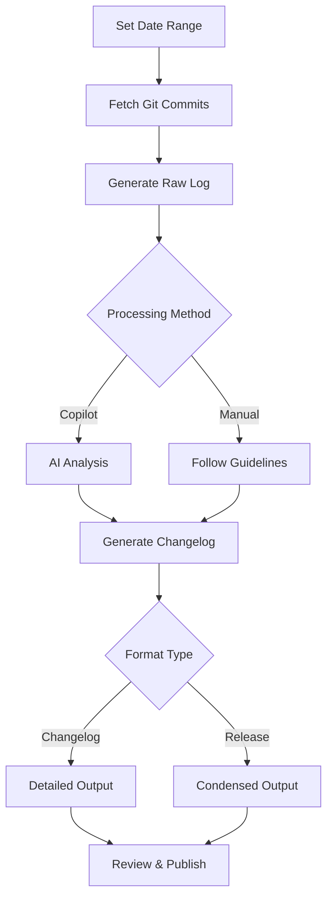

# Changelog Generation System - Implementation Summary

## Overview

A comprehensive AI-powered changelog generation system for Logseq that transforms git commit logs into professional, user-facing changelogs and release notes.

## What Was Created

### 1. Copilot Command: `@workspace /new-changelog`

**Location:** `.github/copilot-instructions.md`

**Usage:**

```text
@workspace /new-changelog <start-date> <end-date> [--format=<changelog|release>]
```

**Features:**

- Automatic git log fetching across all branches
- AI-powered commit categorization
- User-facing language generation
- Two output formats: detailed changelog and condensed release notes

**Examples:**

```text
@workspace /new-changelog 2025-01-05 2025-01-15
@workspace /new-changelog 2025-01-01 2025-01-31 --format=release
```

### 2. Shell Script: `generate-changelog-log.sh`

**Location:** `scripts/generate-changelog-log.sh`

**Purpose:** Generate raw git commit logs for changelog processing

**Features:**

- Date range validation
- Branch filtering
- Custom output paths
- Commit counting
- Helpful error messages

**Usage:**

```bash
./scripts/generate-changelog-log.sh 2025-01-05 2025-01-15
./scripts/generate-changelog-log.sh 2025-01-01 2025-01-31 -o release.md
./scripts/generate-changelog-log.sh 2025-01-01 2025-01-31 -b "origin/master"
```

### 3. Changelog Generation Guidelines

**Location:** `.github/prompts/changelog-generation.prompt.md`

**Contents:**

- Complete formatting specifications
- Category definitions (New Feature, Enhancement, Bug Fix, etc.)
- Functional area groupings
- Example changelogs
- Quality guidelines
- Spotlight section criteria

### 4. Workflow Documentation

**Location:** `docs/CHANGELOG_WORKFLOW.md`

**Contents:**

- Complete end-to-end workflow
- Changelog vs release notes comparison
- Best practices
- Troubleshooting guide
- Example scenarios

### 5. Quick Reference Guide

**Location:** `docs/CHANGELOG_QUICK_REFERENCE.md`

**Contents:**

- Command cheat sheet
- Category reference
- Common task examples
- Workflow checklist
- Troubleshooting tips

## How It Works

### Workflow



### Process Steps

1. **Generate Raw Log**
   - Fetch commits from all remote branches
   - Filter by date range
   - Format with commit hash, author, date, message

2. **AI Analysis** (via Copilot)
   - Identify major themes and patterns
   - Categorize commits by type
   - Group by functional area
   - Generate user-facing descriptions

3. **Create Spotlight**
   - Select 2-3 major initiatives
   - Write compelling summaries
   - Focus on user impact

4. **Organize Changes**
   - Primary categories: New Feature, Enhancement, Bug Fix, etc.
   - Secondary grouping: Functional areas
   - Combine related commits

5. **Extract Contributors**
   - Parse commit authors
   - Alphabetically sort
   - Format as list

6. **Generate Output**
   - Format as markdown
   - Include GitHub commit links
   - Add metadata (dates, totals)

## Output Formats

### Changelog (Default)

**Target Audience:** Developers, power users, technical documentation

**Structure:**

```markdown
# Changelog (YYYY-MM-DD to YYYY-MM-DD)

## Spotlight
[2-3 major features with detailed descriptions]

## New Feature
### [Functional Area]
- [Change description] ([commit-hash])

## Enhancement
### [Functional Area]
- [Change description] ([commit-hash])

## Bug Fix
### [Functional Area]
- [Change description] ([commit-hash])

## Performance
- [Change description] ([commit-hash])

## Refactoring
- [Change description] ([commit-hash])

## Chore
- [Change description] ([commit-hash])

## Contributors
@user1, @user2, @user3
```

### Release Notes

**Target Audience:** End users, stakeholders, marketing

**Structure:**

```markdown
# Release Notes (YYYY-MM-DD to YYYY-MM-DD)

## Spotlight
[2-3 major features with compelling descriptions]

## What's New
- [High-level user-facing feature]
- [High-level user-facing feature]

## Improvements
- [User-visible enhancement]
- [User-visible enhancement]

## Bug Fixes
- [Notable user-facing fix]
- [Notable user-facing fix]

## Contributors
@user1, @user2, @user3
```

## Categories

### Primary Categories

1. **New Feature** - New capabilities added to the product
2. **Enhancement** - Improvements to existing features
3. **Bug Fix** - Corrections to existing functionality
4. **Performance** - Speed and efficiency improvements
5. **Refactoring** - Code structure improvements (usually internal)
6. **Chore** - Maintenance tasks (dependencies, CI/CD, etc.)

### Functional Areas

- Block editing and management
- Graph visualization
- Search and queries
- Plugin system
- Database operations
- UI/UX improvements
- File handling
- Sync and storage
- Mobile support
- Developer tools
- Real-time collaboration (RTC)
- Whiteboards
- PDF annotations
- Settings and configuration

## Key Features

### AI-Powered Analysis

- Automatic categorization of commits
- Pattern recognition for related changes
- User-facing language generation
- Intelligent commit grouping

### Flexible Output

- Two distinct formats for different audiences
- Customizable date ranges
- Branch filtering
- Custom output paths

### Quality Standards

- Consistent formatting
- GitHub commit links
- Alphabetically sorted contributors
- Clear, concise language
- User benefit focus

### Developer-Friendly

- Simple command-line interface
- Helpful error messages
- Validation of inputs
- Progress indicators
- Comprehensive documentation

## Usage Examples

### Monthly Release

```bash
# Generate raw log
cd ~/Projects/src/github.com/logseq
./scripts/generate-changelog-log.sh 2025-01-01 2025-01-31

# Create release notes (in VS Code)
@workspace /new-changelog 2025-01-01 2025-01-31 --format=release

# Create detailed changelog
@workspace /new-changelog 2025-01-01 2025-01-31
```

### Hotfix Release

```bash
# Generate log for hotfix branch
./scripts/generate-changelog-log.sh 2025-01-15 2025-01-16 -b "origin/hotfix"

# Create changelog
@workspace /new-changelog 2025-01-15 2025-01-16
```

### Feature Preview

```bash
# Generate log for feature branch
./scripts/generate-changelog-log.sh 2025-01-01 2025-01-31 -b "origin/feature/semantic-search"

# Create changelog
@workspace /new-changelog 2025-01-01 2025-01-31
```

## File Structure

```text
logseq/
├── .github/
│   └── copilot-instructions.md      # Defines @workspace /new-changelog command
├── docs/
│   ├── CHANGELOG_WORKFLOW.md        # Complete workflow documentation
│   └── CHANGELOG_QUICK_REFERENCE.md # Quick command reference
├── prompts/
│   └── changelog-generation.md      # AI processing guidelines
└── scripts/
    └── generate-changelog-log.sh    # Raw log generation script
```

## Integration Points

### GitHub Copilot

The system integrates with GitHub Copilot through the `@workspace /new-changelog` command, providing:

- Automatic context gathering from git history
- AI-powered analysis and categorization
- Natural language generation
- Consistent formatting

### Shell Environment

The script can be called from:

- Command line: `./scripts/generate-changelog-log.sh`
- Shell functions: Deprecated `New-LogseqChangeLog` now points to new system
- CI/CD pipelines: Can be automated for releases

### Git Workflow

Works with standard git operations:

- `git fetch --all` - Update remote tracking
- `git log` - Extract commit history
- `git branch -r` - List remote branches

## Best Practices

### Writing Commits

```bash
# Good - Clear, categorized, descriptive
feat(blocks): Add custom properties panel support
fix(mobile): Resolve touch target sizing on iOS
perf(db): Optimize query execution for large graphs

# Bad - Vague, no context
updated stuff
fixes
WIP
```

### Selecting Spotlight Items

Choose features that:

- ✓ Significantly impact user experience
- ✓ Represent major development effort
- ✓ Introduce new capabilities
- ✓ Solve long-standing issues
- ✗ Are minor bug fixes
- ✗ Are internal refactorings
- ✗ Are dependency updates

### Review Checklist

Before publishing:

- [ ] All commit hashes link correctly to GitHub
- [ ] Categories are accurate
- [ ] User-facing language is clear
- [ ] No duplicate entries
- [ ] Contributors list is complete
- [ ] Spotlight highlights the most important changes
- [ ] Technical jargon is minimized
- [ ] Benefits are clear to users

## Future Enhancements

Potential improvements:

1. **Automated PR Linking** - Extract and link to GitHub PRs
2. **Issue Tracking** - Link to resolved issues
3. **Metrics** - Add statistics (lines changed, files modified)
4. **Themes** - Detect recurring themes across commits
5. **Breaking Changes** - Highlight breaking changes section
6. **Migration Guides** - Auto-generate for major changes
7. **Multi-Language** - Generate changelogs in multiple languages
8. **Integration** - Direct publishing to GitHub Releases, blog, etc.

## Maintenance

### Updating Guidelines

When updating changelog standards:

1. Edit `.github/prompts/changelog-generation.prompt.md`
2. Update examples in documentation
3. Regenerate past changelogs to verify
4. Update quick reference if needed

### Adding Categories

To add new categories:

1. Update `.github/prompts/changelog-generation.prompt.md`
2. Add to `CHANGELOG_QUICK_REFERENCE.md`
3. Update Copilot instructions if needed
4. Document with examples

### Script Improvements

When modifying the shell script:

1. Update help text (`--help` flag)
2. Test with various date ranges
3. Verify error handling
4. Update documentation
5. Test on different shells (bash, zsh)

## Migration from Old Function

The old `New-LogseqChangeLog` bash function has been deprecated in favor of this new system. The function now displays a deprecation notice and guides users to the new workflow.

**Old workflow:**

```bash
New-LogseqChangeLog 2025-01-05 2025-01-15
# (Manual LLM processing required)
```

**New workflow:**

```bash
./scripts/generate-changelog-log.sh 2025-01-05 2025-01-15
@workspace /new-changelog 2025-01-05 2025-01-15
```

**Improvements:**

- Better error handling
- More flexible options
- Integrated AI processing
- Two output formats
- Comprehensive documentation
- Validation and progress indicators

## Support and Documentation

- **Full Workflow:** `docs/CHANGELOG_WORKFLOW.md`
- **Quick Reference:** `docs/CHANGELOG_QUICK_REFERENCE.md`
- **Generation Guidelines:** `.github/prompts/changelog-generation.prompt.md`
- **Copilot Commands:** `.github/copilot-instructions.md`

## Summary

This system provides a complete, AI-powered solution for generating professional changelogs from git history. It combines automated git log extraction with intelligent AI analysis to produce user-facing documentation that clearly communicates the value and impact of each release.

The dual-format approach (changelog vs. release notes) ensures appropriate communication for different audiences, while the comprehensive documentation makes it easy for anyone on the team to generate high-quality changelogs consistently.
