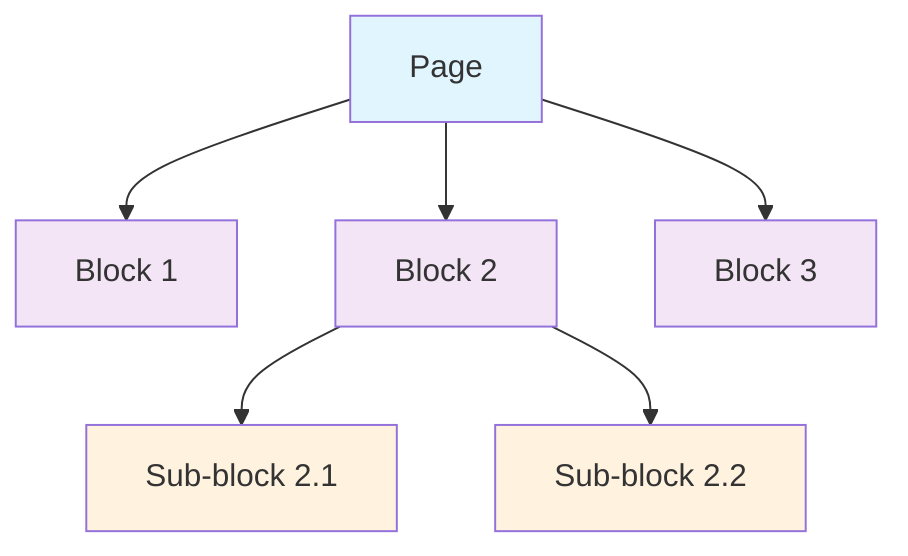
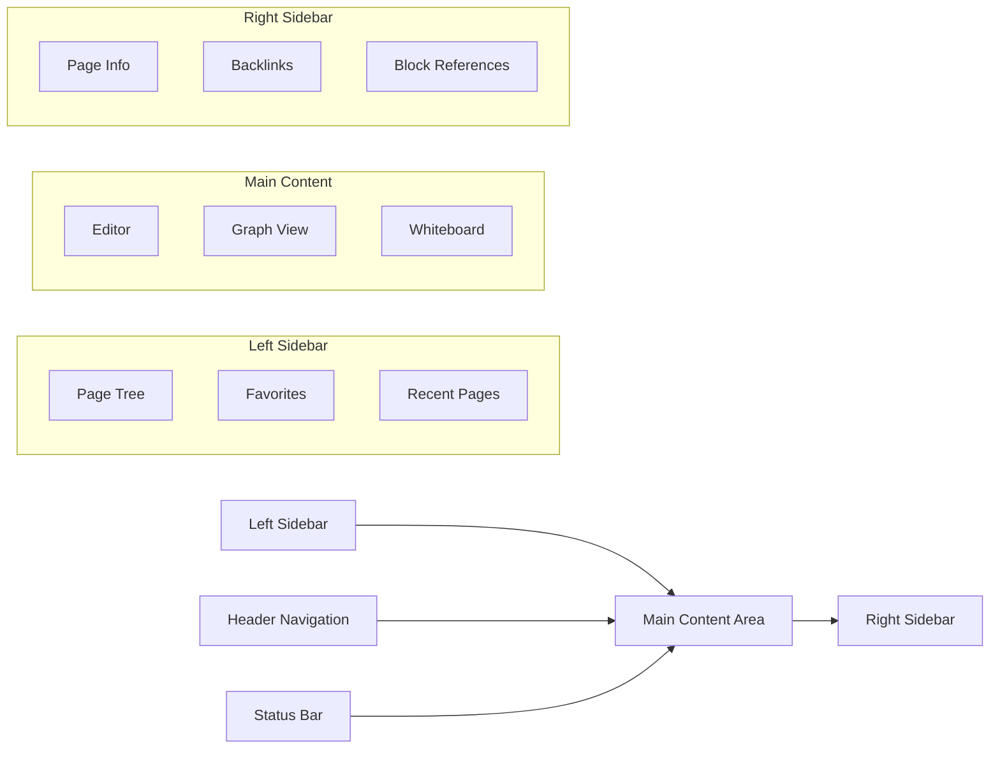

# Application Overview

## What is Logseq?

Logseq is a **knowledge management and collaboration platform** designed to help users capture, organize, and connect their thoughts and information in a meaningful way. Unlike traditional note-taking applications, Logseq treats knowledge as an interconnected graph where every piece of information can link to and reference other pieces, creating a rich web of understanding.

## Core Philosophy

### Privacy-First Approach
Logseq is built on the principle that users should own and control their data. The application operates primarily on local storage, with optional cloud synchronization features that users can choose to enable.

### Open Source Foundation
As an open-source project, Logseq ensures transparency, community contribution, and freedom from vendor lock-in. Users and developers can examine, modify, and extend the codebase.

### User Agency
The platform emphasizes user control over both data and functionality, providing extensive customization options and plugin capabilities.

## Primary Use Cases

### Personal Knowledge Management (PKM)
- **Research Notes**: Organize academic research, literature reviews, and citations
- **Learning Journals**: Track learning progress and connect new concepts
- **Project Documentation**: Maintain project notes with interconnected references
- **Daily Journals**: Capture thoughts, meetings, and daily reflections

### Team Collaboration
- **Shared Knowledge Bases**: Collaborative documentation and knowledge sharing
- **Research Teams**: Shared research findings and cross-references
- **Educational Settings**: Collaborative learning and knowledge building

### Content Creation
- **Writing Projects**: Organize research, outlines, and drafts
- **Publishing Workflows**: Manage content from ideation to publication
- **Documentation**: Technical documentation with rich cross-references

## Key Differentiators

### Block-Based Structure
Unlike page-based systems, Logseq organizes content in **blocks** - discrete units of information that can be referenced, linked, and reorganized independently.



### Bi-directional Linking
Every reference creates a two-way connection, allowing users to discover related content through backlinks and graph traversal.

### Graph Database Foundation
Built on **DataScript**, a Datalog-based database that naturally represents relationships and enables powerful querying capabilities.

### Multi-Modal Content Support
- **Text**: Markdown and Org-mode formats
- **Visual**: Whiteboard canvas for spatial thinking
- **Media**: Images, PDFs, videos, and audio
- **Interactive**: Embeds, widgets, and plugin-generated content

## Application Modes

### File-Based Graphs (Traditional Mode)
- Storage in local file system using Markdown/Org files
- Git-friendly for version control
- Direct file access and manipulation
- Backwards compatible with existing note systems

### Database Graphs (Modern Mode)
- SQLite-based local database storage
- Enhanced performance for large knowledge bases
- Advanced querying and relationship management
- Real-time collaboration capabilities (RTC)

## User Interface Overview

### Main Components



### Navigation Paradigms
- **Journal-First**: Daily pages as entry points
- **Graph Navigation**: Visual exploration of connections
- **Search-Driven**: Global search and command palette
- **Hierarchical**: Traditional folder/page organization

## Content Organization

### Pages and Blocks
- **Pages**: Top-level containers for related content
- **Blocks**: Individual pieces of content within pages
- **References**: Links between any blocks or pages
- **Tags**: Categorical organization across content

### Linking System
- `[[Page Name]]` - Page references
- `((block-id))` - Block references  
- `#tag` - Tags for categorization
- `#[[Multi-word Tag]]` - Complex tags

### Query System
Built-in query language for dynamic content aggregation:
```clojure
{{query (and (property type "meeting") (between -7d +7d))}}
```

## Platform Availability

### Desktop Applications
- **Windows**: Native Electron app
- **macOS**: Native Electron app  
- **Linux**: Native Electron app

### Web Platform
- **Browser Access**: Full functionality in modern browsers
- **Progressive Web App**: Offline capabilities

### Mobile Applications
- **iOS**: Native mobile app (DB version)
- **Android**: Native mobile app (in development)

## Integration Ecosystem

### Built-in Integrations
- **Zotero**: Academic reference management
- **PDF Annotation**: Direct PDF markup and highlighting
- **Image Handling**: OCR and annotation capabilities
- **Video/Audio**: Media playback and annotation

### Plugin Architecture
Extensive plugin system enabling:
- Custom UI components
- External service integrations
- Workflow automation
- Data import/export
- Advanced formatting and visualization

## Data Formats and Standards

### Supported Formats
- **Markdown**: Industry-standard text formatting
- **Org-mode**: Emacs-based structured text format
- **JSON**: Export and API format
- **EDN**: Clojure data notation for advanced features

### Export Capabilities
- Static site generation
- PDF export
- Standard formats for data portability
- Custom export through plugins

## Performance Characteristics

### Local Performance
- **Instant Search**: Sub-100ms search across large graphs
- **Real-time Updates**: Immediate reflection of changes
- **Memory Efficiency**: Optimized for large knowledge bases

### Scalability
- **Large Graphs**: Tested with 100,000+ blocks
- **Concurrent Users**: Multi-user collaboration support
- **Cross-Device Sync**: Efficient incremental synchronization

---

*This overview establishes the foundational understanding of Logseq's purpose, capabilities, and position in the knowledge management landscape.*
