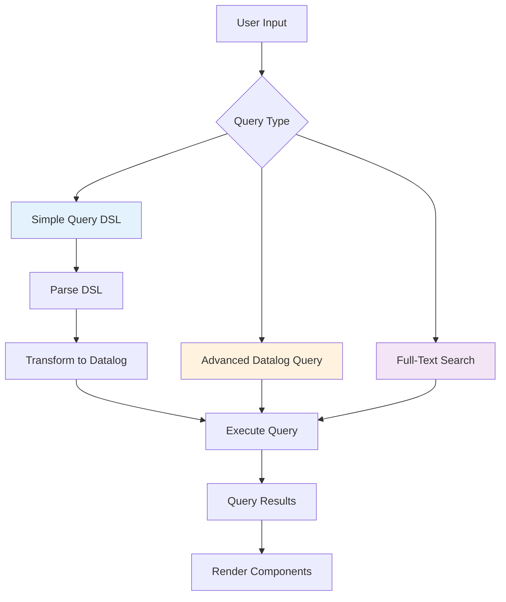
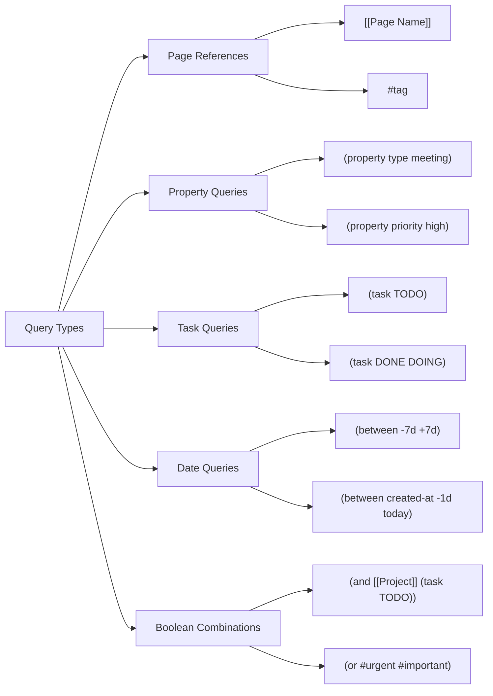
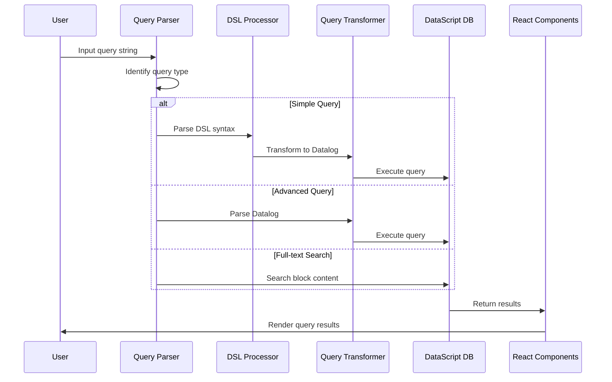
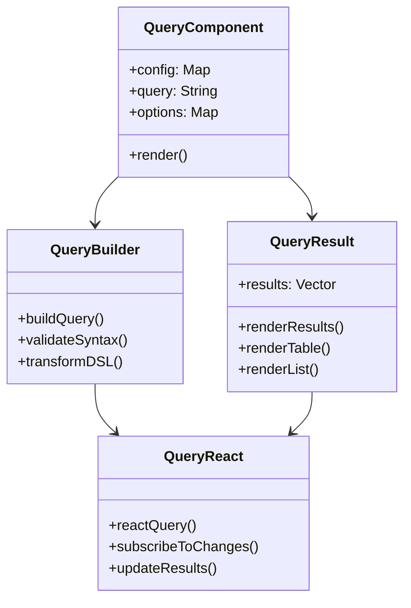

# Query System

## Overview

Logseq's query system is a powerful and flexible mechanism for retrieving and displaying information from your knowledge graph. It supports multiple query types, from simple text-based searches to complex Datalog queries, enabling users to create dynamic views of their data that update automatically as content changes.

## Query Types

### Simple Queries (DSL Queries)

Simple queries use Logseq's Domain-Specific Language (DSL) to provide an intuitive way to search and filter content without requiring knowledge of Datalog syntax.



### Advanced Queries (Datalog)

Advanced queries provide direct access to Logseq's underlying DataScript database using Datalog query syntax, offering maximum flexibility and power.

### Full-Text Search

Full-text search queries enable finding content by searching through block text content.

## Simple Query Syntax

### Basic Syntax Elements

**Page References**:
```
[[Page Name]]     # Find blocks referencing this page
#tag              # Find blocks with this tag
```

**Text Search**:
```
"search term"     # Full-text search
```

**Properties**:
```
(property key value)         # Blocks with specific property
(property key)               # Blocks with property key (any value)
```

**Tasks**:
```
(task TODO)                  # Tasks with TODO status
(task DONE DOING)           # Multiple task statuses
```

**Time-based Filters**:
```
(between -7d +7d)           # Date range (last 7 days to next 7 days)
(between created-at -1d today)  # Creation date range
(between updated-at -1w now)    # Update date range
```

### Boolean Operators

**AND Operations**:
```
(and [[Project]] (task TODO))           # Blocks referencing Project AND having TODO tasks
(and #meeting (between -7d +7d))        # Meeting blocks from past week
```

**OR Operations**:
```
(or [[Page 1]] [[Page 2]])             # Blocks referencing either page
(or (task TODO) (task DOING))          # Tasks that are TODO or DOING
```

**NOT Operations**:
```
(not (task DONE))                      # Exclude completed tasks
(and [[Project]] (not #cancelled))     # Project blocks excluding cancelled ones
```

### Query Examples



**Basic Examples**:
```clojure
;; Find all blocks tagged with "meeting"
#meeting

;; Find blocks referencing "Project Alpha"
[[Project Alpha]]

;; Find all TODO tasks
(task TODO)

;; Find blocks with "priority" property set to "high"
(property priority high)

;; Full-text search for "machine learning"
"machine learning"
```

**Complex Examples**:
```clojure
;; Project tasks due this week
(and [[Project Alpha]] (task TODO DOING) (between -7d +7d))

;; Meeting notes with follow-up actions
(and #meeting (or (task TODO) (property follow-up true)))

;; Recent high-priority items
(and (property priority high) (between created-at -3d today))

;; Research blocks excluding completed items
(and #research (not (task DONE)) (not #archived))
```

## Advanced Query Syntax (Datalog)

### Datalog Query Structure

Advanced queries use DataScript's Datalog syntax, providing direct access to the graph database:

```clojure
;; Basic query structure
[:find ?variable
 :in $ %                    ; Database and rules
 :where
 [?variable :attribute value]]
```

### Common Query Patterns

**Find Blocks by Content**:
```clojure
[:find ?block
 :where
 [?block :block/content ?content]
 [(clojure.string/includes? ?content "keyword")]]
```

**Find Pages with Specific Properties**:
```clojure
[:find ?page-name
 :where
 [?page :page/name ?page-name]
 [?page :page/properties ?props]
 [(get ?props "type") ?type]
 [(= ?type "project")]]
```

**Find Connected Blocks**:
```clojure
[:find ?related-block
 :in $ ?current-block
 :where
 [?current-block :block/refs ?shared-ref]
 [?related-block :block/refs ?shared-ref]
 [(not= ?current-block ?related-block)]]
```

**Hierarchical Queries**:
```clojure
[:find ?child
 :in $ ?parent
 :where
 [?child :block/parent ?parent]]
```

## Query Implementation Architecture

### Query Processing Pipeline



### Query Processing Components

**Query DSL Parser** (`frontend.db.query-dsl`):
```clojure
(defn parse-query
  ([q] (parse-query q {}))
  ([q options]
   (let [q' (template/resolve-dynamic-template! q)]
     (parse q' (merge {:db-graph? (config/db-based-graph? (state/get-current-repo))} options)))))

(defn pre-transform-query
  [q]
  (let [q' (template/resolve-dynamic-template! q)]
    (pre-transform q')))
```

**Query Transformation**:
```clojure
;; Transform simple query to Datalog
(defn query-wrapper
  [where {:keys [blocks? block-attrs]}]
  (let [block-attrs (or block-attrs (butlast file-model/file-graph-block-attrs))
        q (if blocks?
            `[:find (~'pull ~'?b ~block-attrs)
              :in ~'$ ~'%
              :where]
            '[:find (pull ?p [*])
              :in $ %
              :where])]
    (if (coll? (first where))
      (apply conj q where)
      (conj q where))))
```

### Query Execution

**Reactive Query System**:
```clojure
(defn query
  "Runs a dsl query with query as a string. Primary use is from '/query' or '{{query }}'"
  ([repo query-string]
   (query repo query-string {}))
  ([repo query-string query-opts]
   (when (and (string? query-string) (not= "\"\"" query-string))
     (let [db-graph? (config/db-based-graph? repo)
           {query* :query :keys [rules sort-by blocks? sample]} (parse-query query-string {:cards? (:cards? query-opts)})
           blocks? (if db-graph? true blocks?)]
       (when-let [query' (some-> query* (query-wrapper {:blocks? blocks?
                                                        :block-attrs (when db-graph? db-block-attrs)}))]
         (last (query-react/react-query repo
                                        {:query query'
                                         :query-string query-string
                                         :rules rules}
                                        query-opts)))))))
```

## Query Components and UI

### Query Block Component

Queries can be embedded in blocks using different syntaxes:

**Legacy Macro Syntax** (File-based graphs):
```
{{query (and [[Project]] (task TODO))}}
```

**Modern Slash Command** (DB-based graphs):
```
/Query
```

### Query Component Architecture



### Query Result Rendering

**Table View**:
```clojure
(defn query-table
  [config {:keys [result table?] :as opts}]
  (when (and table? (seq result))
    [:div.overflow-auto
     [:table.table-auto
      [:thead
       [:tr
        [:th "Block"]
        [:th "Page"]
        [:th "Created"]]]
      [:tbody
       (for [block result]
         [:tr
          [:td (block-content block)]
          [:td (page-link block)]
          [:td (format-date (:block/created-at block))]])]]]))
```

**List View**:
```clojure
(defn query-list
  [config {:keys [result] :as opts}]
  [:div.query-results
   (for [item result]
     (if (:block/uuid item)
       (block-component config item)
       (page-component config item)))])
```

## Query Features and Options

### Sorting and Filtering

**Sort Options**:
```clojure
;; Sort by creation date (ascending)
(sort-by created-at asc)

;; Sort by update date (descending)  
(sort-by updated-at desc)

;; Sort by property value
(sort-by priority desc)
```

**Sampling**:
```clojure
;; Get random sample of 10 results
(sample 10)
```

### Result Transformation

**Group by Page**:
```clojure
(defn get-group-by-page
  [q {:keys [table?]}]
  (and (not table?)
       (or (query-contains-filter? q "page-property")
           (query-contains-filter? q "page-tags"))))
```

**Custom Views**:
```clojure
;; Define custom result rendering
{:query "(and [[Project]] (task TODO))"
 :view :table
 :sort-by :created-at
 :group-by-page? true}
```

## Time-based Queries

### Date Literals

**Absolute Dates**:
```
today
yesterday  
tomorrow
now
```

**Relative Dates**:
```
-7d    # 7 days ago
+3d    # 3 days from now
-2w    # 2 weeks ago
-1m    # 1 month ago
-1y    # 1 year ago
```

**Date Range Examples**:
```clojure
;; Last week's content
(between -7d today)

;; Content created this month
(between created-at -1m today)

;; Future deadlines
(between due-date today +30d)

;; Journal entries from specific period
(and (page-property journal true) (between -14d -7d))
```

### Time Processing Implementation

```clojure
(defn- ->journal-day-int [input]
  (let [input (string/lower-case (name input))]
    (cond
      (= "today" input)
      (date-time-util/date->int (t/today))

      (= "yesterday" input)
      (date-time-util/date->int (t/yesterday))

      (= "tomorrow" input)
      (date-time-util/date->int (t/plus (t/today) (t/days 1)))

      ;; Handle relative dates like "-7d"
      :else
      (let [duration (parse-long (subs input 0 (dec (count input))))
            kind (last input)
            tf (case kind
                 "y" t/years
                 "m" t/months  
                 "w" t/weeks
                 t/days)]
        (date-time-util/date->int (t/plus (t/today) (tf duration)))))))
```

## Property-based Queries

### Block Properties

**Simple Property Queries**:
```clojure
;; Blocks with specific property value
(property type meeting)

;; Blocks with any value for property
(property priority)

;; Private properties (starts with _)
(property _private-note important)
```

**Property Implementation**:
```clojure
(defn- build-property
  [k v]
  (let [k (name k)
        v' (when v (page-ref/get-page-name v))
        v' (or v' v)]
    (if (and v (string/starts-with? k "_"))
      {:query (list 'private-simple-query-property '?b k v')
       :rules [:private-simple-query-property]}
      {:query (list 'simple-query-property '?b k v')
       :rules [:simple-query-property]})))
```

### Page Properties

**Page-level Property Queries**:
```clojure
;; Pages with specific property
(page-property type project)

;; Pages with boolean properties
(page-property completed true)
(page-property active false)

;; Pages with tag properties
(page-tags #urgent)
(page-tags urgent important)
```

## Performance Optimization

### Query Caching

**React Query System**:
```clojure
(defn react-query
  [repo query query-opts]
  (let [query-id (str (hash query))
        cached-result (get-cached-query query-id)]
    (if cached-result
      cached-result
      (let [result (execute-query repo query query-opts)]
        (cache-query query-id result)
        result))))
```

### Index Utilization

**DataScript Indexes**:
- `:avet` - Attribute-Value-Entity-Transaction
- `:aevt` - Attribute-Entity-Value-Transaction
- `:eavt` - Entity-Attribute-Value-Transaction
- `:vaet` - Value-Attribute-Entity-Transaction

**Query Optimization**:
```clojure
;; Optimized: Uses indexes efficiently
[:find ?block
 :where
 [?block :block/content ?content]
 [(clojure.string/includes? ?content "search-term")]]

;; Less optimal: Scans all entities
[:find ?entity
 :where
 [?entity _ _]
 [?entity :some/attribute ?value]]
```

## Query Error Handling

### Error Types

**Syntax Errors**:
```clojure
;; Invalid syntax
(and [[page]] (task))  ; Missing task status

;; Unclosed parentheses
(and [[page]] (task TODO)  ; Missing closing paren
```

**Runtime Errors**:
```clojure
;; Nonexistent property
(property nonexistent-prop value)

;; Invalid date format
(between invalid-date today)
```

### Error Handling Implementation

```clojure
(defn safe-query-execution
  [query-string]
  (try
    (let [parsed-query (parse-query query-string)]
      (execute-query parsed-query))
    (catch js/Error e
      {:error true
       :message (.-message e)
       :query query-string})))
```

## Query Examples by Use Case

### Project Management

```clojure
;; All active project tasks
(and (property project-name "Alpha") (task TODO DOING))

;; Overdue tasks
(and (task TODO) (property due-date) (between due-date -30d today))

;; High priority items this week
(and (property priority high) (between created-at -7d today))

;; Project status overview
(and (page-property type project) (property status))
```

### Research and Learning

```clojure
;; Research papers by topic
(and #paper (property topic "machine-learning"))

;; Literature review items
(and [[Literature Review]] (property status "to-read"))

;; Meeting notes with action items
(and #meeting (or (task TODO) (property action-item true)))

;; Recent discoveries
(and #discovery (between created-at -14d today))
```

### Content Organization

```clojure
;; Draft blog posts
(and (property type "blog-post") (property status "draft"))

;; Tagged content for review
(and #review (not (property reviewed true)))

;; Archived content
(and #archived (between updated-at -90d -30d))

;; Linked references to specific topics
(and [[Artificial Intelligence]] (not (page [[AI]])))
```

## Query Performance Best Practices

### Efficient Query Design

**1. Use Specific Filters Early**:
```clojure
;; Good: Filter by specific property first
(and (property type meeting) (between -7d today))

;; Less efficient: Broad date range first
(and (between -30d today) (property type meeting))
```

**2. Leverage Indexes**:
```clojure
;; Good: Uses block content index
[:find ?block
 :where
 [?block :block/content ?content]
 [(clojure.string/includes? ?content "keyword")]]

;; Good: Uses page name index
[:find ?page
 :where
 [?page :page/name "Page Name"]]
```

**3. Limit Result Sets**:
```clojure
;; Use sampling for large result sets
(and #large-category (sample 50))

;; Use specific time ranges
(between -7d today)  ; Better than (between -365d today)
```

### Memory Management

**Query Result Caching**:
- Results cached by query hash
- Automatic cache invalidation on data changes
- LRU eviction for memory management

**Reactive Updates**:
- Subscribe only to relevant data changes
- Batch updates for performance
- Debounce frequent query re-execution

## Recent Updates and New Features

### Enhanced Property System
- **Database Graphs**: Built-in properties with `:private-property`
- **Type Safety**: Qualified keyword properties in DB graphs
- **Dynamic Discovery**: Visual query builder finds available properties

### Performance Improvements
- **Background Execution**: Slow queries (>50ms) run in background
- **Query Timing**: Performance monitoring and optimization hints
- **Cache System**: Improved reactive caching with LRU eviction

### Visual Query Builder
- **Real-time Preview**: See results while building queries
- **Graph-aware Filters**: Different operators for file vs DB graphs
- **Error Validation**: Real-time syntax checking and suggestions

### Advanced Features
- **SCI Integration**: Custom result transforms with Safe Clojure
- **Rule Optimization**: Better performance for recursive queries
- **Memory Management**: Virtual scrolling and lazy loading

---

*This comprehensive documentation reflects the current state of Logseq's query system, covering both simple DSL queries for everyday use and advanced Datalog queries for power users. The system is designed to scale from simple searches to complex knowledge graph analysis while maintaining excellent performance characteristics.*
