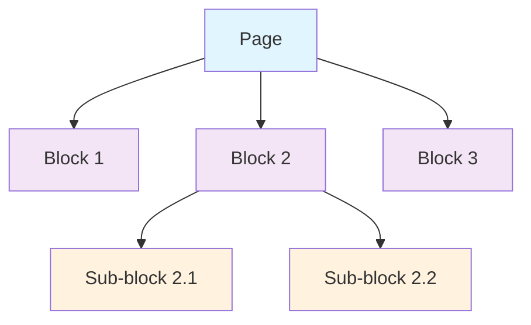
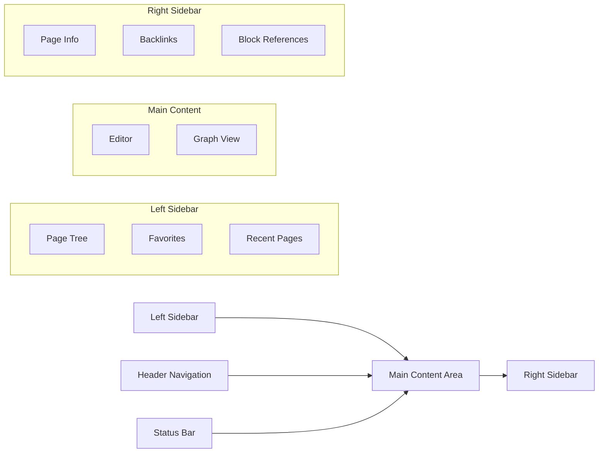

# Application Overview

> **Last revised:** 2026-05-28

## What is Logseq?

Logseq is a **knowledge management and collaboration platform** designed to help users capture, organize, and connect their thoughts and information in a meaningful way. Unlike traditional note-taking applications, Logseq treats knowledge as an interconnected graph where every piece of information can link to and reference other pieces, creating a rich web of understanding.

## Core Philosophy

### Privacy-First Approach

Logseq is built on the principle that users should own and control their data. The application operates primarily on local storage, with optional cloud synchronization features that users can choose to enable.

### Open Source Foundation

As an open-source project, Logseq ensures transparency, community contribution, and freedom from vendor lock-in. Users and developers can examine, modify, and extend the codebase.

### User Agency

The platform emphasizes user control over both data and functionality, providing extensive customization options and plugin capabilities.

## Primary Use Cases

### Personal Knowledge Management (PKM)

- **Research Notes**: Organize academic research, literature reviews, and citations
- **Learning Journals**: Track learning progress and connect new concepts
- **Project Documentation**: Maintain project notes with interconnected references
- **Daily Journals**: Capture thoughts, meetings, and daily reflections

### Team Collaboration

- **Shared Knowledge Bases**: Collaborative documentation and knowledge sharing
- **Research Teams**: Shared research findings and cross-references
- **Educational Settings**: Collaborative learning and knowledge building

### Content Creation

- **Writing Projects**: Organize research, outlines, and drafts
- **Publishing Workflows**: Manage content from ideation to publication
- **Documentation**: Technical documentation with rich cross-references

## Key Differentiators

### Block-Based Structure

Unlike page-based systems, Logseq organizes content in **blocks** - discrete units of information that can be referenced, linked, and reorganized independently.



### Bi-directional Linking

Every reference creates a two-way connection, allowing users to discover related content through backlinks and graph traversal.

### Graph Database Foundation

Built on **DataScript**, a Datalog-based database that naturally represents relationships and enables powerful querying capabilities.

### Multi-Modal Content Support

- **Text**: Markdown and Org-mode formats
- **Media**: Images, PDFs, videos, and audio
- **Interactive**: Embeds, widgets, and plugin-generated content

> **Removed:** Whiteboard canvas (spatial thinking / tldraw integration) has been removed from the application. The `@tldraw/tldraw` package is no longer a dependency. Residual schema attributes (`:logseq.class/Whiteboard`, `:logseq.property.tldraw/page`) remain solely for data-migration compatibility.

## Application Modes

### File-Based Graphs (Traditional Mode)

- Storage in local file system using Markdown/Org files
- Git-friendly for version control
- Direct file access and manipulation
- Backwards compatible with existing note systems

### Database Graphs (Modern Mode)

- SQLite-based local database storage
- Enhanced performance for large knowledge bases
- Advanced querying and relationship management
- Real-time collaboration capabilities (RTC)

## User Interface Overview

### Main Components



> **Removed:** Whiteboard has been removed from the Main Content area.

### Navigation Paradigms

- **Journal-First**: Daily pages as entry points
- **Graph Navigation**: Visual exploration of connections
- **Search-Driven**: Global search and command palette
- **Hierarchical**: Traditional folder/page organization

## Content Organization

### Pages and Blocks

- **Pages**: Top-level containers for related content
- **Blocks**: Individual pieces of content within pages
- **References**: Links between any blocks or pages
- **Tags**: Categorical organization across content

### Linking System

- `[[Page Name]]` - Page references
- `[[<uuid>]]` - Node (block or page) references
- `#tag` - Tags for categorization
- `#[[Multi-word Tag]]` - Complex tags

### Query System

Built-in query language for dynamic content aggregation:

```clojure
{{query (and (property type "meeting") (between -7d +7d))}}
```

## Platform Availability

### Desktop Applications

- **Windows**: Native Electron app
- **macOS**: Native Electron app
- **Linux**: Native Electron app

### Web Platform

- **Browser Access**: Full functionality in modern browsers
- **Web App**: `resources/index.html` sets mobile-web-app-capable meta tags for home-screen installation; no service worker or PWA manifest (`manifest.json`) is present in the repository, so offline capabilities are not formally implemented.

### Mobile Applications

- **iOS**: Capacitor-based mobile app (DB graphs)
- **Android**: Capacitor-based mobile app (DB graphs)

## Integration Ecosystem

### Built-in Integrations

- **Zotero**: Academic reference management (`src/main/frontend/extensions/zotero.cljs`)
- **PDF Annotation**: Direct PDF markup and highlighting (`src/main/frontend/extensions/pdf/`)
- **Image Handling**: Resizable image embeds; no native OCR support (use an external OCR tool to create a searchable PDF first)
- **Video**: Embedded playback for local files, YouTube, Vimeo, and Bilibili via `{{video <url>}}` macro
- **Audio** (mobile): Playback and on-device transcription of voice recordings (`transcribeAudio2Text`)

> **Removed:** OCR for images is not implemented in the codebase. The PDF investigation doc (`dz/docs/07-investigations/pdf-feature-platform-compatibility-investigation.md`) explicitly confirms "No OCR Support".

### Plugin Architecture

Extensive plugin system enabling:

- Custom UI components
- External service integrations
- Workflow automation
- Data import/export
- Advanced formatting and visualization

## Data Formats and Standards

### Supported Formats

- **Markdown**: Industry-standard text formatting
- **Org-mode**: Emacs-based structured text format
- **JSON**: Export and API format
- **EDN**: Clojure data notation for advanced features

### Export Capabilities

- **Static site generation** – via `deps/publishing` (CLI/Electron HTML export)
- **Cloud publishing** – per-page publish to logseq.io via `deps/publish` (Cloudflare Worker + Durable Object)
- **Markdown** – full graph export (desktop/web, not native mobile)
- **SQLite DB / ZIP / EDN** – graph-level binary and structured data exports
- **HTML** – public-pages export (Electron only)
- **OPML** – per-block/page outline export
- **Custom export through plugins**

> **Removed:** PDF is not an export format. There is no "Export to PDF" functionality in the codebase. PDF files can be _viewed and annotated_ inside Logseq, but not generated as output.

## Performance Characteristics

### Local Performance

- **Instant Search**: Sub-100ms search across large graphs
- **Real-time Updates**: Immediate reflection of changes
- **Memory Efficiency**: Optimized for large knowledge bases

### Scalability

- **Large Graphs**: Tested with 100,000+ blocks
- **Concurrent Users**: Multi-user collaboration support
- **Cross-Device Sync**: Efficient incremental synchronization

---

## Findings: New Capabilities

The following capabilities exist in the codebase but were not present in the previous revision of this document.

### Logseq CLI

Logseq ships a full-featured command-line interface (`logseq`) with commands grouped into four areas:

| Group                | Commands                                              |
| -------------------- | ----------------------------------------------------- |
| Graph Inspect & Edit | `list`, `upsert`, `remove`, `query`, `search`, `show` |
| Graph Management     | `graph`, `server`, `doctor`, `sync`                   |
| Authentication       | `login`, `logout`                                     |
| Utilities            | `agent`, `completion`, `debug`, `example`, `skill`    |

Source: `src/main/logseq/cli/command/core.cljs`

### AgentBridge (`logseq agent bridge`)

The `logseq agent bridge` command runs a long-lived process that monitors a graph for tasks or comment mentions addressed to a named AI agent, generates a prompt from a configurable template, dispatches the task to an LLM (Codex), and writes the result back as blocks or comments. An "AgentBridge master" session can act as a routing layer across multiple named agents within a graph.

Source: `src/main/logseq/cli/command/agent.cljs`

### Cloud Publishing

In addition to the existing static-site export (`deps/publishing`), a new cloud publishing path exists via `deps/publish`. Individual pages can be published to logseq.io using a Cloudflare Worker + Durable Object backend that stores transit blobs in R2 and metadata in SQLite. Published URLs are tracked in the `:logseq.property.publish/published-url` property.

Source: `src/main/frontend/handler/publish.cljs`, `deps/publish/`

### Audio Transcription (Mobile)

The mobile recorder (`src/main/mobile/components/recorder.cljs`) calls `transcribeAudio2Text` on-device after a voice recording completes, automatically inserting the transcript as block content alongside the audio asset.

---

_This overview establishes the foundational understanding of Logseq's purpose, capabilities, and position in the knowledge management landscape._
