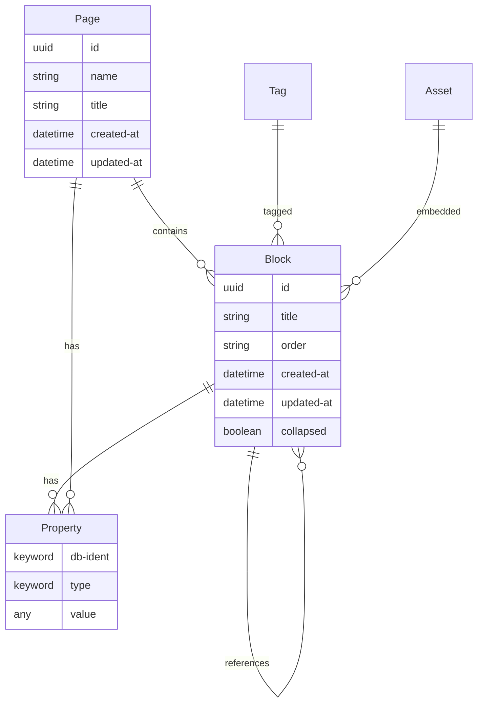
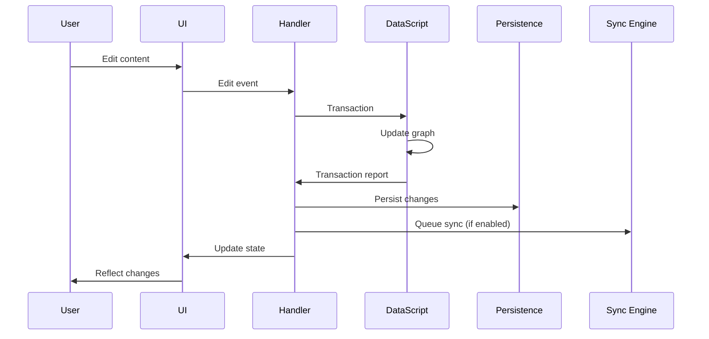
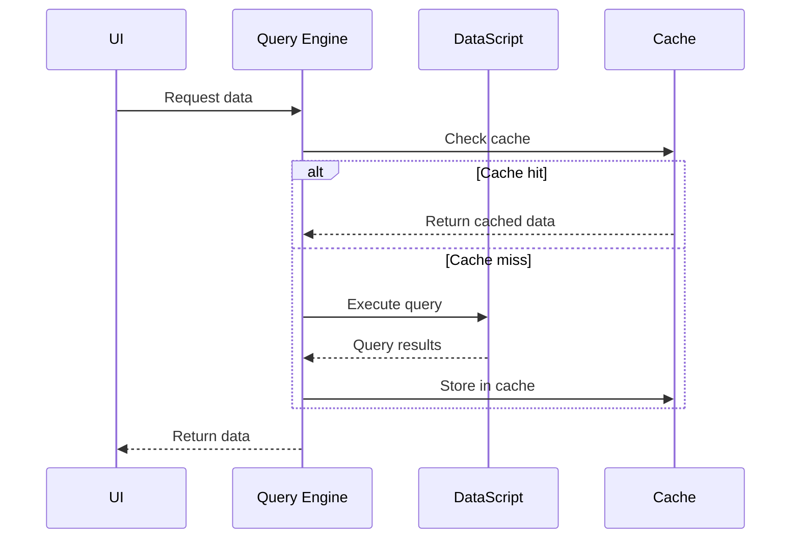
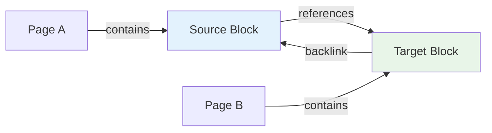
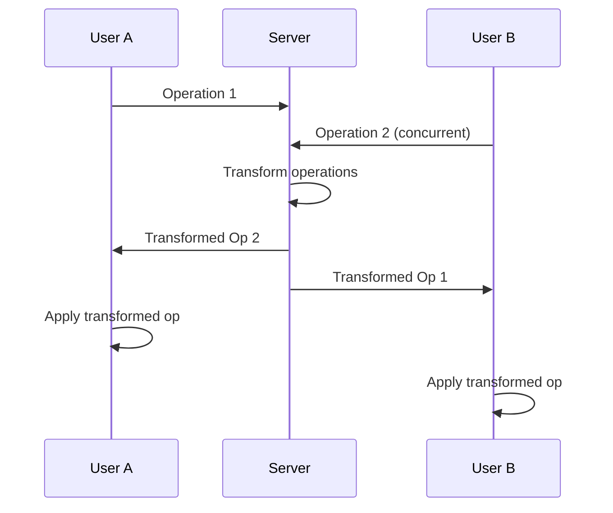

# Data Architecture

> **Last revised:** 2026-05-28

## Overview

Logseq's data architecture is built around a **graph-based data model** that treats all information as interconnected entities in a knowledge graph. The system supports both traditional file-based storage and modern database-driven approaches, providing flexibility for different user needs and use cases.

## Data Model Fundamentals

### Graph Database Approach

Logseq uses **DataScript**, an immutable in-memory database that implements the Datalog query language. This choice enables natural representation of knowledge relationships and powerful querying capabilities.

**Core Principle**: Everything is an entity with attributes and relationships.



### Entity-Attribute-Value (EAV) Model

DataScript stores data in an EAV triple format, providing flexibility and query power:

```clojure
;; Example EAV triples
[block-id :block/title "This is content"]
[block-id :block/page page-id]
[block-id :block/refs [ref-id-1 ref-id-2]]
[page-id :block/name "my page"]
[page-id :block/created-at #inst "2024-01-01"]
```

## Schema Definition

### Core Schema

**Block Entity**:

```clojure
{:block/uuid        {:db/unique :db.unique/identity}
 :block/title       {:db/index true}   ; block/page content text (NOT :block/content)
 :block/page        {:db/valueType :db.type/ref
                     :db/index true}
 :block/parent      {:db/valueType :db.type/ref
                     :db/index true}
 :block/refs        {:db/valueType :db.type/ref
                     :db/cardinality :db.cardinality/many}
 :block/order       {:db/index true}   ; fractional index string, not integer
 :block/collapsed?  {}                 ; note: :block/collapsed? with question mark
 :block/created-at  {:db/index true}
 :block/updated-at  {:db/index true}}
```

**Page Entity** (pages are blocks with `:block/name`):

```clojure
{:block/name        {:db/index true}   ; lowercase page name (not :db.unique/identity)
 :block/title       {:db/index true}   ; display title (original name)
 :block/journal-day {:db/index true}   ; for journal pages
 :block/tags        {:db/valueType :db.type/ref
                     :db/cardinality :db.cardinality/many}
 :block/alias       {:db/valueType :db.type/ref
                     :db/cardinality :db.cardinality/many
                     :db/index true}}
```

> **Removed:** `:block/namespace` — namespace hierarchy is not stored as a separate attribute. Pages use hierarchical naming conventions; no `:block/namespace` ref attribute exists in the schema.

### Property System

In DB graphs, properties are first-class entities identified by a `:db/ident` keyword and stored under namespaced attributes (`:logseq.property/*`). They are not ad-hoc key-value pairs.

**Built-in Property Attributes**:

```clojure
;; Properties are entities with namespaced idents
;; :block/title holds the display name
;; :logseq.property/type holds the type keyword

;; Example: a built-in "type" property entity
{:db/ident          :logseq.property/type
 :block/title       "Property type"
 :logseq.property/type :keyword}

;; Example: a user property for "priority"
{:db/ident          :user.property/priority
 :block/title       "Priority"
 :logseq.property/type :keyword}   ; :string, :number, :date, :checkbox, :url, :node, etc.

;; Example: a user property for "due-date"
{:db/ident          :user.property/due-date
 :block/title       "Due date"
 :logseq.property/type :date}
```

## Storage Architectures

### File-Based Storage (Traditional)

**Directory Structure**:

```txt
graph-directory/
├── pages/
│   ├── contents.md
│   ├── project-notes.md
│   └── meetings/
│       ├── 2024-01-15.md
│       └── 2024-01-16.md
├── journals/
│   ├── 2024_01_15.md
│   ├── 2024_01_16.md
│   └── 2024_01_17.md
├── assets/
│   ├── images/
│   └── documents/
├── logseq/
│   ├── config.edn
│   └── metadata.edn
└── .gitignore
```

**File Format (Markdown)**:

```markdown
---
title: Project Notes
tags: project, planning
created-at: 2024-01-15
---

# Project Overview

- [[Requirements]] gathering phase
- Implementation timeline: [[2024-01-20]]
  - Database design
  - API development
  - Frontend implementation

## References

- ((block-uuid-reference))
- [External Link](https://example.com)
```

### Database Storage (Modern)

**SQLite Backend**:

Logseq's SQLite storage uses an address-content model with Transit serialization for DataScript persistence, not a traditional relational schema. The key table stores serialized DataScript segments:

```sql
-- Actual storage model (address-based for DataScript persistence)
-- kvs table: stores Transit-serialized DataScript data
CREATE TABLE IF NOT EXISTS kvs (
    addr INTEGER PRIMARY KEY,
    content TEXT,    -- Transit-serialized DataScript data
    addresses JSON   -- JSON array of referenced addresses
);

-- Separate SQLite databases per graph:
-- Main DB: DataScript graph data
-- Search DB: FTS5 full-text search index
-- Client-ops DB: RTC operation log
```

## Data Flow Architecture

### Write Operations



### Read Operations



## Query System

### Datalog Queries

**Basic Queries**:

```clojure
;; Find all blocks containing "TODO"
[:find ?block ?content
 :where
 [?block :block/content ?content]
 [(clojure.string/includes? ?content "TODO")]]

;; Find pages with specific tag
[:find ?page-name
 :where
 [?page :block/name ?page-name]
 [?page :block/tags ?tag]
 [?tag :block/name "project"]]
```

**Advanced Queries**:

```clojure
;; Find related pages through shared references
[:find ?related-page
 :in $ ?current-page
 :where
 [?current-page :block/name ?current-name]
 [?block :block/page ?current-page]
 [?block :block/refs ?ref]
 [?other-block :block/refs ?ref]
 [?other-block :block/page ?related-page]
 [(not= ?current-page ?related-page)]]
```

### Query Performance Optimization

**Indexing Strategy**:

```clojure
;; Indexes used by DataScript (verified in codebase)
:avet  ; Attribute-Value-Entity — used for attribute lookups by value
:aevt  ; Attribute-Entity-Value — used for scanning all values of an attribute
:eavt  ; Entity-Attribute-Value — used for entity-specific attribute lookups
;; Note: :vaet is not present in this codebase
```

**Query Caching**:

- LRU cache for frequently accessed queries
- Reactive query invalidation
- Memoization of expensive computations

## Relationship Management

### Link Types

**Page References**:

```clojure
;; [[Page Name]] creates:
{:block/refs [{:block/name "page name"}]}
```

**Block References**:

```clojure
;; ((block-uuid)) creates:
{:block/refs [{:block/uuid #uuid "550e8400-e29b-41d4-a716-446655440000"}]}
```

**Tag References**:

```clojure
;; #tag creates:
{:block/refs [{:block/name "tag"}]}
```

### Backlink Computation



**Backlink Query**:

```clojure
;; Find all blocks that reference a given block
[:find ?referring-block
 :in $ ?target-block
 :where
 [?referring-block :block/refs ?target-block]]
```

## Data Synchronization

### Real-Time Collaboration (RTC)

**Operational Transformation**:



**Conflict Resolution**:

- Last-writer-wins for simple properties
- Operational transformation for text edits
- Merge strategies for complex data structures

### Data Persistence Strategies

**File-Based Persistence**:

```clojure
;; File-based graphs write markdown files on each save.
;; The actual write path goes through the editor handler -> file worker -> IPC.
;; See: src/main/frontend/handler/editor.cljs and src/main/frontend/worker/file.cljs
```

**Database Persistence**:

```clojure
;; SQLite storage via DataScript IStorage protocol
;; DataScript automatically persists via the IStorage implementation
;; which Transit-serializes data and stores it in the kvs table
(reify IStorage
  (-store [_ addr+data-seq _delete-addrs]
    (upsert-addr-content! db data))
  (-restore [_ addr]
    (restore-data-from-addr db addr)))
```

## Performance Considerations

### Memory Management

**Graph Size Optimization**:

- Lazy loading of large graphs
- Pagination for query results
- Garbage collection of unused entities

**Cache Strategies**:

```clojure
;; Query result caching
(def query-cache (atom {}))

(defn cached-query [query & inputs]
  (let [cache-key [query inputs]]
    (if-let [result (get @query-cache cache-key)]
      result
      (let [result (apply db/q query inputs)]
        (swap! query-cache assoc cache-key result)
        result))))
```

### Scalability Metrics

**Performance Targets**:

- Sub-100ms query response for graphs up to 100k blocks
- Real-time sync for up to 50 concurrent users
- Memory usage under 500MB for typical graphs

## Data Migration and Versioning

### Schema Evolution

The current DB schema version is **65.33**. Migrations are data-driven, defined in `src/main/frontend/worker/db/migrate.cljs` as a vector of `[version migration-map]` tuples:

```clojure
;; Actual migration framework: schema-version->updates
(def schema-version->updates
  [["65.30" {:properties [:logseq.property/assignee]}]
   ["65.31" {:properties [:logseq.property.agent/session-id]}]
   ["65.32" {:fix repair-comment-classes-and-targets}]
   ["65.33" {:properties [:logseq.property.view/gallery-asset-property
                          :logseq.property.view/gallery-display-properties
                          :logseq.property.view/gallery-card-size
                          :logseq.property.view/gallery-card-width
                          :logseq.property.view/gallery-card-height]}]])
;; Each migration map supports keys: :properties, :classes, :fix, :delete-properties
```

> **Removed:** The `migrate-schema` / `defmulti apply-migration` pattern shown previously does not exist. The actual system uses the `schema-version->updates` data structure above.

### Data Import/Export

**Export Formats**:

- Markdown (file-based graphs and DB graphs)
- HTML
- OPML
- EDN (developer/debug export)
- Roam JSON (compatible with Roam Research format)

> **Removed:** RDF export — no RDF export capability exists in the codebase.

**Import Sources**:

- File-based Logseq graphs (markdown files)
- DB-format SQLite exports (`.sqlite` / `.zip`)
- Standard markdown files

> **Removed:** Roam Research database import, Obsidian vault import, and Notion workspace import are not implemented. Only file-based markdown import and SQLite DB import exist. Logseq can _export_ to Roam JSON format but cannot import from Roam, Obsidian, or Notion directly.

## Security and Privacy

### Data Encryption

> **Removed:** At-rest encryption — no `encrypt-content`, `encrypt/aes-encrypt`, or `encode/base64-encode` functions exist in the codebase. The codebase does not implement application-level at-rest encryption for graph data.

> **Removed:** Certificate pinning and end-to-end encryption for sync operations — no evidence of these features in source code. Sync uses standard TLS but no pinning or application-level E2E encryption layer was found.

### Privacy Controls

**Data Locality**:

- Local-first storage by default
- User-controlled cloud sync
- No third-party data sharing

**Audit Trail**:

- Transaction logging for data changes
- User action tracking (optional)
- Change attribution and timestamps

---

## Findings: New Capabilities

The following capabilities exist in the codebase but were not mentioned in the original document:

### Schema Versioning

DB graphs carry a structured schema version (currently **65.33**, as a `{:major 65 :minor 33}` map). The version is stored in the graph as `:logseq.kv/schema-version` and validated on open. See `deps/db/src/logseq/db/frontend/schema.cljs` and `src/main/frontend/worker/db/migrate.cljs`.

### Fractional-Index Block Ordering

`:block/order` is a **fractional index string** (not an integer), allowing efficient reordering of blocks without renumbering siblings. The ordering is managed via `deps/db/src/logseq/db/common/order.cljs`.

### SQLite GC for kvs Table

The `deps/db/src/logseq/db/sqlite/gc.cljs` namespace implements garbage collection of unreferenced addresses in the `kvs` table via `gc-kvs-table!`, keeping storage compact over time.

### Class-Based Type System

In addition to tags, DB graphs have a formal class system (`logseq.class/*` idents). Blocks can be tagged with classes (via `:block/tags`) to inherit typed properties defined on those classes. This is distinct from file-graph tags.

### Built-in Property Namespace

All built-in properties live under the `:logseq.property/*` namespace (e.g., `:logseq.property/type`, `:logseq.property/hide?`, `:logseq.property/public?`). User-defined properties use the `:user.property/*` namespace.

---

_This data architecture documentation provides comprehensive insight into how Logseq stores, manages, and processes knowledge graph data across different storage backends and use cases._
