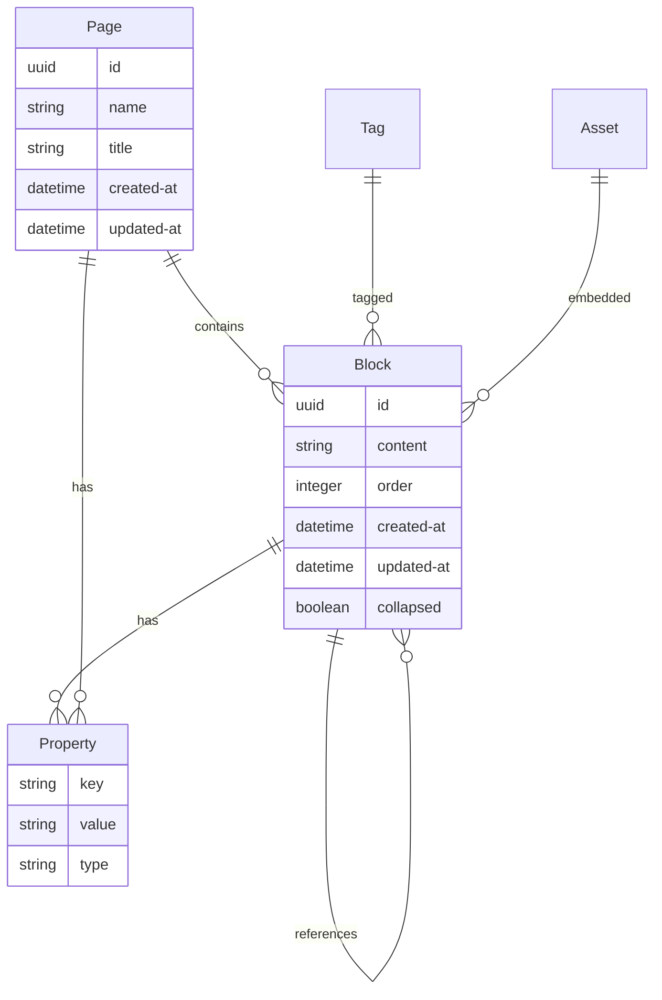
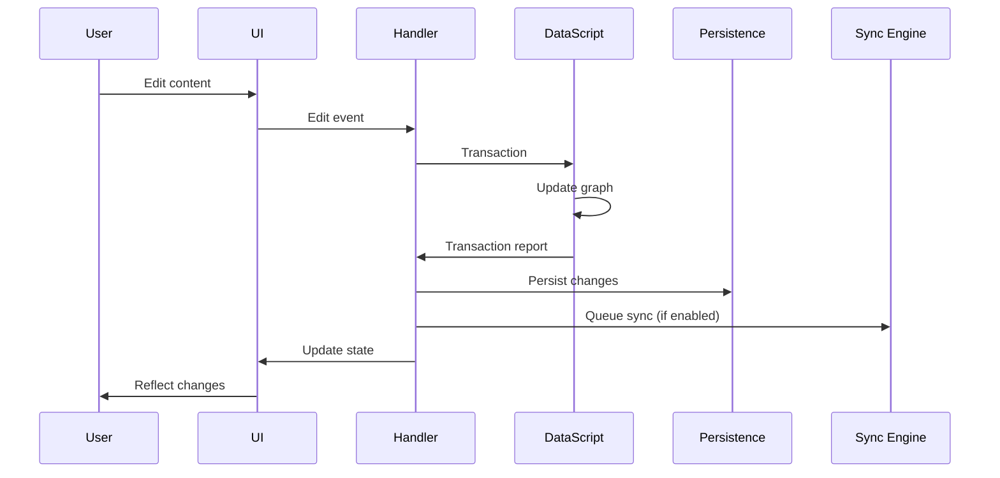
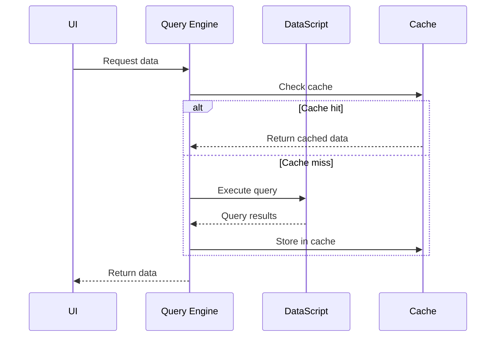
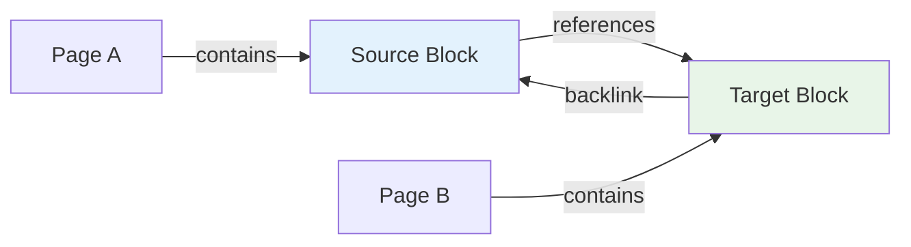
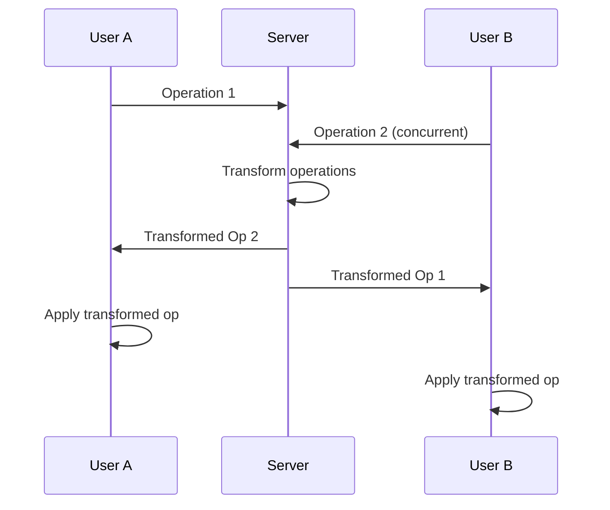

# Data Architecture

> **Last revised:** 2026-03-10

## Overview

Logseq's data architecture is built around a **graph-based data model** that treats all information as interconnected entities in a knowledge graph. The system supports both traditional file-based storage and modern database-driven approaches, providing flexibility for different user needs and use cases.

## Data Model Fundamentals

### Graph Database Approach

Logseq uses **DataScript**, an immutable in-memory database that implements the Datalog query language. This choice enables natural representation of knowledge relationships and powerful querying capabilities.

**Core Principle**: Everything is an entity with attributes and relationships.



### Entity-Attribute-Value (EAV) Model

DataScript stores data in an EAV triple format, providing flexibility and query power:

```clojure
;; Example EAV triples
[block-id :block/content "This is content"]
[block-id :block/page page-id]
[block-id :block/refs [ref-id-1 ref-id-2]]
[page-id :block/name "my page"]
[page-id :block/created-at #inst "2024-01-01"]
```

## Schema Definition

### Core Schema

**Block Entity**:

```clojure
{:block/uuid        {:db/unique :db.unique/identity}
 :block/content     {:db/valueType :db.type/string}
 :block/page        {:db/valueType :db.type/ref}
 :block/parent      {:db/valueType :db.type/ref}
 :block/refs        {:db/valueType :db.type/ref
                     :db/cardinality :db.cardinality/many}
 :block/created-at  {:db/valueType :db.type/instant}
 :block/updated-at  {:db/valueType :db.type/instant}}
```

**Page Entity** (pages are blocks with `:block/name`):

```clojure
{:block/name        {:db/unique :db.unique/identity}  ; lowercase page name
 :block/title       {}                                 ; display title
 :block/namespace   {:db/valueType :db.type/ref}
 :block/tags        {:db/valueType :db.type/ref
                     :db/cardinality :db.cardinality/many}}
```

### Property System

**Dynamic Properties**:

```clojure
;; Properties are flexible key-value pairs
{:property/key "author"
 :property/value "John Doe"
 :property/type "string"}

{:property/key "priority"
 :property/value "high"
 :property/type "enum"}

{:property/key "due-date"
 :property/value #inst "2024-12-31"
 :property/type "date"}
```

## Storage Architectures

### File-Based Storage (Traditional)

**Directory Structure**:

```txt
graph-directory/
├── pages/
│   ├── contents.md
│   ├── project-notes.md
│   └── meetings/
│       ├── 2024-01-15.md
│       └── 2024-01-16.md
├── journals/
│   ├── 2024_01_15.md
│   ├── 2024_01_16.md
│   └── 2024_01_17.md
├── assets/
│   ├── images/
│   └── documents/
├── logseq/
│   ├── config.edn
│   └── metadata.edn
└── .gitignore
```

**File Format (Markdown)**:

```markdown
---
title: Project Notes
tags: project, planning
created-at: 2024-01-15
---

# Project Overview

- [[Requirements]] gathering phase
- Implementation timeline: [[2024-01-20]]
  - Database design
  - API development
  - Frontend implementation

## References

- ((block-uuid-reference))
- [External Link](https://example.com)
```

### Database Storage (Modern)

**SQLite Backend**:

Logseq's SQLite storage uses an address-content model with Transit serialization for DataScript persistence, not a traditional relational schema. The key table stores serialized DataScript segments:

```sql
-- Actual storage model (address-based for DataScript persistence)
-- kvs table: stores Transit-serialized DataScript data
CREATE TABLE IF NOT EXISTS kvs (
    addr INTEGER PRIMARY KEY,
    content TEXT,          -- Transit-serialized DataScript data
    addresses TEXT         -- JSON array of referenced addresses
);

-- Separate SQLite databases per graph:
-- Main DB: DataScript graph data
-- Search DB: FTS5 full-text search index
-- Client-ops DB: RTC operation log
```

## Data Flow Architecture

### Write Operations



### Read Operations



## Query System

### Datalog Queries

**Basic Queries**:

```clojure
;; Find all blocks containing "TODO"
[:find ?block ?content
 :where
 [?block :block/content ?content]
 [(clojure.string/includes? ?content "TODO")]]

;; Find pages with specific tag
[:find ?page-name
 :where
 [?page :block/name ?page-name]
 [?page :block/tags ?tag]
 [?tag :block/name "project"]]
```

**Advanced Queries**:

```clojure
;; Find related pages through shared references
[:find ?related-page
 :in $ ?current-page
 :where
 [?current-page :block/name ?current-name]
 [?block :block/page ?current-page]
 [?block :block/refs ?ref]
 [?other-block :block/refs ?ref]
 [?other-block :block/page ?related-page]
 [(not= ?current-page ?related-page)]]
```

### Query Performance Optimization

**Indexing Strategy**:

```clojure
;; Automatic indexes created by DataScript
:avet  ; Attribute-Value-Entity-Transaction
:aevt  ; Attribute-Entity-Value-Transaction
:eavt  ; Entity-Attribute-Value-Transaction
:vaet  ; Value-Attribute-Entity-Transaction
```

**Query Caching**:

- LRU cache for frequently accessed queries
- Reactive query invalidation
- Memoization of expensive computations

## Relationship Management

### Link Types

**Page References**:

```clojure
;; [[Page Name]] creates:
{:block/refs [{:block/name "page name"}]}
```

**Block References**:

```clojure
;; ((block-uuid)) creates:
{:block/refs [{:block/uuid #uuid "550e8400-e29b-41d4-a716-446655440000"}]}
```

**Tag References**:

```clojure
;; #tag creates:
{:block/refs [{:block/name "tag"}]}
```

### Backlink Computation



**Backlink Query**:

```clojure
;; Find all blocks that reference a given block
[:find ?referring-block
 :in $ ?target-block
 :where
 [?referring-block :block/refs ?target-block]]
```

## Data Synchronization

### Real-Time Collaboration (RTC)

**Operational Transformation**:



**Conflict Resolution**:

- Last-writer-wins for simple properties
- Operational transformation for text edits
- Merge strategies for complex data structures

### Data Persistence Strategies

**File-Based Persistence**:

```clojure
;; Incremental file updates
(defn persist-block-change [block-data]
  (let [file-path (block->file-path block-data)
        file-content (generate-markdown block-data)]
    (write-file file-path file-content)))
```

**Database Persistence**:

```clojure
;; SQLite storage via DataScript IStorage protocol
;; DataScript automatically persists via the IStorage implementation
;; which Transit-serializes data and stores it in the kvs table
(reify IStorage
  (-store [_ addr+data-seq _delete-addrs]
    (upsert-addr-content! db data))
  (-restore [_ addr]
    (restore-data-from-addr db addr)))
```

## Performance Considerations

### Memory Management

**Graph Size Optimization**:

- Lazy loading of large graphs
- Pagination for query results
- Garbage collection of unused entities

**Cache Strategies**:

```clojure
;; Query result caching
(def query-cache (atom {}))

(defn cached-query [query & inputs]
  (let [cache-key [query inputs]]
    (if-let [result (get @query-cache cache-key)]
      result
      (let [result (apply db/q query inputs)]
        (swap! query-cache assoc cache-key result)
        result))))
```

### Scalability Metrics

**Performance Targets**:

- Sub-100ms query response for graphs up to 100k blocks
- Real-time sync for up to 50 concurrent users
- Memory usage under 500MB for typical graphs

## Data Migration and Versioning

### Schema Evolution

**Migration Framework**:

```clojure
(defn migrate-schema [db from-version to-version]
  (reduce apply-migration db
    (get-migrations from-version to-version)))

(defmulti apply-migration
  (fn [db migration] (:migration/type migration)))

(defmethod apply-migration :add-attribute
  [db {:keys [attribute schema]}]
  (update-schema db attribute schema))
```

### Data Import/Export

**Export Formats**:

- JSON for full graph export
- Markdown for file-based compatibility
- EDN for Clojure-native format
- RDF for semantic web integration

**Import Sources**:

- Roam Research databases
- Obsidian vaults
- Notion workspaces
- Standard markdown files

## Security and Privacy

### Data Encryption

**At-Rest Encryption**:

```clojure
;; Optional encryption for sensitive data
(defn encrypt-content [content encryption-key]
  (-> content
      (encrypt/aes-encrypt encryption-key)
      (encode/base64-encode)))
```

**In-Transit Encryption**:

- TLS 1.3 for all network communications
- End-to-end encryption for sync operations
- Certificate pinning for enhanced security

### Privacy Controls

**Data Locality**:

- Local-first storage by default
- User-controlled cloud sync
- No third-party data sharing

**Audit Trail**:

- Transaction logging for data changes
- User action tracking (optional)
- Change attribution and timestamps

---

_This data architecture documentation provides comprehensive insight into how Logseq stores, manages, and processes knowledge graph data across different storage backends and use cases._
