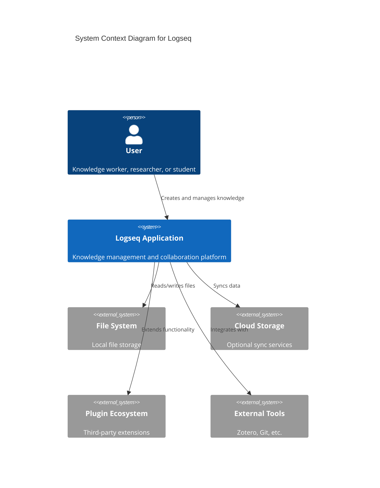
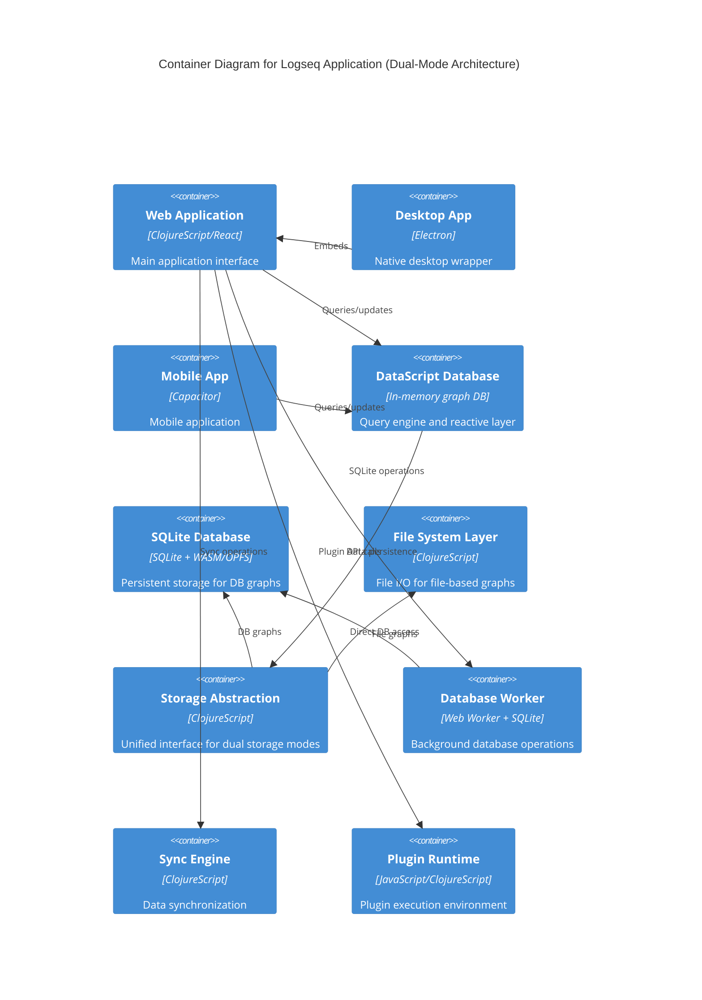
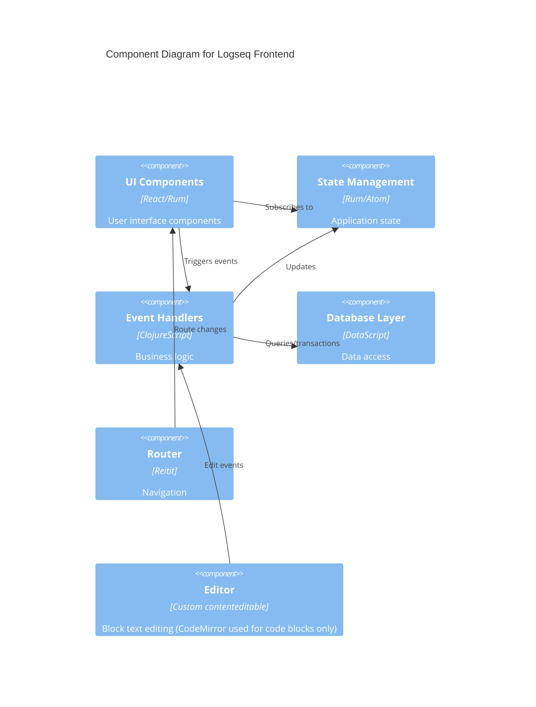
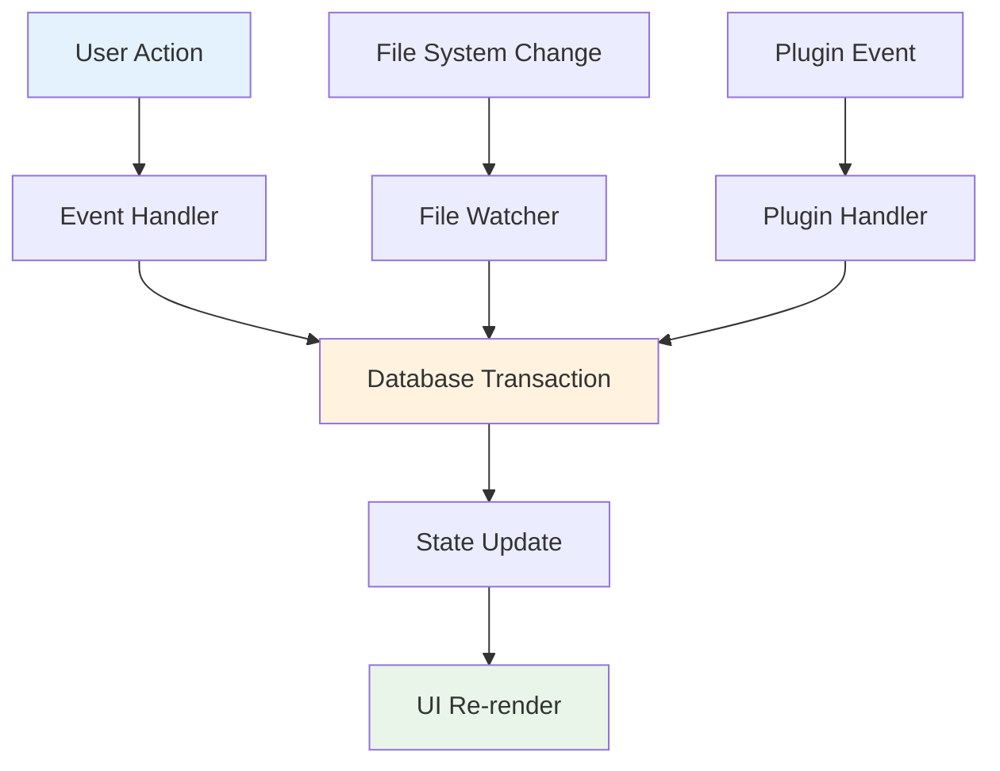
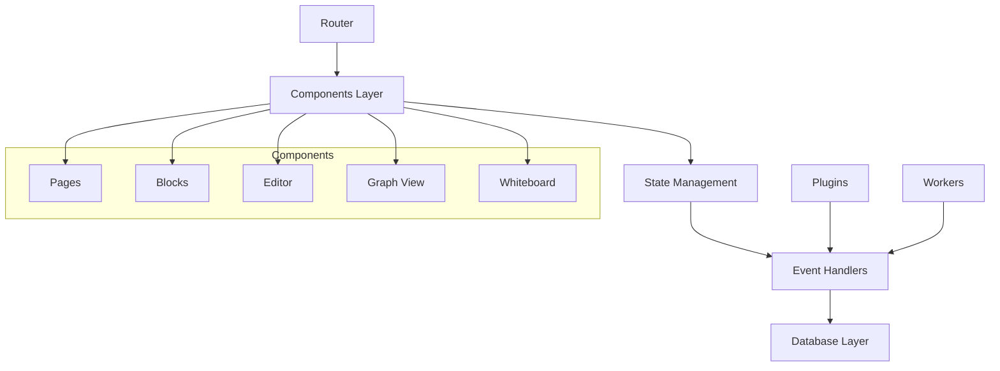
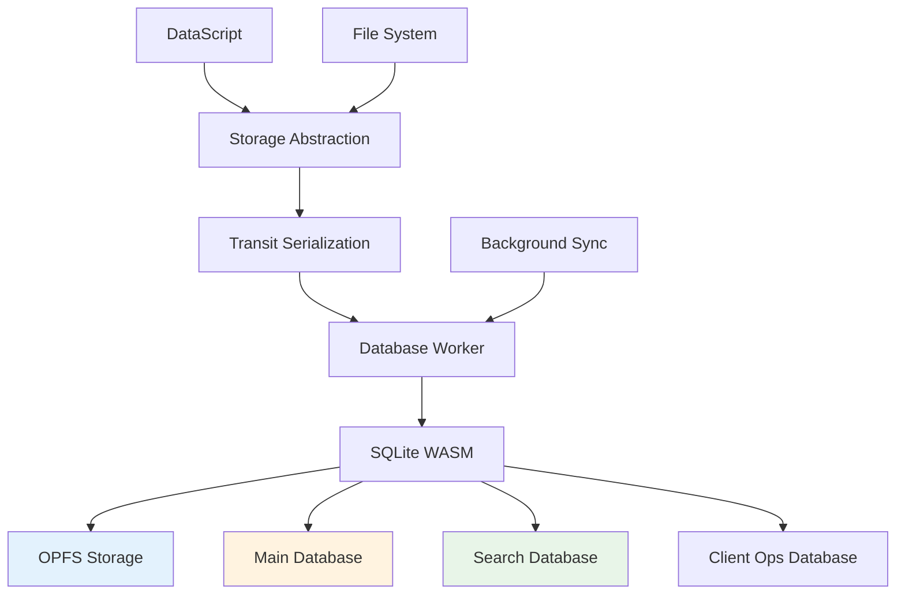
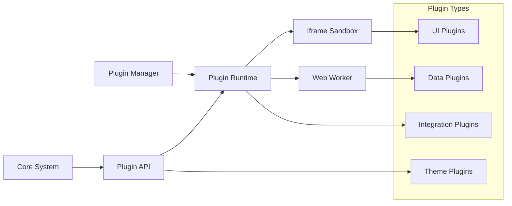
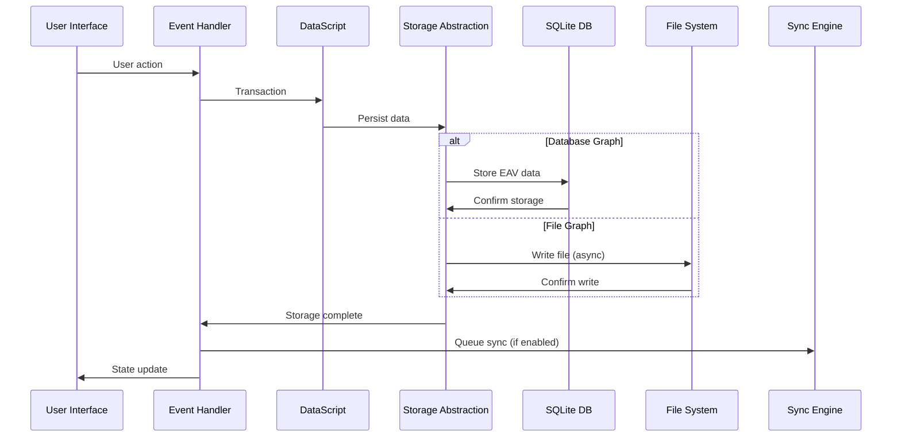
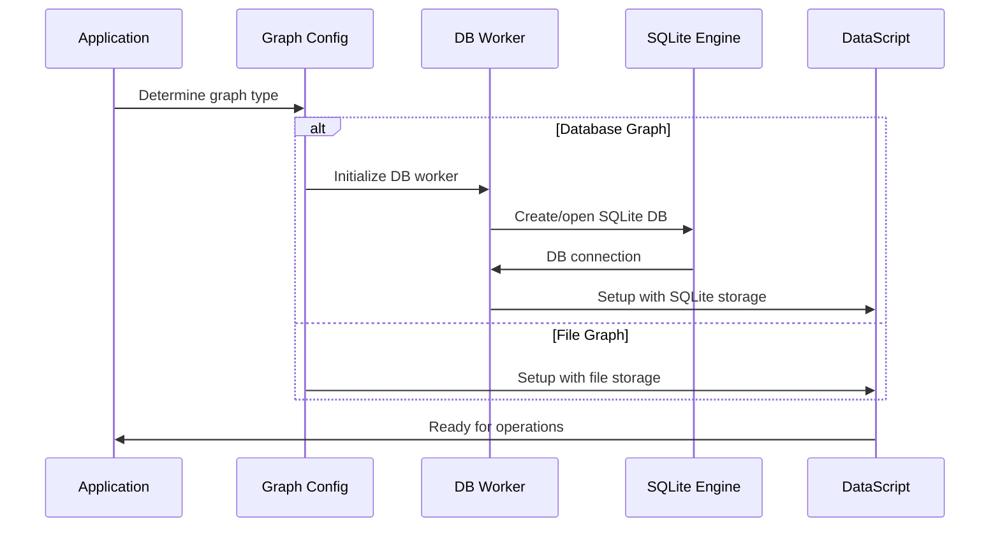
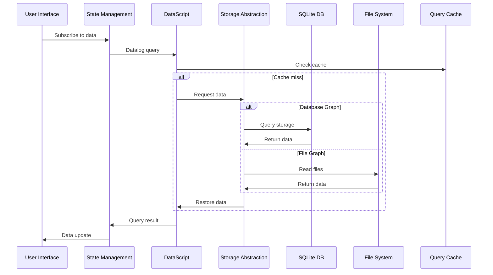

# System Architecture

> **Last revised:** 2026-05-28

## Architecture Overview

Logseq employs a **local-first, multi-platform architecture** that prioritizes user data ownership while providing seamless cross-platform experiences. The system features a sophisticated dual-mode architecture supporting both traditional file-based storage and modern SQLite database-backed graphs, designed around reactive, event-driven patterns with graph databases at its core.

**Current Architecture Status:**

- **Dual Storage Models**: File-based graphs and SQLite database-based graphs
- **Seamless Migration**: Transparent switching between storage modes
- **Enhanced Performance**: SQLite implementation provides unlimited scalability and ACID transactions
- **Backward Compatibility**: Full support for existing file-based workflows

## High-Level Architecture



## Container Architecture



## Component Architecture



## Architectural Patterns

### Local-First Architecture

The application follows a **local-first** approach where:

- All data operations happen locally first
- Cloud sync is an optional enhancement
- Users maintain full control over their data
- Offline functionality is guaranteed

### Event-Driven Architecture

Logseq implements an event-driven system using:

- **Event Handlers**: Process user actions and system events
- **State Subscriptions**: Reactive updates to UI components
- **Database Transactions**: Atomic data changes
- **Plugin Hooks**: Extension points for custom functionality

### Reactive Data Flow



## Core Subsystems

### 1. Database Subsystem (Dual-Mode Architecture)

**Purpose**: Unified graph-based knowledge storage with dual persistence models

#### DataScript Layer (Query Engine)

**Key Components**:

- **DataScript Core**: In-memory Datalog database for queries and reactive updates
- **Schema Management**: Dynamic schema selection based on graph type
- **Query Engine**: Unified Datalog query processing for both storage modes
- **Transaction Log**: Change tracking and undo/redo with dual persistence

#### Storage Backends

**A. File-Based Graphs (Legacy Mode)**:

- **Purpose**: Traditional file-system storage with markdown/org files
- **Storage**: Direct file I/O with format parsers
- **Limitations**: File system constraints, limited scalability
- **Benefits**: Full file system access, external tool compatibility

**B. Database-Based Graphs (SQLite Mode)**:

- **Purpose**: Modern persistent storage with unlimited scalability
- **Storage**: SQLite database with ACID transactions
- **Technology Stack**: SQLite WASM + OPFS (browser) / Native SQLite (desktop)
- **Benefits**: Unlimited storage, better performance, full-text search integration

#### Unified Data Model

```clojure
;; Block entity structure (file-based graphs)
{:db/id 123
 :block/uuid #uuid "550e8400-e29b-41d4-a716-446655440000"
 :block/content "This is a block of text"
 :block/page {:db/id 456}
 :block/parent {:db/id 122}
 :block/refs [{:db/id 789} {:db/id 890}]}

;; Block entity structure (database-based graphs)
;; Note: :block/content is NOT in the DB graph schema.
;; Block and page text is stored in :block/title.
{:db/id 123
 :block/uuid #uuid "550e8400-e29b-41d4-a716-446655440000"
 :block/title "This is a block of text"
 :block/page {:db/id 456}
 :block/parent {:db/id 122}
 :block/refs [{:db/id 789} {:db/id 890}]
 ;; DB-specific attributes
 :block/tags [{:db/id 999}]          ; refs to logseq.class/Card entity, etc.
 :block/closed-value-property [{:db/id 888}]} ; cardinality/many ref type
```

#### Storage Abstraction Layer

```clojure
;; Storage interface (from datascript.storage)
(defprotocol IStorage
  (-store [this addr+data-seq delete-addrs])
  (-restore [this addr]))

;; Graph type detection (logseq.db.sqlite.util / frontend.config)
(defn db-based-graph? [graph-name]
  (sqlite-util/db-based-graph? graph-name))
```

### 2. Frontend Application Layer

**Purpose**: User interface and interaction management

**Architecture**:



### 3. Storage Integration Layer

**Purpose**: Unified storage abstraction supporting dual persistence modes

#### File System Integration (File-Based Graphs)

**Layers**:

- **File Protocols**: Abstraction over different storage backends
- **Format Parsers**: Markdown/Org-mode processing
- **File Watchers**: Real-time file change detection
- **Conflict Resolution**: Handle concurrent file modifications

#### SQLite Integration (Database-Based Graphs)

**Components**:

- **SQLite WASM**: Browser-based SQLite with OPFS persistence
- **Connection Pooling**: Efficient database connection management
- **Transaction Management**: ACID transactions with WAL mode
- **Storage Serialization**: Transit-based data serialization
- **Full-Text Search**: Integrated search database with automatic indexing

**SQLite Architecture**:



**Key Implementation Details**:

```clojure
;; SQLite storage implementation
(defn new-sqlite-storage [^Object db]
  (reify IStorage
    (-store [_ addr+data-seq _delete-addrs]
      (let [data (map
                  (fn [[addr data]]
                    (let [data' (if (map? data) (dissoc data :addresses) data)
                          addresses (when (map? data)
                                      (when-let [addresses (:addresses data)]
                                        (js/JSON.stringify (bean/->js addresses))))]
                      #js {:$addr addr
                           :$content (sqlite-util/write-transit-str data')
                           :$addresses addresses}))
                  addr+data-seq)]
        (upsert-addr-content! db data)))
    (-restore [_ addr]
      (restore-data-from-addr db addr))))

;; Connection setup with optimizations
(defn- enable-sqlite-wal-mode! [^Object db]
  (.exec db "PRAGMA locking_mode=exclusive")
  (.exec db "PRAGMA journal_mode=WAL")  ; Write-Ahead Logging for better concurrency
  (.exec db "PRAGMA synchronous=NORMAL"))  ; no per-commit fsync (fff75ea17d)
```

### 4. Plugin System

**Purpose**: Extensibility and third-party integrations

**Architecture**:



## Platform-Specific Implementations

### Desktop (Electron)

- **Main Process**: System integration and window management
- **Renderer Process**: Web application runtime
- **Native APIs**: File system, notifications, system tray
- **Auto-updater**: Seamless application updates

### Web Platform

- **Progressive Web App**: Offline-first web application
- **Service Workers**: Background sync and caching
- **IndexedDB**: Browser-based data persistence
- **File System Access API**: Modern browser file integration

### Mobile (Capacitor)

- **Web View**: ClojureScript application running in a Capacitor web view
- **Native Plugins**: Platform-specific functionality via Capacitor plugins
- **Background Sync**: Data synchronization while offline
- **Performance Optimization**: Mobile-specific optimizations

## Data Flow Architecture

### Write Operations (Dual-Mode)



### Graph Initialization



### Read Operations (Dual-Mode)



## Scalability and Performance

### Graph Type Comparison

| Feature               | File-Based Graphs  | Database-Based Graphs      |
| --------------------- | ------------------ | -------------------------- |
| **Storage Limit**     | File system limit  | Unlimited (SQLite)         |
| **Performance**       | Memory limited     | Disk-based, scalable       |
| **ACID Transactions** | No                 | Yes (SQLite)               |
| **Full-Text Search**  | Limited            | Integrated (FTS5)          |
| **Concurrent Access** | File locking       | SQLite WAL mode            |
| **Backup/Recovery**   | File-based         | Database snapshots         |
| **External Tools**    | Full compatibility | Limited                    |
| **Migration**         | Not needed         | Automatic schema migration |

### Performance Optimizations

#### Common Optimizations

- **Lazy Loading**: Components and data loaded on demand
- **Virtual Scrolling**: Efficient rendering of large lists
- **Query Optimization**: Indexed queries and result caching
- **Memory Management**: Garbage collection and object pooling

#### Database-Specific Optimizations

- **OPFS SAH Pool**: OPFS file handle pool (initialCapacity: 20 handles)
- **WAL Mode**: Write-Ahead Logging for better concurrency
- **Vacuum Operations**: Automatic database maintenance and garbage collection
- **Search Index Management**: Automatic FTS index updates with triggers
- **Transit Serialization**: Optimized data serialization for storage

```clojure
;; Database garbage collection (every 1 month)
;; src/main/frontend/worker/db_core.cljs
(defn- gc-sqlite-dbs! [sqlite-db datascript-conn {:keys [full-gc?]}]
  (let [last-gc-at (:kv/value (d/entity @datascript-conn :logseq.kv/graph-last-gc-at))]
    (when (or full-gc?
              (nil? last-gc-at)
              (not (number? last-gc-at))
              (> (- (common-util/time-ms) last-gc-at) (* 30 24 3600 1000))) ; 1 month ago
      (log/info :gc-sqlite-dbs "gc current graph")
      (sqlite-gc/gc-kvs-table! sqlite-db {:full-gc? full-gc?})
      (.exec sqlite-db "VACUUM")
      (ldb/transact! datascript-conn [{:db/ident :logseq.kv/graph-last-gc-at
                                       :kv/value (common-util/time-ms)}]
                     {:skip-validate-db? true
                      :persist-op? false}))))
```

### Concurrent Operations

- **Transaction Serialization**: Atomic database operations with ACID guarantees
- **Optimistic Updates**: Immediate UI feedback with rollback capability
- **Conflict Resolution**: Advanced merge strategies for concurrent edits
- **Background Processing**: Non-blocking operations in dedicated workers
- **Real-time Collaboration**: Enhanced support for concurrent multi-user editing

## Security Architecture

### Data Protection

#### File-Based Graphs

- **File System Security**: OS-level file permissions
- **Local Encryption**: Optional at-rest encryption
- **Direct File Access**: Full user control over files

#### Database-Based Graphs

- **OPFS Isolation**: Origin Private File System sandboxing
- **SQLite Security**: Built-in transaction integrity
- **Data Integrity**: ACID transactions prevent corruption
- **Automatic Backups**: Database snapshots for recovery

#### Universal Security Features

- **Secure Transmission**: HTTPS/TLS for sync operations
- **Plugin Sandboxing**: Isolated execution environments
- **Content Security Policy**: XSS protection
- **No Network Dependencies**: Core functionality works offline

### Privacy Features

- **No Tracking**: No analytics by default
- **Local Storage**: Data remains on user devices (both modes)
- **Optional Telemetry**: User-controlled usage statistics
- **Open Source Transparency**: Auditable codebase
- **Origin Isolation**: Browser-based graphs isolated per origin

## Deployment Architecture

### Distribution Channels

- **Desktop**: Native installers and package managers
- **Web**: CDN-hosted web application
- **Mobile**: App stores and direct distribution

### Update Mechanisms

- **Auto-updates**: Background application updates
- **Progressive Enhancement**: Incremental feature rollouts
- **Rollback Capability**: Safe update reversals
- **Plugin Updates**: Independent plugin versioning

## Migration and Transition

### Graph Type Selection

**When to Choose File-Based Graphs:**

- External tool integration required (Obsidian, other markdown editors)
- File system access needed for automation
- Small to medium graph sizes (< 10,000 blocks)
- Simple backup requirements (file copying)

**When to Choose Database-Based Graphs:**

- Large graph sizes (> 10,000 blocks)
- Performance is critical
- Advanced search capabilities needed
- Real-time collaboration planned
- Mobile-first usage patterns

### Migration Process

**File-to-Database Migration:**

1. **Export**: Generate graph-agnostic EDN export from file-based graph
2. **Create**: Initialize new database-based graph
3. **Import**: Load EDN data into SQLite-backed graph
4. **Verify**: Confirm data integrity and relationships
5. **Switch**: Update graph references and sync settings

**Migration Implementation:**

```clojure
;; Export from file graph
(defn export-graph-to-edn [repo]
  "Export graph data in universal EDN format")

;; Import to database graph
(defn import-edn-to-db-graph [repo edn-data]
  "Import EDN data into SQLite-backed graph")

;; Schema migration for database graphs
(defn migrate-db-schema [repo from-version to-version]
  "Handle database schema migrations")
```

### Technology Stack Summary

#### Frontend Architecture

- **UI Framework**: React with Rum (ClojureScript)
- **State Management**: DataScript with reactive subscriptions
- **Query Language**: Datalog (unified across storage modes)
- **Routing**: Reitit for navigation

#### Storage Technologies

- **File Graphs**: Direct file I/O with format parsers
- **Database Graphs**: SQLite WASM + OPFS (browser), Native SQLite (desktop)
- **Serialization**: Transit for efficient data serialization
- **Search**: Integrated FTS5 full-text search

#### Platform Integration

- **Desktop**: Electron with native SQLite bindings
- **Web**: SQLite WASM with Origin Private File System
- **Mobile**: Capacitor with SQLite integration

#### Development Tools

- **Language**: ClojureScript for consistency
- **Build System**: shadow-cljs for compilation
- **Testing**: Comprehensive test suites for both storage modes

---

_This comprehensive architecture documentation covers Logseq's evolution from a file-based system to a sophisticated dual-mode platform supporting both traditional file storage and modern SQLite-backed persistence, providing users with the flexibility to choose the best approach for their specific use cases while maintaining full data portability between modes._
