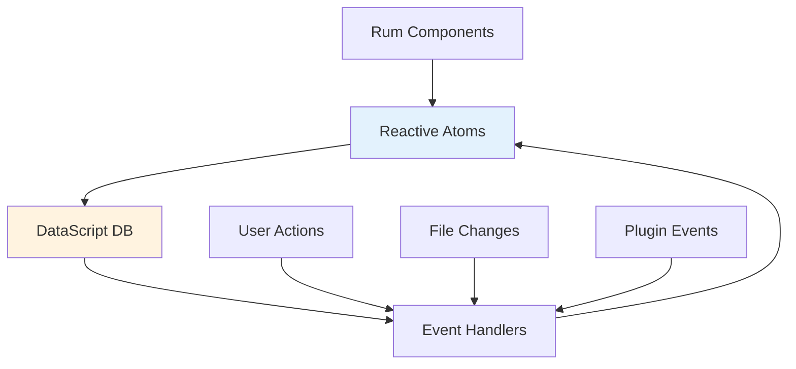

# Technical Stack

> **Last revised:** 2026-05-28

## Technology Overview

Logseq is built on a modern, carefully selected technology stack that prioritizes performance, maintainability, and extensibility. The choice of functional programming languages and reactive patterns reflects the application's focus on data relationships and user interaction.

## Frontend Technologies

### Core Language: ClojureScript

**Why ClojureScript?**

- **Functional Programming**: Immutable data structures and pure functions
- **Lisp Syntax**: Powerful macro system for DSL creation
- **JavaScript Interop**: Seamless integration with JavaScript ecosystem
- **REPL-Driven Development**: Interactive development and debugging

**Benefits**:

- Reduced complexity in state management
- Powerful data transformation capabilities
- Strong support for graph data structures
- Hot reloading and live coding

### UI Framework: React + Rum

**React (18.3.1)**

- Industry-standard UI library
- Virtual DOM for efficient updates
- Component-based architecture
- Extensive ecosystem and tooling

**Rum Framework**

- ClojureScript wrapper for React
- Functional component definitions
- Built-in state management
- Reactive subscriptions

```clojure
(rum/defc block-component < rum/reactive
  [block]
  (let [content (rum/react (:block/content block))]
    [:div.block
     [:div.block-content content]]))
```

### State Management

**Architecture**:



**Key Technologies**:

- **Atoms**: Clojure's reference types for state
- **Reactive Subscriptions**: Automatic UI updates
- **Event System**: Decoupled state mutations

### Database: DataScript

**What is DataScript?**

- In-memory database implementing Datalog
- Immutable database values
- Time-travel debugging
- Powerful query language

**Query Example**:

```clojure
;; Find all blocks that reference a specific page
[:find ?block
 :where
 [?block :block/refs ?page]
 [?page :page/name "Artificial Intelligence"]]
```

**Benefits**:

- Natural representation of graph relationships
- Efficient querying of complex data patterns
- Automatic indexing and optimization
- Transaction-based updates

## Build Tools and Development

### Shadow-CLJS (3.4.6)

**Primary Build Tool**:

- ClojureScript compilation to JavaScript
- Hot reloading during development
- Code splitting and optimization
- Multiple build targets (web, desktop, mobile)

**Configuration**:

```clojure
;; shadow-cljs.edn uses deps.edn for dependency management
{:deps true
 :source-paths ["src/main" "src/electron" "src/resources"]
 :builds {:app {:target :browser
                :output-dir "./static/js"
                :modules {:main {:init-fn frontend.core/init}
                          :code-editor {:entries [frontend.extensions.code]
                                        :depends-on #{:main}}}}}}
```

### Gulp (5.0.1)

**Asset Processing**:

- CSS compilation and optimization
- Static asset management
- Development server setup
- Build task orchestration

### Webpack (5.106.2)

**Module Bundling**:

- JavaScript dependency management
- Asset optimization
- Development and production builds
- Plugin and worker compilation

## Styling and UI Components

### CSS Framework: Tailwind CSS (3.3.5)

**Utility-First Approach**:

- Rapid UI development
- Consistent design system
- Responsive design utilities
- Custom configuration for Logseq themes

### Component Libraries

**Radix UI**:

- Accessible UI primitives
- Unstyled, composable components
- Keyboard navigation support
- ARIA compliance

**Custom UI System (SHUI)**:

- Logseq-specific component library
- Based on shadcn/ui design patterns
- ClojureScript wrappers for React components
- Consistent styling and behavior

```clojure
(defn button [props & children]
  (shui/button
   (merge {:class "logseq-button"} props)
   children))
```

## Desktop Platform: Electron

### Electron Integration

**Main Process**:

- Application lifecycle management
- Native OS integration
- File system access
- Auto-updater functionality

**Renderer Process**:

- Web application runtime
- IPC communication with main process
- Plugin sandbox environment

**Key Features**:

- Native file dialogs
- System tray integration
- Protocol handlers
- Deep OS integration

### Desktop-Specific Technologies

```javascript
// IPC communication example
const { ipcRenderer } = require('electron')

// From renderer to main
ipcRenderer
  .invoke('read-file', filePath)
  .then((content) => updateEditor(content))

// From main to renderer
ipcRenderer.on('file-changed', (event, filePath) => {
  reloadFile(filePath)
})
```

## Mobile Platform: Capacitor

### Mobile Architecture

**Capacitor (8.3.1)**:

The mobile app runs the same ClojureScript application inside a Capacitor web view, with native functionality provided through Capacitor plugins. This is not a React Native app.

- Cross-platform native runtime (web view based)
- Plugin ecosystem for native APIs
- Shared codebase with web/desktop
- Native API access via Capacitor bridge

### Mobile-Specific Features

**Key Capacitor Plugins**:

- `@capacitor/filesystem` (8.1.2) - File system access
- `@capacitor/camera` (8.2.0) - Camera integration
- `@capacitor/clipboard` (8.0.1) - Clipboard operations
- `@capacitor/haptics` (8.0.2) - Tactile feedback
- `@capacitor/keyboard` (8.0.3) - Keyboard management
- `@aparajita/capacitor-secure-storage` (8.0.0) - Secure storage

## Testing and Quality Assurance

### Testing Framework: Playwright (1.58.2)

**End-to-End Testing**:

```javascript
// Example test
test('should create new block', async ({ page }) => {
  await page.goto('/')
  await page.click('.editor')
  await page.type('.editor', 'New block content')
  await page.press('Enter')

  expect(await page.textContent('.block')).toContain('New block content')
})
```

### Code Quality Tools

> **Removed:** Karma has been removed as the unit test runner. Tests are now compiled with shadow-cljs to a `:node-test` target and executed via Node.js (`pnpm test` → `clojure -M:cljs compile test` + `bb dev:run-test-namespaces`).

**Clj-kondo**:

- ClojureScript linting
- Static analysis
- Code quality enforcement

**Stylelint (13.13.1)**:

- CSS linting and formatting
- Style guide enforcement

## Development Dependencies

### Key Development Tools

```json
{
  "devDependencies": {
    "@playwright/test": "1.58.2",
    "shadow-cljs": "3.4.6",
    "gulp": "5.0.1",
    "webpack": "5.106.2",
    "tailwindcss": "3.3.5",
    "typescript": "5.9.3"
  }
}
```

### Build Scripts

**Primary Commands**:

```bash
# Development mode
pnpm watch

# Production build
pnpm release

# Mobile development
pnpm mobile-watch

# Testing
pnpm test
```

## Runtime Dependencies

### Core Libraries

**Data Management**:

- `datascript` - Graph database
- `mldoc` - Document parsing
- `jszip` - Archive handling

**UI and Interaction**:

- `react` (18.3.1) - UI framework
- `react-dom` (18.3.1) - DOM rendering
- `@dnd-kit/core` - Drag and drop
- `react-virtuoso` - Virtual scrolling

**File and Media Handling**:

- `pdfjs-dist` (4.2.67) - PDF processing
- `html2canvas` - Screenshot generation
- `photoswipe` - Image galleries

### Platform-Specific Dependencies

**Desktop (Electron)**:

- Native file system access
- OS integration APIs
- Auto-updater services

**Web Platform**:

- Service worker APIs
- IndexedDB storage
- File System Access API

**Mobile (Capacitor 8.3.1)**:

- Native camera access
- File system integration
- Secure storage and keyboard management

## Performance Optimizations

### Bundle Optimization

**Code Splitting**:

- Separate bundles for core, plugins, and workers
- Lazy loading of non-critical components
- Dynamic imports for large dependencies

**Tree Shaking**:

- Elimination of unused code
- Optimized bundle sizes
- Dead code elimination

### Runtime Performance

**Virtual DOM Optimization**:

- Efficient reconciliation algorithms
- Memoization of expensive computations
- Batched state updates

**Memory Management**:

- Garbage collection optimization
- Object pooling for frequently created objects
- Efficient data structure usage

## Security Considerations

### Content Security Policy

```html
<meta
  http-equiv="Content-Security-Policy"
  content="default-src 'self'; 
               script-src 'self' 'unsafe-eval'; 
               style-src 'self' 'unsafe-inline';"
/>
```

### Plugin Sandboxing

**Iframe Isolation**:

- Separate execution contexts for plugins
- Limited API surface for security
- Message-based communication

**Web Worker Security**:

- Isolated execution environment
- Restricted access to sensitive APIs
- Controlled data flow

## Deployment and Distribution

### Build Targets

**Web Application**:

- Static site generation
- CDN-optimized bundles
- Progressive web app features

**Desktop Applications**:

- Platform-specific installers
- Auto-update mechanisms
- Code signing for security

**Mobile Applications**:

- App store distribution
- Over-the-air updates
- Platform-specific optimizations

---

## Findings: New Capabilities

The following capabilities are present in the current codebase but were not documented:

- **SQLite WASM** (`@sqlite.org/sqlite-wasm` 3.51.2-build9): Client-side SQLite compiled to WebAssembly, used as the storage backend for DB-mode graphs.
- **Pixi.js** (`pixi.js` ^8.18.1): GPU-accelerated 2D graphics renderer, used for graph visualization.
- **`db-worker-node` build target**: A Node.js build of the database worker (`frontend.worker.db-worker-node/main`) that enables server-side and CLI use of the DB engine.
- **`logseq-cli` build target**: A dedicated shadow-cljs build for the Logseq CLI tool (`deps/cli/`).
- **Comlink** (`comlink` ^4.4.2): RPC-style web worker communication library wrapping `postMessage`.
- **Vite** (`vite` ^8.0.10): Additional build tooling present alongside Webpack.
- **Sentry** (`@sentry/react` ^10.51.0): Error and performance monitoring integration.
- **better-sqlite3** (^12.9.0, devDep): Native SQLite bindings used for desktop/CLI builds.
- **`@zvec/zvec`** (0.4.0, optional): Native vector-operation bindings with platform-specific pre-built binaries (darwin-arm64, linux-x64, linux-arm64, win32-x64).
- **Package manager is pnpm** (10.33.0), not yarn. All `yarn` commands in the Build Scripts section have been updated to `pnpm`.
- **Node.js ≥ 22.20.0** is the required engine version (not documented previously).

---

_This technical stack documentation provides comprehensive insight into the technologies and architectural decisions that power Logseq across all platforms._
