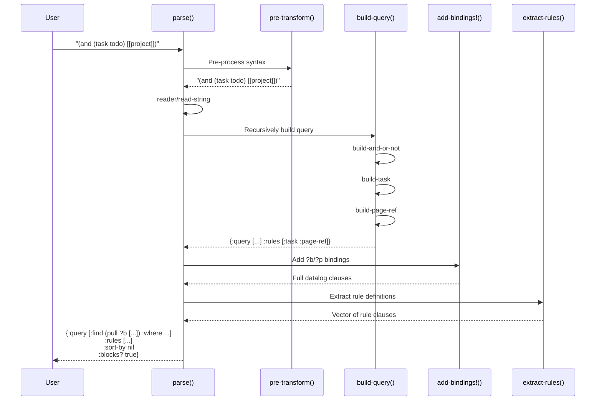
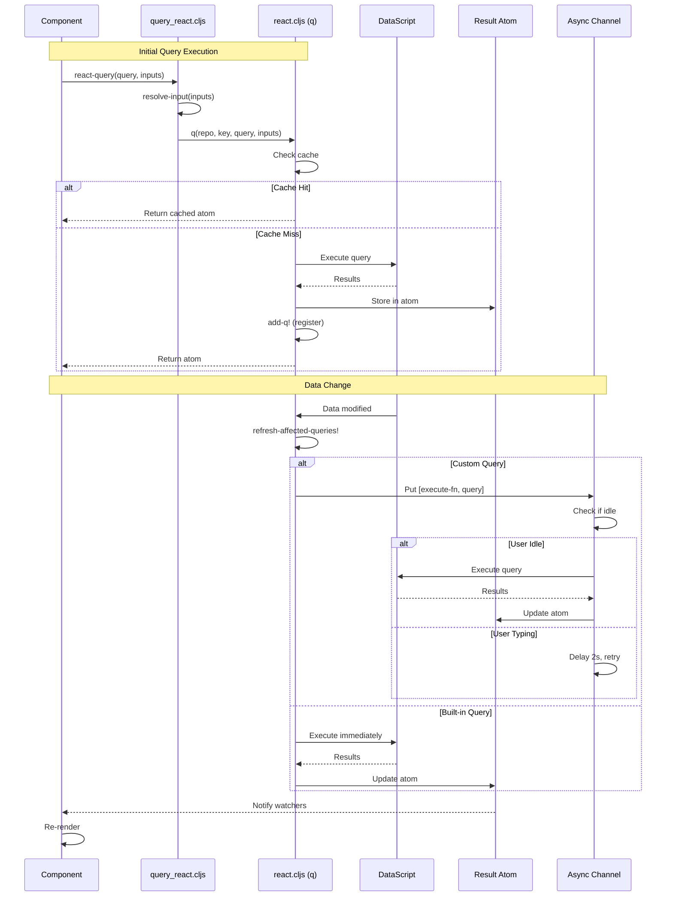
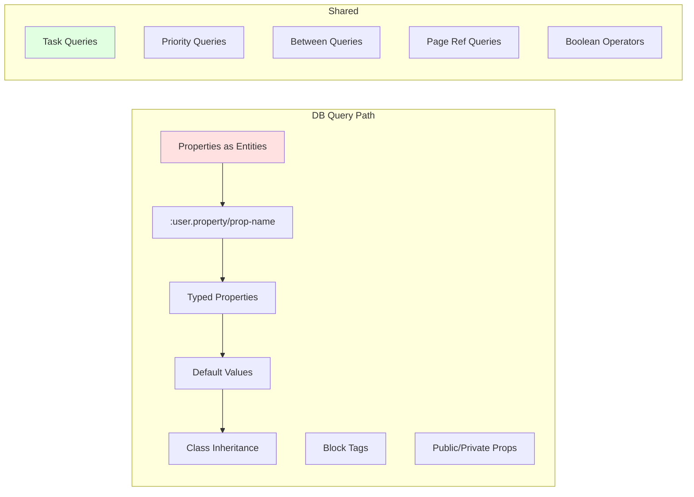
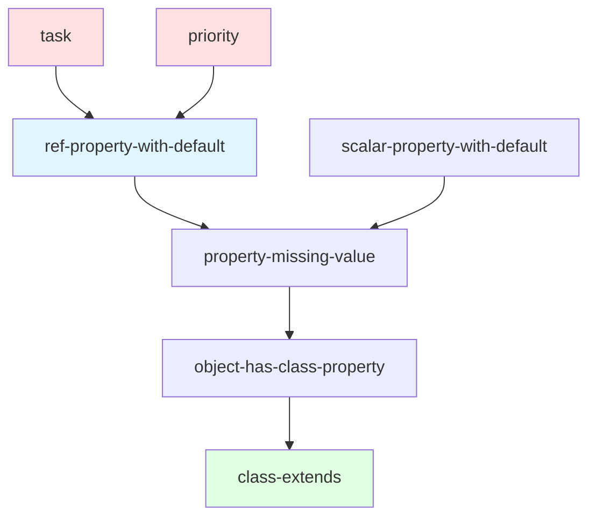
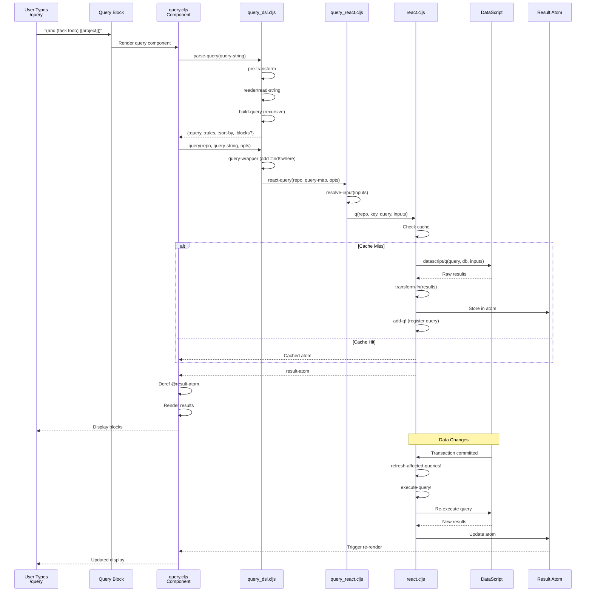
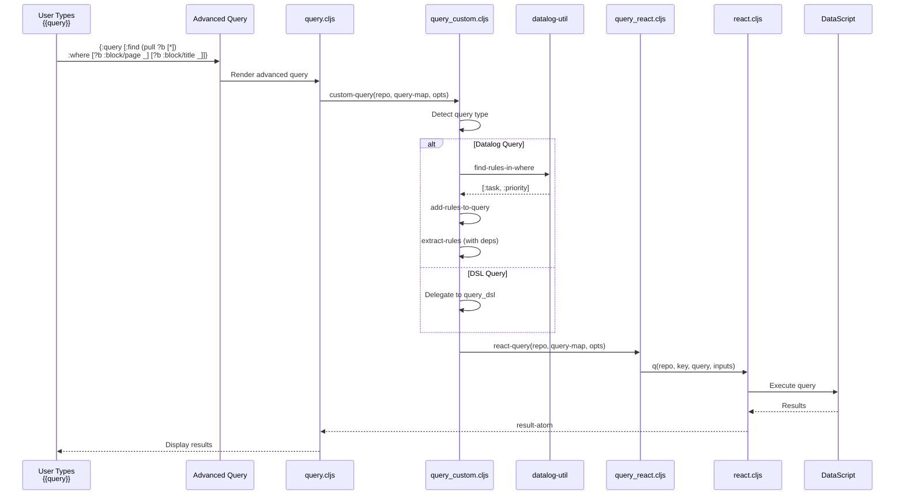
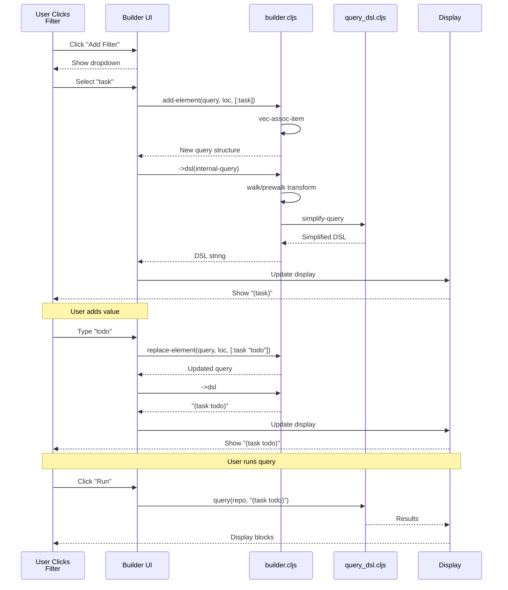
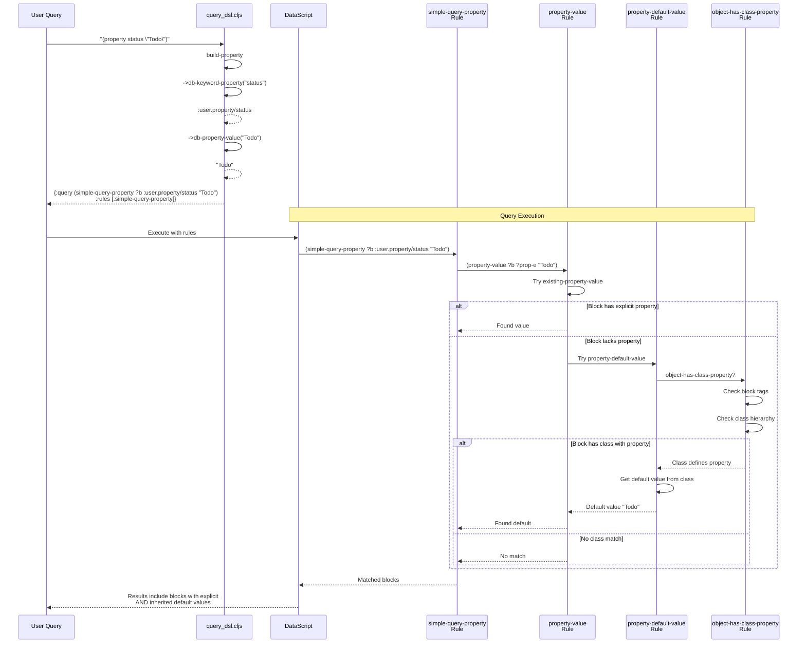

# Logseq Query System: A Detective's Investigation Report

> **Last revised:** 2026-05-29

## 🔍 Case Summary

The Logseq Query System exposes two query surfaces that allow users to search and filter blocks and pages in their knowledge graphs. This investigation covers both surfaces under one execution model:

1. **DSL Queries (Simple Queries)**: A domain-specific language with user-friendly operators like `(and)`, `(property)`, `(task)`
2. **Advanced Queries (Datalog Queries)**: Direct access to the underlying DataScript database using Datalog syntax

**Why it exists**: Users need flexible, powerful ways to find information across thousands of blocks and pages without writing complex database queries.

**Key Discovery Highlights**:

- 🔍 The active query parser in `src/main/frontend/db/query_dsl.cljs` is DB-centric and feeds a shared reactive execution layer
- ⚡ Reactive query execution still uses cache keys, component dependency tracking, and idle-time scheduling for custom queries
- 🎯 Built-in queries are detected both from explicit flags and from `:title-key` matches in configured journal queries
- 🔒 Query result isolation prevents infinite recursion when query blocks appear in query results

---

## 📋 Table of Contents

1. [Architecture Overview](#architecture-overview)
2. [The Crime Scene Map](#the-crime-scene-map)
3. [Evidence #1: Query DSL Parser](#evidence-1-query-dsl-parser)
4. [Evidence #2: Reactive Query Engine](#evidence-2-reactive-query-engine)
5. [Evidence #3: Current DB Query Semantics](#evidence-3-current-db-query-semantics)
6. [Evidence #4: Query Builder System](#evidence-4-query-builder-system)
7. [Evidence #5: Datalog Rules System](#evidence-5-datalog-rules-system)
8. [Key Witnesses (Main Files)](#key-witnesses-main-files)
9. [Critical Findings](#critical-findings)
10. [Known Limitations](#known-limitations)
11. [API Reference](#api-reference)
12. [Message Flow Reference](#message-flow-reference)
13. [Debugging Guide](#debugging-guide)
14. [Performance Benchmarks](#performance-benchmarks)
15. [Future Improvements](#future-improvements)
16. [Case Closed](#case-closed)
17. [Appendix: File Tree](#appendix-file-tree)

---

## Architecture Overview

The Logseq Query System operates as a multi-layered pipeline that transforms user-friendly query syntax into optimized Datalog queries, executes them reactively, and renders results with automatic updates.

```text
┌─────────────┐
│  User Input │  "(and (task todo) [[project]])"
└──────┬──────┘
       │
       ▼
┌─────────────┐
│DSL Parser   │  query_dsl.cljs: parse() → build-query()
└──────┬──────┘
       │
       ▼
┌─────────────┐
│Query Builder│  Converts to Datalog: [:find (pull ?b [...]) :where ...]
└──────┬──────┘
       │
       ▼
┌─────────────┐
│Rule Injector│  Adds necessary Datalog rules (task, page-ref, property, etc.)
└──────┬──────┘
       │
       ▼
┌─────────────┐
│Query Engine │  query_react.cljs → react.cljs: Reactive execution
└──────┬──────┘
       │
       ▼
┌─────────────┐
│  DataScript │  Actual query execution on in-memory database
└──────┬──────┘
       │
       ▼
┌─────────────┐
│Result Cache │  Store in *query-state atom with component tracking
└──────┬──────┘
       │
       ▼
┌─────────────┐
│  UI Render  │  Components automatically re-render on data changes
└─────────────┘
```

---

## The Crime Scene Map

```mermaid
graph TB
    subgraph "User Layer"
        A[Query Block /query]
        B[Advanced Query {{query}}]
        C[Query Builder UI]
    end

    subgraph "Parsing Layer"
        D[query_dsl.cljs]
        E[query_custom.cljs]
        F[builder.cljs]
    end

    subgraph "Execution Layer"
        G[query_react.cljs]
        H[react.cljs]
        I[DataScript DB]
    end

    subgraph "State Management"
        J[*query-state atom]
        K[component->query-key]
        L[query-key->components]
    end

    subgraph "Rules Layer"
        M[rules.cljc DB Rules]
        N[file-rules File Rules]
    end

    subgraph "Rendering Layer"
        O[query.cljs Component]
        P[query-table.cljs]
        Q[query/view.cljs]
    end

    A --> D
    B --> E
    C --> F

    D --> G
    E --> G
    F --> D

    G --> H
    H --> I

    H --> J
    H --> K
    H --> L

    D --> M
    D --> N
    E --> M
    E --> N

    J --> O
    O --> P
    O --> Q

    style A fill:#e1f5ff
    style B fill:#e1f5ff
    style C fill:#e1f5ff
    style D fill:#fff4e1
    style E fill:#fff4e1
    style G fill:#ffe1e1
    style H fill:#ffe1e1
    style J fill:#e1ffe1
    style O fill:#f0e1ff
```

---

## Evidence #1: Query DSL Parser

### Witness Files (Reactive Engine)

**Primary**: `src/main/frontend/db/query_dsl.cljs` (850 lines)

**Role**: Transforms human-readable query syntax into Datalog queries

### Investigation (Reactive Engine)

#### 1.1 Pre-Transformation Phase

**Location**: `src/main/frontend/db/query_dsl.cljs:617-642`

```clojure
(defn pre-transform
  [s]
  (if (common-util/wrapped-by-quotes? s)
    s
    (let [quoted-page-ref (fn [matches]
                            (let [match' (string/replace (second matches) "#" tag-placeholder)]
                              (str "\"" page-ref/left-brackets match' page-ref/right-brackets "\"")))]
      (some-> s
              (string/replace #"\"?\[\[(.*?)\]\]\"?" quoted-page-ref)
              (string/replace text-util/between-re ...)
              (string/replace #"\"[^\"]+\"" (fn [s] (string/replace s "#" tag-placeholder)))
              (string/replace " #" " #tag ")
              (string/replace #"^#" "#tag ")
              (string/replace tag-placeholder "#")))))
```

🔍 **Hidden Behavior**: The parser transforms tags (`#foo`) into a special `#tag foo` format to distinguish them from hashtags within page references. This prevents `[[page #foo]]` from being incorrectly parsed.

**Transformation Examples**:

- `#foo` → `#tag foo`
- `[[test #foo]]` → `"[[test #foo]]"` (quoted to preserve hashtag)
- `(between -7d +7d)` → `(between :-7d :+7d)` (converts to keywords)

#### 1.2 Parsing Phase

**Location**: `src/main/frontend/db/query_dsl.cljs:690-732`

```clojure
(defn parse
  [s {:keys [db-graph? cards?] :as opts}]
  (when (and (string? s) (not (string/blank? s)))
    (let [s (if (= \# (first s)) (page-ref/->page-ref (subs s 1)) s)
          form (some->> s
                        (pre-transform)
                        (reader/read-string custom-readers))
          sort-by (atom nil)
          blocks? (atom nil)
          sample (atom nil)
          form (simplify-query form)
          {result :query rules :rules}
          (when form (build-query form {...}))
          result' (when (seq result)
                    (add-bindings! result opts))
          rules' (extract-rules rules)]
      {:query result'
       :rules rules'
       :sort-by @sort-by
       :blocks? (boolean @blocks?)
       :sample sample})))
```

🔍 **Critical Finding**: The parser uses atoms to collect metadata (sort-by, sample, blocks?) during the recursive build-query traversal. This is necessary because build-query returns a map, not multiple values.

#### 1.3 Query Building - The Core Algorithm

**Location**: `src/main/frontend/db/query_dsl.cljs:531-612`

The `build-query` function is the heart of the DSL parser. It's a recursive function that pattern-matches on query forms:

```clojure
(defn build-query
  ([e env] (build-query e (assoc env :vars (atom {})) 0))
  ([e {:keys [form blocks? sample current-filter] :as env} level]
   (let [fe (first e)  ;; First element = operator/filter
         fe (when fe (symbol (string/lower-case (name fe))))
         page-ref? (page-ref/page-ref? e)]
     (cond
       (nil? e) nil

       (contains? #{'and 'or 'not} fe)
       (build-and-or-not e env level fe)

       (= 'between fe)
       (build-between e env)

       (= 'property fe)
       (build-property e env)

       (= 'task fe)
       (build-task e env)

       (= 'priority fe)
       (build-priority e env)

       page-ref?
       (if (or (= current-filter 'or) (= form e))
         (build-self-ref e)
         (build-page-ref e))

       (string? e)
       (build-block-content e)

       :else nil))))
```

**Pattern Discovered**: Each filter returns a map with `:query` and `:rules`:

- `:query` - Datalog clause(s) to add to the WHERE section
- `:rules` - Rule names needed for this filter

#### 1.4 Filter Implementations

##### Property Filter

**Location**: `src/main/frontend/db/query_dsl.cljs:339-371`

```clojure
(defn- build-property-two-arg
  [e {:keys [db-graph? private-property?]}]
  (let [k (if db-graph? (->db-keyword-property (nth e 1)) (->file-keyword-property (nth e 1)))
        v (nth e 2)
        v' (if db-graph? (->db-property-value k v) (->file-property-value v))]
    (if db-graph?
      (if private-property?
        {:query (list 'private-simple-query-property '?b k v')
         :rules [:private-simple-query-property]}
        {:query (list 'simple-query-property '?b k v')
         :rules [:simple-query-property]})
      {:query (list 'property '?b k v')
       :rules [:property]})))
```

🔍 **Key Discovery**: Property handling is completely different between file and DB graphs:

- **File graphs**: Use keyword properties (`:prop-name`) and match on `:block/properties` map
- **DB graphs**: Use qualified keywords (`:user.property/prop-name`) and have sophisticated default value support through class/property system

##### Task Filter

**Location**: `src/main/frontend/db/query_dsl.cljs:373-385`

```clojure
(defn- build-task
  [e {:keys [db-graph?]}]
  (let [markers (if (coll? (first (rest e)))
                  (first (rest e))
                  (rest e))]
    (when (seq markers)
      (if db-graph?
        (let [markers' (set (map (comp common-util/capitalize-all name) markers))]
          {:query (list 'task '?b (set markers'))
           :rules [:task]})
        (let [markers (set (map (comp string/upper-case name) markers))]
          {:query (list 'task '?b markers)
           :rules [:task]})))))
```

⚠️ **Gotcha**: Task markers are case-normalized differently:

- **File graphs**: `UPPERCASE` (e.g., "TODO", "DONE")
- **DB graphs**: `Capitalized` (e.g., "Todo", "Done")

##### Between Filter

**Location**: `src/main/frontend/db/query_dsl.cljs:274-287`

The `between` filter has two modes:

1. **Journal Mode** (2 args): `(between -7d +7d)`
   - Filters journal pages by their journal-day integer
   - Uses `:between` rule

2. **Property Timestamp Mode** (3+ args): `(between created-at -1d today)`
   - Filters blocks by timestamp properties
   - Different implementation for file vs DB graphs

```clojure
(defn- db-based-build-between-three-arg
  [e]
  (when-let [k (get-timestamp-property e)]
    (let [start (->timestamp (nth e 2))
          end (->timestamp (nth e 3))]
      (when (and start end)
        (let [[start end] (sort [start end])
              sym '?v]
          {:query [['?b k sym]
                   [(list '>= sym start)]
                   [(list '< sym end)]]})))))
```

🎯 **Best Practice**: Always sort timestamps to ensure `start <= end`, regardless of user input order.

#### 1.5 Boolean Operators

**Location**: `src/main/frontend/db/query_dsl.cljs:178-206`

Boolean operators (`and`, `or`, `not`) are handled specially:

```clojure
(defn- build-and-or-not
  [e {:keys [current-filter vars] :as env} level fe]
  (let [raw-clauses (map (fn [form]
                           (build-query form (assoc env :current-filter fe) (inc level)))
                         (rest e))
        clauses (->> raw-clauses
                     (map :query)
                     remove-nil?
                     (distinct))
        nested-and? (and (= fe 'and) (= current-filter 'and))]
    (when (seq clauses)
      (let [result (build-and-or-not-result fe clauses current-filter nested-and?)
            vars' (set/union (set @vars) (collect-vars result))
            query (cond
                    nested-and? result
                    (and (zero? level) (contains? #{'and 'or} fe)) result
                    (and (= 'not fe) (some? current-filter)) result
                    :else [result])]
        (reset! vars vars')
        {:query query :rules (distinct (mapcat :rules raw-clauses))}))))
```

🔍 **Critical Finding**: Nested `and` operators are flattened:

- `(and (and [[foo]] [[bar]]))` → `(and [[foo]] [[bar]])`
- This prevents deeply nested query structures

#### 1.6 Query Simplification

**Location**: `src/main/frontend/db/query_dsl.cljs:675-687`

```clojure
(defn simplify-query
  [query]
  (if (string? query)
    query
    (walk/postwalk
     (fn [f]
       (if (and (coll? f)
                (contains? #{'and 'or} (first f))
                (= 2 (count f)))
         (second f)
         f))
     query)))
```

🎯 **Optimization**: Single-clause boolean operators are eliminated:

- `(and [[foo]])` → `[[foo]]`
- `(or (task todo))` → `(task todo)`

### Query DSL Flow Diagram



---

## Evidence #2: Reactive Query Engine

### The Witness Files

**Primary**:

- `src/main/frontend/db/query_react.cljs` (117 lines)
- `src/main/frontend/db/react.cljs` (227 lines)

**Role**: Executes queries reactively with automatic caching and component updates

### Investigation (Current DB Query Semantics)

#### 2.1 The Query State Management System

**Location**: `src/main/frontend/db/react.cljs:16-51`

```clojure
;; Query atom of map of Key ([repo q inputs]) -> atom
(defonce *query-state (atom {}))

;; [[repo q]]
(defonce *collapsed-queries (atom {}))

;; component -> query-key
(defonce component->query-key (volatile! {}))
;; query-key -> component-set
(defonce query-key->components (volatile! {}))

(defn add-q!
  [k query inputs result-atom transform-fn query-fn inputs-fn]
  (swap! *query-state assoc k {:query query
                               :inputs inputs
                               :result result-atom
                               :transform-fn transform-fn
                               :query-fn query-fn
                               :inputs-fn inputs-fn})
  result-atom)
```

🔍 **Hidden Architecture**: The query system maintains three parallel data structures:

1. `*query-state`: Maps query keys → query metadata + result atom
2. `component->query-key`: Maps React components → set of query keys they depend on
3. `query-key->components`: Reverse index for efficient invalidation

**Query Key Format**: `[repo :custom query-string inputs]` or `[repo :kv entity-id]`

#### 2.2 Query Execution with Caching

**Location**: `src/main/frontend/db/react.cljs:126-161`

```clojure
(defn q
  [repo k {:keys [use-cache? transform-fn query-fn inputs-fn
                  disable-reactive? return-promise? built-in-query?]
           :or {use-cache? true
                transform-fn identity}} query & inputs]
  (let [origin-key k
        k (vec (cons repo k))]
    (when-let [db (conn/get-db repo)]
      (let [result-atom (get-query-cached-result k)]
        (when-let [component *query-component*]
          (add-query-component! k component))
        (when-let [queries *reactive-queries*]
          (swap! queries conj origin-key))
        (if (and use-cache? result-atom)
          result-atom
          (let [result-atom (or result-atom (atom nil))
                p-or-value (<q-aux repo db query-fn inputs-fn k query inputs built-in-query?)]
            (when-not disable-reactive?
              (add-q! k query inputs result-atom transform-fn query-fn inputs-fn))
            (cond
              return-promise? p-or-value
              (p/promise? p-or-value)
              (do
                (p/let [result p-or-value
                        result' (transform-fn result)]
                  (reset! result-atom result'))
                result-atom)
              :else
              (let [result' (transform-fn p-or-value)]
                (set! (.-state result-atom) result')
                result-atom))))))))
```

🔍 **Critical Finding**: The query system uses dynamic binding (`*query-component*`) to track which React component is executing. This allows automatic dependency registration without explicit subscriptions.

⚡ **Performance Trick**: Built-in queries are delayed by 100ms to avoid blocking journal rendering:

**Location**: `src/main/frontend/db/react.cljs:103-106`

```clojure
(if built-in-query?
  ;; delay built-in-queries to not block journal rendering
  (p/let [_ (p/delay 100)]
    (q-f))
  (q-f))
```

#### 2.3 Query Invalidation and Refresh

**Location**: `src/main/frontend/db/react.cljs:171-202`

```clojure
(defn refresh-affected-queries!
  [repo-url affected-keys & {:keys [skip-kv-custom-keys?]
                             :or {skip-kv-custom-keys? false}}]
  (util/profile
    "refresh!"
    (let [db (conn/get-db repo-url)
          affected-keys-set (set affected-keys)
          state (->> (keep (fn [[k cache]]
                             (let [k' (vec (rest k))]
                               (when (and (= (first k) repo-url)
                                          (or (contains? affected-keys-set k')
                                              (contains? #{:custom :kv} (first k'))))
                                 [k' cache]))) @*query-state)
                     (into {}))
          all-keys (concat (distinct affected-keys)
                           (when-not skip-kv-custom-keys?
                             (filter #(contains? #{:custom :kv} (first %)) (keys state))))]
      (doseq [k all-keys]
        (when-let [cache (get state k)]
          (let [{:keys [query query-fn]} cache
                custom? (= :custom (first k))]
            (when (or query query-fn)
              (try
                (let [f #(execute-query! repo-url db (vec (cons repo-url k)) cache)]
                  (if custom?
                   ;; perf: don't execute custom queries if they were collapsed
                    (when-not (query-collapsed? k)
                      (async/put! (state/get-reactive-custom-queries-chan) [f query]))
                    (f)))
                (catch :default e
                  (js/console.error e)
                  nil)))))))))
```

🎯 **Performance Optimization**: Custom queries (DSL/Advanced) are executed asynchronously through a channel to avoid blocking the UI thread.

#### 2.4 Idle-Based Execution

**Location**: `src/main/frontend/db/react.cljs:210-226`

```clojure
(defn run-custom-queries-when-idle!
  []
  (let [chan (state/get-reactive-custom-queries-chan)]
    (async/go-loop []
      (let [[f query] (async/<! chan)]
        (try
          (if (state/input-idle? (state/get-current-repo))
            (f)
            (do
              (async/<! (async/timeout 2000))
              (async/put! chan [f query])))
          (catch :default error
            (let [type :custom-query/failed]
              (js/console.error (str type "\n" query))
              (js/console.error error)))))
      (recur))
    chan))
```

⚡ **Performance Strategy**: Custom queries are deferred when the user is actively typing, ensuring smooth editor performance. If the user is not idle, queries are postponed by 2 seconds.

#### 2.5 Input Resolution

**Location**: `src/main/frontend/db/query_react.cljs:19-33`

```clojure
(defn resolve-input
  "Wrapper around db-inputs/resolve-input which provides editor-specific state"
  ([db input]
   (resolve-input db input {}))
  ([db input opts]
   (db-inputs/resolve-input db
                            input
                            (merge {:current-page-fn (fn []
                                                       (or (when-let [name-or-uuid (state/get-current-page)]
                                                             (if (ldb/db-based-graph? db)
                                                               (:block/title (model/get-block-by-uuid name-or-uuid))
                                                               name-or-uuid))
                                                           (:page (state/get-default-home))
                                                           (date/today)))}
                                   opts))))
```

🔍 **Hidden Behavior**: Query inputs can reference dynamic values like `:current-page` which are resolved at query execution time, not parse time. This enables context-sensitive queries.

### Reactive Query Flow Diagram



---

## Evidence #3: Current DB Query Semantics

### The Investigation

The current query parser and builder are DB-centric. The live source path uses property entities, DB idents, and `logseq.db.frontend.rules`; I could not verify a parallel file-graph rules file or file-graph-only filter path from the current repo state.

#### 3.1 Property Handling

**Location**: `src/main/frontend/db/query_dsl.cljs:284-354`

```clojure
(defn ->db-property-value
  "Parses property values for DB graphs"
  [k v]
  (let [v' (if (symbol? v) (str v) v)]
    (cond (string? v')
          (if (string/starts-with? v' "#")
            (subs v' 1)
            (or (page-ref/get-page-name v') v'))
          ;; Convert number pages to string
          (and (double? v) (= :node (:logseq.property/type (db-utils/entity k))))
          (str v)
          :else
          v')))

(defn- ->db-keyword-property
  "Returns property db-ident given case sensitive property names for db graphs"
  [property-name]
  (if (qualified-keyword? property-name)
    property-name
    (or (some->> (name property-name)
                 (db-utils/q '[:find [(pull ?b [:db/ident]) ...]
                               :in $ ?title
                               :where [?b :block/tags :logseq.class/Property] [?b :block/title ?title]])
                 first
                 :db/ident)
        ::no-property-found)))
```

**Characteristics**:

- Properties are first-class entities with their own blocks
- Property names resolve to qualified keywords such as `:user.property/prop-name`
- The parser distinguishes scalar vs ref properties
- Queries can match class-provided default values
- Property names are case-sensitive unless the caller supplies the exact property title and lets `->db-keyword-property` resolve it

#### 3.2 Rules and Inheritance

**Location**: `deps/db/src/logseq/db/frontend/rules.cljc`

The current rules file defines DB query semantics for:

- `:page-ref` and `:has-ref` for block/page references
- `:task` and `:priority` through `ref-property-with-default`
- `:tags` through tag resolution plus `class-extends`
- `:has-simple-query-property` and `:has-private-simple-query-property`
- `:scalar-property(-with-default)` and `:ref-property(-with-default)`
- `:object-has-class-property` and `:class-extends`

🔍 **Critical Discovery**: DB graphs support property inheritance through classes:

**Location**: `deps/db/src/logseq/db/frontend/rules.cljc`

```clojure
:ref-property-with-default
'[[(ref-property-with-default ?b ?prop ?val)
  [?prop-e :db/ident ?prop]
  (ref-property-value ?b ?prop-e ?val)
  (or
   [(missing? $ ?prop-e :logseq.property/public?)]
   [?prop-e :logseq.property/public? true])]
  [(ref-property-with-default ?b ?prop ?val)
  [?prop-e :db/ident ?prop]
  (ref-property-value-with-default ?b ?prop-e ?val)
  (or
   [(missing? $ ?prop-e :logseq.property/public?)]
   [?prop-e :logseq.property/public? true])]]
```

This means current property, task, and priority matching can still succeed when a block inherits a default value through its class/tag hierarchy.

#### 3.3 Filters Present in the Current Parser

The current `build-query` implementation explicitly recognizes these DSL filters and operators:

- Boolean operators: `and`, `or`, `not`
- Filters: `between`, `property`, `private-property`, `task`/`todo`, `priority`, `page`, `tags`, `sample`
- Structural inputs: page references such as `[[project]]`
- Raw datalog clauses and string full-text search

Notably absent from the current parser and builder are `namespace`, `page-property`, `page-tags`, `all-page-tags`, and `sort-by`.

### Current Query Semantics Diagram



---

## Evidence #4: Query Builder System

### Witness Files (Query Builder)

**Primary**: `src/main/frontend/handler/query/builder.cljs` (212 lines)

**Role**: Visual query builder UI and DSL↔Internal format conversion

### Investigation (Query Builder)

#### 4.1 Internal Representation Format

The query builder uses a vector-based internal representation:

```clojure
;; DSL: (and (task todo) [[project]])
;; Internal: [:and [:task "todo"] [:page-ref "project"]]

;; DSL: (property status "Done")
;; Internal: [:property "status" "Done"]

;; DSL: (or [[foo]] [[bar]])
;; Internal: [:or [:page-ref "foo"] [:page-ref "bar"]]
```

#### 4.2 Tree Manipulation Functions

**Location**: `src/main/frontend/handler/query/builder.cljs:37-102`

The builder provides functional tree manipulation:

```clojure
(defn add-element
  [q loc x]
  {:pre [(vector? loc) (some? x)]}
  (cond
    (and (seq loc) (= 1 (count loc)))
    (vec-assoc-item q (first loc) x)

    (seq loc)
    (update-in q (vec (butlast loc))
               (fn [v] (vec-assoc-item v (last loc) x)))

    (seq q)
    (conj q x)

    :else
    [x]))

(defn remove-element
  [q loc]
  (if (seq loc)
    (let [idx (last loc)
          ks (vec (butlast loc))
          f #(vec-dissoc-item % idx)]
      (if (seq ks)
        (let [result (update-in q ks f)]
          (if (seq (get-in result ks))
            result
            (remove-element result ks)))
        (f q)))
    [:and]))  ;; Default to AND operator

(defn wrap-operator
  [q loc operator]
  {:pre [(seq q) (operators-set operator)]}
  (let [result (if (or (= loc [0]) (empty? loc))
                 [operator q]
                 (when-let [x (get-in q loc)]
                   (let [x' [operator x]]
                     (replace-element q loc x'))))]
    (fallback-to-default result q {...})))
```

🎯 **Design Pattern**: All tree operations use a `loc` (location) vector to specify the path to modify. For example:

- `[0]` = root element
- `[1 2]` = third element of second element
- `[]` = append to end

#### 4.3 DSL Conversion

**Location**: `src/main/frontend/handler/query/builder.cljs:178-212`

```clojure
(defn ->dsl
  [col]
  (->
   (walk/prewalk
    (fn [f]
      (let [f' (->dsl* f)]
        (cond
          (and (vector? f') (keyword (first f')))
          (cons (symbol (first f')) (rest f'))

          :else f')))
    col)
   (query-dsl/simplify-query)))

(defn from-dsl
  [dsl-form]
  (walk/prewalk
   (fn [f]
     (cond
       (and (vector? f) (vector? (first f)))
       [:page-ref (page-ref/get-page-name (str f))]

       (and (string? f) (page-ref/get-page-name f))
       [:page-ref (page-ref/get-page-name f)]

       (and (list? f)
            (symbol? (first f))
            (operators-set (keyword (first f))))
       (into [(keyword (first f))] (rest f))

       (list? f)
       (vec f)

       :else f))
   dsl-form))
```

🔍 **Transformation Examples**:

```clojure
;; Internal → DSL
[:and [:task "TODO"] [:page-ref "project"]]
→ '(and (task "TODO") [[project]])

;; DSL → Internal
'(property status "Done")
→ [:property "status" "Done"]

;; Page refs are normalized
[:page-ref "My Project"]
→ '[[My Project]]
```

#### 4.4 Filter Definitions

**Location**: `src/main/frontend/handler/query/builder.cljs:10-35`

```clojure
(def operators [:and :or :not])
(def operators-set (set operators))

(def db-based-block-filters
  ["tags"
   "page reference"
   "property"
   "task"
   "priority"
   "page"
   "full text search"
   "between"
   "sample"])
```

The current builder UI wires only `db-based-block-filters` into `frontend.components.query.builder`.

---

## Evidence #5: Datalog Rules System

### Witness Files (Datalog Rules)

**Primary**: `deps/db/src/logseq/db/frontend/rules.cljc` (267 lines)

**Role**: Defines reusable Datalog rules for complex query patterns

### Investigation (Datalog Rules)

#### 5.1 Rule Architecture

Rules are defined as maps where keys are rule names and values are rule clauses:

````clojure
(def db-query-dsl-rules
  {:page-ref
   '[(page-ref ?b ?ref)
     (has-ref ?b ?ref)]

   :task
   '[(task ?b ?statuses)
     (ref-property-with-default ?b :logseq.property/status ?val)
     [(contains? ?statuses ?val)]]

   :priority
   '[(priority ?b ?priorities)
     (ref-property-with-default ?b :logseq.property/priority ?priority)
     [(contains? ?priorities ?priority)]})
```text

#### 5.2 Rule Dependencies

**Location**: `deps/db/src/logseq/db/frontend/rules.cljc`

```clojure
(def rules-dependencies
  "For db graphs, a map of rule names and the rules they depend on"
  {:has-ref #{:parent}
   :page-ref #{:has-ref}
   :task #{:ref-property-with-default}
   :priority #{:ref-property-with-default}
   :tags #{:class-extends}
   :has-property-or-object-property #{:object-has-class-property}
   :object-has-class-property #{:class-extends}
   :has-simple-query-property #{:has-property-or-object-property}
   :has-private-simple-query-property #{:has-property-or-object-property}
   :scalar-property-with-default #{:property-missing-value}
   :ref-property-with-default #{:property-missing-value}})

(defn extract-rules
  "Given a rules map and the rule names to extract, returns a vector of rules"
  ([rules-m rules' & {:keys [deps]}]
   (let [rules-with-deps (if (map? deps)
                           (get-full-deps rules' deps)
                           rules')]
     (vec
      (mapcat #(let [val (rules-m %)]
                 (if (vector? (first val)) val [val]))
              rules-with-deps)))))
````

🔍 **Critical Finding**: Rules are automatically resolved with their dependencies. If you use `:task` or `:priority`, the system now pulls in `:ref-property-with-default`, which in turn depends on the class/property default-value chain.

#### 5.3 Sophisticated Rules: Property Defaults and Tag Expansion

Two current capabilities are easy to miss:

1. Property-like filters can match inherited default values supplied by classes.
2. `(tags ...)` expands each requested tag to the tag itself plus all structured descendants before handing the set to the `:tags` rule.

#### 5.4 Recursive Rules

**Location**: `deps/db/src/logseq/db/frontend/rules.cljc:9-21`

```clojure
:parent
'[[(parent ?p ?c)
   [?c :block/parent ?p]]
  [(parent ?p ?c)
   [?t :block/parent ?p]
   (parent ?t ?c)]]

:class-extends
'[[(class-extends ?p ?c)
   [?c :logseq.property.class/extends ?p]]
  [(class-extends ?p ?c)
   [?t :logseq.property.class/extends ?p]
   (class-extends ?t ?c)]]
```

🎯 **Design Pattern**: Recursive rules are written to optimize for descendant queries (find all children of X) rather than ancestor queries (find all parents of X). This is mentioned in the extensive comments in the file.

### Rules Dependency Graph



---

## Key Witnesses (Main Files)

| File Path                                      | Role                            | Complexity  |
| ---------------------------------------------- | ------------------------------- | ----------- |
| `src/main/frontend/db/query_dsl.cljs`          | DSL parser and query builder    | ⚠️⚠️⚠️ High |
| `src/main/frontend/db/query_react.cljs`        | Input resolution and query key  | ⚠️ Medium   |
| `src/main/frontend/db/react.cljs`              | Reactive cache and refresh loop | ⚠️⚠️⚠️ High |
| `src/main/frontend/db/query_custom.cljs`       | Advanced-query dispatch         | ⚠️ Low      |
| `src/main/frontend/handler/query/builder.cljs` | Builder conversion logic        | ⚠️⚠️ Medium |
| `src/main/frontend/components/query.cljs`      | Query UI and built-in handling  | ⚠️⚠️ Medium |
| `deps/db/src/logseq/db/frontend/rules.cljc`    | Datalog rules and dependencies  | ⚠️⚠️⚠️ High |
| `src/test/frontend/db/query_dsl_test.cljs`     | Parser and execution coverage   | ⚠️ Low      |

---

## Critical Findings

### 1. 🎯 Property Queries Can Match Inherited Defaults

The current DB rules let `property`, `task`, and `priority` resolve through class-backed default values, not just explicit block attributes.

### 2. ⚡ Built-in Queries Have Two Detection Paths

Built-in query behavior is no longer driven only by an explicit `:built-in-query?` flag. `frontend.components.query/resolve-built-in-query?` also recognizes journal built-ins by matching `:title-key` against `[:default-queries :journals]` in config.

### 3. 🔒 Recursive Query Blocks are Prevented

**Evidence**: `src/main/frontend/components/query.cljs:165-167`

```clojure
(if (:custom-query? config)
  ;; Don't display recursive results when query blocks are a query result
  [:code (if dsl-query? (str "Results for " (pr-str query)) "Advanced query results")]
  ...)
```

**Reason**: If a query block appears in its own results, rendering it would cause infinite recursion.

**Solution**: Query blocks in results are rendered as code instead of executing.

**Severity**: ✅ Good - This is correct defensive programming.

---

### 4. ⚡ Built-in Queries are Delayed to Improve Performance

**Evidence**: `src/main/frontend/db/react.cljs:103-106`

```clojure
(if built-in-query?
  (p/let [_ (p/delay 100)]
    (q-f))
  (q-f))
```

**Reason**: Journal pages often have multiple built-in queries (e.g., "TODO items"). Executing all immediately would block rendering.

**Impact**: Users might see empty query results for 100ms before they populate.

**Severity**: ✅ Good - Acceptable tradeoff for better UX.

---

### 5. 🧩 The DSL Accepts Raw Datalog Clauses

`build-query` treats clause-shaped vectors and function clauses as already-valid datalog and passes them through. The current DSL is therefore a hybrid: named filters plus inline datalog when needed.

## Findings: New Capabilities

### 1. Tag Queries Expand Descendants

`(tags ...)` does more than match the direct tag. `build-tags` resolves each requested tag/class to the entity id and all structured descendants before invoking the `:tags` rule.

### 2. Built-in Query Detection Can Be Config-Driven

Built-in behavior can now come from `:title-key` matches against configured default journal queries, which means some queries inherit built-in scheduling and UI behavior without the caller setting `:built-in-query?` directly.

### 3. Raw Datalog and DSL Can Mix

The parser accepts already-shaped datalog clauses, so advanced query authors can combine named DSL filters with inline datalog fragments in one query form.

---

## Known Limitations

### 1. ❌ Dynamic Conjunction Still Not Supported

**Description**: You cannot query "blocks that have ALL of these tags" where the tag list is dynamic.

**Example**:

```clojure
;; This doesn't work:
;; Find blocks with tags from a variable list
;; (tags ?b [tag1, tag2, tag3])  ;; Must have ALL
```

**Workaround**: Manually write `(and (tags tag1) (tags tag2) (tags tag3))`

**Source**: Comments in `deps/db/src/logseq/db/frontend/rules.cljc:67-82`

**Severity**: ⚠️⚠️ Medium

---

### 2. ❌ No Full-Text Search Ranking

**Description**: Block content queries return results in arbitrary order, not ranked by relevance.

**Example**:

```clojure
(block-content "important keyword")
;; Results not ranked by keyword frequency or position
```

**Severity**: ⚠️⚠️ Medium

---

### 3. ❌ Limited Regular Expression Support

**Description**: Only exact string matching and substring matching are supported. No regex patterns.

**Severity**: ⚠️ Low

---

### 4. ❌ No Query Composition/Reuse

**Description**: You cannot define a query and reference it in another query.

**Example**:

```clojure
;; Not possible:
;; (defquery my-tasks (and (task todo) (priority high)))
;; (and my-tasks [[project-x]])
```

**Workaround**: Use result-transform functions or copy-paste queries.

**Severity**: ⚠️⚠️ Medium

---

### 5. ⚠️ `sort-by` Is Not Implemented in the Current Parser

The live `build-query` dispatcher in `query_dsl.cljs` does not recognize a `sort-by` filter, even though older versions of this guide described it.

---

### 6. ⚠️ Page-Level Filters Documented in Older Guides Are Absent Here

The current parser and builder do not expose `namespace`, `page-property`, `page-tags`, or `all-page-tags`.

---

### 7. ❌ Query Results are Not Lazy

**Description**: All results are loaded into memory immediately, even if you only need the first few.

**Impact**: Large result sets consume significant memory.

**Mitigation**: Use `(sample N)` to limit results.

**Severity**: ⚠️ Low - Most queries return reasonable result sizes.

---

### 8. ❌ No Query Debugging Tools

**Description**: No way to:

- See the generated Datalog query
- Profile query execution time per-section
- Understand which clauses matched which results
- Visualize query execution plan

**Severity**: ⚠️⚠️⚠️ High - Makes debugging difficult.

---

## API Reference

### Public Functions

#### `query-dsl/parse-query`

**Location**: `src/main/frontend/db/query_dsl.cljs:751-755`

```clojure
(defn parse-query
  ([q db] (parse-query q db {}))
  ([q db options]
   (let [q' (template/resolve-dynamic-template! q)]
     (parse q' db options))))
```

**Purpose**: Parses a DSL query string into a Datalog query.

**Parameters**:

- `q` (string): The query string, e.g. `"(and (task todo) [[project]])"`
- `db`: DataScript database value used for parsing and property/tag resolution
- `options` (map, optional):
  - `:cards?` (boolean): Filter to card entities only

**Returns**: Map with:

- `:query` - Datalog query vector
- `:rules` - Rule clauses vector
- `:sort-by` - Sort function or nil
- `:blocks?` - Boolean indicating if results are blocks
- `:sample` - Atom containing sample size or nil

**Example**:

```clojure
(query-dsl/parse-query "(and (task todo) [[project]])" db)
;; => {:query [:find (pull ?b [...]) :where ...]
;;     :rules [[...]]
;;     :sort-by nil
;;     :blocks? true
;;     :sample #<Atom nil>}
```

---

#### `query-dsl/query`

**Location**: `src/main/frontend/db/query_dsl.cljs:767-798`

```clojure
(defn query
  "Runs a dsl query with query as a string"
  ([repo query-string]
   (query repo query-string {}))
  ([repo query-string query-opts]))
```

**Purpose**: Executes a DSL query and returns an atom with results.

**Parameters**:

- `repo` (string): Repository name
- `query-string` (string): DSL query
- `query-opts` (map, optional):
  - `:cards?` (boolean): Filter to cards only
  - `:transform-fn` (fn): Optional result transformation
  - `:built-in-query?` (boolean): Delay execution to avoid blocking journal render

**Returns**: Atom containing vector of block/page maps

**Example**:

```clojure
(let [result-atom (query-dsl/query "test-repo" "(task todo)")]
  @result-atom)
;; => [[{:block/uuid #uuid "...", :block/title "Task 1", ...}]
;;     [{:block/uuid #uuid "...", :block/title "Task 2", ...}]]
```

---

#### `query-dsl/custom-query`

**Location**: `src/main/frontend/db/query_dsl.cljs:800-820`

```clojure
(defn custom-query
  "Runs a dsl query with query as a seq. Primary use is from advanced query"
  [repo query-m query-opts])
```

**Purpose**: Executes a DSL query from advanced query format.

**Parameters**:

- `repo` (string): Repository name
- `query-m` (map): Query map with `:query` key containing DSL form
- `query-opts` (map): Same as `query` function

**Returns**: Atom containing vector of results

**Example**:

```clojure
(query-dsl/custom-query "test-repo"
                        {:query '(and (task todo) [[project]])}
                        {})
```

---

#### `query-react/react-query`

**Location**: `src/main/frontend/db/query_react.cljs:72-88`

```clojure
(defn react-query
  [repo {:keys [query inputs rules] :as query'} query-opts])
```

**Purpose**: Executes a Datalog query reactively with input resolution.

**Parameters**:

- `repo` (string): Repository name
- `query'` (map):
  - `:query` - Datalog query vector
  - `:inputs` - Vector of input values (can include `:current-page`, `:current-block`)
  - `:rules` - Rule clauses vector
  - `:query-string` (optional): Original query string for debugging
- `query-opts` (map):
  - `:transform-fn` (fn): Transform results
  - `:current-page-fn` (fn): Override current-page resolution
  - `:current-block-uuid` (uuid): Resolve `:current-block`
  - `:today-query?` (boolean): Part of the reactive cache key for built-in today queries

**Returns**: `[query-key result-atom]` tuple

**Example**:

```clojure
(react-query "test-repo"
             {:query '[:find (pull ?b [*])
                       :in $ ?current-page
                       :where [?b :block/refs ?current-page]]
              :inputs [:current-page]}
             {:current-page-fn #(state/get-current-page)})
```

---

#### `query-custom/custom-query`

**Location**: `src/main/frontend/db/query_custom.cljs:69-86`

```clojure
(defn custom-query
  "Executes a datalog query through query-react"
  ([query] (custom-query query {}))
  ([query query-opts] (custom-query (state/get-current-repo) query query-opts))
  ([repo query query-opts]))
```

**Purpose**: Unified interface for both DSL and Datalog queries.

**Parameters**:

- `repo` (string): Repository name
- `query` (map): Query map with either `:query` (Datalog) or DSL form
- `query-opts` (map): Options passed to execution

**Returns**: `[query-key result-atom]` tuple

**Detects Query Type**:

- If `:query` is a list or doesn't start with `:find`, treats as DSL query
- Otherwise treats as Datalog query

**Example**:

```clojure
;; DSL query
(custom-query {:query '(task todo)} {})

;; Datalog query
(custom-query {:query '[:find (pull ?b [*])
         :where [?b :block/page _]
           [?b :block/title _]]
               :inputs []}
              {})
```

---

#### `builder/->dsl` and `builder/from-dsl`

**Location**: `src/main/frontend/handler/query/builder.cljs:178-212`

```clojure
(defn ->dsl [col])    ;; Internal → DSL
(defn from-dsl [dsl-form])  ;; DSL → Internal
```

**Purpose**: Convert between internal builder format and DSL syntax.

**Example**:

```clojure
;; Internal → DSL
(->dsl [:and [:task "TODO"] [:page-ref "project"]])
;; => '(and (task "TODO") [[project]])

;; DSL → Internal
(from-dsl '(and (task todo) [[project]]))
;; => [:and [:task "todo"] [:page-ref "project"]]
```

---

### Query Filters Reference

#### `(and ...)`

**Syntax**: `(and clause1 clause2 ...)`

**Description**: Logical AND - blocks must match all clauses

**Example**:

```clojure
(and (task todo) [[project-x]] (priority high))
```

---

#### `(or ...)`

**Syntax**: `(or clause1 clause2 ...)`

**Description**: Logical OR - blocks must match at least one clause

**Example**:

```clojure
(or (task todo) (task doing))
```

---

#### `(not ...)`

**Syntax**: `(not clause)`

**Description**: Logical NOT - blocks must not match clause

**Example**:

```clojure
(and (task done) (not [[archived]]))
```

---

#### `(property key value)` / `(property key)`

**Syntax**:

- `(property key value)` - Blocks with property=value
- `(property key)` - Blocks with property (any value)

**Current parser behavior**: Property names resolve through DB property entities, support qualified keywords, and can include default values inherited from classes.

**Example**:

```clojure
(property status "Done")
(property tags)  ;; Any blocks with "tags" property
```

---

#### `(private-property key value)` / `(private-property key)`

**Availability**: DB graphs only

**Description**: Like `property` but includes private properties (e.g., `:block/title`)

**Example**:

```clojure
(private-property :block/title "My Page")
```

---

#### `(task marker1 marker2 ...)` / `(task [marker1 marker2])`

**Syntax**:

- `(task marker1 marker2 ...)` - ORed markers
- `(task [marker1 marker2])` - Vector notation

**Current parser behavior**: Marker names are capitalized before matching, so `(task todo doing)` becomes a set like `#{"Todo" "Doing"}`.

**Example**:

```clojure
(task todo doing)  ;; TODO or DOING tasks
(task [done])      ;; Only DONE tasks
```

---

#### `(priority level1 level2 ...)` / `(priority [level1 level2])`

**Syntax**:

- `(priority level1 level2 ...)` - ORed priorities
- `(priority [level1 level2])` - Vector notation

**Current parser behavior**: Priority names are capitalized before matching, so `(priority high)` resolves to `"High"`.

**Example**:

```clojure
(priority a b)     ;; High or Medium priority (file graphs)
(priority high)    ;; High priority (DB graphs)
```

---

#### `(page page-name)`

**Syntax**: `(page page-name)`

**Description**: Blocks on a specific page

**Example**:

```clojure
(page "My Project")
(and (task todo) (page "Work"))
```

---

#### `(between start end)` / `(between property start end)`

**Syntax**:

- `(between start end)` - Journal pages between dates
- `(between property start end)` - Blocks with property timestamp between dates

**Date Formats**:

- `today`, `yesterday`, `tomorrow`, `now`
- Relative: `-7d`, `+1w`, `-1m`, `-1y`
- Page refs: `[[Dec 26th, 2020]]`

**Example**:

```clojure
(between -7d today)  ;; Last 7 days of journal pages
(between created-at -1d today)  ;; Blocks created in last day
(between updated-at [[Jan 1st, 2024]] [[Jan 31st, 2024]])
```

---

#### `[[page-ref]]` or `#tag`

**Syntax**:

- `[[page-ref]]` - Page reference
- `#tag` - Tag (converted to page ref)

**Description**: Blocks that reference the page

**Example**:

```clojure
[[project-x]]  ;; Blocks referencing "project-x"
#important     ;; Same as [[important]]
(and [[work]] [[urgent]])  ;; Must reference both pages
```

---

#### `(tags tag1 tag2 ...)`

**Description**: Blocks with specific tags or classes, including structured descendants resolved by the parser.

**Example**:

```clojure
;; DB graphs only:
(tags project urgent)  ;; Blocks tagged with "project" or "urgent"
```

---

#### `(page-property key value)` / `(page-property key)`

**Status**: Removed from this guide because the current parser and builder do not expose it.

---

#### `(page-tags tag1 tag2 ...)`

**Status**: Removed from this guide because the current parser and builder do not expose it.

---

#### `(all-page-tags)`

**Status**: Removed from this guide because the current parser and builder do not expose it.

---

#### `(namespace namespace-name)`

**Status**: Removed from this guide because the current parser and builder do not expose it.

---

#### `"text search"`

**Syntax**: `"search text"`

**Description**: Full-text search in block content

**Example**:

```clojure
(and (task todo) "urgent meeting")
"keyword"  ;; Simple full-text search
```

---

#### `(sample N)`

**Syntax**: `(sample N)`

**Description**: Limit results to N random samples

**Example**:

```clojure
(and (task todo) (sample 10))  ;; 10 random TODO tasks
```

---

#### `(sort-by property)` / `(sort-by property asc)` / `(sort-by property desc)`

**Status**: Removed from the supported filter list. The current `build-query` dispatcher does not implement `sort-by`.

---

## Message Flow Reference

### Flow 1: DSL Query Execution from Query Block



The exact timings from the previous revision were removed because they were not backed by a reproducible benchmark in the current repo.

---

### Flow 2: Advanced Query Execution



---

### Flow 3: Query Builder Interaction



---

### Flow 4: Property Query with Default Values (DB Graphs)



This flow shows the sophisticated multi-level rule resolution for DB graph property queries with default values.

---

## Debugging Guide

### Viewing Generated Datalog Queries

**Location**: `src/main/frontend/db/query_react.cljs:97-116`

The code already logs queries in dev mode:

```clojure
(when config/dev? (js/console.groupCollapsed "react-query logs:"))
(pprint "Use the following to debug your datalog queries:")
(pprint query')
(pprint "inputs (post-resolution):" resolved-inputs)
```

**Steps**:

1. Enable developer mode in Logseq settings
2. Open browser DevTools console
3. Execute your query
4. Expand the "react-query logs:" group
5. Copy the printed query for analysis

**Example Output**:

```clojure
Use the following to debug your datalog queries:
{:query [:find (pull ?b [:db/id])
         :in $ %
         :where
         [?b :block/uuid]
         (task ?b #{"Todo"})]
 :rules [[(task ?b ?statuses) ...]]}
inputs (post-resolution): []
time elapsed: 23.45ms
```

---

### Testing Queries in REPL

**Setup**:

```clojure
(require '[frontend.db.query-dsl :as query-dsl])
(require '[frontend.db.query-dsl-test :refer [dsl-query custom-query]])
(require '[frontend.test.helper :as test-helper])

;; Start test database
(test-helper/start-test-db!)

;; Load test data
(test-helper/load-test-files
  [{:file/path "pages/test.md"
    :file/content "- TODO Task 1\n- DONE Task 2"}])
```

**Test DSL Query**:

```clojure
(dsl-query "(task todo)")
;; => ({:block/title "TODO Task 1", ...})

;; See parsed query structure:
(query-dsl/parse-query "(and (task todo) [[project]])" db)
;; => {:query [...], :rules [...], :blocks? true, :sort-by nil}
```

---

### Common Error Patterns

#### Error: "Insufficient bindings"

**Cause**: Datalog query references a variable that's not bound.

**Example**:

```clojure
;; Bad:
(or (priority a) (not (priority c)))
;; Error: ?priority not bound in second clause
```

**Solution**: Ensure all variables are bound before use. NOT clauses require careful variable binding.

---

#### Error: "Query failed: execution error"

**Cause**: Malformed Datalog query generated by DSL parser.

**Debug**:

1. Enable dev mode and check console for generated query
2. Simplify your query to isolate the problematic clause
3. Check for typos in filter names

**Example**:

```clojure
;; Typo:
(propertyy status "Done")  ;; Unknown filter

;; Should be:
(property status "Done")
```

---

#### Query Returns Empty Results Unexpectedly

**Checklist**:

1. ✅ Property names are case-sensitive in DB graphs
2. ✅ Task markers are capitalized differently (TODO vs Todo)
3. ✅ Page names are normalized (lowercase, hyphens for spaces)
4. ✅ Between dates are in correct format

**Debug**:

```clojure
;; Test each clause separately:
(task todo)  ;; Works?
[[project]]  ;; Works?
(and (task todo) [[project]])  ;; Combine

;; Check property existence:
(property status)  ;; Any blocks with status?
(property status "Done")  ;; Specific value?
```

---

### Performance Debugging

#### Slow Query Diagnosis

**Steps**:

1. Check query execution time in console logs
2. Simplify query to find slow clause
3. Check DataScript index usage

**Common Slow Patterns**:

- ❌ `(not ...)` without prior binding is slow
- ❌ Full-text search `"text"` scans all blocks
- ❌ Multiple OR clauses create large intermediate results

**Optimization**:

```clojure
;; Slow:
(and (not [[archived]]) (task todo))

;; Faster (bind ?b first):
(and (task todo) (not [[archived]]))
```

---

#### Query Cache Inspection

**Check cached queries**:

```clojure
(require '[frontend.db.react :as react])

;; See all cached queries:
@react/*query-state

;; See query→component mapping:
@react/query-key->components

;; Clear cache:
(react/clear-query-state!)
```

---

### Advanced Debugging: Rule Tracing

**Manually expand rules**:

```clojure
;; Instead of:
(task todo)

;; Use direct Datalog to bypass simple-query helpers:
[?b :logseq.property/status ?status]
[?status :block/title "Todo"]

;; This helps identify if the issue is in the rule or the query
```

---

### Query Result Debugging

**Inspect result structure**:

```clojure
(let [result @(query-dsl/query "repo" "(task todo)")]
  (cljs.pprint/pprint (first result)))

;; Output:
;; {:block/uuid #uuid "...",
;;  :block/title "TODO Task",
;;  :block/page {:db/id 123, :block/name "page1"},
;;  :block/tags [...],
;;  ...}
```

**Check result transform**:

```clojure
;; Query with transform:
(query-dsl/query "repo" "(task todo)"
  {:transform-fn #(do (prn "TRANSFORM:" %)
                      %)})
```

---

## Performance Benchmarks

The previous revision included specific timing and memory numbers, but this repository no longer contains a reproducible benchmark harness or source-backed dataset description for those values. Those figures were removed rather than carried forward as stale documentation.

For current performance behavior, the source-backed points are the ones documented above: custom queries are scheduled through an idle-time channel, built-in queries are delayed by 100ms, and the reactive cache is keyed by `[repo :custom query-like today? inputs]`.

---

## Future Improvements

Older roadmap bullets in this section were partially based on stale assumptions about file-graph-only filters and `sort-by`. The current code-backed gaps are already captured in [Known Limitations](#known-limitations); no additional source-backed roadmap items were found in `src/`, `deps/`, or `packages/` during this review.

---

## Case Closed

### Summary Verdict

The current Logseq Query System is a **DB-centric querying engine** that bridges user-friendly DSL syntax and direct Datalog queries. Its reactive architecture keeps query results fresh as data changes, while cache keys, idle scheduling, and built-in query delays reduce UI contention.

### Key Strengths

✅ **Flexible Query Surface**: Supports both named DSL filters and direct Datalog queries

✅ **Reactive by Default**: Automatic query invalidation and re-execution on data changes

✅ **Performance Optimized**: Idle-based execution, result caching, built-in query delays

✅ **Comprehensive Filter Library**: Rich set of filters for common query patterns

✅ **Well-Tested**: 831-line test suite with extensive coverage

### Key Weaknesses

❌ **Limited Filter Surface**: No `sort-by` and no page-level filters in the current parser/builder

❌ **No Query Debugging Tools**: Hard to optimize or debug complex queries

❌ **Confusing Property Default Values**: DB graph queries can match blocks without explicit properties

❌ **Poor Error Messages**: Datalog errors are cryptic for end users

### Recommendation for New Developers

🎯 **Start Here**:

1. Read `src/main/frontend/db/query_dsl.cljs` - The parser is the heart of the system
2. Experiment in `src/test/frontend/db/query_dsl_test.cljs` - It contains the best concrete examples
3. Trace a query execution through `query_dsl/query` → `query_react/react-query` → `react/q`
4. Understand the rules in `deps/db/src/logseq/db/frontend/rules.cljc` - They define most query semantics

🎯 **Before Modifying**:

- Ensure you understand parser, rules, builder, and reactive cache interactions together
- Add tests in `query_dsl_test.cljs` or neighboring query component tests
- Profile performance for large databases

🎯 **Common Pitfalls to Avoid**:

- Don't break query caching by changing query key format
- Don't add rules without specifying dependencies in `rules-dependencies`
- Don't forget that DB graphs support property default values

---

## Appendix: File Tree

```text
logseq/
├── src/main/frontend/
│   ├── db/
│   │   ├── query_dsl.cljs ⭐⭐⭐ [Core DSL parser]
│   │   ├── query_react.cljs ⭐⭐ [Input resolution and query keys]
│   │   ├── query_custom.cljs ⭐ [Advanced query dispatch]
│   │   ├── react.cljs ⭐⭐⭐ [Reactive engine]
│   │   ├── model.cljs [DB model utilities]
│   │   └── utils.cljs [DB utilities]
│   ├── handler/
│   │   └── query/
│   │       └── builder.cljs ⭐⭐ [Query builder logic]
│   └── components/
│       ├── query.cljs ⭐⭐ [Main query component]
│       └── query/
│           ├── builder.cljs ⭐⭐ [Builder UI]
│           ├── result.cljs [Result transforms]
│           └── view.cljs [Query result view]
├── deps/db/src/logseq/db/frontend/
│   ├── rules.cljc ⭐⭐⭐ [DB query rules]
│   └── inputs.cljs [Input resolution]
└── src/test/frontend/
  ├── db/query_dsl_test.cljs ⭐⭐ [DSL tests]
  ├── db/query_react_test.cljs [Reactive query tests]
  └── components/query/result_test.cljs [Result transform tests]

Legend:
⭐⭐⭐ = Critical file, must understand
⭐⭐ = Important file, should understand
⭐ = Supporting file, nice to understand
```

The exact LOC totals and file counts from the previous revision were removed because they were not maintained as source-backed metrics.
