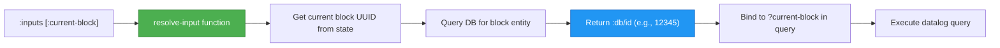

# Logseq Query Inputs: Complete Guide

> **Last revised:** 2026-05-29

**Master Advanced Queries with Dynamic Inputs for DB-Based Graphs**

---

## 🚨 IMPORTANT: Query Syntax Differs Between DB and File-Based Graphs!

**This guide shows query examples in their "raw" format.** How you write them depends on your graph type:

### File-Based Graphs

Wrap queries in `{{query ...}}` or code blocks:

```clojure
{{query (and [[page]])}}
```

### DB-Based Graphs

Use `query::` property (**NO `{{query}}` wrapper!**):

```markdown
query:: (and [[page]])
```

**See [Query Syntax: DB vs File-Based](./syntax-db-vs-file.md) for complete syntax guide.**

---

## 📚 Table of Contents

1. [What Are Query Inputs?](#what-are-query-inputs)
2. [Query Inputs vs Dynamic Variables](#query-inputs-vs-dynamic-variables)
3. [How Query Inputs Work](#how-query-inputs-work)
4. [Context Inputs](#context-inputs)
5. [Date Inputs](#date-inputs)
6. [Relative Date Inputs](#relative-date-inputs)
7. [Timestamp Inputs](#timestamp-inputs)
8. [Relative Timestamp Inputs](#relative-timestamp-inputs)
9. [Complete Reference Table](#complete-reference-table)
10. [Real-World Examples](#real-world-examples)
11. [DB vs File-Based Compatibility](#db-vs-file-based-compatibility)
12. [Best Practices](#best-practices)
13. [Troubleshooting](#troubleshooting)
14. [Advanced Patterns](#advanced-patterns)
15. [FAQ](#faq)

---

## What Are Query Inputs?

**Query inputs** are special keywords used in **advanced queries** (datalog queries) that automatically resolve to dynamic values at query runtime.

### Key Differences from DSL Queries

| Aspect                | DSL Query (Simple)         | Advanced Query with Inputs               |
| --------------------- | -------------------------- | ---------------------------------------- |
| **Query Structure**   | `(and [[foo]])`            | `{:query [...] :inputs [...]}`           |
| **File-based Syntax** | `{{query (and [[foo]])}}`  | `{{query {:query [...]}}}` or code block |
| **DB-based Syntax**   | `query:: (and [[foo]])`    | `query::` with code block                |
| **Variables**         | Template variables `<% %>` | Query inputs `:keyword`                  |
| **When Resolved**     | Before parsing             | At query execution                       |
| **Use Case**          | Simple filtering           | Complex datalog queries                  |

### Why Use Query Inputs?

✅ **Context-Aware**: Access current page, block, or parent
✅ **Precise Timing**: Millisecond-level timestamp queries
✅ **Relative Dates**: Query ranges like "last 7 days"
✅ **DB Optimized**: Designed for DB-based graphs
✅ **Composable**: Combine multiple inputs for complex queries

---

## Query Inputs vs Dynamic Variables

Understanding the difference is crucial:

### Dynamic Variables (`<% %>`)

**DSL Query Example** (syntax varies by graph type):

```clojure
# File-based:
{{query (and <% today %> (task TODO))}}

# DB-based:
query:: (and <% today %> (task "Todo"))
```

**Note**: Task statuses differ between graph types:

- File-based: Uppercase keywords (`TODO`, `DOING`, `DONE`)
- DB-based: Quoted, title-case strings (`"Todo"`, `"Doing"`, `"Done"`)

- **When**: Resolved **before** query parsing
- **Output**: Replaced with page references like `[[2025-10-16]]`
- **Where**: Works in DSL queries, templates, macros
- **Type**: String replacement

### Query Inputs (`:keyword`)

**Advanced Query Example** (syntax varies by graph type):

```clojure
# Both graphs use same query structure:
{:query [:find (pull ?b [*])
         :in $ ?today
         :where [?b :block/journal-day ?today]]
 :inputs [:today]}

# File-based: Wrap in {{query ...}} or code block
# DB-based: Use query:: property with above structure
```

- **When**: Resolved **during** query execution
- **Output**: Integers (dates) or db IDs
- **Where**: Advanced queries only
- **Type**: Datalog binding

### When to Use Which?

| Use Case              | Recommended                     |
| --------------------- | ------------------------------- |
| Simple page queries   | Dynamic variables `<% today %>` |
| Block relationships   | Query inputs `:current-block`   |
| Timestamp comparisons | Query inputs `:right-now-ms`    |
| Relative date ranges  | Query inputs `:-7d` to `:today` |
| Templates             | Dynamic variables               |
| Context-aware queries | Query inputs `:current-page`    |

---

## How Query Inputs Work

### Basic Syntax

```clojure
{:title "Query Title"
 :query [:find (pull ?b [*])
         :in $ ?input-name
         :where [?b :block/parent ?input-name]]
 :inputs [:current-block]}
```

### Anatomy of a Query with Inputs

1. **`:query`** - The datalog query with variables (e.g., `?input-name`)
2. **`:in`** - Declares input variables (must match `:inputs` order)
3. **`:inputs`** - Array of input keywords to resolve
4. **`:where`** - Uses the variables from `:in`

### Resolution Process



### Code Location

**Implementation**: `deps/db/src/logseq/db/frontend/inputs.cljs`

**Key Function**:

```clojure
(defn resolve-input [db input opts]
  ;; Resolves :current-page, :today, :-7d, etc.
  ;; Returns appropriate value based on input type
  )
```

---

## Context Inputs

Context inputs provide information about the current editing context.

### `:current-page`

**Returns**: Current page name (lowercase string)

**Use Case**: Query blocks on the active page

**Example**:

```clojure
{:title "Blocks on Current Page"
 :query [:find (pull ?b [*])
         :in $ ?current-page
         :where
         [?b :block/page ?p]
         [?p :block/name ?current-page]]
 :inputs [:current-page]}
```

**Output**: All blocks on whatever page you're currently viewing

**Important**:

- Returns lowercase page name
- Returns `nil` if no page context available
- Works differently in sidebars (see `:query-page`)

---

### `:query-page`

**Returns**: Page name where the query block lives

**Difference from `:current-page`**:

| Scenario                         | `:current-page` | `:query-page`         |
| -------------------------------- | --------------- | --------------------- |
| Query on Page A, viewing Page A  | "page a"        | "page a"              |
| Query on Page A, viewing Page B  | "page b"        | "page a"              |
| Query in sidebar while on Page A | "page a"        | (page where query is) |

**Use Case**: Query context relative to where the query is defined

**Example**:

```clojure
{:title "Tasks for This Project"
 :query [:find (pull ?b [*])
         :in $ ?project-page
         :where
         [?b :block/page ?p]
         [?p :block/name ?project-page]
         [?b :block/marker "TODO"]]
 :inputs [:query-page]}
```

**Why This is Powerful**: Place this query on "Project Alpha" page, and it always shows that project's tasks, even when viewed from elsewhere.

---

### `:current-block`

**Returns**: Current block's `:db/id` (integer)

**Use Case**: Query children, siblings, or related blocks

**Example - Children of Current Block**:

```clojure
{:title "My Children"
 :query [:find (pull ?child [*])
         :in $ ?current
         :where
         [?child :block/parent ?current]]
 :inputs [:current-block]}
```

**Example - Siblings of Current Block**:

```clojure
{:title "My Siblings"
 :query [:find (pull ?sibling [*])
         :in $ ?current
         :where
         [?current :block/parent ?p]
         [?sibling :block/parent ?p]
         [(not= ?sibling ?current)]]
 :inputs [:current-block]}
```

**Important**:

- Only available when editing/viewing a block
- Returns `db/id`, not UUID
- Can be used to traverse block tree

---

### `:parent-block`

**Returns**: Parent block's `:db/id` (integer)

**Use Case**: Query siblings or parent's properties

**Example - All Siblings (including self)**:

```clojure
{:title "All Children of My Parent"
 :query [:find (pull ?sibling [*])
         :in $ ?parent
         :where
         [?sibling :block/parent ?parent]]
 :inputs [:parent-block]}
```

**Example - Parent's Properties**:

```clojure
{:title "Parent's Tags"
 :query [:find (pull ?parent [:block/tags])
         :in $ ?parent
         :where
         [?parent :block/tags]]
 :inputs [:parent-block]}
```

---

## Date Inputs

Date inputs return integer representations of dates (YYYYMMDD format).

### `:today`

**Returns**: Integer like `20251016`

**Use Case**: Query journal pages or blocks with today's date

**Example**:

```clojure
{:title "Today's Journal"
 :query [:find (pull ?b [*])
         :in $ ?today
         :where
         [?b :block/journal-day ?today]]
 :inputs [:today]}
```

**Data Format**:

- `20251016` = October 16, 2025
- Used for `:block/journal-day` attribute

---

### `:yesterday`

**Returns**: Integer for yesterday's date

**Example**:

```clojure
{:title "Yesterday's Tasks"
 :query [:find (pull ?b [*])
         :in $ ?yesterday
         :where
         [?b :block/journal-day ?yesterday]
         [?b :block/marker]]
 :inputs [:yesterday]}
```

---

### `:tomorrow`

**Returns**: Integer for tomorrow's date

**Example**:

```clojure
{:title "Tomorrow's Schedule"
 :query [:find (pull ?b [*])
         :in $ ?tomorrow
         :where
         [?b :block/journal-day ?tomorrow]]
 :inputs [:tomorrow]}
```

---

## Relative Date Inputs

Relative date inputs let you query date ranges dynamically.

### Syntax Pattern

```
:-Xd  = X days ago
:-Xw  = X weeks ago
:-Xm  = X months ago
:-Xy  = X years ago

:+Xd  = X days from now
:+Xw  = X weeks from now
:+Xm  = X months from now
:+Xy  = X years from now
```

### Examples

| Input  | Today is Oct 16 | Returns                   |
| ------ | --------------- | ------------------------- |
| `:-1d` | Oct 16, 2025    | `20251015` (Oct 15)       |
| `:-7d` | Oct 16, 2025    | `20251009` (Oct 9)        |
| `:-1w` | Oct 16, 2025    | `20251009` (Oct 9)        |
| `:-1m` | Oct 16, 2025    | `20250916` (Sep 16)       |
| `:-1y` | Oct 16, 2025    | `20241016` (Oct 16, 2024) |
| `:+3d` | Oct 16, 2025    | `20251019` (Oct 19)       |
| `:+1w` | Oct 16, 2025    | `20251023` (Oct 23)       |

### Real Example - Last 7 Days

```clojure
{:title "Last Week's Activity"
 :query [:find (pull ?b [*])
         :in $ ?start ?end %
         :where
         (between ?b ?start ?end)]
 :inputs [:-7d :today]
 :rules [[(between ?b ?start ?end)
          [?b :block/journal-day ?d]
          [(>= ?d ?start)]
          [(<= ?d ?end)]]]}
```

**Explanation**:

- `:-7d` resolves to 7 days ago (e.g., `20251009`)
- `:today` resolves to today (e.g., `20251016`)
- Query finds all journal entries between those dates

---

## Timestamp Inputs

Timestamp inputs return **milliseconds since Unix epoch** for precise time queries.

### `:right-now-ms`

**Returns**: Current timestamp in milliseconds

**Use Case**: Query recently created/modified blocks

**Example - Blocks Created in Last Hour**:

```clojure
{:title "Recent Blocks"
 :query [:find (pull ?b [*])
         :in $ ?now
         :where
         [?b :block/created-at ?t]
         [(- ?now 3600000) ?hour-ago]
         [(>= ?t ?hour-ago)]]
 :inputs [:right-now-ms]}
```

**Note**: `3600000` = 1 hour in milliseconds

---

### `:start-of-today-ms`

**Returns**: Timestamp for today at 00:00:00.000

**Example - Blocks Created Today**:

```clojure
{:title "Created Today"
 :query [:find (pull ?b [*])
         :in $ ?start ?end
         :where
         [?b :block/created-at ?t]
         [(>= ?t ?start)]
         [(<= ?t ?end)]]
 :inputs [:start-of-today-ms :right-now-ms]}
```

---

### `:end-of-today-ms`

**Returns**: Timestamp for today at 23:59:59.999

---

### Time-Specific Inputs

**Pattern**: `:today-HHMM`, `:today-HHMMSS`, `:today-HHMMSSmmm`

**Examples**:

- `:today-0900` = Today at 9:00 AM (9:00:00.000)
- `:today-1430` = Today at 2:30 PM (14:30:00.000)
- `:today-143045` = Today at 2:30:45 PM (14:30:45.000)
- `:today-143045500` = Today at 2:30:45.500 PM

**Use Case**: Query blocks within specific time windows

**Example - Morning Blocks**:

```clojure
{:title "Morning Work (6am-12pm)"
 :query [:find (pull ?b [*])
         :in $ ?start ?end
         :where
         [?b :block/created-at ?t]
         [(>= ?t ?start)]
         [(< ?t ?end)]]
 :inputs [:today-0600 :today-1200]}
```

---

## Relative Timestamp Inputs

Combine relative dates with timestamps for powerful time-range queries.

### Syntax Patterns

```
:-Xd-ms     = X days ago at start of day (00:00:00.000)
:+Xd-ms     = X days from now at end of day (23:59:59.999)

:-Xd-start  = X days ago at 00:00:00.000
:-Xd-end    = X days ago at 23:59:59.999
:+Xd-start  = X days from now at 00:00:00.000
:+Xd-end    = X days from now at 23:59:59.999

:-Xd-HHMM   = X days ago at specific time
:+Xd-HHMM   = X days from now at specific time
```

### Examples

| Input        | Today is Oct 16, 12:00 PM | Returns (ms timestamp) |
| ------------ | ------------------------- | ---------------------- |
| `:-1d-ms`    | Oct 16, 2025              | Oct 15, 00:00:00.000   |
| `:+1d-ms`    | Oct 16, 2025              | Oct 17, 23:59:59.999   |
| `:-3d-start` | Oct 16, 2025              | Oct 13, 00:00:00.000   |
| `:-3d-end`   | Oct 16, 2025              | Oct 13, 23:59:59.999   |
| `:-1d-0900`  | Oct 16, 2025              | Oct 15, 09:00:00.000   |
| `:+2d-1430`  | Oct 16, 2025              | Oct 18, 14:30:00.000   |

### Real Example - Last 24 Hours

```clojure
{:title "Last 24 Hours"
 :query [:find (pull ?b [*])
         :in $ ?start ?end
         :where
         [?b :block/created-at ?t]
         [(>= ?t ?start)]
         [(<= ?t ?end)]]
 :inputs [:-1d-ms :right-now-ms]}
```

### Real Example - Last Week's Work Hours (9am-5pm)

```clojure
{:title "Last Week 9-5"
 :query [:find (pull ?b [*])
         :in $ ?start ?end
         :where
         [?b :block/created-at ?t]
         [(>= ?t ?start)]
         [(<= ?t ?end)]
         ;; Additional filtering for time of day would need custom logic
         ]
 :inputs [:-7d-0900 :today-1700]}
```

---

## Complete Reference Table

### Context Inputs

| Input            | Returns               | Type    | Use Case                            |
| ---------------- | --------------------- | ------- | ----------------------------------- |
| `:current-page`  | Page name (lowercase) | String  | Page where you're currently viewing |
| `:query-page`    | Page name (lowercase) | String  | Page where query block lives        |
| `:current-block` | Block ID              | Integer | Block being edited/viewed           |
| `:parent-block`  | Block ID              | Integer | Parent of current block             |

### Date Inputs (Integer - YYYYMMDD)

| Input        | Returns      | Example    |
| ------------ | ------------ | ---------- |
| `:today`     | Today's date | `20251016` |
| `:yesterday` | Yesterday    | `20251015` |
| `:tomorrow`  | Tomorrow     | `20251017` |

### Relative Date Inputs (Integer - YYYYMMDD)

| Pattern | Example | Returns (if today is Oct 16, 2025) |
| ------- | ------- | ---------------------------------- |
| `:-Xd`  | `:-7d`  | `20251009` (Oct 9)                 |
| `:-Xw`  | `:-2w`  | `20251002` (Oct 2)                 |
| `:-Xm`  | `:-1m`  | `20250916` (Sep 16)                |
| `:-Xy`  | `:-1y`  | `20241016` (Oct 16, 2024)          |
| `:+Xd`  | `:+3d`  | `20251019` (Oct 19)                |
| `:+Xw`  | `:+1w`  | `20251023` (Oct 23)                |
| `:+Xm`  | `:+2m`  | `20251216` (Dec 16)                |
| `:+Xy`  | `:+1y`  | `20261016` (Oct 16, 2026)          |

### Timestamp Inputs (Milliseconds)

| Input                | Returns               | Description                     |
| -------------------- | --------------------- | ------------------------------- |
| `:right-now-ms`      | Current timestamp     | Exact moment query runs         |
| `:start-of-today-ms` | Today 00:00:00.000    | Start of day                    |
| `:end-of-today-ms`   | Today 23:59:59.999    | End of day                      |
| `:today-start`       | Today 00:00:00.000    | Alias for start-of-today-ms     |
| `:today-end`         | Today 23:59:59.999    | Alias for end-of-today-ms       |
| `:today-HHMM`        | Today at HH:MM:00.000 | Specific time                   |
| `:today-HHMMSS`      | Today at HH:MM:SS.000 | Specific time with seconds      |
| `:today-HHMMSSmmm`   | Today at HH:MM:SS.mmm | Specific time with milliseconds |

### Relative Timestamp Inputs (Milliseconds)

| Pattern       | Example       | Description                     |
| ------------- | ------------- | ------------------------------- |
| `:-Xd-ms`     | `:-1d-ms`     | X days ago at start of day      |
| `:+Xd-ms`     | `:+1d-ms`     | X days from now at end of day   |
| `:-Xd-start`  | `:-3d-start`  | X days ago at 00:00:00.000      |
| `:-Xd-end`    | `:-3d-end`    | X days ago at 23:59:59.999      |
| `:+Xd-start`  | `:+2d-start`  | X days from now at 00:00:00.000 |
| `:+Xd-end`    | `:+2d-end`    | X days from now at 23:59:59.999 |
| `:-Xd-HHMM`   | `:-1d-0900`   | X days ago at HH:MM             |
| `:+Xd-HHMM`   | `:+2d-1430`   | X days from now at HH:MM        |
| `:-Xd-HHMMSS` | `:-1d-143045` | X days ago at HH:MM:SS          |
| `:+Xd-HHMMSS` | `:+1d-083000` | X days from now at HH:MM:SS     |

### Deprecated (Still Works)

| Input           | Replacement | Description              |
| --------------- | ----------- | ------------------------ |
| `:Xd-before`    | `:-Xd`      | Old relative date syntax |
| `:Xd-after`     | `:+Xd`      | Old relative date syntax |
| `:Xd-before-ms` | `:-Xd-ms`   | Old relative timestamp   |
| `:Xd-after-ms`  | `:+Xd-ms`   | Old relative timestamp   |

---

## Real-World Examples

### Example 1: Project Dashboard

**Goal**: Show all activity on current project page from the last 7 days

```clojure
{:title "📊 This Week's Project Activity"
 :query [:find (pull ?b [*])
         :in $ ?project ?start ?end
         :where
         [?b :block/page ?p]
         [?p :block/name ?project]
         [?b :block/created-at ?t]
         [(>= ?t ?start)]
         [(<= ?t ?end)]]
 :inputs [:current-page :-7d-start :right-now-ms]}
```

**Place this on any project page** - it automatically adapts!

---

### Example 2: Block Hierarchy Navigator

**Goal**: Show children, siblings, and parent of current block

```clojure
{:title "🗂️ Block Context"
 :query [:find (pull ?related [:block/title :block/uuid])
         :in $ ?current ?parent
         :where
         (or-join [?related ?current ?parent]
                  ;; Children
                  [?related :block/parent ?current]
                  ;; Siblings
                  (and [?related :block/parent ?parent]
                       [(not= ?related ?current)])
                  ;; Parent
                  [?parent :db/id ?related])]
 :inputs [:current-block :parent-block]}
```

---

### Example 3: Time-Based Task Filter

**Goal**: Tasks created today between 9am and 5pm

```clojure
{:title "📋 Today's Work Hours Tasks"
 :query [:find (pull ?b [*])
         :in $ ?start ?end
         :where
         [?b :block/marker ?m]
         [(contains? #{"TODO" "DOING" "NOW"} ?m)]
         [?b :block/created-at ?t]
         [(>= ?t ?start)]
         [(< ?t ?end)]]
 :inputs [:today-0900 :today-1700]}
```

---

### Example 4: Weekly Review

**Goal**: All completed tasks from last week

```clojure
{:title "✅ Last Week's Wins"
 :query [:find (pull ?b [*])
         :in $ ?start ?end
         :where
         [?b :block/marker "DONE"]
         [?b :block/created-at ?t]
         [(>= ?t ?start)]
         [(<= ?t ?end)]]
 :inputs [:-7d-start :today-start]}
```

---

### Example 5: Smart Daily Note Query

**Goal**: Show yesterday's incomplete tasks on today's page

```clojure
{:title "⚠️ Carryover from Yesterday"
 :query [:find (pull ?b [*])
         :in $ ?yesterday
         :where
         [?b :block/journal-day ?yesterday]
         [?b :block/marker ?m]
         [(contains? #{"TODO" "DOING" "NOW"} ?m)]]
 :inputs [:yesterday]}
```

Place this in your daily note template!

---

### Example 6: Recent Activity Stream

**Goal**: Show all blocks modified in the last hour

```clojure
{:title "🔥 Last Hour's Activity"
 :query [:find (pull ?b [*])
         :in $ ?threshold
         :where
         [?b :block/updated-at ?t]
         [(>= ?t ?threshold)]]
 :inputs [:today-1200]}  ;; Replace HHMM with hour ago
```

**Note**: For true "last hour", you'd calculate from `:right-now-ms - 3600000`

---

### Example 7: Cross-Page Task Aggregator

**Goal**: All tasks tagged with current page

```clojure
{:title "🔗 Tasks Mentioning This Page"
 :query [:find (pull ?b [*])
         :in $ ?page-name
         :where
         [?page :block/name ?page-name]
         [?b :block/refs ?page]
         [?b :block/marker]]
 :inputs [:current-page]}
```

---

### Example 8: Deadline Tracker

**Goal**: Tasks due within next 3 days

```clojure
{:title "⏰ Upcoming Deadlines"
 :query [:find (pull ?b [*])
         :in $ ?today ?cutoff %
         :where
         [?b :block/marker "TODO"]
         (property ?b :due ?due-date)
         [(>= ?due-date ?today)]
         [(<= ?due-date ?cutoff)]]
 :inputs [:today :+3d]
 :rules [[(property ?b ?prop-name ?v)
          [?b :block/properties ?props]
          [(get ?props ?prop-name) ?v]]]}
```

---

## DB vs File-Based Compatibility

### Query Inputs Compatibility Matrix

| Input                   | DB-Based | File-Based | Notes                          |
| ----------------------- | -------- | ---------- | ------------------------------ |
| **Context Inputs**      |          |            |                                |
| `:current-page`         | ✅ Yes   | ✅ Yes     | Returns page name              |
| `:query-page`           | ✅ Yes   | ✅ Yes     | Returns page where query lives |
| `:current-block`        | ✅ Yes   | ✅ Yes     | Returns :db/id                 |
| `:parent-block`         | ✅ Yes   | ✅ Yes     | Returns :db/id                 |
| **Date Inputs**         |          |            |                                |
| `:today`                | ✅ Yes   | ✅ Yes     | Integer format                 |
| `:yesterday`            | ✅ Yes   | ✅ Yes     | Integer format                 |
| `:tomorrow`             | ✅ Yes   | ✅ Yes     | Integer format                 |
| **Relative Dates**      |          |            |                                |
| `:-Xd/w/m/y`            | ✅ Yes   | ✅ Yes     | All units supported            |
| `:+Xd/w/m/y`            | ✅ Yes   | ✅ Yes     | All units supported            |
| **Timestamp Inputs**    |          |            |                                |
| `:right-now-ms`         | ✅ Yes   | ✅ Yes     | Current timestamp              |
| `:start-of-today-ms`    | ✅ Yes   | ✅ Yes     | Midnight                       |
| `:end-of-today-ms`      | ✅ Yes   | ✅ Yes     | 23:59:59.999                   |
| `:today-HHMM`           | ✅ Yes   | ✅ Yes     | Specific times                 |
| **Relative Timestamps** |          |            |                                |
| `:-Xd-ms`               | ✅ Yes   | ✅ Yes     | All formats supported          |
| `:-Xd-start/end`        | ✅ Yes   | ✅ Yes     | All formats supported          |
| `:-Xd-HHMM`             | ✅ Yes   | ✅ Yes     | All formats supported          |

**Verdict**: ✅ **All query inputs work in both DB and file-based graphs!**

### DB-Based Advantages

While inputs work in both, DB-based graphs offer:

- ✅ Faster query execution
- ✅ More efficient indexing
- ✅ Better support for complex relationships
- ✅ Optimized for `:db/id` lookups

---

## Best Practices

### 1. Choose the Right Input Type

**❌ Don't** mix integer dates with timestamps:

```clojure
;; WRONG - Comparing journal-day (int) with timestamp (ms)
[?b :block/journal-day ?today]
[(>= ?today ?timestamp)]  ;; Type mismatch!
```

**✅ Do** use consistent types:

```clojure
;; RIGHT - Both are integers
[?b :block/journal-day ?today]
[(>= ?today ?yesterday)]
```

### 2. Order Inputs Correctly

Input order must match `:in` declaration:

**❌ Wrong Order**:

```clojure
{:query [:find (pull ?b [*])
         :in $ ?end ?start  ;; Reversed!
         :where ...]
 :inputs [:today :-7d]}     ;; Doesn't match
```

**✅ Correct Order**:

```clojure
{:query [:find (pull ?b [*])
         :in $ ?start ?end
         :where ...]
 :inputs [:-7d :today]}
```

### 3. Use Descriptive Variable Names

**❌ Generic**:

```clojure
:in $ ?x ?y
```

**✅ Descriptive**:

```clojure
:in $ ?start-date ?end-date
```

### 4. Document Your Queries

Add `:title` to explain what the query does:

```clojure
{:title "📊 Last Week's Activity - Shows all blocks created in the past 7 days"
 :query [...]
 :inputs [...]}
```

### 5. Test Edge Cases

Test your queries:

- At midnight (day transitions)
- On month boundaries
- With no data in the range
- With null values

### 6. Prefer Relative Inputs Over Hardcoded

**❌ Hardcoded**:

```clojure
[?b :block/journal-day 20251016]  ;; Breaks tomorrow!
```

**✅ Relative**:

```clojure
:inputs [:today]
```

### 7. Use Rules for Reusability

Define reusable rules for common patterns:

```clojure
{:query [:find (pull ?b [*])
         :in $ ?start ?end %
         :where (between ?b ?start ?end)]
 :inputs [:-7d :today]
 :rules [[(between ?b ?start ?end)
          [?b :block/journal-day ?d]
          [(>= ?d ?start)]
          [(<= ?d ?end)]]]}
```

### 8. Combine Context and Time Inputs

**Powerful Pattern**:

```clojure
{:title "This Project's Recent Activity"
 :query [:find (pull ?b [*])
         :in $ ?project ?since
         :where
         [?b :block/page ?p]
         [?p :block/name ?project]
         [?b :block/created-at ?t]
         [(>= ?t ?since)]]
 :inputs [:current-page :-7d-start]}
```

This query is:

- Context-aware (`:current-page`)
- Time-aware (`:-7d-start`)
- Reusable (works on any page)

---

## Troubleshooting

### Problem 1: Query Returns Empty Results

**Symptom**: Query with inputs returns nothing

**Debugging Steps**:

1. **Test inputs separately**:

   ```clojure
   {:query [:find ?input
            :in $ ?input
            :where [(identity ?input)]]
    :inputs [:current-page]}
   ```

   This shows what `:current-page` resolves to.

2. **Check data exists**:

   ```clojure
   {:query [:find ?b
            :where [?b :block/journal-day]]
    :inputs []}
   ```

   Verify you have journal data.

3. **Verify input type matches attribute**:
   - `:block/journal-day` needs integers (`:today`, `:-7d`)
   - `:block/created-at` needs timestamps (`:right-now-ms`, `:-1d-ms`)

---

### Problem 2: "Nothing found for entity" Error

**Symptom**: Error when using `:current-block` or `:parent-block`

**Cause**: No block context available

**Solution**:

- Ensure you're viewing/editing a block when query runs
- Check if `:current-block-uuid` is provided in query options
- Verify the block exists in database

---

### Problem 3: Wrong Date Range

**Symptom**: `:-7d` to `:today` doesn't show expected blocks

**Debugging**:

1. **Check resolved values**:

   ```clojure
   {:query [:find ?start ?end
            :in $ ?start ?end
            :where [(identity ?start)]]
    :inputs [:-7d :today]}
   ```

2. **Verify your data**:
   - Check `:block/journal-day` values
   - Ensure they're in integer format (YYYYMMDD)
   - Confirm date range overlaps with your data

---

### Problem 4: Timestamp Comparison Fails

**Symptom**: Comparing timestamps doesn't work as expected

**Common Mistake**:

```clojure
;; WRONG - Comparing different types
[?b :block/journal-day ?d]
[?b :block/created-at ?t]
[(>= ?d ?t)]  ;; Int vs Ms!
```

**Solution**: Use consistent types

```clojure
;; RIGHT - Both timestamps
[?b :block/created-at ?t]
[(>= ?t ?threshold)]
```

---

### Problem 5: `:current-page` Returns Unexpected Value

**Symptom**: `:current-page` doesn't match visible page

**Causes**:

1. **Sidebar**: Query runs in sidebar context, not main page
2. **Editing**: If editing a block, might return block's page
3. **Lowercase**: Always returns lowercase name

**Solution**: Use `:query-page` instead for stable context

---

### Problem 6: Time Zone Issues

**Symptom**: `:today-0900` doesn't match expected time

**Explanation**: All times are in **local browser timezone**

**Solution**:

- Times are relative to user's system time
- `:start-of-today-ms` = midnight in local timezone
- Cannot override timezone in queries

---

## Advanced Patterns

### Pattern 1: Sliding Time Window

**Goal**: Always show last N hours/days regardless of current time

```clojure
{:title "Last 24 Hours (Rolling)"
 :query [:find (pull ?b [*])
         :in $ ?now
         :where
         [?b :block/created-at ?t]
         [(- ?now 86400000) ?day-ago]  ;; 24 hours in ms
         [(>= ?t ?day-ago)]]
 :inputs [:right-now-ms]}
```

**Calculation**:

- 1 hour = 3,600,000 ms
- 1 day = 86,400,000 ms
- 1 week = 604,800,000 ms

---

### Pattern 2: Multiple Context Awareness

**Goal**: Query relative to multiple contexts

```clojure
{:title "Project Tasks in Current Block's Context"
 :query [:find (pull ?b [*])
         :in $ ?project ?current
         :where
         [?b :block/page ?p]
         [?p :block/name ?project]
         [?b :block/marker "TODO"]
         ;; Also show if referenced in current block
         (or [?current :block/refs ?b]
             [?b :block/parent ?current])]
 :inputs [:current-page :current-block]}
```

---

### Pattern 3: Conditional Time Range

**Goal**: Different ranges for different pages

```clojure
{:title "Adaptive Time Range"
 :query [:find (pull ?b [*])
         :in $ ?page ?start ?end
         :where
         [?b :block/page ?p]
         [?p :block/name ?page]
         [?b :block/created-at ?t]
         [(>= ?t ?start)]
         [(<= ?t ?end)]]
 :inputs [:current-page :-7d-start :right-now-ms]}
```

Then customize per page by overriding inputs.

---

### Pattern 4: Relative to Query Block Creation

**Goal**: Show content created since this query was added

```clojure
{:title "New Since This Query Created"
 :query [:find (pull ?b [*])
         :in $ ?query-block ?page
         :where
         [?query-block :block/created-at ?threshold]
         [?b :block/page ?p]
         [?p :block/name ?page]
         [?b :block/created-at ?t]
         [(> ?t ?threshold)]]
 :inputs [:current-block :current-page]}
```

**Clever**: Self-referential query using its own creation time!

---

### Pattern 5: Cross-Time Comparison

**Goal**: Compare this week vs last week

```clojure
{:title "This Week vs Last Week"
 :query [:find (pull ?b [:block/title :block/created-at])
         :in $ ?this-week-start ?last-week-start ?last-week-end
         :where
         (or (and [?b :block/created-at ?t]
                  [(>= ?t ?this-week-start)])
             (and [?b :block/created-at ?t]
                  [(>= ?t ?last-week-start)]
                  [(<= ?t ?last-week-end)]))]
 :inputs [:-7d-start :-14d-start :-7d-end]}
```

---

### Pattern 6: Hierarchical Context

**Goal**: Query blocks within current block's subtree

```clojure
{:title "Everything in This Subtree"
 :query [:find (pull ?b [*])
         :in $ ?root
         :where
         (or [?b :block/parent ?root]
             (and [?b :block/parent ?intermediate]
                  [?intermediate :block/parent ?root]))]
 :inputs [:current-block]}
```

**Note**: This only goes 2 levels deep. For full tree, need recursive rules.

---

### Pattern 7: Time-Bucketed Aggregation

**Goal**: Count blocks per day for last week

```clojure
{:title "Daily Activity Count"
 :query [:find ?day (count ?b)
         :in $ ?start ?end %
         :where
         (between ?b ?start ?end)
         [?b :block/journal-day ?day]]
 :inputs [:-7d :today]
 :rules [[(between ?b ?start ?end)
          [?b :block/journal-day ?d]
          [(>= ?d ?start)]
          [(<= ?d ?end)]]]}
```

Returns pairs like `[20251010 15]` = 15 blocks on Oct 10.

---

## FAQ

### Q1: Can I use multiple date inputs in one query?

**A**: Yes! Common pattern:

```clojure
:inputs [:-30d :-7d :today :+7d]
```

This gives you 4 date variables to work with.

---

### Q2: What's the difference between `:current-page` and `:query-page`?

**A**:

- `:current-page` = Page you're viewing
- `:query-page` = Page where query block lives

Use `:query-page` for stable context, `:current-page` for dynamic views.

---

### Q3: Can I combine query inputs with template variables?

**A**: Not directly. They're separate systems:

- Template variables `<% %>` work in DSL queries (simple)
- Query inputs `:keyword` work in advanced queries (datalog)

---

### Q4: Why does `:today` return an integer instead of a page reference?

**A**: Different purposes:

- `<% today %>` → Page reference `[[2025-10-16]]` for linking
- `:today` → Integer `20251016` for database comparisons

---

### Q5: Can I create custom inputs?

**A**: No, inputs are hardcoded in `logseq.db.frontend.inputs` namespace. You can:

- Use page reference strings: `:inputs ["[[Page Name]]"]` (string in `[[...]]` format)
- Use literals: `:inputs ["string" 42]`
- But not custom resolved keywords

---

### Q6: Do inputs work in simple queries?

**A**: No. Inputs only work in advanced queries with `:query`, `:inputs` structure.

For simple queries, use template variables `<% %>`.

---

### Q7: How do I query "between X and Y days ago"?

**A**:

```clojure
:inputs [:-7d :-3d]  ;; 7 days ago to 3 days ago
```

---

### Q8: Can inputs access block properties?

**A**: No. Inputs resolve to:

- Page names (strings)
- Block IDs (integers)
- Dates (integers)
- Timestamps (milliseconds)

They don't resolve property values. Use the query `:where` clause for that.

---

### Q9: Why is my `:current-block` query failing?

**A**: Check:

1. Are you editing/viewing a block? (not just on a page)
2. Is the block in the database?
3. Does your query use `?current-block` correctly?

---

### Q10: How precise are timestamp inputs?

**A**:

- `:right-now-ms` = millisecond precision
- `:-Xd-HHMMSS` = second precision
- `:-Xd-HHMM` = minute precision
- `:-Xd` = day precision

---

### Q11: Can I query "last Monday" or "next Friday"?

**A**: Not directly with inputs. You'd need to:

1. Calculate the date manually
2. Use `:inputs [20251013]` (hardcoded)
3. Or use template variables `<% last monday %>` in DSL queries

---

### Q12: What timezone are timestamp inputs in?

**A**: Local browser timezone. Cannot override.

---

### Q13: Do inputs update automatically?

**A**: Yes! Queries re-run when:

- Page changes (`:current-page` updates)
- Block context changes
- Time passes (`:today` changes at midnight)

---

### Q14: Can I use negative numbers for `:+Xd`?

**A**: No, use `:-Xd` for past dates. Signs matter:

- `:-7d` = 7 days ago ✅
- `:+7d` = 7 days from now ✅
- `:-(-7)d` = Invalid ❌

---

### Q15: How do I debug query inputs?

**A**: Use this pattern:

```clojure
{:query [:find ?input
         :in $ ?input
         :where [(identity ?input)]]
 :inputs [:current-page]}
```

Shows exactly what the input resolves to.

---

## Quick Reference Card

### Most Common Patterns

```clojure
# Current page's blocks
:inputs [:current-page]

# Last 7 days
:inputs [:-7d :today]

# Last 24 hours
:inputs [:-1d-ms :right-now-ms]

# Current block's children
:inputs [:current-block]

# This week (Mon-Sun)
:inputs [:-7d :today]  # Approximate

# Today 9am-5pm
:inputs [:today-0900 :today-1700]

# Blocks since query created
:inputs [:current-block]  # Use :block/created-at

# Project context + time range
:inputs [:current-page :-7d-start :right-now-ms]
```

---

## Findings: New Capabilities

### Namespaced Keyword Form for Relative Dates

The source code and tests confirm a **namespaced keyword form** for relative date inputs:

```clojure
:today/+1d   ;; equivalent to :+1d  (1 day from now)
:today/-1d   ;; equivalent to :-1d  (1 day ago)
:today/+1w   ;; equivalent to :+1w  (1 week from now)
```

This form exploits the ClojureScript namespaced keyword convention. The namespace (`today`) selects the reference date (currently only `today` is supported), and the name (`+1d`, `-1w`, etc.) specifies the offset. Both forms resolve identically.

**Source**: `resolve-keyword-input :relative-date` — uses `(namespace input)` to determine reference date, `(name input)` for the offset.

**Test coverage**: `deps/db/test/logseq/db/frontend/inputs_test.cljs` — `:today/+1d` tested alongside `:+1d`.

---

## Resources

### Documentation

- **Dynamic Variables Guide**: [dynamic-variables-user-guide.md](./dynamic-variables-user-guide.md)
- **Developer Guide**: [dynamic-variables-developer-guide.md](./dynamic-variables-developer-guide.md)
- **Logseq Docs**: [docs.logseq.com](https://docs.logseq.com/)

### Code References

- **Implementation**: `deps/db/src/logseq/db/frontend/inputs.cljs`
- **Tests**: `deps/db/test/logseq/db/frontend/inputs_test.cljs`
- **Query React**: `src/main/frontend/db/query_react.cljs:19-33`

### Community

- **Forum**: forum.logseq.com
- **Discord**: #advanced-queries channel
- **GitHub**: Report issues or request features

---

## Appendix: Complete Input Resolution Table

### How Each Input Resolves

| Input                | Resolution Function                         | Return Type | Depends On                             |
| -------------------- | ------------------------------------------- | ----------- | -------------------------------------- |
| `:current-page`      | `resolve-keyword-input`                     | String      | `current-page-fn` from state           |
| `:query-page`        | `resolve-keyword-input`                     | String      | `current-block-uuid` → block's page    |
| `:current-block`     | `resolve-keyword-input`                     | Integer     | `current-block-uuid` → :db/id          |
| `:parent-block`      | `resolve-keyword-input`                     | Integer     | `current-block-uuid` → parent's :db/id |
| `:today`             | `resolve-keyword-input`                     | Integer     | `(t/today)`                            |
| `:yesterday`         | `resolve-keyword-input`                     | Integer     | `(t/minus (t/today) (t/days 1))`       |
| `:tomorrow`          | `resolve-keyword-input`                     | Integer     | `(t/plus (t/today) (t/days 1))`        |
| `:right-now-ms`      | `resolve-keyword-input`                     | Integer     | `(common-util/time-ms)`                |
| `:start-of-today-ms` | `resolve-keyword-input`                     | Integer     | `(date-at-local-ms 0 0 0 0)`           |
| `:end-of-today-ms`   | `resolve-keyword-input`                     | Integer     | `(date-at-local-ms 23 59 59 999)`      |
| `:-Xd/w/m/y`         | `resolve-keyword-input :relative-date`      | Integer     | `(get-offset-date ...)`                |
| `:+Xd/w/m/y`         | `resolve-keyword-input :relative-date`      | Integer     | `(get-offset-date ...)`                |
| `:-Xd-ms`            | `resolve-keyword-input :relative-date-time` | Integer     | `(date-at-local-ms ...)`               |
| `:-Xd-start`         | `resolve-keyword-input :relative-date-time` | Integer     | `(date-at-local-ms ... 0 0 0 0)`       |
| `:-Xd-end`           | `resolve-keyword-input :relative-date-time` | Integer     | `(date-at-local-ms ... 23 59 59 999)`  |
| `:-Xd-HHMM`          | `resolve-keyword-input :relative-date-time` | Integer     | `(date-at-local-ms ... HH MM 0 0)`     |

---

**Last Updated:** 2026-05-29
**Version:** 1.0.1
**Tested With:** Logseq DB-based graphs (primary), File-based graphs (compatible)

---

_Master query inputs to build powerful, context-aware queries that adapt dynamically to your workflow!_ 🚀
