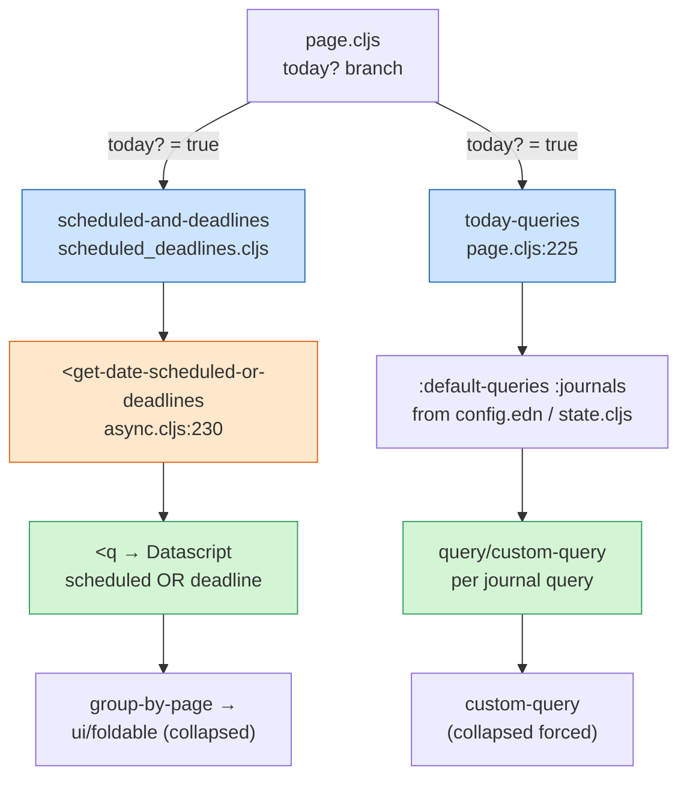
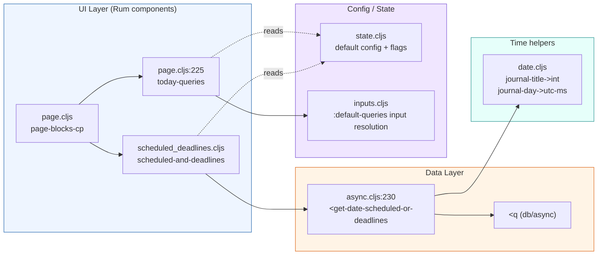
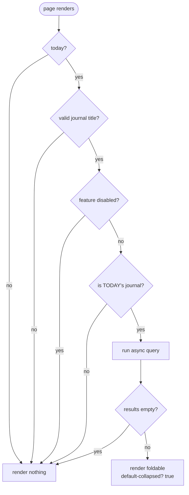
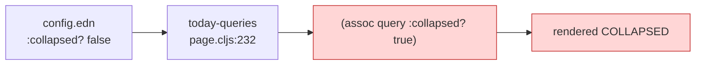

# Scheduled & Deadline Journal Query: A Detective's Investigation Report

> Investigation depth: **Standard** · Special focus: **Frontend (ClojureScript / Rum) + Datascript data layer** · Graph type: **DB graphs**

## 🔍 Case Summary

- **What it does**: On *today's* journal page, Logseq renders an agenda — a "Scheduled and Deadline" section listing every open task whose `scheduled` or `deadline` date falls within a forward window (today → today + N days).
- **Why it exists**: Journals are the daily entry point. Surfacing upcoming scheduled/deadline tasks on today's page turns the journal into a lightweight agenda without the user writing a single query.
- **Key discovery highlights**:
  - 🔍 There are **two independent renderers** that look similar but are different code paths: the hardcoded **Scheduled-and-Deadline section** and the config-driven **`:default-queries :journals`** list.
  - ❌ **The headline gotcha**: both paths are **force-collapsed**. The built-in section hardcodes `:default-collapsed? true`, and the default-queries renderer *overwrites* every query's `:collapsed?` with `true` at render time. **No `config.edn` setting un-collapses either of them.**
  - 🔍 The query compares against **millisecond timestamps**, not journal-day integers — a subtle trap when porting it to a custom query.

## 📋 Table of Contents

1. [Architecture Overview](#architecture-overview)
2. [The Crime Scene Map](#the-crime-scene-map)
3. [Evidence #1: The Built-in Scheduled-and-Deadline Section](#evidence-1-the-built-in-scheduled-and-deadline-section)
4. [Evidence #2: The Datascript Query](#evidence-2-the-datascript-query)
5. [Evidence #3: The Forced-Collapse Conspiracy](#evidence-3-the-forced-collapse-conspiracy)
6. [Evidence #4: The Time-Window Inputs](#evidence-4-the-time-window-inputs)
7. [Key Witnesses (Main Files)](#key-witnesses-main-files)
8. [Critical Findings](#critical-findings)
9. [Configuration Reference](#configuration-reference)
10. [Message Flow Reference](#message-flow-reference)
11. [Debugging Guide](#debugging-guide)
12. [Performance Notes](#performance-notes)
13. [Known Limitations](#known-limitations)
14. [Future Improvements](#future-improvements)
15. [Case Closed](#case-closed)
16. [Appendix: File Tree](#appendix-file-tree)

## Architecture Overview

The feature is a thin **render-on-today's-journal** vertical slice: a Rum component asks an async DB query for matching blocks, groups them by page, and renders them inside a collapsible (`ui/foldable`) panel. There is no background job, cache, or worker — it runs reactively when the journal page mounts.



> ⚠️ **Two paths, one name.** Users see "Scheduled and Deadline" and assume it's one of their `:default-queries`. It is not. The built-in section (left branch) and the configurable default-queries (right branch) are separate code with separate collapse behavior.

## The Crime Scene Map



## Evidence #1: The Built-in Scheduled-and-Deadline Section

### The Witness Files

| File | Role |
|------|------|
| `src/main/frontend/components/page.cljs:531` | Mounts the section, only when `today?` |
| `src/main/frontend/components/scheduled_deadlines.cljs` | The Rum component itself |
| `src/main/frontend/db/async.cljs:230` | The async query it calls |

### The Investigation

The section is mounted from the page component, gated on `today?`:

**Location**: `src/main/frontend/components/page.cljs:530-531`
```clojure
(when today?
  (scheduled/scheduled-and-deadlines title))   ; → only on today's journal
```

The component fetches asynchronously in its `:init`, stashes the result in a local atom, and renders it reactively:

**Location**: `src/main/frontend/components/scheduled_deadlines.cljs:21-45`
```clojure
(rum/defcs scheduled-and-deadlines < rum/reactive
  {:init (fn [state]
           (let [*result (atom nil)
                 page-name (first (:rum/args state))]
             (p/let [result (when (scheduled-or-deadlines? page-name)            ; ← guard
                              (db-async/<get-date-scheduled-or-deadlines
                               (string/capitalize page-name)))]
               (reset! *result result))
             (assoc state ::result *result)))}
  [state page-name]
  (let [scheduled-or-deadlines (rum/react (::result state))]
    (when (seq scheduled-or-deadlines)                                           ; ← hidden when empty
      [:div.scheduled-or-deadlines
       (ui/foldable
        [:div.text-sm.font-medium (t :page/scheduled-and-deadline)]             ; "Scheduled and Deadline"
        (fn [] ...)
        {:title-trigger? true
         :default-collapsed? true})])))                                          ; ← ❌ HARDCODED collapse
```

🔍 **Hidden behaviors:**
- The section only appears when **all three** guard conditions hold (`scheduled-or-deadlines?`, `scheduled_deadlines.cljs:15-19`):
  1. `date/valid-journal-title?` — the page is a journal page.
  2. `not (state/scheduled-deadlines-disabled?)` — the feature flag is off.
  3. `db/today-journal-page?` — it is *today's* journal, not any past/future journal.
- When the result set is empty, the section renders **nothing** (`when (seq ...)`), so it silently disappears on quiet days.



## Evidence #2: The Datascript Query

### The Witness File

`src/main/frontend/db/async.cljs:230-259` — `<get-date-scheduled-or-deadlines`.

### The Investigation

**Location**: `src/main/frontend/db/async.cljs:230-259`
```clojure
(defn <get-date-scheduled-or-deadlines
  [journal-title]
  (when-let [date (date/journal-title->int journal-title)]                  ; "Jun 2nd, 2026" → 20260602
    (let [future-days (state/get-scheduled-future-days)                      ; default 7
          current-day (tf/parse yyyyMMdd-formatter (str date))
          future-date (t/plus current-day (t/days future-days))
          start-time  (date/journal-day->utc-ms date)                       ; ← MILLISECONDS
          future-time (tc/to-long future-date)]                             ; ← MILLISECONDS
      (when-let [repo (and future-day (state/get-current-repo))]
        (p/let [result (<q repo {}
                           '[:find [(pull ?block ?block-attrs) ...]
                             :in $ ?start-time ?end-time ?block-attrs
                             :where
                             (or [?block :logseq.property/scheduled ?n]      ; ← DB-graph property
                                 [?block :logseq.property/deadline ?n])
                             [(>= ?n ?start-time)]
                             [(<= ?n ?end-time)]
                             [?block :logseq.property/status ?status]
                             [?status :db/ident ?status-ident]              ; ← status is a REF entity
                             [(not= ?status-ident :logseq.property/status.done)]
                             [(not= ?status-ident :logseq.property/status.canceled)]]
                           start-time future-time '[*])]
          (->> result
               db-model/sort-by-order-recursive                            ; preserve outline order
               db-utils/group-by-page))))))                                ; → {page → [blocks]}
```

🔍 **Critical detail — milliseconds, not journal-days.** `?n` (the `scheduled`/`deadline` value) is compared against `start-time`/`future-time`, which are **epoch milliseconds** (`journal-day->utc-ms`, `tc/to-long`). This is *unlike* the DOING/TODO default queries, which compare `:block/journal-day` against `yyyyMMdd` integers. Any custom port of this query **must** use millisecond inputs (see [Evidence #4](#evidence-4-the-time-window-inputs)).

🔍 **Status is a ref, not a string.** Done/canceled filtering dereferences `:logseq.property/status` to a status entity and tests its `:db/ident`. You cannot write `[?b :logseq.property/status "Done"]`.

```mermaid
sequenceDiagram
    participant C as scheduled-and-deadlines (init)
    participant A as &lt;get-date-scheduled-or-deadlines
    participant S as state
    participant Q as &lt;q (Datascript)
    participant M as db-model/db-utils

    C->>A: journal-title ("Jun 2nd, 2026")
    A->>A: journal-title->int → 20260602
    A->>S: get-scheduled-future-days → 7
    A->>A: start-time / future-time (ms)
    A->>Q: query(start-time, future-time, [*])
    Q-->>A: matching blocks (open, in window)
    A->>M: sort-by-order-recursive
    A->>M: group-by-page
    M-->>C: {page → [blocks]}
    C->>C: reset! ::result
    Note over C: Rum re-renders foldable (collapsed)
```

## Evidence #3: The Forced-Collapse Conspiracy

This is the case-breaking discovery — and it applies to the **other** path, the configurable `:default-queries :journals`.

### The Witness File

`src/main/frontend/components/page.cljs:225-242` — `today-queries`.

### The Investigation

**Location**: `src/main/frontend/components/page.cljs:225-242`
```clojure
(rum/defc today-queries < rum/reactive
  [repo today? sidebar?]
  (when (and today? (not sidebar?))
    (let [queries (get-in (state/sub-config repo) [:default-queries :journals])]
      (when (seq queries)
        [:div#today-queries
         (for [query queries]
           (let [query' (assoc query :collapsed? true)]     ; ← ❌ OVERRIDES user's :collapsed?
             ...
             (query/custom-query ... query')))]))))
```

❌ **The footgun.** Whatever `:collapsed?` the user writes in `config.edn` for a journal default query, line 231 **overwrites it with `true`**. So:

> Setting `:collapsed? false` on a `:default-queries :journals` entry has **no effect on today's journal**. The query always renders collapsed.

Combined with Evidence #1's hardcoded `:default-collapsed? true`, the verdict is unambiguous: **there is no `config.edn` setting that makes either the built-in agenda section or the default journal queries start expanded.** The only config lever is the on/off flag (see [Configuration Reference](#configuration-reference)).



## Evidence #4: The Time-Window Inputs

If you want an *expandable* agenda, you must rebuild it as your own custom query (not a journal default query — those are force-collapsed). To match the built-in window you need millisecond inputs.

**Location**: `deps/db/src/logseq/db/frontend/inputs.cljs:113-133`
```clojure
;; today-time returns an epoch int (milliseconds)
(defmethod resolve-keyword-input :today-time [_db input _opts]
  (let [[hh mm ss ms] (case input
                        :start-of-today-ms [0 0 0 0]      ; ← start of today, ms
                        :end-of-today-ms   [23 59 59 999]
                        (get-ts-units nil (subs (name input) 6)))]
    (date-at-local-ms (t/today) hh mm ss ms)))

;; relative-date-time returns an epoch int (milliseconds)
(defmethod resolve-keyword-input :relative-date-time [_ input _]
  ;; matches e.g. :+7d-ms  → today + 7 days, end-of-day ms
  ...)
```

So `[:start-of-today-ms :+7d-ms]` reproduces the built-in `[start-time, future-time]` window. The `7` must match your `:scheduled/future-days`.

## Key Witnesses (Main Files)

| File | Line(s) | Role |
|------|---------|------|
| `src/main/frontend/components/page.cljs` | 530-531 | Mounts the built-in section (today only) |
| `src/main/frontend/components/page.cljs` | 224-241 | `today-queries` — renders default journal queries, **forces collapse** |
| `src/main/frontend/components/scheduled_deadlines.cljs` | 1-46 | The agenda component, hardcoded `:default-collapsed? true` |
| `src/main/frontend/db/async.cljs` | 228-257 | `<get-date-scheduled-or-deadlines` — the Datascript query |
| `src/main/frontend/state.cljs` | 355-385 | DB-graph default config incl. DOING/TODO journal queries |
| `src/main/frontend/state.cljs` | 505-508 | `get-scheduled-future-days` (default **7**) |
| `src/main/frontend/state.cljs` | 605-607 | `scheduled-deadlines-disabled?` reads the flag |
| `deps/db/src/logseq/db/frontend/inputs.cljs` | 113-133 | Resolves `-ms` / relative-date-time query inputs |
| `src/main/frontend/date.cljs` | 95-99 | `journal-title->int`; `journal-day->utc-ms` alias |
| `src/main/frontend/schema/handler/common_config.cljc` | 14, 41-43 | Config schema for the flag & `:default-queries` |
| `src/resources/dicts/en.edn` | 1110 | `:page/scheduled-and-deadline` → "Scheduled and Deadline" |

## Critical Findings

1. ❌ **`:collapsed?` is ignored for journal queries.** `page.cljs:232` rewrites every default journal query with `:collapsed? true`. The built-in section is also hardcoded collapsed (`scheduled_deadlines.cljs:45`). **No config un-collapses them.** *(Severity: High — this is a frequent user expectation that silently fails.)*
2. 🔍 **Two separate code paths share one user-visible name.** The built-in agenda ≠ `:default-queries`. Disabling one does not affect the other.
3. 🔍 **Millisecond window, not journal-day.** The built-in query compares `scheduled`/`deadline` against epoch-ms bounds; the DOING/TODO defaults compare `:block/journal-day` against `yyyyMMdd`. Mixing them up yields empty results.
4. ✅ **Empty-safe.** Both paths render nothing when there are no results (`when (seq ...)`), so they never show empty headers.
5. 🔍 **Today-only.** Both the built-in section and `today-queries` are gated on `today?` (and the section additionally on `db/today-journal-page?`). They never appear on past/future journals or in the right sidebar (`not sidebar?`).
6. ⚙️ **`:scheduled/future-days` defaults to 7** (`state.cljs:505-508`); non-integer values fall back to 7.

## Configuration Reference

### Turn the built-in section off

**Location**: `src/main/frontend/state.cljs:605-607`
```clojure
;; config.edn (top level)
:feature/disable-scheduled-and-deadline-query? true
```
This is the **only** config knob for the built-in agenda. It hides it entirely; it cannot un-collapse it.

### Widen / narrow the window

```clojure
:scheduled/future-days 14   ; default 7
```

### Replace it with an expandable custom query

Because journal default queries are force-collapsed, an expandable agenda must be an ordinary custom query placed in a page/block (not under `:default-queries`). Mirror the built-in query and use ms inputs:

```clojure
{:title "⏰ Scheduled & Deadline"
 :query [:find (pull ?block [*])
         :in $ ?start-time ?end-time
         :where
         (or [?block :logseq.property/scheduled ?n]
             [?block :logseq.property/deadline ?n])
         [(>= ?n ?start-time)]
         [(<= ?n ?end-time)]
         [?block :logseq.property/status ?status]
         [?status :db/ident ?status-ident]
         [(not= ?status-ident :logseq.property/status.done)]
         [(not= ?status-ident :logseq.property/status.canceled)]]
 :inputs [:start-of-today-ms :+7d-ms]
 :group-by-page? true
 :collapsed? false}   ; honored in a normal custom query, NOT in :default-queries :journals
```

> ⚠️ DB graphs only. `:logseq.property/scheduled` / `:logseq.property/deadline` and the status-ref filter do not exist on file graphs.

## Message Flow Reference

```mermaid
sequenceDiagram
    autonumber
    participant Page as page-blocks-cp (page.cljs)
    participant Sec as scheduled-and-deadlines
    participant Async as &lt;get-date-scheduled-or-deadlines
    participant DB as Datascript
    participant Fold as ui/foldable

    Page->>Sec: (when today? (scheduled-and-deadlines title))
    Sec->>Sec: scheduled-or-deadlines? guards
    alt guards pass
        Sec->>Async: <call> journal-title
        Async->>DB: query(start-ms, end-ms)
        DB-->>Async: open scheduled/deadline blocks
        Async-->>Sec: grouped-by-page result
        Sec->>Fold: render (default-collapsed? true)
    else guards fail or empty
        Sec-->>Page: render nothing
    end
```

## Debugging Guide

**"The section never shows up."** Check, in order:
1. Are you on **today's** journal? Past/future journals never show it (`db/today-journal-page?`, `scheduled_deadlines.cljs:19`).
2. Is `:feature/disable-scheduled-and-deadline-query?` set to `true`? (`state.cljs:605-607`)
3. Do you actually have **open** tasks (status not done/canceled) with a `scheduled`/`deadline` inside today → today+`future-days`? Empty results render nothing.

**"My `:collapsed? false` doesn't work."** Expected — `page.cljs:232` overrides it for journal queries, and the built-in section is hardcoded. Use a non-default custom query instead.

**"My custom port returns nothing."** Almost always the ms-vs-journal-day trap. Confirm your inputs resolve to milliseconds (`:start-of-today-ms`, `:+Nd-ms`), not `:today`/`:7d-after` (which return `yyyyMMdd` ints).

**Inspect the live query**: in the app devtools console, run the query from `async.cljs:242-256` against the current DB with hand-supplied ms bounds to see raw matches before grouping.

## Performance Notes

- **Single async Datascript query** per today-journal render; no polling, no worker round-trip beyond the standard `<q`.
- **Scan cost** scales with the number of blocks carrying `:logseq.property/scheduled` / `:logseq.property/deadline`, not total graph size — both are indexed attributes, so the `or` clause resolves via the AVET index, then range-filters `?n`.
- **Post-processing** (`sort-by-order-recursive`, `group-by-page`) is O(results); negligible for typical agendas (tens of blocks).
- Runs in the component `:init`, so it does **not** block first paint of the journal — the agenda fills in when the promise resolves.

## Known Limitations

| Limitation | Severity | Notes |
|------------|----------|-------|
| Cannot start expanded via config | ⚠️ Medium | Hardcoded `:default-collapsed? true` + forced `:collapsed? true` |
| Today-only | ⚠️ Low | No way to show the agenda on a past/future journal |
| DB graphs only | ⚠️ Low | Properties/status-ref shape is DB-specific |
| Window only looks **forward** | 🔍 Low | Overdue items before today are not included by the built-in query (start = today) |
| `:default-queries` is replace-not-merge | ⚠️ Medium | Defining it drops the built-in DOING/TODO queries unless you re-add them |

## Future Improvements

1. ✅ Honor `:collapsed?` for journal default queries (remove the unconditional `assoc` at `page.cljs:232`, or only default it when the key is absent).
2. ✅ Expose `:default-collapsed?` for the built-in section as a config option (e.g. `:feature/scheduled-and-deadline-collapsed?`).
3. 🔍 Optionally include **overdue** open tasks (start bound earlier than today) behind a config toggle.
4. 🔍 Allow the agenda on any selected journal/day, not just today.

## Case Closed

The "Scheduled and Deadline" agenda is a small, today-only reactive component backed by one millisecond-windowed Datascript query. The investigation's decisive finding is that **its collapsed state — and that of every default journal query — is hardcoded and cannot be configured open**, despite `:collapsed?` appearing settable. Users wanting an always-open agenda must disable the built-in section and author a normal custom query with millisecond inputs. Verdict: working as coded, but the collapse behavior is an undocumented footgun worth fixing upstream.

## Appendix: File Tree

```
src/main/frontend/
├── components/
│   ├── page.cljs                     # mounts section (531); today-queries forces collapse (224-241)
│   └── scheduled_deadlines.cljs      # the agenda component (hardcoded collapsed)
├── db/
│   └── async.cljs                    # <get-date-scheduled-or-deadlines (228-257)
├── date.cljs                         # journal-title->int, journal-day->utc-ms
├── state.cljs                        # defaults, future-days (505-508), disabled? flag (605-607)
└── schema/handler/
    └── common_config.cljc            # config schema: flag (14), :default-queries (41-43)

deps/db/src/logseq/db/frontend/
└── inputs.cljs                       # -ms / relative-date-time input resolution (113-133)

src/resources/dicts/
└── en.edn                            # :page/scheduled-and-deadline label (1110)
```
