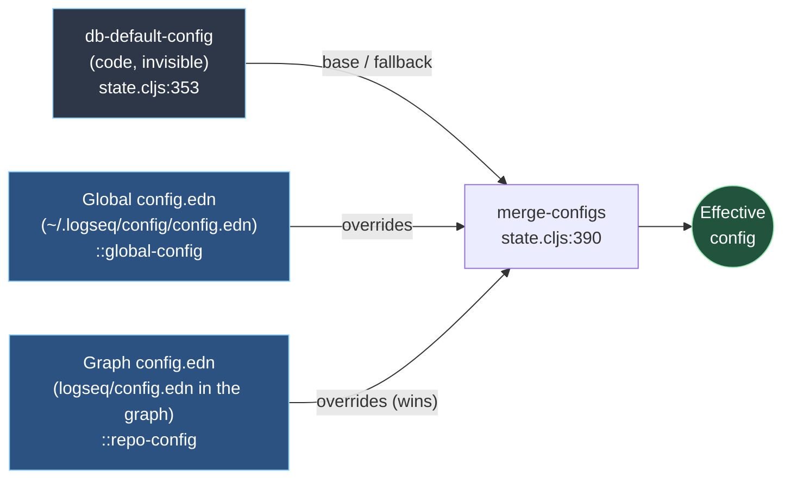
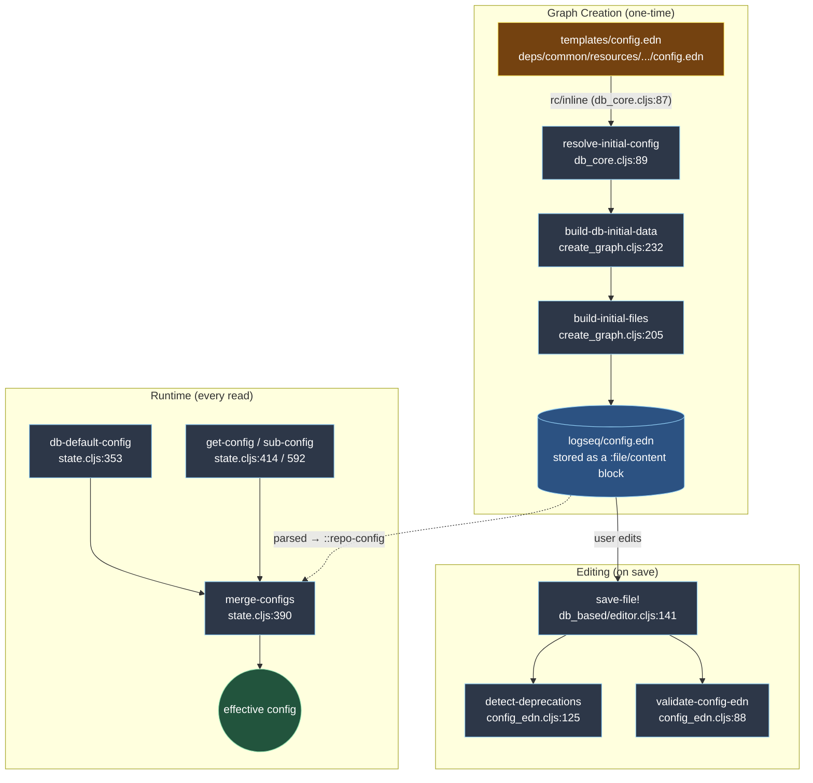
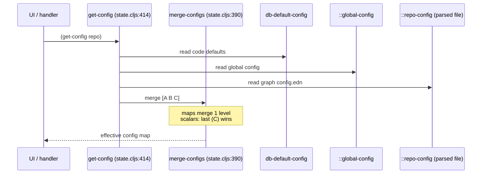
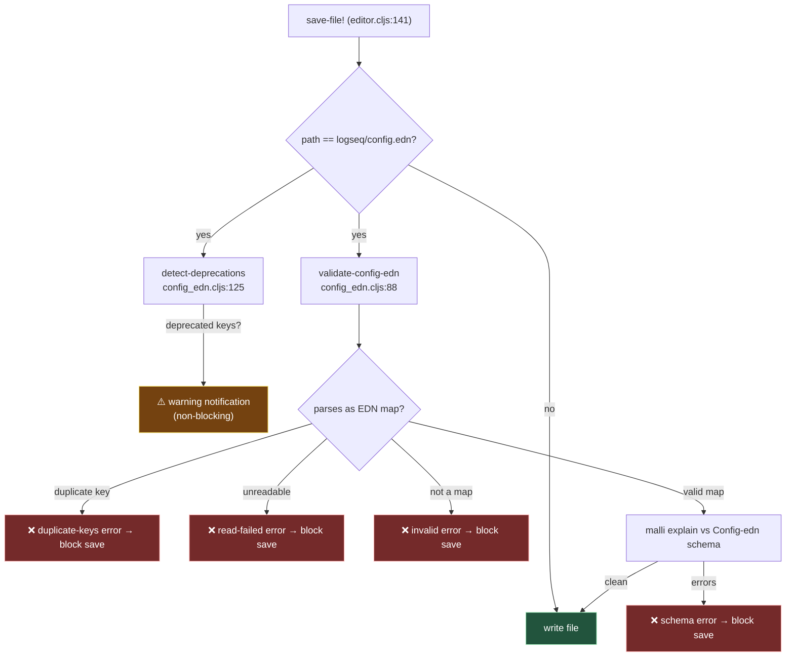

# `config.edn` Default Settings for DB Graphs: A Detective's Investigation Report

> Investigation depth: **Standard** · Subject: the default `config.edn` settings applied to Logseq **DB (database) graphs** · Codebase commit: `eng-documentation` branch (post upstream/master merge `b73a1f8f25`)

## 🔍 Case Summary

- **What this is:** Every Logseq DB graph is born with a configuration. That configuration is *not* a single file — it is the **layered merge** of an on-disk `logseq/config.edn` template and an invisible, code-defined `db-default-config` fallback.
- **The problem it solves:** Users need sensible behavior out of the box (journals, tooltips, default queries) without writing any config. Developers need a single, validated key namespace shared between file and DB graphs, while quietly retiring the dozens of file-graph keys that make no sense in a database.
- **🔍 Key discovery #1:** DB graphs and file graphs are seeded from the **exact same** on-disk template (`deps/common/resources/templates/config.edn`). There is no `config-db.edn`.
- **🔍 Key discovery #2:** The settings a DB graph *actually runs with* come from **two** sources merged at read time — the template you can see, and a hidden `db-default-config` map you cannot (`state.cljs:353`). The journal "Doing/Todo" default queries live *only* in the hidden layer.
- **🔍 Key discovery #3:** ~22 historically-valid keys are **deprecated in DB graphs** and trigger warnings, governed by `file-only-config` (`common/config.cljs:104`).

## 📋 Table of Contents

1. [Architecture Overview](#architecture-overview)
2. [The Crime Scene Map](#the-crime-scene-map)
3. [Evidence #1: The On-Disk Template (what gets written)](#evidence-1-the-on-disk-template-what-gets-written)
4. [Evidence #2: The Hidden Defaults (db-default-config)](#evidence-2-the-hidden-defaults-db-default-config)
5. [Evidence #3: The Merge & Read Path (what actually runs)](#evidence-3-the-merge--read-path-what-actually-runs)
6. [Evidence #4: Deprecated Keys (the file-only graveyard)](#evidence-4-deprecated-keys-the-file-only-graveyard)
7. [Evidence #5: Validation at Save Time](#evidence-5-validation-at-save-time)
8. [Key Witnesses (Main Files)](#key-witnesses-main-files)
9. [Default Values Reference](#default-values-reference)
10. [Sample config.edn With All Default Values](#sample-configedn-with-all-default-values)
11. [Config Key Schema Reference](#config-key-schema-reference)
12. [Critical Findings](#critical-findings)
13. [Known Limitations](#known-limitations)
14. [Debugging Guide](#debugging-guide)
15. [Performance Notes](#performance-notes)
16. [Future Improvements](#future-improvements)
17. [Case Closed](#case-closed)
18. [Appendix: File Tree](#appendix-file-tree)

## Architecture Overview

A DB graph's effective configuration is computed, not stored. Three layers are merged every time `get-config` is called, with later layers winning (maps merge one level deep):



⚠️ **Gotcha:** The on-disk `logseq/config.edn` you see in a graph is layer **C**, not the whole story. Anything not written there (most notably `:default-queries`) silently falls back to layer **A**.

## The Crime Scene Map



## Evidence #1: The On-Disk Template (what gets written)

### The Witness Files

| File | Role |
|------|------|
| `deps/common/resources/templates/config.edn` | The single template seeded into **every** new graph (file *and* DB). |
| `src/main/frontend/worker/db_core.cljs:87` | Inlines that template as `default-graph-config-content`. |
| `src/main/frontend/config.cljs:302` | Inlines the *same* template as `config-default-content` (file-graph path). |

### The Investigation Trail

When a DB graph is created with no explicit config, `resolve-initial-config` falls back to the bundled template:

**Location**: `src/main/frontend/worker/db_core.cljs:87`
```clojure
(def ^:private default-graph-config-content (rc/inline "templates/config.edn"))

(defn- resolve-initial-config
  [config]
  (if (some? config)
    config                          ; → caller-supplied config wins
    default-graph-config-content))  ; → otherwise the bundled template
```

That string becomes a real `:file/content` block at path `logseq/config.edn`:

**Location**: `deps/db/src/logseq/db/sqlite/create_graph.cljs:205`
```clojure
(defn- build-initial-files [config-content]
  [{:block/uuid (common-uuid/gen-uuid :builtin-block-uuid "logseq/config.edn")
    :file/path (str "logseq/" "config.edn")
    :file/content config-content          ; ← the template text lands here
    :file/created-at (js/Date.)
    :file/last-modified-at (js/Date.)}
   ;; … custom.css, custom.js, publish.css, publish.js (all empty)
   ])
```

🔍 **Surprising discovery:** There is **no DB-specific template**. A classpath search returns exactly one `templates/config.edn`. File and DB graphs share it; DB-specific behavior is added *underneath* at runtime (Evidence #2), and file-only keys are *subtracted* by deprecation (Evidence #4).

The template's *active* (uncommented) defaults — i.e. the keys literally present in a fresh `logseq/config.edn`:

| Key | Default in template | Source line |
|-----|---------------------|-------------|
| `:meta/version` | `1` | `config.edn:1` |
| `:ui/enable-tooltip?` | `true` | `config.edn:9` |
| `:ui/show-full-blocks?` | `false` | `config.edn:17` |
| `:ui/auto-expand-block-refs?` | `true` | `config.edn:21` |
| `:feature/enable-search-remove-accents?` | `true` | `config.edn:26` |
| `:start-of-week` | `6` (Sunday) | `config.edn:52` |
| `:shortcuts` | `{}` | `config.edn:114` |
| `:shortcut/doc-mode-enter-for-new-block?` | `false` | `config.edn:119` |
| `:block/title-max-length` | `10000` | `config.edn:124` |
| `:ui/show-command-doc?` | `true` | `config.edn:128` |
| `:ui/show-empty-bullets?` | `false` | `config.edn:132` |
| `:query/views` | `{:pprint (fn [r] [:pre.code (pprint r)])}` | `config.edn:135` |
| `:commands` | `[]` | `config.edn:158` |
| `:outliner/block-title-collapse-enabled?` | `false` | `config.edn:167` |
| `:macros` | `{}` | `config.edn:176` |
| `:ref/default-open-blocks-level` | `2` | `config.edn:188` |

Everything else in the template is commented documentation showing the *implicit* default (e.g. `:scheduled/future-days 7`, `:ui/show-brackets? true`).

## Evidence #2: The Hidden Defaults (`db-default-config`)

### The Witness File

`src/main/frontend/state.cljs` — defines two code-level default maps that sit **beneath** the on-disk file.

### The Investigation Trail

**Location**: `src/main/frontend/state.cljs:348`
```clojure
(def common-default-config
  "Common default config for a user's repo config"
  {:feature/enable-search-remove-accents? true
   :ui/auto-expand-block-refs? true})

(def db-default-config
  "Default repo config for DB graphs"
  (merge common-default-config
         {:default-queries
          {:journals
           [{:title-key :journal.default-query/doing   ; "Doing" tasks, last 14 days
             :title-icon "InProgress50"
             :query '[:find (pull ?b [*]) ...]
             :inputs [:14d :today]
             :collapsed? true}
            {:title-key :journal.default-query/todo     ; "Todo" tasks, next 7 days
             :title-icon "Todo"
             :query '[:find (pull ?b [*]) ...]
             :inputs [:today :7d-after]
             :group-by-page? false
             :collapsed? true}]}
          :ui/hide-empty-properties? false}))
```

🔍 **Critical finding:** The two default journal queries — **"Doing"** (tasks with `Doing` status over the last 14 days) and **"Todo"** (tasks with `Todo` status over the next 7 days) — are **not** in the on-disk template. They exist only in `db-default-config`. A user who never touches `config.edn` still gets them because layer A is merged in at read time. To remove them, a user must explicitly set `:default-queries {:journals []}` in their `logseq/config.edn` (which overrides layer A).

## Evidence #3: The Merge & Read Path (what actually runs)

### The Witness File

`src/main/frontend/state.cljs` — `merge-configs`, `get-config`, `sub-config`.

### The Investigation Trail

**Location**: `src/main/frontend/state.cljs:390`
```clojure
(defn merge-configs
  "Merges user configs in given orders. All values are overridden except for maps
  which are merged."
  [& configs]
  (->> configs
       (filter map?)
       (apply merge-with
              (fn merge-config [current new]
                (if (and (map? current) (map? new))
                  (merge current new)   ; ← maps merge ONE level deep
                  new)))))             ; ← everything else: last wins
```

**Location**: `src/main/frontend/state.cljs:414`
```clojure
(defn get-config
  ([] (get-config (get-current-repo)))
  ([repo-url]
   (merge-configs
    db-default-config        ; layer A — code defaults (DB-specific)
    (get-global-config)      ; layer B — global config.edn
    (get-graph-config repo-url)))) ; layer C — this graph's config.edn (wins)
```

`sub-config` (`state.cljs:592`) is the reactive equivalent used by UI components and applies the identical three-layer merge.



⚠️ **Gotcha — shallow merge:** Map merging is only **one level deep**. If a user sets `:default-queries {:journals [...]}`, their `:journals` vector wholly replaces the default `:journals` (good). But because the merge happens at the `:default-queries` key, a user-set `:default-queries` map merges *its keys* with the default's keys — so setting `{:journals []}` does cleanly blank the journal queries.

## Evidence #4: Deprecated Keys (the file-only graveyard)

### The Witness File

`deps/common/src/logseq/common/config.cljs` — `file-only-config` and `unused-in-db-graphs-deprecation`.

### The Investigation Trail

**Location**: `deps/common/src/logseq/common/config.cljs:104`
```clojure
(def file-only-config
  "File only config keys that are deprecated in DB graphs along with
  descriptions for their deprecation."
  (merge
   (zipmap
    [:file/name-format :file-sync/ignore-files :hidden
     :ignored-page-references-keywords :journal/file-name-format
     :journal/page-title-format :journals-directory :logbook/settings
     :org-mode/insert-file-link? :pages-directory :preferred-workflow
     :property/separated-by-commas :property-pages/excludelist
     :srs/learning-fraction :srs/initial-interval :whiteboards-directory
     :feature/enable-whiteboards?]
    (repeat unused-in-db-graphs-deprecation))   ; "is not used in DB graphs"
   {:preferred-format       "is not used in DB graphs as there is only markdown mode."
    :property-pages/enabled? "is not used in DB graphs as all properties have pages"
    :block-hidden-properties "is not used in DB graphs as hiding a property is done in its configuration"
    :feature/enable-block-timestamps? "is not used in DB graphs as it is always enabled"
    :favorites              "is not stored in config for DB graphs"
    :default-templates      "is replaced by #Template and the `Apply template to tags` property"}))
```

These keys are valid in **file** graphs but ignored in **DB** graphs. Setting them produces a warning (Evidence #5). The user-facing messages live in the i18n dictionary:

**Location**: `src/resources/dicts/en.edn:780`
```clojure
:graph.validation/config-favorites-warning            "is not stored in config for DB graphs."
:graph.validation/config-default-templates-warning    "is replaced by #Template and the `Apply template to tags` property."
:graph.validation/config-unused-in-db-graphs-warning  "is not used in DB graphs."
:graph.validation/config-preferred-format-warning     "is not used in DB graphs as there is only markdown mode."
;; … plus block-hidden-properties, property-pages-enabled,
;;    feature-enable-block-timestamps, editor-command-trigger, arweave-gateway
```

Two extra keys are deprecated outside `file-only-config` (hard-coded in the handler): `:editor/command-trigger` and `:arweave/gateway` (`config_edn.cljs:55`).

## Evidence #5: Validation at Save Time

### The Investigation Trail

Whenever a DB-graph user saves `logseq/config.edn`, two checks fire:

**Location**: `src/main/frontend/handler/db_based/editor.cljs:141`
```clojure
(defn save-file!
  "This fn is the db version of file-handler/alter-file"
  [path content]
  (let [file-valid? (if (= path "logseq/config.edn")
                      (do (config-edn-common-handler/detect-deprecations path content)
                          (config-edn-common-handler/validate-config-edn
                           path content repo-config-schema/Config-edn))
                      true)]
    (when file-valid?
      (p/do! (db/transact! [{:file/path path :file/content content ...}])))))
```



✅ **Behavioral note:** Deprecation detection is a **warning** (`:warning` status, non-blocking — `config_edn.cljs:142`). Schema/parse failures are **errors** that prevent the save (`config_edn.cljs:85` returns `false` → `save-file!` skips the transact).

## Key Witnesses (Main Files)

| File | Role | Key line(s) |
|------|------|-------------|
| `deps/common/resources/templates/config.edn` | The seeded on-disk template (shared file+DB) | whole file |
| `src/main/frontend/worker/db_core.cljs` | Inlines template; `resolve-initial-config` fallback | `87`, `89`, `576` |
| `deps/db/src/logseq/db/sqlite/create_graph.cljs` | Writes template into the graph as a file block | `205`, `232` |
| `src/main/frontend/state.cljs` | `db-default-config`, `merge-configs`, `get-config`, `sub-config` | `348`, `353`, `390`, `414`, `592` |
| `deps/common/src/logseq/common/config.cljs` | `file-only-config` deprecation registry | `101`, `104` |
| `src/main/frontend/handler/common/config_edn.cljs` | Validation + deprecation detection | `88`, `125` |
| `src/main/frontend/handler/db_based/editor.cljs` | Wires validation into `save-file!` | `141`–`146` |
| `src/main/frontend/schema/handler/common_config.cljc` | Malli `Config-edn` schema (valid keys + types) | `5`–`67` |
| `src/main/frontend/schema/handler/repo_config.cljc` | Repo-config schema (aliases the common one) | `7` |
| `src/resources/dicts/en.edn` | Deprecation/validation warning text | `775`–`784` |

## Default Values Reference

The **effective** default config of a brand-new DB graph (template merged over `db-default-config`):

| Key | Effective default | Origin layer |
|-----|-------------------|--------------|
| `:meta/version` | `1` | template |
| `:ui/enable-tooltip?` | `true` | template |
| `:ui/show-brackets?` | `true` | implicit (commented) |
| `:ui/show-full-blocks?` | `false` | template |
| `:ui/auto-expand-block-refs?` | `true` | template + `db-default-config` |
| `:ui/show-command-doc?` | `true` | template |
| `:ui/show-empty-bullets?` | `false` | template |
| `:ui/hide-empty-properties?` | `false` | `db-default-config` (`state.cljs:385`) |
| `:feature/enable-search-remove-accents?` | `true` | template + `db-default-config` |
| `:feature/enable-journals?` | `true` | implicit (commented) |
| `:feature/enable-flashcards?` | `true` | implicit (commented) |
| `:scheduled/future-days` | `7` | implicit (commented) |
| `:start-of-week` | `6` (Sunday) | template |
| `:shortcuts` | `{}` | template |
| `:shortcut/doc-mode-enter-for-new-block?` | `false` | template |
| `:block/title-max-length` | `10000` | template |
| `:query/views` | `{:pprint (fn [r] [:pre.code (pprint r)])}` | template |
| `:default-queries` | `{:journals [Doing(14d), Todo(7d)]}` | **`db-default-config` only** |
| `:commands` | `[]` | template |
| `:outliner/block-title-collapse-enabled?` | `false` | template |
| `:macros` | `{}` | template (+ built-in `"img"` macro, `state.cljs:433`) |
| `:ref/default-open-blocks-level` | `2` | template |
| `:export/bullet-indentation` | `:tab` | implicit (commented) |
| `:publishing/all-pages-public?` | `false` | implicit (commented) |

## Sample `config.edn` With All Default Values

The following is a **complete, valid** `logseq/config.edn` for a DB graph with every key written out at its default value. Dropping this in reproduces a brand-new graph's behavior exactly (it makes the invisible `db-default-config` layer explicit — most notably `:default-queries`).

> Keys whose true default is *unset* (no value until you opt in — e.g. `:custom-css-url`, `:default-home`) are shown **commented** with their per-field defaults. Uncommenting them changes behavior away from the default.

```clojure
{;; Config schema version. Do not change.
 :meta/version 1

 ;; ── UI ──────────────────────────────────────────────────────────
 :ui/enable-tooltip? true                       ; tooltip preview on hover
 :ui/show-brackets? true                        ; show [[ ]] around page refs
 :ui/show-full-blocks? false                    ; show all lines of a ((block)) ref
 :ui/auto-expand-block-refs? true               ; expand block refs when zooming in
 :ui/show-command-doc? true                     ; command docs on hover
 :ui/show-empty-bullets? false                  ; show empty bullet points
 :ui/hide-empty-properties? false               ; hide empty block properties

 ;; ── Features ────────────────────────────────────────────────────
 :feature/enable-search-remove-accents? true    ; ignore accents when searching
 :feature/enable-journals? true                 ; enable journals
 :feature/enable-flashcards? true               ; enable flashcards
 :feature/disable-scheduled-and-deadline-query? false ; keep the built-in journal query

 ;; ── Scheduling / journals ───────────────────────────────────────
 :scheduled/future-days 7                        ; days ahead for scheduled/deadline query
 :start-of-week 6                                ; 0=Mon … 6=Sun

 ;; ── Editing / outlining ─────────────────────────────────────────
 :shortcut/doc-mode-enter-for-new-block? false   ; Enter creates a new block in doc mode
 :block/title-max-length 10000                   ; blocks larger than this aren't search/editable
 :outliner/block-title-collapse-enabled? false   ; allow collapsing titled blocks with content
 :ref/default-open-blocks-level 2                ; linked-reference expansion depth
 :editor/logical-outdenting? false
 :editor/preferred-pasting-file? false
 ;; :editor/extra-codemirror-options {:lineWrapping false :lineNumbers true :readOnly false}

 ;; ── Export / publishing ─────────────────────────────────────────
 :export/bullet-indentation :tab                 ; :tab | :two-spaces | :four-spaces | :eight-spaces
 :publishing/all-pages-public? false

 ;; ── Collections (empty by default) ──────────────────────────────
 :shortcuts {}                                   ; custom keybindings
 :commands []                                    ; custom command-palette entries
 :macros {}                                      ; text macros (built-in "img" always available)

 ;; ── Queries ─────────────────────────────────────────────────────
 ;; Pre-defined :view fn usable in advanced queries.
 :query/views
 {:pprint (fn [r] [:pre.code (pprint r)])}

 ;; Advanced-query :result-transform fns (none by default).
 ;; :query/result-transforms {}

 ;; Default journal queries — supplied by db-default-config (state.cljs:353),
 ;; NOT normally written to disk. Set :journals to [] to remove them.
 :default-queries
 {:journals
  [{:title-key :journal.default-query/doing
    :title-icon "InProgress50"
    :query [:find (pull ?b [*])
            :in $ ?start ?today
            :where
            (task ?b #{"Doing"})
            [?b :block/page ?p]
            [?p :block/journal-day ?d]
            [(>= ?d ?start)]
            [(<= ?d ?today)]]
    :inputs [:14d :today]
    :collapsed? true}
   {:title-key :journal.default-query/todo
    :title-icon "Todo"
    :query [:find (pull ?b [*])
            :in $ ?start ?next
            :where
            (task ?b #{"Todo"})
            [?b :block/page ?p]
            [?p :block/journal-day ?d]
            [(> ?d ?start)]
            [(< ?d ?next)]]
    :inputs [:today :7d-after]
    :group-by-page? false
    :collapsed? true}]}

 ;; ── Unset by default (opt-in; shown with their per-field defaults) ─
 ;; :custom-css-url "@import url('…');"
 ;; :custom-js-url  "https://…/custom.js"
 ;; :default-home   {:page "home" :sidebar "Contents"}
 ;; :mobile/photo   {:allow-editing? true :quality 80}
 ;; :mobile         {:gestures/disabled-in-block-with-tags ["kanban"]}
 ;; :quick-capture-templates {:text  "[[quick capture]] **{time}**: {text} from {url}"
 ;;                           :media "[[quick capture]] **{time}**: {url}"}
 ;; :quick-capture-options   {:insert-today?  true
 ;;                           :redirect-page? false
 ;;                           :default-page   "quick capture"
 ;;                           :prettify-url?  true}
 }
```

⚠️ **Two caveats:**
- This is **larger** than a real fresh graph's file. New graphs ship the terser `templates/config.edn` (Evidence #1) and rely on the hidden `db-default-config` layer for `:default-queries` and `:ui/hide-empty-properties?`. The block above just makes those explicit.
- Do **not** add file-only keys (Evidence #4) such as `:journals-directory`, `:preferred-format`, `:favorites`, or `:default-templates` — they are deprecated in DB graphs and will raise a warning on save.

## Config Key Schema Reference

The Malli schema (`common_config.cljc:5`) defines the complete set of **valid** DB-graph keys. All keys are optional (`mu/optional-keys`). Types:

| Key | Type |
|-----|------|
| `:meta/version` | `int` |
| `:ui/enable-tooltip?` `:ui/show-brackets?` `:ui/show-full-blocks?` `:ui/hide-empty-properties?` `:ui/auto-expand-block-refs?` `:ui/show-command-doc?` `:ui/show-empty-bullets?` | `boolean` |
| `:feature/enable-search-remove-accents?` `:feature/enable-journals?` `:feature/enable-flashcards?` `:feature/disable-scheduled-and-deadline-query?` | `boolean` |
| `:scheduled/future-days` `:block/title-max-length` `:ref/default-open-blocks-level` | `int` |
| `:start-of-week` | `enum 0–6` |
| `:custom-css-url` `:custom-js-url` | `string` |
| `:export/bullet-indentation` | `enum :eight-spaces :four-spaces :two-spaces :tab` |
| `:publishing/all-pages-public?` `:shortcut/doc-mode-enter-for-new-block?` `:outliner/block-title-collapse-enabled?` `:editor/logical-outdenting?` `:editor/preferred-pasting-file?` | `boolean` |
| `:default-home` | `{:page string?, :sidebar string|vector}` |
| `:shortcuts` | `map-of keyword → string|false|vector` |
| `:query/views` `:query/result-transforms` | `map-of keyword → sequential` |
| `:default-queries` | `{:journals [map …]}` |
| `:commands` | `vector of [string string|vector]` |
| `:macros` | `map-of string|keyword → string` |
| `:mobile/photo` | `{:allow-editing? bool, :quality int}` |
| `:mobile` | `{:gestures/disabled-in-block-with-tags [string]}` |
| `:editor/extra-codemirror-options` | `map` |
| `:quick-capture-templates` | `{:text string, :media string}` |
| `:quick-capture-options` | `{:insert-today? bool, :redirect-page? bool, :default-page string, :prettify-url? bool}` |

⚠️ Keys *not* in this schema that appear in a config file will fail malli validation and **block the save**.

## Critical Findings

1. **🔍 One template, two graph types.** `deps/common/resources/templates/config.edn` is the only template on the classpath; both `config.cljs:302` (file) and `db_core.cljs:87` (DB) inline it. DB-ness is added by a runtime layer, not a separate file.
2. **🔍 Defaults are computed, not stored.** Effective config = `merge-configs(db-default-config, global, repo)` (`state.cljs:414`). Reading the on-disk file alone undercounts the defaults.
3. **🔍 Journal default queries are invisible.** "Doing"/"Todo" come from `db-default-config` (`state.cljs:353`), never written to disk. Override with `:default-queries {:journals []}`.
4. **⚠️ ~24 keys are deprecated in DB graphs.** 17 generic + 7 specifically-messaged in `file-only-config`, plus `:editor/command-trigger` and `:arweave/gateway` hard-coded in the handler.
5. **✅ Validation is two-tier.** Deprecations → non-blocking warning; parse/schema errors → blocking error (`config_edn.cljs` + `editor.cljs:141`).
6. **🔍 Don't confuse `config.edn` with `cli.edn`.** The CLI tool keeps its *own* config (`src/main/logseq/cli/config.cljs`) at `~/.logseq/cli.edn` with unrelated defaults (`:timeout-ms 10000`, `:ws-url`, `:http-base` — `config.cljs:108`). That is CLI behavior, **not** graph behavior.

## Known Limitations

| Limitation | Severity | Evidence |
|------------|----------|----------|
| Defaults are "buried in getters," not data-driven — each getter re-applies its own fallback. | 🟡 Medium (maintainability) | `state.cljs:342` TODO comment |
| Map merge is only one level deep; nested maps can't be partially overridden. | 🟡 Medium | `merge-configs` `state.cljs:397` |
| Template and code defaults can drift (e.g. `:ui/auto-expand-block-refs?` is set in *both* template and `db-default-config`). | 🟢 Low (redundant but consistent) | `config.edn:21` vs `state.cljs:351` |
| No single source of truth lists every effective default; values are split across template + `db-default-config` + commented docs. | 🟡 Medium | this report's two tables |
| `repo-config` schema just aliases `common-config`; intended divergence is unrealized. | 🟢 Low | `repo_config.cljc:5` comment |

## Debugging Guide

**"My setting in `config.edn` isn't taking effect."**
1. Confirm the key is in the schema (`common_config.cljc`). If not, the save was **rejected** — look for an error notification.
2. Confirm it isn't in `file-only-config` (`common/config.cljs:104`) — those are ignored in DB graphs.
3. Remember layer C wins: a value present in your graph `config.edn` overrides global and code defaults.

**"Where does the default come from?"** Check in this order:
- Graph `logseq/config.edn` (open the file) → layer C.
- Global config → layer B.
- `db-default-config` / `common-default-config` (`state.cljs:348`) → layer A.

**Inspect the live effective config** (in the app's dev console / nbb REPL against the worker): evaluate `(frontend.state/get-config)` — it returns the fully merged map.

**"Why do I see Doing/Todo queries on every journal?"** They are `db-default-config` defaults (`state.cljs:358`). Set `:default-queries {:journals []}` to remove.

**Trace a deprecation warning:** search the warning text in `src/resources/dicts/en.edn` (`:graph.validation/config-*-warning`), map back via `config-key->deprecation-i18n-key` (`config_edn.cljs:37`).

## Performance Notes

- `get-config` performs an in-memory merge of ≤3 small maps on every call — cheap, but called frequently. `state.cljs:344` flags the repeated `get-current-repo` fetch as wasteful; not a correctness issue.
- The template is inlined at **compile time** via `rc/inline` (`db_core.cljs:87`) — zero runtime I/O to read defaults.
- `:block/title-max-length 10000` (`config.edn:124`) is itself a performance guard: blocks larger than this are neither searchable nor editable, by design.

## Future Improvements

1. **Data-drive the defaults** (already a TODO at `state.cljs:342`): collapse template + `db-default-config` + getter fallbacks into one declarative table, eliminating drift.
2. **Single effective-defaults map** exported for docs/tests, so this report's two tables can't go stale.
3. **Deep-merge option** for nested config maps where partial overrides are desirable.
4. **Realize the repo/global schema split** (`repo_config.cljc:5`) or delete the indirection.

## Case Closed

The "default `config.edn` settings for DB graphs" is a **three-layer merge**, not a file. A new DB graph is seeded with the shared `templates/config.edn` (the visible layer), runs with `db-default-config` quietly merged underneath (the invisible layer that supplies journal queries and a couple of UI defaults), and rejects/deprecates the file-graph-only keys at save time via the malli `Config-edn` schema and the `file-only-config` registry. To know what a setting *actually* resolves to, you must reason about all three layers — `get-config` (`state.cljs:414`) is the one true oracle. **Verdict: documented, with evidence.**

## Appendix: File Tree

```
logseq/
├── deps/
│   ├── common/
│   │   ├── resources/templates/config.edn        ← the shared seed template
│   │   └── src/logseq/common/config.cljs         ← file-only-config (deprecations)
│   └── db/src/logseq/db/sqlite/create_graph.cljs ← writes template into graph
├── src/
│   ├── main/
│   │   ├── frontend/
│   │   │   ├── worker/db_core.cljs               ← inline template, resolve-initial-config
│   │   │   ├── state.cljs                         ← db-default-config, merge-configs, get-config
│   │   │   ├── config.cljs                        ← config-default-content (file path)
│   │   │   ├── handler/
│   │   │   │   ├── common/config_edn.cljs         ← validate + detect-deprecations
│   │   │   │   └── db_based/editor.cljs           ← save-file! wiring
│   │   │   └── schema/handler/
│   │   │       ├── common_config.cljc             ← Config-edn malli schema
│   │   │       └── repo_config.cljc               ← repo schema (alias)
│   │   └── logseq/cli/config.cljs                 ← cli.edn (NOT graph config)
│   └── resources/dicts/en.edn                     ← deprecation/validation messages
```
