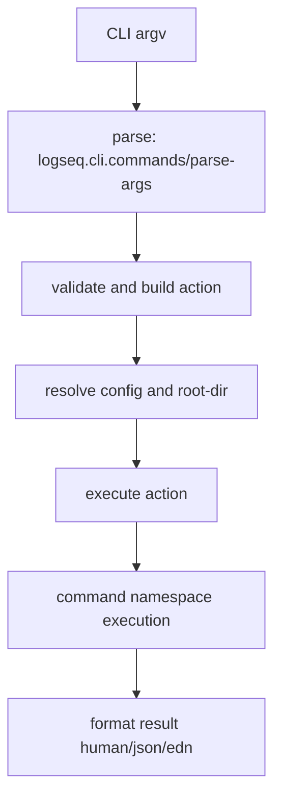

# Logseq CLI Developer Guide

> **Last revised:** 2026-05-29

## Scope

This guide documents the current Logseq CLI implementation in:

- `src/main/logseq/cli/`
- related runtime calls in `src/main/` and `deps/`

It replaces older `deps/cli` architecture notes.

## Architecture Overview

The current CLI is command-driven and server-mediated:

1. `logseq.cli.main` parses args and resolves config.
2. `logseq.cli.commands` validates options and builds an action map.
3. Commands execute via `logseq.cli.command.*` namespaces.
4. Most graph operations run through `db-worker-node` thread APIs via:
   - `logseq.cli.server`
   - `logseq.cli.transport`

Key entry files:

- `src/main/logseq/cli/main.cljs`
- `src/main/logseq/cli/commands.cljs`
- `src/main/logseq/cli/command/core.cljs`

## Global CLI Contract

Global flags are defined in `src/main/logseq/cli/command/core.cljs`:

- `--help` / `-h`
- `--version`
- `--config`
- `--graph` / `-g`
- `--root-dir`
- `--timeout-ms`
- `--output` / `-o`
- `--verbose` / `-v`
- `--profile`

Output modes are `human`, `json`, and `edn` (`src/main/logseq/cli/output_mode.cljs`).

## Command Surface (Current)

Top-level command groups are composed in `src/main/logseq/cli/commands.cljs`.

### Graph Management

- `graph list`
- `graph create`
- `graph switch`
- `graph remove`
- `graph validate`
- `graph info`
- `graph export`
- `graph import`
- `graph backup list|create|restore|remove`

### Server Management

- `server list`
- `server cleanup`
- `server start`
- `server stop`
- `server restart`

### Data Read/Write

- `list page|tag|property|task|node|asset`
- `show`
- `search block|page|property|tag`
- `query`
- `query list`
- `upsert block|page|task|asset|tag|property`
- `remove block|page|tag|property`
- `debug pull`

### Sync and Auth

- `sync status|start|stop|upload|download|asset download|remote-graphs|ensure-keys|grant-access|config set|get|unset`
- `login`
- `logout`

### Utilities

- `doctor`
- `completion`
- `skill show|install`
- `agent bridge`
- `example ...`

## Findings: Removed or Replaced

> **Removed:** The old CLI implementation paths under `deps/cli/src/logseq/cli/**` are no longer the active command implementation.

> **Removed:** The documented dual-mode model (local SQLite mode vs HTTP API token mode) is stale for the current CLI command stack. Current commands route through `db-worker-node`/thread APIs rather than the old `api-server-token` switch.

> **Removed:** Legacy command set and names from the old guide (`append`, `export-edn`, `import-edn`, `validate`, `mcp-server` as top-level old-style commands) are not the current primary command surface in `src/main/logseq/cli/commands.cljs`.

> **Removed:** Old HTTP API token flow documentation (`LOGSEQ_API_SERVER_TOKEN`, direct POST `/api` for routine CLI commands) is not the current execution model.

> **Removed:** Old architecture references to `cli.mjs` + `@logseq/nbb-logseq` bootstrap as the canonical runtime entry are stale for the code currently under `src/main/logseq/cli/`.

## Findings: New Capabilities

The current CLI adds substantial capability beyond the older guide:

1. Structured output modes (`human` / `json` / `edn`) with centralized formatting.
2. First-class graph backup lifecycle commands (`graph backup list/create/restore/remove`).
3. Expanded write model with typed upsert commands for blocks/pages/tasks/assets/tags/properties.
4. Dedicated runtime diagnostics via `doctor` (script checks, root-dir checks, server readiness/revision mismatch).
5. Auth workflows (`login`, `logout`) and sync operational controls (`sync ...`).
6. Built-in query catalog support via `query list` and named query execution (`--name`, `--inputs`).
7. Shell completion generation (`completion zsh|bash`).
8. Built-in skill distribution (`skill show`, `skill install` including `--global`).
9. Agent bridge workflow (`agent bridge`) for task-routing integration.
10. Server lifecycle controls (`server list|cleanup|start|stop|restart`) for db-worker-node orchestration.

## Command Execution Model (Current)

Key execution path:

- Parse and validate in `src/main/logseq/cli/commands.cljs`
- Dispatch in `src/main/logseq/cli/main.cljs`
- Command handlers in `src/main/logseq/cli/command/*.cljs`

## Practical Notes for Contributors

1. Prefer updating command docs from `src/main/logseq/cli/command/*.cljs` `entries` definitions and option specs.
2. Treat `src/main/logseq/cli/commands.cljs` as command-surface source of truth.
3. Use `src/main/logseq/cli/output_mode.cljs` for output-mode behavior.
4. For graph/sync/server behavior, validate both action-building and execute branches.
5. Avoid reintroducing deprecated `deps/cli` path references unless documenting historical behavior explicitly.

## Verification Snapshot (2026-05-29)

Validated against current source under:

- `src/main/logseq/cli/main.cljs`
- `src/main/logseq/cli/commands.cljs`
- `src/main/logseq/cli/command/core.cljs`
- `src/main/logseq/cli/command/graph.cljs`
- `src/main/logseq/cli/command/list.cljs`
- `src/main/logseq/cli/command/search.cljs`
- `src/main/logseq/cli/command/query.cljs`
- `src/main/logseq/cli/command/show.cljs`
- `src/main/logseq/cli/command/upsert.cljs`
- `src/main/logseq/cli/command/remove.cljs`
- `src/main/logseq/cli/command/server.cljs`
- `src/main/logseq/cli/command/sync.cljs`
- `src/main/logseq/cli/command/auth.cljs`
- `src/main/logseq/cli/command/doctor.cljs`
- `src/main/logseq/cli/command/debug.cljs`
- `src/main/logseq/cli/command/completion.cljs`
- `src/main/logseq/cli/command/skill.cljs`
- `src/main/logseq/cli/command/agent.cljs`
- `src/main/logseq/cli/output_mode.cljs`
