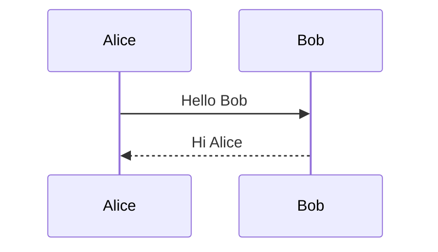
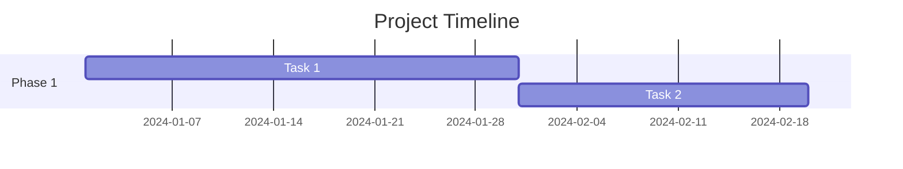

# Logseq DB (Database Mode) Guide

This guide explains how to work with Logseq Database Mode graphs. Unlike the older file-based mode ("Logseq OG"), database mode stores content in SQLite and uses **UI-driven interactions** rather than text-based syntax for many features.

> **Last revised:** 2026-05-29. **Partly audited 2026-10-04:** only block references, embeds and the slash-menu embed command were checked (source plus the 2026-10-01 nightly); the rest of this guide has not been re-verified.

## Overview

**Critical Understanding:** Logseq DB is fundamentally different from file-based Logseq:

- **Storage**: SQLite database (not markdown files)
- **Properties**: Structured data stored in the database (not `key:: value` text syntax)
- **Queries**: Created via `/Query` command; `{{query}}` remains available in compatibility paths
- **Tasks**: UI-based status management (not legacy text markers)
- **Block References**: Handled through the UI (Copy block ref) as `[[<block-uuid>]]`; `((block-uuid))` is plain text in DB graphs

**What Works in DB Mode:**

- Basic markdown formatting (bold, italic, links, etc.)
- Page links `[[Page Name]]`
- Tags `#tag`
- Code blocks
- Math (LaTeX)
- Diagrams (Mermaid)

**What Does NOT Work in DB Mode:**

- ❌ `property:: value` syntax (use UI instead)
  > **Removed:** `TODO/DOING/DONE`, `NOW/LATER/WAITING/CANCELLED`, and `[#A]/[#B]/[#C]` are file-mode text markers; DB mode uses the Status and Priority properties.
  > **Corrected 2026-10-04:** DB mode references blocks and pages with `[[<UUID>]]` (Copy block ref); `((UUID))` is plain text.
  > **Corrected 2026-10-04:** `{{embed ...}}` is deprecated in DB mode in both the `((UUID))` and `[[UUID]]` forms and renders "{{embed}} is deprecated. Use '/Node embed' command instead." Use `/Node embed` (verified live, nightly 20261001).
  > **Removed:** `SCHEDULED: <date>` and `DEADLINE: <date>` org-mode text syntax; DB mode uses the Scheduled and Deadline properties.

## Findings: New Capabilities

- DB task status now uses closed values: Backlog, Todo, Doing, In Review, Done, and Canceled.
- Priority now uses closed values: Low, Medium, High, and Urgent.
- `/Scheduled`, `/Deadline`, and `/Query` are first-class DB authoring commands.

## Block Structure

### Basic Blocks

Blocks are created by typing and pressing Enter:

```markdown
- This is a block
- This is another block
  - This is a nested/child block (Tab to indent)
  - Another child block
- Back to parent level (Shift+Tab to outdent)
```

**Key Principle:** Everything in Logseq DB is a block with a unique UUID stored in the database.

## UUIDs in DB Mode

### Page and Block References

**Critical:** In DB mode, pages use `[[Page Name]]` links and blocks use `[[<UUID>]]` refs.

**Pages:**

- Normal: `[[Page Name]]`

> **Removed:** The guide's earlier same-name UUID page-link rule is not a normal DB authoring pattern; duplicate page names are rejected.

**Blocks:**

- Always: `((65abc123-def4-5678-90ab-cdef12345678))`

**Key Difference from File Mode:**

- File mode: `((block-id))` for blocks, `[[Page]]` for pages
- DB mode: `[[Page Name]]` for pages, `[[<UUID>]]` for blocks

### Getting UUIDs

**Via UI:**

1. Right-click a block → "Copy block ref"
2. Paste: `((uuid-will-be-here))`

**Via typing:**

1. Type `[[`
2. Search for page
3. Select → Logseq inserts `[[Page Name]]`

OR:

1. Type `((`
2. Search for block
3. Select → Logseq inserts `[[<UUID>]]` (`frontend.util.ref/->block-ref` is the page-ref form)

### Block References

**In DB Mode:** Block references use `[[<UUID>]]` syntax; `((UUID))` is plain text.

**How to create:**

1. Type `((` - this triggers block reference search
2. Search for and select the block you want to reference
3. Logseq inserts the reference as `((block-uuid-here))`

**Manual syntax:**

```markdown
- Reference to a block: ((65abc123-def4-5678-90ab-cdef12345678))
```

**Note:** Block refs are UUID-backed, but they still keep the `((...))` wrapper in DB mode.

### Block Embeds (UI-Based)

**In DB Mode:** Block embeds are created through the UI (`/Node embed`) and are `:block/link` blocks, not text.

**How to embed:**

1. Right-click on a block
2. Select "Copy block embed"
3. Paste in target location

OR:

1. Type `/Node embed`
2. Search for the block to embed

**Result:** Logseq inserts a block with an empty title whose `:block/link` points at the chosen block. There is no embed text in the block, and the target's content renders in its place (verified live 2026-10-04, nightly 20261001).

**Note:** The `{{embed ((UUID))}}` macro is deprecated in DB graphs and shows a deprecation message.

## Page Links

### Basic Page Links

```markdown
[[Page Name]]
[[Page Name]] with text after
Text before [[Page Name]] and after
```

### UUID-Based Links

**When pages have the same name**, Logseq uses UUID-based links:

```markdown
[[65abc123-def4-5678-90ab-cdef12345678]]
```

Logseq displays the page title but stores the UUID reference.

**Pages use `[[Page Name]]` links in DB mode. Blocks use `[[<UUID>]]` refs.**

### Namespaced Pages

```markdown
[[Project/Alpha]]
[[Project/Alpha/Tasks]]
[[Company/Department/Team/Person]]
```

Namespaces use `/` to create hierarchy.

### Page References vs Tags

```markdown
- This links to a page: [[page-name]]
- This creates a tag: #tag-name
- Tags are just pages with # syntax: #[[multi word tag]]
```

## Properties (Database-First)

### Understanding DB Mode Properties

**Critical:** In DB mode, properties are **structured database entities**, not text syntax.

**The `property:: value` syntax does NOT work in DB mode.**

### How to Add Properties (UI-Based)

**Method 1: Using `/` command**

1. Type `/` in a block
2. Search for the property name (e.g., "status", "priority")
3. Select the property
4. Enter the value in the UI

**Method 2: Using property menu**

1. Click the block menu (three dots)
2. Select "Add property"
3. Choose or create property
4. Set value

**Method 3: Shortcuts**

- `Cmd/Ctrl + P` then `S` - Add scheduled date
- `Cmd/Ctrl + P` then `D` - Add deadline

### Page Properties

Page properties appear at the top of a page:

- Click "Add property" button at page top
- Select from existing properties or create new
- Built-in: `icon`, `alias`, `tags`, etc.

### Property Types

| Type      | Example                       | Description            |
| --------- | ----------------------------- | ---------------------- |
| Text      | `name:: John`                 | Plain text value       |
| Number    | `count:: 42`                  | Numeric value          |
| Date      | `due:: [[2024-01-30]]`        | Page link to date      |
| Page      | `project:: [[Project Alpha]]` | Link to another page   |
| URL       | `link:: https://example.com`  | External link          |
| Checkbox  | `completed:: true`            | Boolean value          |
| List      | `tags:: tag1, tag2, tag3`     | Comma-separated values |
| Reference | `ref:: [[<UUID>]]`            | Block reference        |

### Built-in Properties

Common built-in properties in Logseq:

- `title::` - Page title
- `alias::` - Alternative names for a page
- `tags::` - Page tags
- `icon::` - Page icon (emoji or image)
- `public::` - Whether page is public
- `filters::` - Query filters
- `template::` - Mark as template
- `template-including-parent::` - Template includes parent

## Task Management (UI-Based)

### Task Status (UI-Based)

**In DB Mode:** Task statuses are managed through UI, stored as `:logseq.property/status` property.

**How to set status:**

1. Type `/` in a block
2. Select a status: Backlog, Todo, Doing, In Review, Done, Canceled
3. Status appears as a UI element on the left side of the block

**Status Values:**

- **Backlog** - Deferred
- **Todo** - Not started
- **Doing** - In progress
- **In Review** - Under review
- **Done** - Completed
- **Canceled** - Canceled

**Note:** Task queries and task UI labels use title-case DB values such as `Todo`, `Doing`, `Done`, `In Review`, `Backlog`, and `Canceled`.

### Priorities (UI-Based)

**How to set priority:**

1. Type `/Priority` in a block
2. Select: Low, Medium, High, or Urgent
3. Priority appears as a UI element

**Priority Values:**

- **Low** - Low priority
- **Medium** - Medium priority
- **High** - High priority
- **Urgent** - Urgent

**Note:** The `[#A]`, `[#B]`, `[#C]` text syntax does NOT work in DB mode.

### Scheduled and Deadlines (UI-Based)

**How to add scheduled/deadline:**

- Or type `/Scheduled` or `/Deadline`

**Storage:** Dates stored as `:logseq.property/scheduled` and `:logseq.property/deadline` (datetime timestamps)

**Note:** The `SCHEDULED: <date>` and `DEADLINE: <date>` org-mode text syntax does NOT work in DB mode.

### Repeated Tasks

Repeating tasks are configured through the UI:

1. Set a scheduled or deadline date
2. Click the date
3. Enable "Repeat"
4. Choose frequency (minute, hour, day, week, month, year)
5. Set interval (e.g., every 2 weeks)

**Storage:** Stored as properties:

- `:logseq.property.repeat/recur-frequency`
- `:logseq.property.repeat/recur-unit`
- `:logseq.property.repeat/repeated?`

## Text Formatting

### Basic Formatting

| Style         | Syntax       | Example           | Output            |
| ------------- | ------------ | ----------------- | ----------------- |
| Bold          | `**text**`   | `**Bold**`        | **Bold**          |
| Italic        | `*text*`     | `*Italic*`        | _Italic_          |
| Bold + Italic | `***text***` | `***Both***`      | **_Both_**        |
| Strikethrough | `~~text~~`   | `~~Striked~~`     | ~~Striked~~       |
| Highlight     | `^^text^^`   | `^^Highlighted^^` | ^^Highlighted^^   |
| Inline code   | `` `code` `` | `` `code` ``      | `code`            |
| Underline     | `__text__`   | `__Underlined__`  | <u>Underlined</u> |

### Headings in Blocks

```markdown
- # Heading 1
- ## Heading 2
- ### Heading 3
```

Note: In Logseq, headings are still blocks in the outline structure.

## Queries (UI-Based)

### Critical: `/Query` Command (Not `{{query}}`)

**In DB Mode:** Queries are created with the `/Query` command. `{{query}}` still exists in compatibility paths, but the DB authoring flow uses `/Query`.

**The `/Query` command writes a query block with the `:logseq.property/query` property.**

### Simple Queries

**How to create:**

1. Type `/Query` (capital Q)
2. Logseq creates a query block with the `:logseq.property/query` property
3. Enter your query in the property value field

**Query syntax examples:**

```clojure
(and [[Project Alpha]])
(and [[Project]] [[Active]])
(task Todo)
(task Todo Doing)
(priority High Urgent)
```

**Important:** Task statuses use **title-case** in DB mode:

- ✅ `Backlog`, `Todo`, `Doing`, `In Review`, `Done`, `Canceled`
- ❌ NOT `TODO`, `DOING`, `DONE`, `NOW`, `LATER`, `WAITING`, `CANCELLED` (file-based syntax)

### Advanced Queries

**How to create:**

1. Type `/Query`
2. Enter a Clojure map in the property value:

```clojure
{:title "High Priority Tasks"
 :query [:find (pull ?b [*])
         :where
         [?b :block/tags ?tag]
         [?tag :db/ident :logseq.property/status.todo]]
 :inputs []}
```

### Query Examples

**Today's tasks:**

```clojure
(and <% today %> (task Todo))
```

**Multiple statuses:**

```clojure
(task Todo Doing)
```

**Property filter:**

```clojure
(property status done)
```

**Scheduled for today:**

```clojure
(and (task Todo) (property scheduled today))
```

**Date range:**

```clojure
(and (task Todo) (between deadline today +7d))
```

**Template variables work:**

- `<% today %>` - Today's date
- `<% yesterday %>`
- `<% tomorrow %>`
- `<% current page %>`

## Embeds (UI-Based)

### Page Embeds

**How to embed pages:**

1. Type `/Node embed`
2. Search for and select the node (this guide's earlier `/Embed page` is not a DB-graph command; only `/Node embed` is in the DB slash menu source)
3. Logseq inserts a `:block/link` block that renders the target

**Note:** The `{{embed [[Page Name]]}}` text syntax does NOT work in DB mode.

### Block Embeds

**How to embed blocks:**

1. Right-click a block → "Copy block embed"
2. Paste in target location

OR:

1. Type `/Node embed`
2. Search for the block

**Note:** The embed is a block linked through `:block/link`; the `{{embed ((UUID))}}` text syntax is deprecated.

## Code Blocks

### Inline Code

```markdown
- This contains `inline code` within a block
```

### Code Blocks

````markdown
- Code block example:
  ```javascript
  function hello() {
    console.log('Hello, Logseq!')
  }
  ```
````

### Supported Languages

````markdown
```python
def greet(name):
    print(f"Hello, {name}!")
```

```clojure
(defn greet [name]
  (println "Hello," name))
```

```sql
SELECT * FROM users WHERE active = true;
```
````

## Math (LaTeX)

### Inline Math

```markdown
- This equation $E = mc^2$ is inline
- Another example: $\sum_{i=1}^{n} i = \frac{n(n+1)}{2}$
```

### Block Math

```markdown
- Math block:
  $$
  \int_a^b f(x)dx = F(b) - F(a)
  $$
```

### Display Mode Math

```markdown
$$
\begin{bmatrix}
a & b \\
c & d
\end{bmatrix}
$$
```

## Diagrams (Mermaid)

````markdown
- Flowchart diagram:
  ```mermaid
  graph TD
      A[Start] --> B{Decision}
      B -->|Yes| C[Do this]
      B -->|No| D[Do that]
      C --> E[End]
      D --> E
  ```
````

### Sequence Diagrams

````markdown

````

### Gantt Charts

````markdown

````

## Lists and Outlines

### Unordered Lists (Blocks)

```markdown
- Item 1
- Item 2
  - Nested item 2.1
  - Nested item 2.2
    - Deeply nested 2.2.1
- Item 3
```

### Ordered Lists

```markdown
- 1. First item
- 2. Second item
  - 2.1. Nested item
  - 2.2. Another nested
- 3. Third item
```

Note: In Logseq, ordered lists are still blocks with numbering prefix.

### Mixed Lists

```markdown
- Bullet item
  - 1. Numbered sub-item
  - 2. Another numbered
    - Bullet under numbered
```

## Block Quotes

```markdown
- > This is a quoted block
  > It can span multiple lines
  > And preserves formatting
```

## Horizontal Rules

```markdown
- ## Content above
- Content below
```

## Links

### External Links

```markdown
- [Link text](https://example.com)
- [Logseq](https://logseq.com)
- Direct URL: https://example.com
```

### Image Links

```markdown
- 
- 
- {:width 300}
```

### Asset Links

```markdown
- 
- 
```

## Macros (Limited in DB Mode)

### Built-in Macros That Work

Some text-based macros still work:

```markdown
- Current time: {{current time}}
- Today: {{today}}
- Yesterday: {{yesterday}}
- Tomorrow: {{tomorrow}}
```

### Embed Macros (NOT Supported)

**These do NOT work in DB mode:**

- ❌ `{{embed ((block-reference))}}` (deprecated; use `/Node embed`)
- ❌ `{{embed [[Page Name]]}}`
- ❌ `{{youtube URL}}`
- ❌ `{{twitter URL}}`

**Use UI-based embeds instead** (see Embeds section above).

### Custom Macros

Custom macros may not work reliably in DB mode. Check the latest Logseq documentation.

## Templates (UI-Based)

### Creating Templates

**In DB Mode:** Templates are created through UI and stored as database entities.

**How to create:**

1. Create a page for your template (e.g., "Meeting Template")
2. Add content/structure to the page
3. Right-click the page → "Convert to template"

OR:

1. Create blocks with your template structure
2. Right-click the parent block → "Make template"

### Using Templates

**How to use:**

1. Type `/Template`
2. Search for and select your template
3. Logseq inserts the template content

**Note:** The `template::` and `template-including-parent::` property syntax is from file-based mode and may not work the same way in DB mode.

## Namespaces and Hierarchy

### Page Namespaces

```markdown
[[Projects/Alpha]]
[[Projects/Alpha/Tasks]]
[[Projects/Beta]]
```

Creates hierarchy:

- Projects (parent)
  - Alpha (child)
    - Tasks (grandchild)
  - Beta (child)

### Tag Namespaces

```markdown
#project/alpha
#project/alpha/backend
#status/active
```

## Advanced Features (DB Mode)

### Property Schema (Database-Level)

In DB mode, properties have schemas:

- **Type**: default, number, date, datetime, checkbox, url, page, class
- **Cardinality**: one (single value) or many (multiple values)
- **Visibility**: public (user-editable) or hidden

**Managed through:** Plugin API or Logseq UI

### Classes and Tags

In DB mode, tags can have properties attached:

1. Create a tag (e.g., `#Person`)
2. Add properties to the tag definition
3. All blocks tagged with that tag can use those properties

**Example use case:** Create a `#Book` tag with properties like `author`, `year`, `rating`

## Important Clarifications

### What Still Works (Text-Based)

These markdown features work the same in DB mode:

- **Formatting:** Bold `**text**`, italic `*text*`, highlight `^^text^^`
- **Links:** Page links `[[Page]]`, external links `[text](url)`
- **Tags:** `#tag` syntax
- **Code:** Inline `` `code` `` and code blocks
- **Math:** Inline `$math$` and block `$$math$$`
- **Diagrams:** Mermaid code blocks
- **Lists:** Bullet points and numbered lists
- **Headings:** `# Heading` within blocks

### What Doesn't Work (Must Use UI)

These file-mode text syntaxes do NOT work in DB mode:

- ❌ `property:: value` (use UI to add properties)
- ❌ `{{query}}` macros (use `/Query` command)
- ❌ `((UUID))` block references (plain text; use `[[<UUID>]]` via Copy block ref)
- ❌ `{{embed}}` macros (deprecated; use the `/Node embed` command)
- ❌ `TODO/DOING/DONE` markers (use `/` status commands)
- ❌ `[#A]` priorities (use `/Priority` command)
- ❌ `SCHEDULED: <date>` (use Cmd+P, S)
- ❌ `DEADLINE: <date>` (use Cmd+P, D)
- ❌ `template::` property (use "Convert to template")

### For Plugin Developers

When developing plugins for DB mode:

- Use `logseq.App.checkCurrentIsDbGraph()` to detect mode
- Use `logseq.Editor.upsertBlockProperty()` for properties
- Don't generate `property:: value` text in DB mode
- See `libs/development-notes/db_properties_guide.md` for API details

## Linked References

Logseq automatically shows linked references at the bottom of each page - no special syntax needed.

### Filters

Linked references can be filtered through the UI, not via text syntax.

## Commands and Shortcuts (DB Mode)

### Slash Commands

Type `/` in a block to access:

- `/Query` - Create a query (NOT `{{query}}`)
- `/Node embed` - Embed a block or page as a linked block
- `/Template` - Insert a template
- `/Draw` - Create a drawing
- `/Priority` - Set priority (Low/Medium/High/Urgent)
- `/Todo` - Set status to Todo
- `/Doing` - Set status to Doing
- `/Done` - Set status to Done
- `/Scheduled` - Add scheduled date
- `/Deadline` - Add deadline date

### Keyboard Shortcuts

**Properties:**

- `Cmd/Ctrl + P` then `S` - Add scheduled
- `Cmd/Ctrl + P` then `D` - Add deadline

**Block Operations:**

- `((` - Trigger block reference search
- `[[` - Link to a page
- `#` - Create a tag
- `/` - Open commands menu
- `Enter` - Create new block
- `Tab` - Indent block
- `Shift+Tab` - Outdent block

### Right-Click Context Menu

- Copy block reference
- Copy block embed
- Add property
- Convert to template
- Delete block

## Complete Example (DB Mode)

**How this would look in Logseq DB:**

````markdown
- # Project Alpha - Sprint Planning
  [Properties set via UI:]
  - icon: 📋
  - tags: project, planning, sprint
  - date: [linked to Jan 25, 2024 page]
- # Sprint Goals
- [Status: Todo] [Priority: High] Implement user authentication
  [Properties set via UI:]
  - scheduled: Jan 26, 2024
  - deadline: Jan 30, 2024
  - assignee: [linked to John Doe page]
  - Research OAuth2 providers
  - Set up authentication middleware
  - Add login/logout endpoints
- [Status: Todo] [Priority: High] Database schema migration
  [Properties set via UI:]
  - scheduled: Jan 27, 2024
  - assignee: [linked to Jane Smith page]
  - Review current schema
  - Plan migration strategy
  - Write migration scripts
- ## Medium Priority Tasks
- [Status: Todo] [Priority: Medium] Update documentation
  [Properties set via UI:]
  - deadline: Feb 5, 2024
  - API documentation
  - User guide updates
- ## Query: All Active Tasks
  [Created with /Query command:]
  query: (and (task Todo Doing) (property project [[Project Alpha]]))
- ## Technical Notes
- The authentication flow uses JWT tokens with expiry of $24$ hours.
  - Token refresh formula: $t_{refresh} = t_{expiry} - \Delta t$
- Architecture diagram:
  ```mermaid
  graph LR
      A[Client] --> B[API Gateway]
      B --> C[Auth Service]
      B --> D[Database]
      C --> D
  ```
````

- Code example:
  ```javascript
  async function authenticate(credentials) {
    const token = await authService.login(credentials)
    return { token, expiresIn: 86400 }
  }
  ```

````

**Note:** The example above shows conceptual structure. In actual DB mode:
- Properties appear as UI elements (not text)
- Task statuses show as colored badges
- Dates have calendar UI
- Links are interactive elements
- Queries render results automatically

## Database-Specific Features

### Property Graph

DB mode creates a true property graph:
- Entities (pages, blocks) have properties
- Properties have schemas (type, cardinality, constraints)
- Properties can reference other entities
- Full Datalog query support

### Plugin API Access

Plugins can interact with DB mode using dedicated APIs:

```typescript
// Check if current graph is DB mode
const isDb = await logseq.App.checkCurrentIsDbGraph()

// Property operations
await logseq.Editor.upsertBlockProperty(blockUuid, 'status', 'done')
await logseq.Editor.upsertProperty('rating', {
  type: 'number',
  cardinality: 'one',
  public: true
})

// Tag/class operations
await logseq.Editor.createTag('Book', {
  tagProperties: [
    { name: 'author', schema: { type: 'default', cardinality: 'one' }},
    { name: 'year', schema: { type: 'number', cardinality: 'one' }}
  ]
})
````

### Advanced Queries

DB mode supports powerful Datalog queries:

```clojure
{:title "Books by Year"
 :query [:find ?title ?year
         :where
         [?b :block/tags ?tag]
         [?tag :db/ident :class/Book]
         [?b :logseq.property/title ?title]
         [?b :logseq.property/year ?year]]
 :order-by [[?year :desc]]}
```

## Best Practices (DB Mode)

### 1. Use UI for Properties

**Don't:** Try to write `property:: value` text syntax
**Do:** Use `/` commands or property menu to add properties

### 2. Use `/Query` for Queries

**Don't:** Use `{{query}}` macros (deprecated)
**Do:** Use `/Query` command and enter query value in property

### 3. Use Title-Case for Task Statuses in Queries

**Don't:** `(task TODO DOING)`
**Do:** `(task Todo Doing)`

### 4. Leverage UI-Based Features

- Use keyboard shortcuts (Cmd+P for properties)
- Right-click menus for operations
- Block menu (three dots) for options

### 5. Understand Database Storage

- Content is stored in SQLite, not markdown files
- Export regularly if you need file backups
- Use Logseq Sync or export for version control

### 6. Use Namespaces for Organization

```markdown
[[Projects/Alpha]]
[[Projects/Alpha/Tasks]]
[[Company/People/Engineering/John]]
```

### 7. Tag with Classes

Create tags with properties for structured data:

- `#Book` with properties: author, year, rating
- `#Person` with properties: email, department, role
- `#Task` with properties: assignee, due-date, status

## DB Mode vs File Mode (Logseq OG)

| Feature              | File Mode (Logseq OG)               | DB Mode (Logseq DB)                             |
| -------------------- | ----------------------------------- | ----------------------------------------------- |
| **Storage**          | Markdown/Org files                  | SQLite database                                 |
| **Structure**        | File-based                          | Database entities                               |
| **Page links**       | `[[Page]]` or `[[Page#^block-id]]`  | `[[Page]]`                                      |
| **Block references** | `((block-id))` text syntax          | `[[<UUID>]]` (UUID-backed)                       |
| **Properties**       | `property:: value` text             | UI-based (stored in database)                   |
| **Embeds**           | `![[Page]]` or `{{embed}}`          | `/Node embed` (`:block/link` block)             |
| **Highlight**        | `^^text^^`                          | `^^text^^` (same)                               |
| **Tasks**            | `TODO/DOING/DONE` text markers      | UI-based status (Todo/Doing/Done)               |
| **Priorities**       | `[#A]` `[#B]` `[#C]` text           | UI-based (Low/Medium/High/Urgent)               |
| **Scheduled**        | `SCHEDULED: <date>` org-mode        | UI-based property (Cmd+P, S)                    |
| **Deadline**         | `DEADLINE: <date>` org-mode         | UI-based property (Cmd+P, D)                    |
| **Tags**             | `#tag` or `[[tag]]`                 | `#tag` or `[[tag]]` (same, but stored as class) |
| **Queries**          | `{{query}}` macro                   | `/Query` command (creates property)             |
| **Query status**     | `TODO`, `DOING`, `DONE` (uppercase) | `Todo`, `Doing`, `Done` (title-case)            |
| **Templates**        | `template::` property               | UI-based conversion                             |
| **Export**           | Direct file access                  | Export to markdown/JSON/EDN                     |
| **Sync**             | Git, file sync                      | Logseq Sync or export + Git                     |
| **Performance**      | File I/O based                      | Database queries (faster for large graphs)      |

**Migration:** Content can be imported from file mode to DB mode, but not all syntax translates directly.

## Summary: Key Differences from File Mode

**DB Mode is UI-First, Not Text-First**

File Mode (Logseq OG) used text syntax for everything. DB Mode stores data in a database and uses UI for most operations.

**What Changed:**

- Properties: Text syntax → UI-based
- Queries: `{{query}}` → `/Query` command
- Tasks: Text markers → UI status
- Block references: legacy file-mode block IDs → UUID-backed `[[<UUID>]]` refs
- Embeds: `{{embed}}` and page-style embed text → `/Node embed` (a `:block/link` block)

**What Stayed the Same:**

- Basic markdown formatting
- Page links `[[Page]]`
- Tags `#tag`
- Code blocks
- Math and diagrams

**Critical UUID Change:** In DB mode, pages stay as `[[Page Name]]` links and blocks use UUID-backed `[[<UUID>]]` refs. This differs from file mode where block refs used legacy block IDs and pages used `[[Page]]`.

**Bottom Line:** If you're used to typing everything in file mode, DB mode requires adapting to UI-based workflows for properties, tasks, and queries.

## References

- [Logseq Documentation](https://docs.logseq.com/)
- [Logseq DB Documentation](https://docs.logseq.com/db)
- [Query Syntax: DB vs File](dz/docs/03-features/query-system/syntax-db-vs-file.md)
- [DB Properties Guide (Plugin Developers)](libs/development-notes/db_properties_guide.md)
- [Database Graph Schema Reference](dz/docs/03-features/database-graphs/schema-reference.md)
- [Plugin API Changes 2024-2025](dz/docs/04-api-reference/plugin-api/changes-2024-2025.md)
