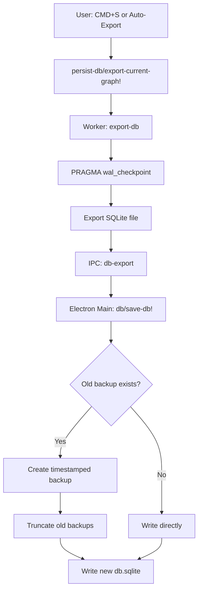

# Graph Database Backup Investigation: Electron Desktop App

**Document Type:** Code Investigation  
**Platform:** Electron (Windows & macOS)  
**Feature:** Database Graph Backup System  
**Last Updated:** January 9, 2026  
**Investigation Date:** January 9, 2026

---

## Executive Summary

### Key Findings

1. **Multiple Backup Layers** - Database graphs have 4 independent backup mechanisms
2. **Platform Agnostic** - Core backup logic identical across Windows/macOS, only file paths differ
3. **Automatic & Manual** - Both periodic auto-backup and user-triggered manual backup supported
4. **Smart Retention** - Daily+hourly retention policy keeps 6 hourly + 6 daily backups (12 total)
5. **Zero Config Required** - Backups happen automatically when saving database to disk

### Critical Insights

- **Primary backup:** Database saved to `~/.logseq/graphs/<graph-name>/db.sqlite`
- **Backup directory:** `~/.logseq/graphs/<graph-name>/backups/` (keeps 12 timestamped versions)
- **Retention strategy:** 6 newest backups at hourly intervals, 6 older at daily intervals
- **Platform differences:** Only file path separators differ (Windows uses `\`, macOS/Linux use `/`)
- **Backup trigger:** Automatic on every `save-db!` call (manual save via CMD+S or periodic export)

---

## 1. Backup Architecture Overview

### The Four Backup Layers

```
Layer 1: Primary Database File
└─> ~/.logseq/graphs/<graph-name>/db.sqlite
    └─> Written on every save operation
    └─> Contains current state of SQLite database

Layer 2: Timestamped Backups
└─> ~/.logseq/graphs/<graph-name>/backups/
    └─> Created before overwriting primary db.sqlite
    └─> Keeps 12 versions (6 hourly + 6 daily)
    └─> Format: 2026-01-09T14_30_45.123Z.sqlite

Layer 3: File-Based Backups (logseq/bak/)
└─> <graph-dir>/logseq/bak/
    └─> Emergency backups for file conflicts
    └─> Keeps 6 versions per file
    └─> Used for database-mode file writes

Layer 4: Version Files (logseq/version-files/)
└─> <graph-dir>/logseq/version-files/local/
    └─> Timestamped snapshots for file sync
    └─> Keeps 6 versions per file
```

### Component Interactions



---

## 2. Entry Points & Triggers

### 2.1 Manual Backup (CMD+S)

**Keyboard Shortcut:** CMD+S (macOS) / Ctrl+S (Windows)

**Flow:**

```
User presses CMD+S
  ↓
frontend.modules.shortcut/binding [:editor/save-db-to-disk]
  ↓
frontend.handler.events/handle [:graph/save-db-to-disk]
  ↓
frontend.persist-db/export-current-graph! (force-save=true)
  ↓
Backup created
```

**Code Reference:**

- Shortcut: [src/main/frontend/modules/shortcut/config.cljs:479-481](../../src/main/frontend/modules/shortcut/config.cljs#L479-L481)
- Handler: [src/main/frontend/handler/events.cljs:273-274](../../src/main/frontend/handler/events.cljs#L273-L274)

### 2.2 Automatic Periodic Export

**Interval:** Every 30 seconds (if graph has changes)

**Flow:**

```
Timer: Every 30s
  ↓
frontend.persist-db/start-db-persisting-loop!
  ↓
Check if graph changed (tx-id comparison)
  ↓
If changed → export-current-graph!
  ↓
Backup created
```

**Code Reference:**

- Timer setup: [src/main/frontend/persist_db.cljs:124-145](../../src/main/frontend/persist_db.cljs#L124-L145)

### 2.3 On Window Close

**Trigger:** Before window closes or app quits

**Flow:**

```
Window close event
  ↓
electron.window/on-close-actions!
  ↓
Persist database before closing
  ↓
Backup created
```

---

## 3. Storage Mechanisms & Locations

### 3.1 Primary Storage Path

**Location:** `~/.logseq/graphs/<sanitized-graph-name>/db.sqlite`

**Path Resolution:**

```clojure
;; electron.db.cljs:17-19
(defn ensure-graph-dir! [db-name]
  (ensure-graphs-dir!)
  (let [graph-dir (node-path/join
                    (cli-common-graph/get-db-graphs-dir)
                    (common-sqlite/sanitize-db-name db-name))]
    (fs/ensureDirSync graph-dir)
    graph-dir))
```

**Platform-Specific Paths:**

- **macOS:** `/Users/<username>/.logseq/graphs/<graph-name>/db.sqlite`
- **Windows:** `C:\Users\<username>\.logseq\graphs\<graph-name>\db.sqlite`
- **Linux:** `/home/<username>/.logseq/graphs/<graph-name>/db.sqlite`

### 3.2 Backup Storage Path

**Location:** `~/.logseq/graphs/<graph-name>/backups/`

**Backup Creation:**

```clojure
;; electron.db.cljs:28-39
(defn save-db! [db-name data]
  (let [[db-name db-path] (common-sqlite/get-db-full-path
                            (cli-common-graph/get-db-graphs-dir) db-name)
        old-data (get-db db-name)
        backups-path (common-sqlite/get-db-backups-path
                       (cli-common-graph/get-db-graphs-dir) db-name)]
    (when old-data
      (backup-file/backup-file db-name nil nil
                               ".sqlite"
                               old-data
                               {:backups-dir backups-path
                                :truncate-daily? true
                                :keep-versions 12}))
    (fs/writeFileSync db-path data)))
```

### 3.3 File Name Format

**Pattern:** `YYYY-MM-DDTHH_MM_SS.sssZ.sqlite`

**Examples:**

- `2026-01-09T14_30_45.123Z.sqlite`
- `2026-01-09T15_45_12.456Z.sqlite`

**Note:** Underscores replace colons in timestamps for filesystem compatibility across platforms.

---

## 4. Platform-Specific Implementation

### 4.1 Cross-Platform File System Access

**Platform Detection:**

```clojure
;; electron.utils.cljs:15-17
(defonce mac? (= (.-platform js/process) "darwin"))
(defonce win32? (= (.-platform js/process) "win32"))
(defonce linux? (= (.-platform js/process) "linux"))
```

### 4.2 Path Construction

**Unified Path Joining:**

```clojure
;; Uses Node.js path.join() which handles platform differences
(node-path/join base-dir graph-name "db.sqlite")
```

**Result:**

- Windows: `base-dir\graph-name\db.sqlite`
- macOS/Linux: `base-dir/graph-name/db.sqlite`

### 4.3 File Name Sanitization

**Sanitization Rules (Same across platforms):**

```clojure
;; electron.search.cljs:22-26
(defn sanitize-db-name [db-name]
  (-> db-name
      (string/replace "/" "_")
      (string/replace "\\" "_")
      (string/replace ":" "_"))) ;; Windows drive letters
```

### 4.4 Platform Differences Summary

| Aspect               | Windows                      | macOS                        | Linux                        |
| -------------------- | ---------------------------- | ---------------------------- | ---------------------------- |
| **Base Directory**   | `%USERPROFILE%\.logseq`      | `~/.logseq`                  | `~/.logseq`                  |
| **Path Separator**   | `\`                          | `/`                          | `/`                          |
| **Path Join**        | `node-path/join` (automatic) | `node-path/join` (automatic) | `node-path/join` (automatic) |
| **File Permissions** | NTFS (automatic)             | chmod 644 (if enabled)       | chmod 644 (if enabled)       |
| **Backup Logic**     | ✅ Identical                 | ✅ Identical                 | ✅ Identical                 |
| **Retention Policy** | ✅ Identical                 | ✅ Identical                 | ✅ Identical                 |

**Key Insight:** The backup system is platform-agnostic. Node.js abstracts file system differences.

---

## 5. Backup Retention Policy

### 5.1 Daily + Hourly Retention Strategy

**Algorithm:** [electron.backup-file.cljs:49-115](../../src/electron/electron/backup_file.cljs#L49-L115)

**Policy:**

```
Total Backups Kept: 12
├── Phase 1: Hourly Retention (newest 6 backups)
│   └── Keep one backup per hour
│   └── Deduplicated by hour bucket (HH:00-HH:59)
│
└── Phase 2: Daily Retention (next 6 backups)
    └── Keep one backup per day
    └── Deduplicated by day (YYYY-MM-DD)
```

**Example Timeline:**

```
Current: 2026-01-09 15:30

Kept Backups:
├─ Hourly (6):
│  ├─ 2026-01-09T15_15_23.456Z.sqlite  (hour: 15)
│  ├─ 2026-01-09T14_22_11.789Z.sqlite  (hour: 14)
│  ├─ 2026-01-09T13_45_33.012Z.sqlite  (hour: 13)
│  ├─ 2026-01-09T12_30_44.234Z.sqlite  (hour: 12)
│  ├─ 2026-01-09T11_18_55.567Z.sqlite  (hour: 11)
│  └─ 2026-01-09T10_05_22.890Z.sqlite  (hour: 10)
│
└─ Daily (6):
   ├─ 2026-01-08T23_59_01.123Z.sqlite  (day: 2026-01-08)
   ├─ 2026-01-07T18_30_45.456Z.sqlite  (day: 2026-01-07)
   ├─ 2026-01-06T12_15_22.789Z.sqlite  (day: 2026-01-06)
   ├─ 2026-01-05T09_45_33.012Z.sqlite  (day: 2026-01-05)
   ├─ 2026-01-04T14_22_44.234Z.sqlite  (day: 2026-01-04)
   └─ 2026-01-03T20_10_55.567Z.sqlite  (day: 2026-01-03)
```

### 5.2 Throttling (Too-Soon Check)

**Minimum Interval:** 1 hour (3600000 ms)

**Logic:**

```clojure
;; electron.backup-file.cljs:133-143
(defn- too-soon? [dir]
  (let [info (latest-backup-info dir)
        min-interval-ms 3600000  ; 1 hour
        now-ms (.now js/Date)
        latest-backup-ts (:ts info)]
    (and latest-backup-ts
         (pos? min-interval-ms)
         (< (- now-ms latest-backup-ts) min-interval-ms))))
```

**Effect:** Prevents creating more than 1 backup per hour, even if `save-db!` is called frequently.

### 5.3 Backup File Metadata

**Stored Information:**

```clojure
{:name "2026-01-09T14_30_45.123Z.sqlite"
 :ts 1736432445123  ; Unix timestamp in milliseconds
 :size 12345678}     ; File size in bytes
```

---

## 6. Code Location Reference

### Core Components

| Component                  | File                                                                                     | Lines   | Purpose                     |
| -------------------------- | ---------------------------------------------------------------------------------------- | ------- | --------------------------- |
| **Backup File Management** | [src/electron/electron/backup_file.cljs](../../src/electron/electron/backup_file.cljs)   | 1-170   | Core backup/retention logic |
| **Database Storage**       | [src/electron/electron/db.cljs](../../src/electron/electron/db.cljs)                     | 1-60    | SQLite file I/O operations  |
| **Electron Handler**       | [src/electron/electron/handler.cljs](../../src/electron/electron/handler.cljs)           | 72-80   | IPC handlers for backup     |
| **Persist DB**             | [src/main/frontend/persist_db.cljs](../../src/main/frontend/persist_db.cljs)             | 54-145  | Export orchestration        |
| **DB Worker**              | [src/main/frontend/worker/db_worker.cljs](../../src/main/frontend/worker/db_worker.cljs) | 569-574 | Worker thread export        |

### Key Functions

| Function                          | Location                                                                           | Purpose                       |
| --------------------------------- | ---------------------------------------------------------------------------------- | ----------------------------- |
| `backup-file`                     | [backup_file.cljs:145-168](../../src/electron/electron/backup_file.cljs#L145-L168) | Create timestamped backup     |
| `truncate-daily-versioned-files!` | [backup_file.cljs:49-115](../../src/electron/electron/backup_file.cljs#L49-L115)   | Apply retention policy        |
| `save-db!`                        | [db.cljs:28-39](../../src/electron/electron/db.cljs#L28-L39)                       | Write SQLite to disk + backup |
| `export-current-graph!`           | [persist_db.cljs:54-75](../../src/main/frontend/persist_db.cljs#L54-L75)           | Trigger export process        |
| `:thread-api/export-db`           | [db_worker.cljs:569-574](../../src/main/frontend/worker/db_worker.cljs#L569-L574)  | Export from worker thread     |

### IPC Handlers

| Handler              | Location                                                                   | Purpose                 |
| -------------------- | -------------------------------------------------------------------------- | ----------------------- |
| `:db-export`         | [handler.cljs:285-287](../../src/electron/electron/handler.cljs#L285-L287) | Receive database export |
| `:backupDbFile`      | [handler.cljs:72-77](../../src/electron/electron/handler.cljs#L72-L77)     | Backup file on conflict |
| `:openFileBackupDir` | [handler.cljs:82-86](../../src/electron/electron/handler.cljs#L82-L86)     | Open backup folder      |

---

## 7. Flow Diagrams

### 7.1 Save Database Flow (with Backup)

```
User Action (CMD+S or Auto-Save)
        ↓
frontend.persist_db.export-current-graph!
        ↓
Check if graph changed (tx-id comparison)
        ↓ (changed OR force-save=true)
Worker Thread: :thread-api/export-db
  ├─ PRAGMA wal_checkpoint(2)     [Flush WAL]
  └─ <export-db-file repo          [Read from OPFS]
        ↓
Return ArrayBuffer to main thread
        ↓
IPC: :db-export repo data
        ↓
Electron Main Process
        ↓
db/save-db! db-name data
  ├─ Read old-data from db.sqlite  [if exists]
  ├─ Create backup of old-data     [if old-data exists]
  │   ├─ Generate timestamp filename
  │   ├─ Write to backups/ directory
  │   └─ Truncate old backups (keep 12)
  └─ Write new data to db.sqlite
        ↓
Success ✓
```

### 7.2 Backup Retention Flow

```
save-db! called with new database data
        ↓
Check if old db.sqlite exists
        ↓ (exists)
Read old-data from db.sqlite
        ↓
backup-file/backup-file called
  ├─ Create backups/ directory (if not exists)
  ├─ Generate timestamp: 2026-01-09T14_30_45.123Z.sqlite
  ├─ Check too-soon? (< 1 hour since last backup?)
  │   └─ If too soon → Skip backup creation
  │   └─ If OK → Continue
  ├─ Write old-data to backups/<timestamp>.sqlite
  └─ truncate-daily-versioned-files! (keep 12)
      ├─ List all .sqlite files in backups/
      ├─ Sort by timestamp (newest first)
      ├─ Apply retention policy:
      │   ├─ Keep 6 newest (1 per hour)
      │   └─ Keep 6 older (1 per day)
      └─ Delete files not in keep-set
        ↓
Write new data to db.sqlite
        ↓
Complete ✓
```

---

## 8. Risk Analysis

### 8.1 Identified Risks

#### 🟢 LOW RISK: Platform Path Incompatibility

- **Issue:** Different path separators across platforms
- **Mitigation:** Node.js `path.join()` handles this automatically
- **Impact:** Negligible

#### 🟢 LOW RISK: Backup Directory Not Created

- **Issue:** Missing backups/ directory could cause failures
- **Mitigation:** `fs-extra/ensureDirSync` creates directories recursively
- **Impact:** Negligible

#### 🟡 MEDIUM RISK: Disk Space Exhaustion

- **Issue:** 12 backups × large database = significant disk usage
- **Mitigation:** Automatic retention policy limits to 12 versions
- **Recommendation:** Monitor for large graphs (>100MB each)
- **Impact:** Moderate for users with limited disk space

#### 🟡 MEDIUM RISK: Concurrent Write Race Condition

- **Issue:** Multiple save operations in quick succession
- **Mitigation:**
  - WAL checkpoint before export ensures consistency
  - Synchronous write operations (`writeFileSync`)
  - Too-soon check prevents backup spam
- **Impact:** Unlikely but possible data corruption if OS crashes during write

#### 🟡 MEDIUM RISK: Backup Throttling Loss

- **Issue:** Too-soon check might skip important backups within 1 hour
- **Example:** User makes critical changes at 14:15, 14:30, 14:45 → Only 14:15 backed up
- **Mitigation:** Hourly retention still captures changes
- **Recommendation:** Document this behavior for users

#### 🔴 HIGH RISK: Backup Directory Deletion

- **Issue:** User manually deletes `~/.logseq/graphs/<name>/backups/`
- **Mitigation:** None - user action
- **Recommendation:**
  - Warn users not to delete Logseq directories
  - Consider backup to external location option
- **Impact:** Loss of all backup history

### 8.2 Edge Cases

#### Case 1: Very First Save (No Old Data)

```clojure
(when old-data  ; old-data is nil
  (backup-file ...))  ; Skipped!

(fs/writeFileSync db-path data)  ; Write directly
```

**Result:** ✅ Works correctly - no backup needed for first save

#### Case 2: Rapid Successive Saves

```
14:10:30 - Save → Backup created
14:15:45 - Save → Backup SKIPPED (< 1 hour)
14:20:12 - Save → Backup SKIPPED (< 1 hour)
15:11:00 - Save → Backup created
```

**Result:** ⚠️ Changes at 14:15 and 14:20 not individually backed up

#### Case 3: Manual Backup Folder Deletion During Operation

```
14:10 - Backup created successfully
14:15 - User deletes backups/ folder
14:20 - Next save → ensureDirSync recreates folder
```

**Result:** ✅ System recovers, but previous backups lost

#### Case 4: Database Larger Than Available Disk Space

```
Database: 500MB
Available: 300MB
save-db! → Write fails with ENOSPC error
```

**Result:** ❌ No backup created, original db.sqlite may be corrupted
**Recommendation:** Check available space before writing

---

## 9. Recommendations

### 9.1 For Users

#### Best Practices

1. **Monitor Disk Space**

   - Check `~/.logseq/graphs/` size periodically
   - Each backup = size of database
   - 12 backups can consume significant space for large graphs

2. **Don't Modify Logseq Directories**

   - Never manually edit files in `~/.logseq/`
   - Don't delete `backups/` folder
   - Use Logseq's export features instead

3. **External Backup Strategy**

   - Logseq backups protect against corruption, not disk failure
   - Regularly export to external drive or cloud storage
   - Use File System Access API backup feature (Settings → Export)

4. **Recovery Process**

   ```bash
   # List available backups
   ls -lh ~/.logseq/graphs/<graph-name>/backups/

   # Restore from backup (close Logseq first!)
   cp ~/.logseq/graphs/<graph-name>/backups/2026-01-09T14_30_45.123Z.sqlite \
      ~/.logseq/graphs/<graph-name>/db.sqlite
   ```

### 9.2 For Developers

#### Immediate Improvements

1. **Add Disk Space Check**

   ```clojure
   (defn save-db! [db-name data]
     (let [available-space (get-available-disk-space)
           required-space (* 2 (.-length data))]  ; 2x for backup + new file
       (when (< available-space required-space)
         (throw (ex-info "Insufficient disk space"
                        {:available available-space
                         :required required-space})))))
   ```

2. **Expose Backup Status to UI**

   ```clojure
   (defn get-backup-info [repo]
     {:total-backups (count-backups repo)
      :total-size (calculate-backup-size repo)
      :oldest-backup (get-oldest-backup-date repo)
      :newest-backup (get-newest-backup-date repo)})
   ```

3. **Configurable Retention Policy**

   ```clojure
   ;; Allow users to customize
   {:keep-versions 12         ; Total backups
    :hourly-retention 6       ; Newest N at hourly intervals
    :min-interval-hours 1}    ; Throttle interval
   ```

4. **Atomic Write with Temp File**
   ```clojure
   (defn save-db! [db-name data]
     (let [db-path (get-db-path db-name)
           temp-path (str db-path ".tmp")]
       ;; Write to temp first
       (fs/writeFileSync temp-path data)
       ;; Create backup of old file
       (when (fs/existsSync db-path)
         (create-backup! db-path))
       ;; Atomic rename
       (fs/renameSync temp-path db-path)))
   ```

#### Medium-Term Enhancements

1. **Backup Verification**

   - After creating backup, verify file integrity
   - Compare checksums (SHA256)
   - Alert on corruption detection

2. **Backup Compression**

   - Compress backups with gzip/brotli
   - Could reduce disk usage by 50-70%
   - Trade-off: CPU time vs disk space

3. **Cloud Backup Integration**

   - Optional sync to cloud storage
   - Encrypt before upload
   - Automatic retention management

4. **Recovery UI**
   - Built-in backup browser in Logseq
   - Visual timeline of backups
   - One-click restore with preview

#### Long-Term Architecture

1. **Incremental Backups**

   - Only store changed pages/blocks
   - Significantly reduces disk usage
   - Requires WAL-based diff tracking

2. **Backup Profiles**

   - Minimal: 3 daily backups
   - Standard: 12 (current)
   - Paranoid: 24 hourly + 14 daily + 4 weekly

3. **Multi-Destination Backup**
   - Local + NAS + Cloud simultaneously
   - Configurable priorities
   - Health monitoring dashboard

### 9.3 Testing Recommendations

#### Unit Tests Needed

```clojure
(deftest backup-retention-policy-test
  (testing "Keeps 6 hourly + 6 daily backups"
    ;; Create 50 backups spanning 7 days
    ;; Verify exactly 12 remain
    ;; Verify hourly dedup in newest 6
    ;; Verify daily dedup in older 6
    ))

(deftest too-soon-throttling-test
  (testing "Prevents backup within 1 hour"
    ;; Create backup at T
    ;; Try backup at T+30min → should skip
    ;; Try backup at T+61min → should succeed
    ))

(deftest platform-path-compatibility-test
  (testing "Paths work on Windows/macOS/Linux"
    ;; Mock process.platform
    ;; Verify path construction
    ;; Check sanitization
    ))
```

#### Integration Tests Needed

1. **Backup Creation During Save**

   - Save database multiple times
   - Verify backups created with correct timestamps
   - Verify retention policy applied

2. **Recovery from Backup**

   - Create graph, make changes, save
   - Restore from backup
   - Verify data integrity

3. **Disk Space Exhaustion**

   - Mock ENOSPC error
   - Verify graceful degradation
   - Verify error message to user

4. **Concurrent Save Operations**
   - Multiple windows, same graph
   - Rapid save operations
   - Verify no corruption

#### E2E Tests Needed

1. **Full Lifecycle Test**

   ```
   1. Create new database graph
   2. Add content and save (no backup yet)
   3. Edit content and save (first backup)
   4. Make 20 more edits over 2 days
   5. Verify exactly 12 backups exist
   6. Verify retention policy correct
   ```

2. **Recovery Scenario**
   ```
   1. Create graph with known content
   2. Save (backup created)
   3. Corrupt db.sqlite
   4. Restore from backup
   5. Verify content matches
   ```

---

## 10. Related Documentation

- [CMD+S Save Investigation](./cmd-s-save-db-persistence.md) - Manual save deep dive
- [CMD+R Reload Persistence](./cmd-r-reload-persistence.md) - Window reload behavior
- [Git Backup for DB Mode](../03-features/git-backup/versioning-db-mode.md) - Version control integration
- [System Architecture](../02-architecture/system-architecture.md) - Overall architecture

---

## 11. Appendices

### Appendix A: Backup File Name Parsing

**Format:** `YYYY-MM-DDTHH_MM_SS.sssZ.sqlite`

**Parsing Logic:**

```clojure
(defn- parse-backup-ts [filename]
  "Backup filenames are like: 2025-12-25T01_23_45.678Z.ext
   We turn '_' back into ':' and parse as ISO."
  (let [base (-> filename
                 (string/replace #"\.[^.]+$" "")  ; Remove extension
                 (string/replace "_" ":"))        ; Restore colons
        ms (.parse js/Date base)]
    (when-not (js/isNaN ms) ms)))
```

**Examples:**

- Input: `2026-01-09T14_30_45.123Z.sqlite`
- Base: `2026-01-09T14:30:45.123Z`
- Output: `1736432445123` (Unix timestamp in ms)

### Appendix B: Directory Structure

```
~/.logseq/
└── graphs/
    └── <graph-name>/
        ├── db.sqlite                    # Primary database
        ├── db.sqlite-wal               # Write-Ahead Log (if active)
        ├── db.sqlite-shm               # Shared memory (if active)
        └── backups/                    # Timestamped backups
            ├── 2026-01-09T15_30_12.456Z.sqlite  # Newest (hourly)
            ├── 2026-01-09T14_22_33.789Z.sqlite
            ├── 2026-01-09T13_15_44.012Z.sqlite
            ├── 2026-01-09T12_45_55.234Z.sqlite
            ├── 2026-01-09T11_30_01.567Z.sqlite
            ├── 2026-01-09T10_15_12.890Z.sqlite
            ├── 2026-01-08T23_59_23.123Z.sqlite  # Oldest hourly
            ├── 2026-01-07T18_30_34.456Z.sqlite  # Daily
            ├── 2026-01-06T12_15_45.789Z.sqlite
            ├── 2026-01-05T09_45_56.012Z.sqlite
            ├── 2026-01-04T14_22_01.234Z.sqlite
            └── 2026-01-03T20_10_12.567Z.sqlite  # Oldest daily
```

### Appendix C: Glossary

| Term         | Definition                                                  |
| ------------ | ----------------------------------------------------------- |
| **OPFS**     | Origin Private File System - Browser-based file storage API |
| **WAL**      | Write-Ahead Logging - SQLite transaction log mode           |
| **Transit**  | Clojure serialization format (JSON-based)                   |
| **IPC**      | Inter-Process Communication (Electron renderer ↔ main)      |
| **ENOSPC**   | Error: No Space - Disk full error code                      |
| **Sanitize** | Replace invalid filename characters with safe alternatives  |
| **Truncate** | Delete old files to enforce retention policy                |

---

## Change Log

| Date       | Version | Changes                        |
| ---------- | ------- | ------------------------------ |
| 2026-01-09 | 1.0     | Initial investigation document |

---

**End of Investigation Report**
