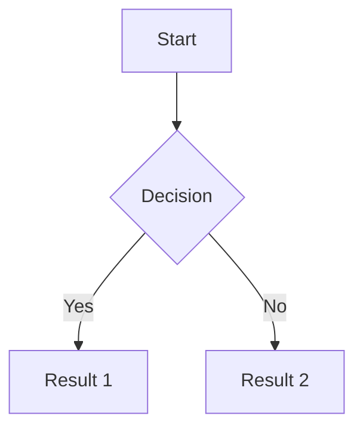
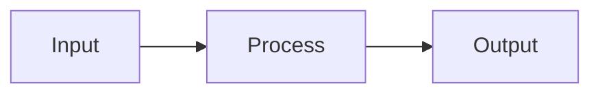

# Markdown Syntax Reference

Reference for the markup Logseq accepts inside a block. Covers text styling, links, code, tables and the Logseq-specific forms, and marks the forms that are deprecated in DB graphs.

**Quick Access:** Type `/` in any block for formatting commands.

## How Logseq parses a block

Logseq does not use a CommonMark parser. Block titles are parsed by [mldoc](https://github.com/logseq/mldoc), an OCaml Org/Markdown parser wrapped at [`deps/graph-parser/src/logseq/graph_parser/mldoc.cljc`](../../../../../deps/graph-parser/src/logseq/graph_parser/mldoc.cljc), and the resulting AST is rendered by [`src/main/frontend/components/block.cljs`](../../../../../src/main/frontend/components/block.cljs). A form only "works" if `block.cljs` has a branch for it — this page lists the branches that exist at the revision in the frontmatter.

Two consequences shape everything below:

- **Markdown is input syntax, not storage.** In a DB graph, headings, code blocks, quotes and math are stored as node properties (`:logseq.property/heading`, `:logseq.property.node/display-type`), not as `#` or ` ``` ` characters. Typing the markdown is a shorthand that gets normalized away.
- **Several Org-style forms are deprecated** and now render an in-app warning instead of content. They are listed with their warning text rather than removed from this page, because you will still meet them in imported graphs.

---

## Table of Contents

1. [Text Formatting](#text-formatting)
2. [Headings](#headings)
3. [Lists](#lists)
4. [Links](#links)
5. [Code](#code)
6. [Tables](#tables)
7. [Block Elements](#block-elements)
8. [Logseq-Specific Syntax](#logseq-specific-syntax)
9. [Special Characters](#special-characters)

---

## Text Formatting

### Basic Formatting

mldoc's inline emphasis kinds are exactly `Bold`, `Italic`, `Underline`, `Strike_through` and `Highlight` ([`schema/mldoc.cljc:72`](../../../../../deps/graph-parser/src/logseq/graph_parser/schema/mldoc.cljc)), mapped to `<b>`, `<i>`, `<ins>`, `<del>` and `<mark>` at [`block.cljs:1931-1940`](../../../../../src/main/frontend/components/block.cljs).

| Style         | Syntax                | Renders as | Shortcut       |
| ------------- | --------------------- | ---------- | -------------- |
| Bold          | `**text**`            | `<b>`      | `mod+b`        |
| Italic        | `*text*`              | `<i>`      | `mod+i`        |
| Strikethrough | `~~text~~`            | `<del>`    | `mod+shift+s`  |
| Highlight     | `^^text^^`            | `<mark>`   | `mod+shift+h`  |
| Inline code   | `` `text` ``          | `<code>`   | –              |
| Underline     | `<ins>text</ins>`     | `<ins>`    | – (`/Underline`) |
| Superscript   | `^{text}`             | `<sup>`    | –              |
| Subscript     | `_{text}`             | `<sub>`    | –              |

`mod` is `⌘` on macOS and `Ctrl` elsewhere. The four keyboard bindings are declared at [`modules/shortcut/config.cljs:119-129`](../../../../../src/main/frontend/modules/shortcut/config.cljs); the characters they wrap the selection in come from `get-bold` / `get-italic` / `get-strike-through` / `get-highlight` at [`frontend/config.cljs:206-241`](../../../../../src/main/frontend/config.cljs).

Three corrections to folklore about these shortcuts:

- There is **no `mod+e` for inline code**. `mod+e` is `:editor/quick-add` ([`shortcut/config.cljs:444-446`](../../../../../src/main/frontend/modules/shortcut/config.cljs)).
- There is **no `mod+k` for links**. `mod+k` is global search (`:go/search`, [`shortcut/config.cljs:304-305`](../../../../../src/main/frontend/modules/shortcut/config.cljs)). The link shortcut is `mod+l` (`:editor/insert-link`, [`:241-242`](../../../../../src/main/frontend/modules/shortcut/config.cljs)).
- Highlight is `mod+shift+h`, not `mod+h`.

> **Unverified:** the highlight shortcut and the highlight markup disagree in source. Typing `^` twice auto-pairs into `^^…^^` ([`handler/editor.cljs:3424-3426`](../../../../../src/main/frontend/handler/editor.cljs)), the in-app syntax help shows `^^highlight^^` ([`components/shortcut_help.cljs:47`](../../../../../src/main/frontend/components/shortcut_help.cljs)) and the file-graph importer writes `^^…^^` ([`graph_parser/exporter.cljs:1213`](../../../../../deps/graph-parser/src/logseq/graph_parser/exporter.cljs)) — but `config/get-highlight` returns `"=="` for `:markdown` ([`frontend/config.cljs:236-240`](../../../../../src/main/frontend/config.cljs)), so `mod+shift+h` wraps the selection in `==`. Whether mldoc parses `==…==` as `Highlight` could not be confirmed from this repository (mldoc is an external dependency). Prefer `^^…^^`, which every in-repo producer and the syntax help agree on.

**Examples:**

```markdown
This is **bold text** and this is *italic*.
You can ~~cross things out~~ or ^^highlight them^^.
Use `inline code` for commands or variables.
H_{2}O and E = mc^{2}.
```

### Combining Styles

```markdown
**Bold and *italic***
~~**Struck through bold**~~
^^**Highlighted bold**^^
`**Bold code**` (bold won't render inside code)
```

---

## Headings

### Heading is a property, not markup

In a DB graph a heading is the `:logseq.property/heading` property on the block, holding the level `1`–`6`. Typing `# ` … `###### ` at the start of a block still works, but as an **input shorthand**: `wrap-parse-block` detects the leading `#{1,6}\s+`, strips it from the title and sets the property instead ([`handler/db_based/editor.cljs:47-52`](../../../../../src/main/frontend/handler/db_based/editor.cljs) and [`:105-108`](../../../../../src/main/frontend/handler/db_based/editor.cljs), using `clear-markdown-heading` at [`deps/common/src/logseq/common/util.cljs:327-332`](../../../../../deps/common/src/logseq/common/util.cljs)). The `#` characters are not stored.

Normalization is skipped for blocks whose `:logseq.property.node/display-type` is `:code` or `:math`, so a `#` inside a code block stays literal ([`db_based/editor.cljs:54-56`](../../../../../src/main/frontend/handler/db_based/editor.cljs)).

```markdown
# Heading 1
## Heading 2
### Heading 3
#### Heading 4
##### Heading 5
###### Heading 6
```

### Slash commands

The heading commands are generated from `:editor.slash/heading-label` for levels 1–6, plus a "Normal text" entry that clears the property ([`commands.cljs:198-213`](../../../../../src/main/frontend/commands.cljs); labels at [`src/resources/dicts/en.edn:535`, `:542`, `:553-554`](../../../../../src/resources/dicts/en.edn)):

```text
/Normal text   → clears heading, back to body text
/Heading 1 … /Heading 6
```

There are no `/h1`, `/h2`, `/h3` aliases — the command names are the full labels above.

**Best Practices:**

- One `#` per level, with a space after it (`#Heading` is not a heading; the pattern requires `\s+`).
- Use levels hierarchically and keep headings short.
- To remove a heading, use `/Normal text` rather than deleting `#` characters — the characters are not what is stored.

---

## Lists

### Unordered Lists

**Syntax:**

```markdown
- Item 1
- Item 2
  - Nested item 2.1
  - Nested item 2.2
    - Deep nested 2.2.1
- Item 3
```

**Or use:**

```markdown
- Item 1
- Item 2

* Item 1
* Item 2
```

**Logseq Default:**

Logseq uses `-` (dash) by default for bullets.

### Ordered Lists

**Syntax:**

```markdown
1. First item
2. Second item
   1. Nested first
   2. Nested second
3. Third item
```

**Numbered blocks (not markdown):** to number a run of sibling *blocks* rather than lines inside one block, use the LIST TYPE slash commands, which toggle a property on the block:

```text
/Number list      → :editor/toggle-own-number-list
/Number children  → :editor/toggle-children-number-list
```

([`commands.cljs:306-316`](../../../../../src/main/frontend/commands.cljs))

### Task Lists

**Markdown checkboxes** work inside a single block. `list-item` renders an interactive checkbox whenever mldoc reports one, and clicking it rewrites the block text ([`block.cljs:4802-4822`](../../../../../src/main/frontend/components/block.cljs), toggling via `list-checkbox` at [`:2400-2410`](../../../../../src/main/frontend/components/block.cljs)):

```markdown
- [ ] Unchecked task
- [x] Checked task
```

**Logseq task markers are file-graph syntax and do nothing in a DB graph.** Typing `TODO`, `DOING`, `LATER`, `NOW`, `WAITING` or `CANCELLED` at the start of a block leaves plain text — `:block/marker` is not an attribute of a DB graph. A DB-graph task is the `:logseq.property/status` property, a closed-value ref with exactly six values ([`deps/db/src/logseq/db/frontend/property.cljs:313-318`](../../../../../deps/db/src/logseq/db/frontend/property.cljs)):

| Status    | `:db/ident`                         |
| --------- | ----------------------------------- |
| Backlog   | `:logseq.property/status.backlog`   |
| Todo      | `:logseq.property/status.todo`      |
| Doing     | `:logseq.property/status.doing`     |
| In Review | `:logseq.property/status.in-review` |
| Done      | `:logseq.property/status.done`      |
| Canceled  | `:logseq.property/status.canceled`  |

Set them with the TASK STATUS slash commands, which are generated from those closed values rather than hard-coded ([`commands.cljs:150-166`](../../../../../src/main/frontend/commands.cljs)):

```text
/Backlog  /Todo  /Doing  /In Review  /Done  /Canceled
```

Priority is the same shape — four closed values (`:logseq.property/priority.low|.medium|.high|.urgent`, [`property.cljs:334-337`](../../../../../deps/db/src/logseq/db/frontend/property.cljs)) exposed as `/Priority Low` … `/Priority Urgent` plus `/No priority` ([`commands.cljs:167-190`](../../../../../src/main/frontend/commands.cljs)).

---

## Links

### Page Links (Wiki-style)

**Syntax:**

```markdown
[[Page Name]]
[[Page/Nested/Name]]
```

The delimiters are defined at [`deps/common/src/logseq/common/util/page_ref.cljs:7-9`](../../../../../deps/common/src/logseq/common/util/page_ref.cljs); `link-cp` dispatches the `Page_ref` URL type at [`block.cljs:1559-1563`](../../../../../src/main/frontend/components/block.cljs). `/Node reference` inserts `[[]]` and opens the page search ([`commands.cljs:227-231`](../../../../../src/main/frontend/commands.cljs)).

**`[[Page|Display Text]]` is not Logseq syntax.** `page_ref.cljs` has no handling for `|` at all — `get-page-name` uses `#"\[\[(.*)\]\]"` ([`page_ref.cljs:15`](../../../../../deps/common/src/logseq/common/util/page_ref.cljs)), so `[[Projects|My Projects]]` resolves to a page whose title is literally `Projects|My Projects`. To give a page a second name, use the built-in **Alias** property (`:block/alias`, [`deps/db/src/logseq/db/frontend/property.cljs:68-69`](../../../../../deps/db/src/logseq/db/frontend/property.cljs)).

**Nested titles create one page per segment.** `[[Projects/Work/Client A]]` does not create a single page with slashes in its name: the title is split and each segment becomes its own page under **Library**, with the leaf page titled `Client A` ([`deps/outliner/src/logseq/outliner/page.cljs:385-388`](../../../../../deps/outliner/src/logseq/outliner/page.cljs)).

**Create pages:**

Typing `[[New Page]]` creates the page when you navigate to it.

### External Links

**Syntax:**

```markdown
[Link Text](https://example.com)
[Link with title](https://example.com 'Hover title')
<https://example.com>
https://example.com (auto-linked)
```

**Examples:**

```markdown
Visit [Logseq](https://logseq.com)
Read [documentation](https://docs.logseq.com 'Logseq Docs')
Quick: <https://github.com>
Auto: https://logseq.com
```

### Block References

**Syntax:**

```markdown
((66d1c9f0-1f6e-4b2c-9c4f-0e2a5b8d1234))
```

A block ref must contain **a full UUID and nothing else**. The recogniser is a strict regex — `#"\(\(([a-fA-F0-9]{8}-[a-fA-F0-9]{4}-[a-fA-F0-9]{4}-[a-fA-F0-9]{4}-[a-fA-F0-9]{12})\)\)"` at [`deps/common/src/logseq/common/util/block_ref.cljs:9`](../../../../../deps/common/src/logseq/common/util/block_ref.cljs). There is no `((uuid Display text))` form; trailing text makes the whole thing fail to match and it stays plain text.

**Create block reference:**

```text
1. Right-click the block bullet → Copy block ref
2. Paste
3. Or type (( and search
```

### Block and Page Embeds

**`{{embed ...}}` is deprecated.** In a DB graph it renders a warning rather than the embedded content:

> `{{embed}} is deprecated. Use '/Node embed' command instead.`

([`block.cljs:1917-1918`](../../../../../src/main/frontend/components/block.cljs); message at [`src/resources/dicts/en.edn:157`](../../../../../src/resources/dicts/en.edn))

Use the slash command instead:

```text
/Node embed   → opens the block/page search and embeds the chosen node
```

It runs `db-based-embed-block`, which triggers `[:editor/search-block :embed]` ([`commands.cljs:105-108`](../../../../../src/main/frontend/commands.cljs), wired in at [`:236-239`](../../../../../src/main/frontend/commands.cljs)).

---

## Code

### Inline Code

**Syntax:**

```markdown
Use `code` for inline code
Or `` code with `backticks` inside ``
```

**Examples:**

```markdown
Run `npm install` to install packages.
Use `` SELECT * FROM `users`  `` for SQL.
```

### Code Blocks

**Syntax:**

````markdown
```language
code here
```
````

**Supported Languages:**

The language list is CodeMirror's, not a Logseq list. Modes are imported at [`src/main/frontend/extensions/code.cljs:7-128`](../../../../../src/main/frontend/extensions/code.cljs) and the in-app language picker enumerates `window.CodeMirror.modeInfo` directly ([`block.cljs:4882-4884`](../../../../../src/main/frontend/components/block.cljs)), so whatever appears in that picker is what is supported. It includes clojure, javascript, python, ruby, go, rust, the clike family (C/C++/C#/Java/Kotlin/Scala), shell, sql, css, xml, yaml, diff, dockerfile and many more.

**Examples:**

````markdown
```javascript
function hello() {
  console.log('Hello World')
}
```

```python
def hello():
    print("Hello World")
```

```bash
#!/bin/bash
echo "Hello World"
```
````

**Rendered:**

```javascript
function hello() {
  console.log('Hello World')
}
```

### Code blocks are nodes, not fences

`/Code block` does not insert three backticks. It runs `code-block-steps`, which upserts the block to `:logseq.property.node/display-type :code` and exits the editor ([`commands.cljs:134-138`](../../../../../src/main/frontend/commands.cljs)); the language is stored in `:logseq.property.code/lang`. Typing a fenced block also works — mldoc parses it to `["Src" options]` and `src-cp` renders a CodeMirror editor ([`block.cljs:5116-5124`](../../../../../src/main/frontend/components/block.cljs)) — but the node form is what the app writes.

### Evaluating Clojure

A `clojure` code block whose options include `:results` is evaluated with SCI and its result rendered below the block ([`block.cljs:4963-4965`](../../../../../src/main/frontend/components/block.cljs)):

````markdown
```clojure :results
(+ 1 2)
```
````

> Removed claim: earlier revisions of this page documented ` ```javascript {numberLines: true} ` and ` ```javascript {highlight: [2, 3]} `. Neither string appears anywhere in the repository — there is no reader for either option, and both are ignored.

---

## Tables

### Basic Table

**Syntax:**

```markdown
| Header 1 | Header 2 | Header 3 |
| -------- | -------- | -------- |
| Cell 1   | Cell 2   | Cell 3   |
| Cell 4   | Cell 5   | Cell 6   |
```

**Rendered:**

| Header 1 | Header 2 | Header 3 |
| -------- | -------- | -------- |
| Cell 1   | Cell 2   | Cell 3   |
| Cell 4   | Cell 5   | Cell 6   |

### Alignment

```markdown
| Left | Center | Right |
| :--- | :----: | ----: |
| L1   |   C1   |    R1 |
| L2   |   C2   |    R2 |
```

**Alignment:**

- `:---` → Left align
- `:---:` → Center align
- `---:` → Right align

**Rendered:**

| Left | Center | Right |
| :--- | :----: | ----: |
| L1   |   C1   |    R1 |
| L2   |   C2   |    R2 |

### Table Tips

```markdown
✅ Tips:

- Columns don't need to line up perfectly
- Use | to separate columns
- Dashes (---) for header separator
- Can include markdown in cells

Example with formatting:
| Name | Status | Link |
|------|--------|------|
| **Bold** | `code` | [[Page]] |
```

---

## Block Elements

### Blockquotes

**Markdown `>` still works** and renders a `<blockquote>` ([`block.cljs:5031-5034`](../../../../../src/main/frontend/components/block.cljs)):

```markdown
> Single line quote

> Multiple line quote
> continues here
```

**`#+BEGIN_QUOTE` is deprecated.** Any block whose raw content starts with `#+BEGIN_QUOTE` (case-insensitive) is flagged at [`block.cljs:2806-2807`](../../../../../src/main/frontend/components/block.cljs) and renders:

> `#+BEGIN_QUOTE is deprecated. Use '/Quote' command instead.`

([`src/resources/dicts/en.edn:121`](../../../../../src/resources/dicts/en.edn))

**Slash command:** `/Quote` — it does not insert `>`; it sets `:logseq.property.node/display-type :quote` on the block ([`commands.cljs:140-143`](../../../../../src/main/frontend/commands.cljs)).

### Horizontal Rules

`---` on its own parses to `Horizontal_Rule` and renders `<hr>` ([`block.cljs:5003-5004`](../../../../../src/main/frontend/components/block.cljs)); the same string is what `config/get-hr` produces for markdown ([`frontend/config.cljs:198-203`](../../../../../src/main/frontend/config.cljs)).

```markdown
---
```

> Removed claim: earlier revisions listed `/line` and `/divider` slash commands. Neither exists in `commands-map` ([`commands.cljs:220-376`](../../../../../src/main/frontend/commands.cljs)).

### Callouts/Admonitions

Org-style admonition blocks are still rendered. `markup-element-cp` has exactly six named admonition branches — **note, tip, important, caution, warning, pinned** ([`block.cljs:5060-5077`](../../../../../src/main/frontend/components/block.cljs)) — each dispatched to `ui/admonition`, which only produces output for those six names because it looks the icon up in a `case` and returns `nil` otherwise ([`src/main/frontend/ui.cljs:629-644`](../../../../../src/main/frontend/ui.cljs)):

```markdown
#+BEGIN_TIP
This is a tip!
#+END_TIP

#+BEGIN_NOTE
#+BEGIN_IMPORTANT
#+BEGIN_CAUTION
#+BEGIN_WARNING
#+BEGIN_PINNED
```

`#+BEGIN_CENTER` is a separate branch that wraps the content in `<div class="text-center">` rather than an admonition ([`block.cljs:5078-5081`](../../../../../src/main/frontend/components/block.cljs)).

**There are no `/tip`, `/warning`, `/important`, `/note` or `/caution` slash commands** — nothing in `commands-map` inserts an admonition. These must be typed.

**Custom blocks:** any other `#+BEGIN_FOO … #+END_FOO` falls through to a generic branch that emits `<div class="FOO">` around the content ([`block.cljs:5083-5087`](../../../../../src/main/frontend/components/block.cljs)). The `_options` after `#+BEGIN_FOO` are **discarded**, so `#+BEGIN_CUSTOM Custom Title` does not render a title — style the class from CSS instead.

---

## Logseq-Specific Syntax

### Properties

**Syntax:**

```markdown
key:: value
property-name:: property value
tags:: [[Tag1]], [[Tag2]]
status:: in-progress
priority:: high
```

**Multi-line Property:**

```markdown
description::

- Line 1
- Line 2
- Line 3
```

### Tags

**Syntax:**

```markdown
#tag
#nested/tag
#tag-with-dashes
#TagWithCaps
```

**Or:** `/tag`

**Examples:**

```markdown
This is a #project note about #work/client-a
Tagged with multiple: #important #review #2026
```

### Page References

**Syntax:**

```markdown
[[Page Name]]
[[namespace/page]]
[[Projects/Work/Client A]]
```

**With alias:**

```markdown
[[Full Page Name|Short Name]]
Example: [[Projects/Work/Alpha|Alpha]]
```

### Block Properties

**Syntax:**

```markdown
- Block content here
  id:: unique-id
  created-at:: 2026-01-22
  type:: note
```

**Common Block Properties:**

```markdown
id:: custom-block-id
tags:: [[Tag]]
created-at:: timestamp
updated-at:: timestamp
collapsed:: true
```

### Commands and Macros

**Syntax:**

```markdown
{{command arg1 arg2}}
{{embed [[Page]]}}
{{youtube VIDEO_ID}}
{{pdf URL}}
{{tweet TWEET_URL}}
```

**Examples:**

```markdown
{{embed ((block-ref))}}
{{youtube https://youtu.be/VIDEO}}
{{pdf https://example.com/file.pdf}}
```

---

## Special Characters

### Escaping Characters

**Escape with backslash:**

```markdown
\* Not a bullet
\# Not a tag
\[ Not a link start
\` Not code
```

**Special characters:**

```markdown
\* → \*
\# → #
\[ → [
\] → ]
\( → (
\) → )
\{ → {
\} → }
\` → `
\~ → ~
\^ → ^
\\ → \
```

### HTML Entities

```markdown
&nbsp; → Non-breaking space
&lt; → <
&gt; → >
&amp; → &
&copy; → ©
&trade; → ™
&reg; → ®
```

### Emoji

**Unicode Emoji:**

```markdown
😀 😃 😄 😁 🎉 🎊 ✅ ❌ ⚠️
📝 📚 📊 🔥 💡 🚀 ⭐ 🏆
```

**Use emoji picker:** `⌘+Ctrl+Space` (macOS)

---

## Advanced Formatting

### Nested Blocks

**Syntax:**

```markdown
- Parent block
  - Child block 1
    - Grandchild block
  - Child block 2
    - Another grandchild
```

**Indent:** `Tab`
**Outdent:** `Shift+Tab`

### Mixed Content

```markdown
- Block with **bold** and _italic_
  - Code: `npm install`
  - Link: [[Page]]
  - Tag: #example
    id:: block-123
    priority:: high
```

### Math (LaTeX)

**Inline Math:**

```markdown
$E = mc^2$
$\sum_{i=1}^{n} x_i$
```

**Block Math:**

```markdown
$$
\frac{-b \pm \sqrt{b^2 - 4ac}}{2a}
$$
```

**Rendered:**

$E = mc^2$

$$
\frac{-b \pm \sqrt{b^2 - 4ac}}{2a}
$$

### Diagrams (Mermaid)

**Syntax:**

````markdown

````

**Flowchart Example:**



---

## Keyboard Shortcuts

### Quick Formatting

| Format        | Shortcut (macOS) | Shortcut (Windows) |
| ------------- | ---------------- | ------------------ |
| Bold          | `⌘+B`            | `Ctrl+B`           |
| Italic        | `⌘+I`            | `Ctrl+I`           |
| Highlight     | `⌘+H`            | `Ctrl+H`           |
| Inline code   | `⌘+E`            | `Ctrl+E`           |
| Link          | `⌘+K`            | `Ctrl+K`           |
| Strikethrough | `⌘+Shift+S`      | `Ctrl+Shift+S`     |

**See:** [Keyboard Shortcuts Reference](../interface/keyboard-shortcuts.md)

---

## Markdown vs Logseq

### Standard Markdown

**Logseq supports:**

```markdown
✅ Headings (# ## ###)
✅ Bold (**text**)
✅ Italic (_text_)
✅ Links ([text](url))
✅ Code (`code`)
✅ Lists (- item)
✅ Tables
✅ Blockquotes (>)
```

### Logseq Extensions

**Additional syntax:**

```markdown
🆕 Page links: [[Page]]
🆕 Block refs: ((uuid))
🆕 Embeds: {{embed}}
🆕 Properties: key:: value
🆕 Tags: #tag
🆕 Markers: TODO, DOING, DONE
🆕 Highlight: ^^text^^
🆕 Queries: #+BEGIN_QUERY
🆕 Callouts: #+BEGIN_TIP
```

### Compatibility

**Export to standard Markdown:**

```markdown
Logseq → Markdown export converts:

- [[Page]] → [Page](Page.md)
- ((ref)) → Link to block
- Properties → YAML frontmatter
- Tags → Markdown tags

Some features lost:

- Block references (become links)
- Embeds (become links)
- Queries (removed)
```

---

## Best Practices

### Formatting Guidelines

```markdown
✅ Do:

- Use semantic formatting (bold for emphasis)
- Keep formatting simple
- Be consistent with style choices
- Use headers for structure
- Link related content

❌ Avoid:

- Overusing bold/italic
- Too many colors/highlights
- Complex nested formatting
- Excessive emoji
- ALL CAPS
```

### Performance Tips

```markdown
- Large tables (100+ rows): Use queries instead
- Huge code blocks: Link to external files
- Many embeds: Use links instead
- Deep nesting (10+ levels): Flatten structure
```

### Accessibility

```markdown
- Use descriptive link text: [[Database Guide]] not [[Click here]]
- Alt text for images: 
- Semantic headings (hierarchical)
- Avoid color-only information
- Clear table headers
```

---

## Common Issues

**Problem: Markdown not rendering**

```markdown
✓ Check: Space after # for headings
✓ Check: Correct number of backticks for code
✓ Check: Balanced \*\* for bold
✓ Check: Not inside code block
```

**Problem: Links not working**

```markdown
✓ Check: [[Page Name]] not [Page Name]
✓ Check: Correct page name (case-sensitive)
✓ Check: Page exists or will be created
```

**Problem: Code block not formatting**

````markdown
✓ Check: Three backticks ```not one`
✓ Check: Language name lowercase
✓ Check: Closing backticks present
````

---

## Quick Reference Card

**Print this for reference:**

````markdown
FORMATTING
**bold** ^^highlight^^
_italic_ `code`
~~strike~~ <u>underline</u>

LINKS
[[Page]] Page link
[[Page|Alias]] With alias
((block-ref)) Block ref
[Text](url) External

CODE
`inline`

```language
block
```
````

STRUCTURE

# H1 ## H2 ### H3

- Bullet list

1. Numbered list
   > Quote
   > --- (line)

LOGSEQ
key:: value Property
#tag Tag
TODO Task
{{embed}} Embed
/command Slash cmd

```

---

## Next Steps

**Master Markdown:**

1. Practice basic formatting
2. Learn Logseq extensions
3. Use keyboard shortcuts
4. Explore advanced features
5. Develop consistent style

**Related:**
- [Slash Commands](../interface/slash-commands.md)
- [Block Editing](../../tutorials/getting-started/block-editing.md)
- [Advanced Formatting](../../how-to/content/advanced-formatting.md)

---

**Questions?** Join [Logseq Discord](https://discord.gg/KpN4eHY) or visit [discuss.logseq.com](https://discuss.logseq.com).
```
