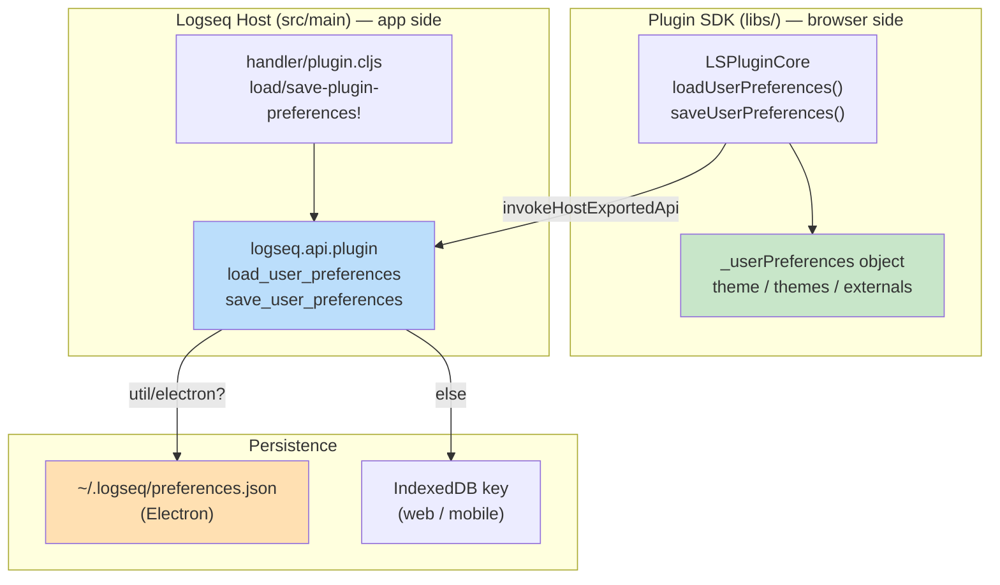
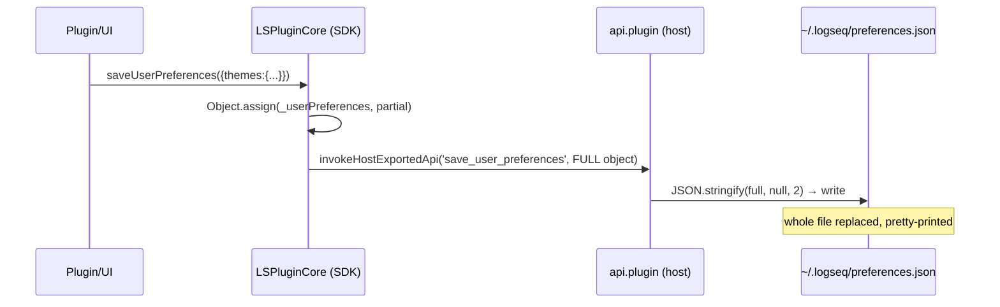

# `~/.logseq/preferences.json`: A Detective's Investigation Report

## 🔍 Case Summary

- **What it is:** A single JSON file at `~/.logseq/preferences.json` that stores **the plugin system's global "user preferences"** — specifically the user's **selected theme(s)** and **registered external plugin locations**.
- **Why it exists:** These settings live *outside* any single graph because they are app-wide and span all graphs: which theme is active (per light/dark mode) and where externally-loaded (dev) plugins live on disk. They cannot live in a graph's `config.edn` because they aren't graph-scoped.
- **Key discovery:** Despite the broad name "preferences," this file is **owned entirely by the plugin/theme subsystem (`LSPluginCore`)**. It is **not** the file that stores general app settings (window size, keymaps, feature flags) — those live elsewhere. The schema is small and fixed: just three top-level keys.

## 📋 Table of Contents

1. [Architecture Overview](#architecture-overview)
2. [The Crime Scene Map](#the-crime-scene-map)
3. [Evidence #1: The File Location](#evidence-1-the-file-location)
4. [Evidence #2: The Schema — What's Actually Stored](#evidence-2-the-schema--whats-actually-stored)
5. [Evidence #3: The Read/Write Path](#evidence-3-the-readwrite-path)
6. [Key Witnesses](#key-witnesses-main-files)
7. [Critical Findings](#critical-findings)
8. [Known Limitations](#known-limitations)
9. [API Reference](#api-reference)
10. [Message Flow Reference](#message-flow-reference)
11. [Debugging Guide](#debugging-guide)
12. [Case Closed](#case-closed)

## Architecture Overview

`preferences.json` is the persistence layer for `LSPluginCore`'s in-memory `_userPreferences` object. The browser/SDK side holds the canonical object; the host (Logseq app) only provides two exported APIs — one to read the JSON, one to write it. On Electron it is a real file; on web/mobile it falls back to IndexedDB under the same logical key.

## The Crime Scene Map



## Evidence #1: The File Location

The directory root `~/.logseq` is resolved in the Electron main process, then `preferences.json` is joined onto it.

**Location:** `src/electron/electron/utils.cljs:68`
```clojure
(defn get-ls-dotdir-root
  []
  (let [lg-dir (node-path/join (.getPath app "home") ".logseq")]
    (when-not (fs/existsSync lg-dir)
      (fs/mkdirSync lg-dir))               ; → ~/.logseq created on demand
    (fix-win-path! lg-dir)))
```

**Location:** `src/electron/electron/configs.cljs:10`
```clojure
(defonce dot-root (.join node-path (.getPath app "home") ".logseq"))
```

The filename is appended in the API layer:

**Location:** `src/main/logseq/api/plugin.cljs:242-244`
```clojure
(let [repo ""
      path (plugin-handler/get-ls-dotdir-root)
      path (util/node-path.join path "preferences.json")]  ; → ~/.logseq/preferences.json
  ...)
```

🔍 **Discovery:** A user can open this file directly from the UI. The "Plugins" settings panel exposes a button that calls `apis.openPath(root + "/preferences.json")` — `src/main/frontend/components/plugins.cljs:933`.

## Evidence #2: The Schema — What's Actually Stored

⚠️ **Corrected finding:** The `UserPreferences` interface below is a **compile-time type only — it is NOT a runtime schema.** The store is an **open key/value map**: any keys written through `saveUserPreferences` are persisted and merged back on load (see [Evidence #3](#evidence-3-the-readwrite-path)). The interface documents the *core* keys, not the *complete* set.

**Location:** `libs/src/LSPlugin.core.ts:201-209`
```typescript
interface UserPreferences {
  theme: LegacyTheme            // the single active theme (legacy, mode-agnostic)
  themes: {                     // mode-aware theme selection
    mode: ThemeMode             // 'light' | 'dark' — the active mode
    light: Theme                // theme to use in light mode
    dark: Theme                 // theme to use in dark mode
  }
  externals: string[]           // absolute fs paths of external (dev) plugins
}
```

**Keys observed beyond the interface (written by app code, not typed):**

| Key | Type | Written by |
|-----|------|------------|
| `pinnedToolbarItems` | `string[]` | `op-pinned-toolbar-item!` → `save-plugin-preferences!` (`handler/plugin.cljs:1122-1140`) |
| *(arbitrary)* | any | Any plugin calling `logseq` SDK `saveUserPreferences({...})`, or a manual edit |

Because `loadUserPreferences` does `Object.assign(_userPreferences, fileContents)` (`LSPlugin.core.ts:1413`) and `saveUserPreferences` writes the **whole** merged object, **unknown keys are never dropped** — they round-trip intact. So an entry like `"spellcheck": { "dictionaries": ["en_US", "fr"] }` *would* persist if something wrote it, even though no core Logseq code path currently does. (Logseq's own spellcheck toggle is `:spell-check`, stored separately in `userData/configs.edn` — `electron/configs.cljs:12,34` — not here.)

Default value when the file is missing/empty — `libs/src/LSPlugin.core.ts:1381-1389`:
```typescript
private readonly _userPreferences: UserPreferences = {
  theme: null,
  themes: { mode: 'light', light: null, dark: null },
  externals: [],
}
```

A `Theme` / `LegacyTheme` entry (what gets nested under `theme` / `themes.light` / `themes.dark`) — `libs/src/LSPlugin.ts:16-26`:
```typescript
export interface LegacyTheme {
  name: string
  url: string
  description?: string
  mode?: ThemeMode
  pid: PluginLocalIdentity   // id of the plugin that provides the theme
}
export interface Theme extends LegacyTheme { mode: ThemeMode }
```

So a populated `preferences.json` looks like:
```json
{
  "theme": null,
  "themes": {
    "mode": "dark",
    "light": null,
    "dark": {
      "name": "My Theme",
      "url": "lsp://logseq.io/my-theme/dist/theme.css",
      "mode": "dark",
      "pid": "my-theme-plugin"
    }
  },
  "externals": [
    "/Users/me/dev/my-plugin"
  ]
}
```

### So — what *type* of setting is this?

| Key | Type of setting | Set when… |
|-----|-----------------|-----------|
| `theme` | Active theme (legacy, single) | A plugin selects a theme without a mode |
| `themes.mode` | Active light/dark mode | User/theme switches mode |
| `themes.light` / `themes.dark` | Per-mode theme choice | User picks a theme for a given mode (`LSPlugin.core.ts:1887`) |
| `externals` | Registered external plugin paths | A dev loads an unpacked plugin from disk (`LSPlugin.core.ts:1598`) |

In one line: **`preferences.json` stores app-wide plugin/theme preferences — your selected theme(s) per light/dark mode and the on-disk locations of externally loaded plugins.**

## Evidence #3: The Read/Write Path

Reading is electron-vs-web branched; missing files are created and blank content is coerced to `{}`.

**Location:** `src/main/logseq/api/plugin.cljs:240-251`
```clojure
(def load_user_preferences
  (fn []
    (let [repo ""
          path (plugin-handler/get-ls-dotdir-root)
          path (util/node-path.join path "preferences.json")]
      (if (util/electron?)
        (p/let [_ (fs/create-if-not-exists repo nil path)        ; ✅ self-healing
                json (fs/read-file nil path)
                json (if (string/blank? json) "{}" json)]         ; ✅ blank → {}
          (js/JSON.parse json))
        (p/let [json (idb/get-item path)]                         ; web/mobile fallback
          (or json #js {}))))))
```

**Location:** `src/main/logseq/api/plugin.cljs:253-261`
```clojure
(def save_user_preferences
  (fn [^js data]
    (when data
      (let [repo "" path (plugin-handler/get-ls-dotdir-root)
            path (util/node-path.join path "preferences.json")]
        (if (util/electron?)
          (fs/write-plain-text-file! repo nil path
            (js/JSON.stringify data nil 2) {:skip-compare? true})  ; pretty-printed, 2-space
          (idb/set-item! path data))))))
```

⚠️ **Gotcha:** `save_user_preferences` writes **the entire object passed to it** — it does not merge field-by-field at the host. The merge happens earlier, in the SDK: `saveUserPreferences(partial)` does `Object.assign(this._userPreferences, partial)` then sends the *whole* object (`LSPlugin.core.ts:1420-1429`). If you call the host API directly with a partial, you will **overwrite and lose** the other keys.



## Key Witnesses (Main Files)

| File | Role |
|------|------|
| `libs/src/LSPlugin.core.ts:201-209` | `UserPreferences` schema — the authoritative shape |
| `libs/src/LSPlugin.core.ts:1408-1433` | SDK `loadUserPreferences` / `saveUserPreferences` (merge + persist) |
| `libs/src/LSPlugin.core.ts:1887,1918` | Theme select/unregister → writes `themes` |
| `libs/src/LSPlugin.core.ts:1598,1658` | External plugin add/remove → writes `externals` |
| `src/main/logseq/api/plugin.cljs:240-261` | Host exported APIs that read/write the actual file |
| `src/main/frontend/handler/plugin.cljs:90-101,171-186` | App-side load/save + `:plugin/preferences` state, external removal |
| `src/electron/electron/utils.cljs:68` | Resolves `~/.logseq` root |
| `src/main/frontend/components/plugins.cljs:933` | "Open preferences.json" UI button |

## Critical Findings

1. **It is plugin/theme state, not general app config.** ❌ Window/editor/keymap and the `:spell-check` toggle are *not* here — those live in `userData/configs.edn`. This file is owned by the plugin/theme subsystem.
2. **Open schema, not fixed.** ⚠️ The TS `UserPreferences` interface lists 3 keys but is not enforced at runtime. `Object.assign` on both load and save means **any extra key persists and round-trips** — e.g. `pinnedToolbarItems` (shipped by the app, `handler/plugin.cljs:1129`), or anything a plugin/manual edit writes (`spellcheck`, etc.).
3. **App-wide, graph-independent.** Lives in `~/.logseq`, shared across all graphs — `repo` is hard-coded to `""` in both read and write (`api/plugin.cljs:242,256`).
4. **Cross-platform fallback.** On web/mobile the same logical data goes to IndexedDB, keyed by the same path string (`api/plugin.cljs:250,261`).
5. **Self-healing reads.** Missing file → created; blank file → treated as `{}` (`api/plugin.cljs:246-248`). Safe to delete to reset.

## Known Limitations

- ⚠️ **Whole-object writes** — no host-side partial merge; direct callers risk clobbering (severity: medium for plugin devs).
- ⚠️ **No schema validation/migration** — `Object.assign` blindly merges whatever the file contains into `_userPreferences` (`LSPlugin.core.ts:1413`); a corrupt/extra key persists silently.
- 🔍 **Legacy `theme` vs `themes` duality** — `theme` (single, legacy) and `themes` (mode-aware) coexist; both can be set, which is historical baggage.

## API Reference

**SDK (browser):**
- `LSPluginCore.loadUserPreferences(): Promise<void>` — loads file into `_userPreferences` (`LSPlugin.core.ts:1408`).
- `LSPluginCore.saveUserPreferences(partial: Partial<UserPreferences>): Promise<void>` — merges then persists full object (`LSPlugin.core.ts:1420`).

**Host exported (ClojureScript, reachable via `invokeHostExportedApi` / `logseq.api`):**
- `load_user_preferences() → Promise<object>` (`api.cljs:45`, `api/plugin.cljs:240`).
- `save_user_preferences(data) → Promise<void>` (`api.cljs:46`, `api/plugin.cljs:253`).

**App handlers:**
- `frontend.handler.plugin/load-plugin-preferences` → stores into `state/:plugin/preferences` (`handler/plugin.cljs:171`).
- `frontend.handler.plugin/save-plugin-preferences!` (`handler/plugin.cljs:179`).

## Message Flow Reference

Theme selection persistence — `LSPlugin.core.ts:1887`:
```typescript
await this.saveUserPreferences(
  theme.mode
    ? { themes: { ...this._userPreferences.themes, mode: theme.mode, [theme.mode]: theme } }
    : { theme: theme }
)
```

External plugin registration persistence — `LSPlugin.core.ts:1598`:
```typescript
await this.saveUserPreferences({ externals: Array.from(externals) })
```

## Debugging Guide

- **Inspect:** `cat ~/.logseq/preferences.json` — or in-app, Plugins settings → open `preferences.json` button (`plugins.cljs:933`).
- **Reset theme/externals:** quit Logseq, delete the file (it self-heals to defaults on next read).
- **Theme not sticking?** Confirm the active `themes.mode` matches the key (`light`/`dark`) the theme was written under — a theme set in dark mode won't apply while in light mode.
- **External plugin keeps reappearing/vanishing?** Check the `externals` array; removal goes through `remove-external-plugin-path!` (`handler/plugin.cljs:90`), which normalizes paths before comparison.
- **Web build:** the file won't exist — inspect IndexedDB for the `preferences.json` key instead.

## Case Closed

**Verdict:** `~/.logseq/preferences.json` is the **plugin subsystem's global preference store**. It holds exactly three settings types — the active **theme** (legacy single), the **mode-aware theme selection** (`themes.mode` / `themes.light` / `themes.dark`), and the list of **external plugin filesystem paths** (`externals`). It is app-wide (not per-graph), owned by `LSPluginCore`, persisted as a pretty-printed JSON file on Electron and IndexedDB elsewhere, and is safe to delete to reset. It is **not** where general application settings live.

## Appendix: File Tree

```
~/.logseq/
├── preferences.json        ← theme + themes + externals  (this case)
├── plugins/                ← installed plugin packages
└── settings/<plugin-id>.json ← per-plugin user settings (separate system)

logseq/ (source)
├── libs/src/
│   ├── LSPlugin.ts                 (Theme / ThemeMode types)
│   └── LSPlugin.core.ts            (UserPreferences schema + load/save)
└── src/
    ├── main/logseq/api/plugin.cljs (host load_/save_user_preferences)
    ├── main/frontend/handler/plugin.cljs
    ├── main/frontend/components/plugins.cljs
    └── electron/electron/utils.cljs (get-ls-dotdir-root)
```
